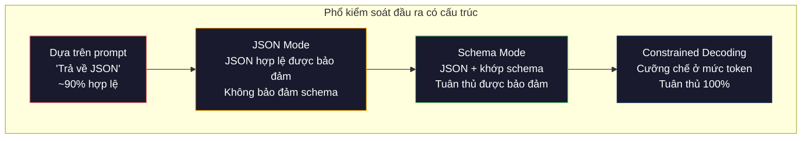
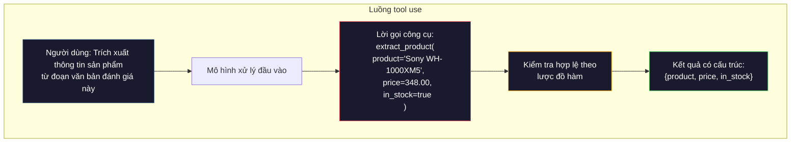

# Đầu ra có cấu trúc: JSON, kiểm tra lược đồ, giải mã ràng buộc

> LLM của bạn trả về một chuỗi. Ứng dụng của bạn cần JSON. Khoảng cách đó đã làm sập nhiều hệ thống production hơn bất kỳ ảo giác nào của mô hình. Structured output (đầu ra có cấu trúc) chính là cầu nối giữa ngôn ngữ tự nhiên và dữ liệu có kiểu. Làm đúng, LLM của bạn trở thành một API đáng tin cậy. Làm sai, bạn sẽ phải parse văn bản tự do bằng regex lúc 3 giờ sáng.

**Type:** Build
**Languages:** Python
**Prerequisites:** Giai đoạn 10, Bài 01-05 (LLM from scratch)
**Time:** ~90 phút
**Related:** Giai đoạn 5 · 20 (Structured Outputs & Constrained Decoding) trình bày lý thuyết ở mức decoder (bộ xử lý logit FSM/CFG, Outlines, XGrammar). Bài này tập trung vào bề mặt SDK dùng trong production (`response_format` của OpenAI, tool use của Anthropic, Instructor) — hãy đọc Giai đoạn 5 · 20 trước nếu bạn muốn hiểu điều gì diễn ra bên dưới lớp API.

## Mục tiêu học tập

- Triển khai đầu ra ở JSON mode và đầu ra ràng buộc theo schema (lược đồ) bằng các tham số API của OpenAI và Anthropic
- Xây dựng lớp validation (kiểm tra hợp lệ) bằng Pydantic để từ chối các đầu ra sai định dạng của LLM và retry (thử lại) kèm phản hồi lỗi
- Giải thích cách constrained decoding (giải mã ràng buộc) buộc ra JSON hợp lệ ở mức token mà không cần xử lý hậu kỳ
- Thiết kế prompt trích xuất vững chắc, chuyển văn bản phi cấu trúc thành cấu trúc dữ liệu có kiểu một cách đáng tin cậy

## Vấn đề

Bạn hỏi LLM: "Trích xuất tên sản phẩm, giá và tình trạng còn hàng từ đoạn văn bản này." Nó trả lời:

```
The product is the Sony WH-1000XM5 headphones, which cost $348.00 and are currently in stock.
```

Đó là một câu trả lời hoàn toàn đúng. Nó cũng hoàn toàn vô dụng với ứng dụng của bạn. Hệ thống kho hàng của bạn cần `{"product": "Sony WH-1000XM5", "price": 348.00, "in_stock": true}`. Bạn cần một object JSON với những khóa cụ thể, kiểu cụ thể và ràng buộc giá trị cụ thể. Bạn không cần một câu văn.

Cách giải ngây thơ: thêm "Hãy trả lời bằng JSON" vào prompt. Cách này hiệu quả 90% số lần. 10% còn lại, mô hình bọc JSON trong hàng rào code markdown, hoặc thêm mở bài kiểu "Đây là JSON:", hoặc tạo ra JSON sai cú pháp vì đóng ngoặc quá sớm. Trình phân tích JSON của bạn sập. Pipeline của bạn gãy. Bạn thêm try/except và một vòng lặp thử lại. Lần thử lại đôi khi cho dữ liệu khác. Giờ bạn có thêm vấn đề nhất quán chồng lên vấn đề phân tích cú pháp.

Đây không phải vấn đề thiết kế prompt. Đây là vấn đề giải mã. Mô hình sinh token từ trái sang phải. Ở mỗi vị trí, nó chọn token tiếp theo có khả năng cao nhất trong bộ từ vựng hơn 100K lựa chọn. Phần lớn các lựa chọn đó sẽ tạo ra JSON không hợp lệ ở bất kỳ vị trí nào. Nếu mô hình vừa phát ra `{"price":`, token tiếp theo phải là một chữ số, một dấu nháy (cho chuỗi), `null`, `true`, `false` hoặc dấu trừ. Bất cứ thứ gì khác đều tạo ra JSON không hợp lệ. Không có ràng buộc, mô hình có thể chọn một từ tiếng Anh hoàn toàn hợp lý nhưng sai cú pháp thảm hại.

## Khái niệm

### Phổ kiểm soát đầu ra có cấu trúc

Có bốn mức kiểm soát đầu ra có cấu trúc, mỗi mức đáng tin cậy hơn mức trước.



**Dựa trên prompt** ("Hãy trả lời bằng JSON hợp lệ"): không có cơ chế cưỡng chế. Mô hình thường tuân theo nhưng đôi khi không. Độ tin cậy: ~90%. Kiểu hỏng: hàng rào markdown, văn bản mở bài, đầu ra bị cắt cụt, sai cấu trúc.

**JSON mode**: API bảo đảm đầu ra là JSON hợp lệ. `response_format: { type: "json_object" }` của OpenAI bật chế độ này. Đầu ra sẽ parse được mà không lỗi. Nhưng nó có thể không khớp schema bạn mong đợi -- khóa thừa, sai kiểu, thiếu trường.

**Schema mode**: API nhận một JSON Schema và bảo đảm đầu ra khớp với nó. Năm 2026, mọi nhà cung cấp lớn đều hỗ trợ sẵn: `response_format: { type: "json_schema", json_schema: {...} }` của OpenAI (cũng dùng được như `tool_choice="required"`), tool use của Anthropic với `input_schema`, và `response_schema` + `response_mime_type: "application/json"` của Gemini. Đầu ra có đúng khóa, đúng kiểu và đúng ràng buộc bạn đã chỉ định.

**Constrained decoding**: ở mỗi vị trí token trong quá trình sinh, decoder che (mask) tất cả token sẽ tạo ra đầu ra không hợp lệ. Nếu schema yêu cầu một số mà mô hình sắp phát ra một chữ cái, token đó bị đặt xác suất bằng 0. Mô hình chỉ có thể sinh ra các token dẫn tới đầu ra hợp lệ. Đây là thứ mà chế độ structured output của OpenAI và các thư viện như Outlines, Guidance triển khai ở bên dưới.

### JSON Schema: ngôn ngữ hợp đồng

JSON Schema là cách bạn nói cho mô hình (hoặc lớp validation) biết đầu ra phải có hình dạng gì. Mọi hệ thống structured output lớn đều dùng nó.

```json
{
  "type": "object",
  "properties": {
    "product": { "type": "string" },
    "price": { "type": "number", "minimum": 0 },
    "in_stock": { "type": "boolean" },
    "categories": {
      "type": "array",
      "items": { "type": "string" }
    }
  },
  "required": ["product", "price", "in_stock"]
}
```

Schema này nói rằng: đầu ra phải là một object có `product` kiểu chuỗi, `price` là số không âm, `in_stock` kiểu boolean, và `categories` là mảng chuỗi tùy chọn. Bất kỳ đầu ra nào không khớp đều bị từ chối.

Schema xử lý các ca khó: object lồng nhau, mảng với phần tử có kiểu, enum (giới hạn chuỗi vào các giá trị cụ thể), so khớp mẫu (regex trên chuỗi), và tổ hợp (oneOf, anyOf, allOf cho đầu ra đa hình).

### Mẫu Pydantic

Trong Python, bạn không viết JSON Schema bằng tay. Bạn định nghĩa một model Pydantic và nó sinh schema cho bạn.

```python
from pydantic import BaseModel

class Product(BaseModel):
    product: str
    price: float
    in_stock: bool
    categories: list[str] = []
```

Kết quả là cùng JSON Schema như trên. Thư viện Instructor (và SDK của OpenAI) nhận trực tiếp model Pydantic: truyền vào lớp model, nhận về một instance đã kiểm tra hợp lệ. Nếu đầu ra của LLM không khớp, Instructor tự động thử lại.

### Function calling (gọi hàm) / Tool use

Một giao diện thay thế cho cùng vấn đề. Thay vì yêu cầu mô hình tạo JSON trực tiếp, bạn định nghĩa các "công cụ" (hàm) với tham số có kiểu. Mô hình xuất ra một lời gọi hàm với tham số có cấu trúc. OpenAI gọi là "function calling". Anthropic gọi là "tool use". Kết quả vẫn vậy: dữ liệu có cấu trúc.



Tool use được ưu tiên khi mô hình cần chọn gọi hàm nào, chứ không chỉ điền tham số. Nếu bạn có 10 schema trích xuất khác nhau và mô hình phải chọn đúng cái dựa trên đầu vào, tool use cho bạn cả việc chọn schema lẫn đầu ra có cấu trúc.

### Các kiểu hỏng thường gặp

Ngay cả khi đã cưỡng chế schema, đầu ra có cấu trúc vẫn có thể hỏng theo những cách tinh vi.

**Giá trị bịa**: đầu ra khớp schema nhưng chứa dữ liệu bịa ra. Mô hình tạo `{"price": 299.99}` khi văn bản ghi $348. Kiểm tra lược đồ không bắt được điều này -- kiểu đúng, giá trị sai.

**Nhầm lẫn enum**: bạn giới hạn một trường vào `["in_stock", "out_of_stock", "preorder"]`. Mô hình xuất `"available"` -- đúng nghĩa, nhưng không nằm trong tập cho phép. Constrained decoding tốt ngăn được điều này. Cách dựa trên prompt thì không.

**Độ sâu object lồng nhau**: schema lồng sâu (4+ mức) sinh nhiều lỗi hơn. Mỗi mức lồng là thêm một chỗ mà mô hình có thể mất dấu cấu trúc.

**Độ dài mảng**: mô hình có thể tạo quá nhiều hoặc quá ít phần tử trong một mảng. Schema hỗ trợ `minItems` và `maxItems` nhưng không phải nhà cung cấp nào cũng cưỡng chế chúng ở mức giải mã.

**Bỏ sót trường tùy chọn**: mô hình bỏ những trường về mặt kỹ thuật là tùy chọn nhưng lại quan trọng về nghĩa cho tình huống của bạn. Hãy đặt chúng là bắt buộc trong schema dù dữ liệu đôi khi thiếu -- buộc mô hình xuất `null` một cách tường minh.

```figure
mx-schema-funnel
```

## Tự tay làm

### Bước 1: Trình kiểm tra JSON Schema

Xây một trình kiểm tra từ đầu để xem một object Python có khớp với JSON Schema hay không. Đây là phần chạy ở phía đầu ra để xác minh tuân thủ.

```python
import json

def validate_schema(data, schema):
    errors = []
    _validate(data, schema, "", errors)
    return errors

def _validate(data, schema, path, errors):
    schema_type = schema.get("type")

    if schema_type == "object":
        if not isinstance(data, dict):
            errors.append(f"{path}: expected object, got {type(data).__name__}")
            return
        for key in schema.get("required", []):
            if key not in data:
                errors.append(f"{path}.{key}: required field missing")
        properties = schema.get("properties", {})
        for key, value in data.items():
            if key in properties:
                _validate(value, properties[key], f"{path}.{key}", errors)

    elif schema_type == "array":
        if not isinstance(data, list):
            errors.append(f"{path}: expected array, got {type(data).__name__}")
            return
        min_items = schema.get("minItems", 0)
        max_items = schema.get("maxItems", float("inf"))
        if len(data) < min_items:
            errors.append(f"{path}: array has {len(data)} items, minimum is {min_items}")
        if len(data) > max_items:
            errors.append(f"{path}: array has {len(data)} items, maximum is {max_items}")
        items_schema = schema.get("items", {})
        for i, item in enumerate(data):
            _validate(item, items_schema, f"{path}[{i}]", errors)

    elif schema_type == "string":
        if not isinstance(data, str):
            errors.append(f"{path}: expected string, got {type(data).__name__}")
            return
        enum_values = schema.get("enum")
        if enum_values and data not in enum_values:
            errors.append(f"{path}: '{data}' not in allowed values {enum_values}")

    elif schema_type == "number":
        if not isinstance(data, (int, float)):
            errors.append(f"{path}: expected number, got {type(data).__name__}")
            return
        minimum = schema.get("minimum")
        maximum = schema.get("maximum")
        if minimum is not None and data < minimum:
            errors.append(f"{path}: {data} is less than minimum {minimum}")
        if maximum is not None and data > maximum:
            errors.append(f"{path}: {data} is greater than maximum {maximum}")

    elif schema_type == "boolean":
        if not isinstance(data, bool):
            errors.append(f"{path}: expected boolean, got {type(data).__name__}")

    elif schema_type == "integer":
        if not isinstance(data, int) or isinstance(data, bool):
            errors.append(f"{path}: expected integer, got {type(data).__name__}")
```

### Bước 2: Sinh schema từ model kiểu Pydantic

Xây một bộ chuyển đổi tối giản từ lớp sang schema. Định nghĩa một lớp Python và sinh JSON Schema của nó một cách tự động.

```python
class SchemaField:
    def __init__(self, field_type, required=True, default=None, enum=None, minimum=None, maximum=None):
        self.field_type = field_type
        self.required = required
        self.default = default
        self.enum = enum
        self.minimum = minimum
        self.maximum = maximum

def python_type_to_schema(field):
    type_map = {
        str: "string",
        int: "integer",
        float: "number",
        bool: "boolean",
    }

    schema = {}

    if field.field_type in type_map:
        schema["type"] = type_map[field.field_type]
    elif field.field_type == list:
        schema["type"] = "array"
        schema["items"] = {"type": "string"}
    elif isinstance(field.field_type, dict):
        schema = field.field_type

    if field.enum:
        schema["enum"] = field.enum
    if field.minimum is not None:
        schema["minimum"] = field.minimum
    if field.maximum is not None:
        schema["maximum"] = field.maximum

    return schema

def model_to_schema(name, fields):
    properties = {}
    required = []

    for field_name, field in fields.items():
        properties[field_name] = python_type_to_schema(field)
        if field.required:
            required.append(field_name)

    return {
        "type": "object",
        "properties": properties,
        "required": required,
    }
```

### Bước 3: Bộ lọc token có ràng buộc

Mô phỏng constrained decoding. Cho một chuỗi JSON dở dang và một schema, xác định những nhóm token nào hợp lệ ở vị trí hiện tại.

```python
def next_valid_tokens(partial_json, schema):
    stripped = partial_json.strip()

    if not stripped:
        return ["{"]

    try:
        json.loads(stripped)
        return ["<EOS>"]
    except json.JSONDecodeError:
        pass

    last_char = stripped[-1] if stripped else ""

    if last_char == "{":
        return ['"', "}"]
    elif last_char == '"':
        if stripped.endswith('":'):
            return ['"', "0-9", "true", "false", "null", "[", "{"]
        return ["a-z", '"']
    elif last_char == ":":
        return [" ", '"', "0-9", "true", "false", "null", "[", "{"]
    elif last_char == ",":
        return [" ", '"', "{", "["]
    elif last_char in "0123456789":
        return ["0-9", ".", ",", "}", "]"]
    elif last_char == "}":
        return [",", "}", "]", "<EOS>"]
    elif last_char == "]":
        return [",", "}", "<EOS>"]
    elif last_char == "[":
        return ['"', "0-9", "true", "false", "null", "{", "[", "]"]
    else:
        return ["any"]

def demonstrate_constrained_decoding():
    partial_states = [
        '',
        '{',
        '{"product"',
        '{"product":',
        '{"product": "Sony"',
        '{"product": "Sony",',
        '{"product": "Sony", "price":',
        '{"product": "Sony", "price": 348',
        '{"product": "Sony", "price": 348}',
    ]

    print(f"{'Partial JSON':<45} {'Valid Next Tokens'}")
    print("-" * 80)
    for state in partial_states:
        valid = next_valid_tokens(state, {})
        display = state if state else "(empty)"
        print(f"{display:<45} {valid}")
```

### Bước 4: Pipeline trích xuất

Kết hợp mọi thứ thành một pipeline trích xuất: định nghĩa schema, mô phỏng LLM tạo đầu ra có cấu trúc, kiểm tra đầu ra và xử lý việc thử lại.

```python
def simulate_llm_extraction(text, schema, attempt=0):
    if "headphones" in text.lower() or "sony" in text.lower():
        if attempt == 0:
            return '{"product": "Sony WH-1000XM5", "price": 348.00, "in_stock": true, "categories": ["audio", "headphones"]}'
        return '{"product": "Sony WH-1000XM5", "price": 348.00, "in_stock": true}'

    if "laptop" in text.lower():
        return '{"product": "MacBook Pro 16", "price": 2499.00, "in_stock": false, "categories": ["computers"]}'

    return '{"product": "Unknown", "price": 0, "in_stock": false}'

def extract_with_retry(text, schema, max_retries=3):
    for attempt in range(max_retries):
        raw = simulate_llm_extraction(text, schema, attempt)

        try:
            data = json.loads(raw)
        except json.JSONDecodeError as e:
            print(f"  Attempt {attempt + 1}: JSON parse error -- {e}")
            continue

        errors = validate_schema(data, schema)
        if not errors:
            return data

        print(f"  Attempt {attempt + 1}: Schema validation errors -- {errors}")

    return None

product_schema = {
    "type": "object",
    "properties": {
        "product": {"type": "string"},
        "price": {"type": "number", "minimum": 0},
        "in_stock": {"type": "boolean"},
        "categories": {"type": "array", "items": {"type": "string"}},
    },
    "required": ["product", "price", "in_stock"],
}
```

### Bước 5: Chạy toàn bộ pipeline

```python
def run_demo():
    print("=" * 60)
    print("  Structured Output Pipeline Demo")
    print("=" * 60)

    print("\n--- Schema Definition ---")
    product_fields = {
        "product": SchemaField(str),
        "price": SchemaField(float, minimum=0),
        "in_stock": SchemaField(bool),
        "categories": SchemaField(list, required=False),
    }
    generated_schema = model_to_schema("Product", product_fields)
    print(json.dumps(generated_schema, indent=2))

    print("\n--- Schema Validation ---")
    test_cases = [
        ({"product": "Test", "price": 10.0, "in_stock": True}, "Valid object"),
        ({"product": "Test", "price": -5.0, "in_stock": True}, "Negative price"),
        ({"product": "Test", "in_stock": True}, "Missing price"),
        ({"product": "Test", "price": "ten", "in_stock": True}, "String as price"),
        ("not an object", "String instead of object"),
    ]

    for data, label in test_cases:
        errors = validate_schema(data, product_schema)
        status = "PASS" if not errors else f"FAIL: {errors}"
        print(f"  {label}: {status}")

    print("\n--- Constrained Decoding Simulation ---")
    demonstrate_constrained_decoding()

    print("\n--- Extraction Pipeline ---")
    texts = [
        "The Sony WH-1000XM5 headphones are priced at $348 and currently available.",
        "The new MacBook Pro 16-inch laptop costs $2499 but is sold out.",
        "This is a random sentence with no product info.",
    ]

    for text in texts:
        print(f"\n  Input: {text[:60]}...")
        result = extract_with_retry(text, product_schema)
        if result:
            print(f"  Output: {json.dumps(result)}")
        else:
            print(f"  Output: FAILED after retries")
```

## Áp dụng

### Đầu ra có cấu trúc với OpenAI

```python
# from openai import OpenAI
# from pydantic import BaseModel
#
# client = OpenAI()
#
# class Product(BaseModel):
#     product: str
#     price: float
#     in_stock: bool
#
# response = client.beta.chat.completions.parse(
#     model="gpt-5-mini",
#     messages=[
#         {"role": "system", "content": "Extract product information."},
#         {"role": "user", "content": "Sony WH-1000XM5, $348, in stock"},
#     ],
#     response_format=Product,
# )
#
# product = response.choices[0].message.parsed
# print(product.product, product.price, product.in_stock)
```

Chế độ structured output của OpenAI dùng constrained decoding ở bên trong. Mỗi token mô hình sinh ra đều được bảo đảm tạo đầu ra khớp schema Pydantic. Không cần thử lại. Không cần kiểm tra. Ràng buộc được nướng vào chính quá trình giải mã.

### Tool use của Anthropic

```python
# import anthropic
#
# client = anthropic.Anthropic()
#
# response = client.messages.create(
#     model="claude-opus-4-7",
#     max_tokens=1024,
#     tools=[{
#         "name": "extract_product",
#         "description": "Extract product information from text",
#         "input_schema": {
#             "type": "object",
#             "properties": {
#                 "product": {"type": "string"},
#                 "price": {"type": "number"},
#                 "in_stock": {"type": "boolean"},
#             },
#             "required": ["product", "price", "in_stock"],
#         },
#     }],
#     messages=[{"role": "user", "content": "Extract: Sony WH-1000XM5, $348, in stock"}],
# )
```

Anthropic đạt được structured output thông qua tool use. Mô hình phát ra một lời gọi công cụ với các tham số có cấu trúc khớp `input_schema`. Cùng kết quả, khác bề mặt API.

### Thư viện Instructor

```python
# pip install instructor
# import instructor
# from openai import OpenAI
# from pydantic import BaseModel
#
# client = instructor.from_openai(OpenAI())
#
# class Product(BaseModel):
#     product: str
#     price: float
#     in_stock: bool
#
# product = client.chat.completions.create(
#     model="gpt-5-mini",
#     response_model=Product,
#     messages=[{"role": "user", "content": "Sony WH-1000XM5, $348, in stock"}],
# )
```

Instructor bọc bất kỳ client LLM nào và thêm cơ chế tự động thử lại kèm kiểm tra hợp lệ. Nếu lần đầu không qua kiểm tra, nó gửi lỗi trở lại mô hình làm ngữ cảnh và yêu cầu sửa đầu ra. Cách này dùng được với mọi nhà cung cấp, không chỉ OpenAI.

## Đóng gói

Bài này tạo ra `outputs/prompt-structured-extractor.md` -- một mẫu prompt tái sử dụng, trích xuất dữ liệu có cấu trúc từ bất kỳ văn bản nào khi có định nghĩa schema. Đưa vào một JSON Schema và văn bản phi cấu trúc, nó trả về JSON đã kiểm tra hợp lệ.

Nó cũng tạo ra `outputs/skill-structured-outputs.md` -- một khung quyết định để chọn chiến lược đầu ra có cấu trúc phù hợp, dựa trên nhà cung cấp, yêu cầu độ tin cậy và độ phức tạp schema của bạn.

## Bài tập

1. Mở rộng trình kiểm tra schema để hỗ trợ `oneOf` (dữ liệu phải khớp đúng một trong nhiều schema). Cách này xử lý đầu ra đa hình -- ví dụ một trường có thể là object `Product` hoặc `Service` với hình dạng khác nhau.

2. Xây công cụ "schema diff" so sánh hai schema và xác định thay đổi phá vỡ tương thích (bỏ trường bắt buộc, đổi kiểu) so với thay đổi không phá vỡ (thêm trường tùy chọn, nới lỏng ràng buộc). Điều này thiết yếu khi đánh phiên bản cho schema trích xuất trong production.

3. Triển khai một bộ mô phỏng constrained decoding thực tế hơn. Cho một JSON Schema và bộ từ vựng 100 token (chữ cái, chữ số, dấu câu, từ khóa), đi qua từng bước sinh và che các token không hợp lệ ở mỗi vị trí. Đo xem bao nhiêu phần trăm bộ từ vựng là hợp lệ ở mỗi bước.

4. Xây một bộ đánh giá trích xuất. Tạo 50 mô tả sản phẩm với đầu ra JSON gán nhãn bằng tay. Chạy pipeline trích xuất trên cả 50 và đo khớp chính xác, độ chính xác theo từng trường và mức tuân thủ kiểu. Xác định trường nào khó trích xuất đúng nhất.

5. Thêm "điểm tin cậy" vào pipeline trích xuất. Với mỗi trường được trích xuất, ước lượng mô hình tự tin đến đâu (dựa trên xác suất token, hoặc chạy trích xuất 3 lần và đo tính nhất quán). Đánh dấu các trường có độ tin cậy thấp để con người xem lại.

## Thuật ngữ chính

| Thuật ngữ | Người ta thường nói | Ý nghĩa thực sự |
|------|----------------|----------------------|
| JSON mode | "Trả về JSON" | Cờ API bảo đảm đầu ra JSON hợp lệ về cú pháp, nhưng không cưỡng chế bất kỳ schema cụ thể nào |
| Structured output | "JSON có kiểu" | Đầu ra khớp một JSON Schema cụ thể với đúng khóa, đúng kiểu và đúng ràng buộc |
| Constrained decoding | "Sinh có hướng dẫn" | Ở mỗi vị trí token, che các token sẽ tạo đầu ra không hợp lệ -- bảo đảm tuân thủ schema 100% |
| JSON Schema | "Một mẫu JSON" | Ngôn ngữ khai báo để mô tả cấu trúc, kiểu và ràng buộc của dữ liệu JSON (được OpenAPI, JSON Forms,... dùng) |
| Pydantic | "Python dataclasses+" | Thư viện Python định nghĩa model dữ liệu kèm kiểm tra kiểu, được FastAPI và Instructor dùng để sinh JSON Schema |
| Function calling | "Gọi công cụ" | LLM xuất ra một lời gọi hàm có cấu trúc (tên + tham số có kiểu) thay vì văn bản tự do -- cả OpenAI và Anthropic đều hỗ trợ |
| Instructor | "Pydantic cho LLM" | Thư viện Python bọc client LLM để trả về instance Pydantic đã kiểm tra hợp lệ, tự động thử lại khi kiểm tra thất bại |
| Token masking | "Lọc bộ từ vựng" | Đặt xác suất của những token cụ thể về 0 trong quá trình sinh để mô hình không thể tạo ra chúng |
| Schema compliance | "Khớp hình dạng" | Đầu ra có đủ mọi trường bắt buộc, đúng kiểu, giá trị nằm trong ràng buộc và không có trường thừa bị cấm |
| Retry loop | "Thử lại đến khi được" | Gửi lỗi kiểm tra trở lại mô hình và yêu cầu sửa đầu ra -- Instructor làm việc này tự động, tới một số lần tối đa cấu hình được |

## Đọc thêm

- [Hướng dẫn Structured Outputs của OpenAI](https://platform.openai.com/docs/guides/structured-outputs) -- tài liệu chính thức về giải mã ràng buộc dựa trên JSON Schema trong API OpenAI
- [Willard & Louf, 2023 -- "Efficient Guided Generation for Large Language Models"](https://arxiv.org/abs/2307.09702) -- bài báo Outlines, mô tả cách biên dịch JSON Schema thành máy trạng thái hữu hạn cho ràng buộc ở mức token
- [Tài liệu Instructor](https://python.useinstructor.com/) -- thư viện chuẩn để lấy đầu ra có cấu trúc từ bất kỳ LLM nào với kiểm tra hợp lệ Pydantic và thử lại
- [Hướng dẫn Tool Use của Anthropic](https://docs.anthropic.com/en/docs/tool-use) -- cách Claude triển khai structured output qua tool use với `input_schema` là JSON Schema
- [Đặc tả JSON Schema](https://json-schema.org/) -- đặc tả đầy đủ của ngôn ngữ schema mà mọi hệ thống structured output lớn đều dùng
- [Thư viện Outlines](https://github.com/outlines-dev/outlines) -- sinh có ràng buộc mã nguồn mở, dùng regex và JSON Schema biên dịch thành máy trạng thái hữu hạn
- [Dong et al., "XGrammar: Flexible and Efficient Structured Generation Engine for Large Language Models" (MLSys 2025)](https://arxiv.org/abs/2411.15100) -- grammar (ngữ pháp) engine hiện đại nhất hiện nay; biên dịch automaton đẩy xuống, che token ở tốc độ ~100 ns / token.
- [Beurer-Kellner et al., "Prompting Is Programming: A Query Language for Large Language Models" (LMQL)](https://arxiv.org/abs/2212.06094) -- bài báo LMQL, đặt constrained decoding như một ngôn ngữ truy vấn với ràng buộc về kiểu và giá trị.
- [Microsoft Guidance (tài liệu framework)](https://github.com/guidance-ai/guidance) -- sinh có ràng buộc theo mẫu; phần bổ sung không phụ thuộc nhà cung cấp cho Outlines và XGrammar.

---

[← Bài trước: Few-Shot, Chain-of-Thought, Tree-of-Thought](../../02-few-shot-cot/docs/vi.md) · [Bài sau: Embedding & Biểu diễn Vector →](../../04-embeddings/docs/vi.md)
