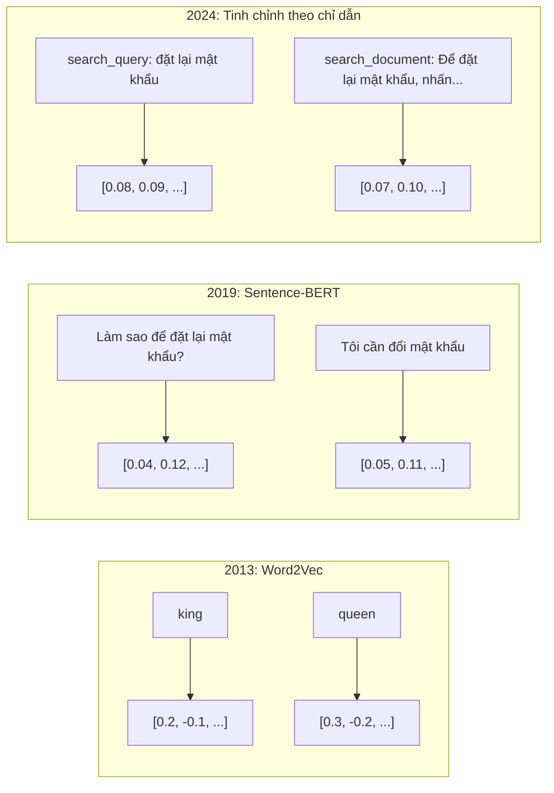
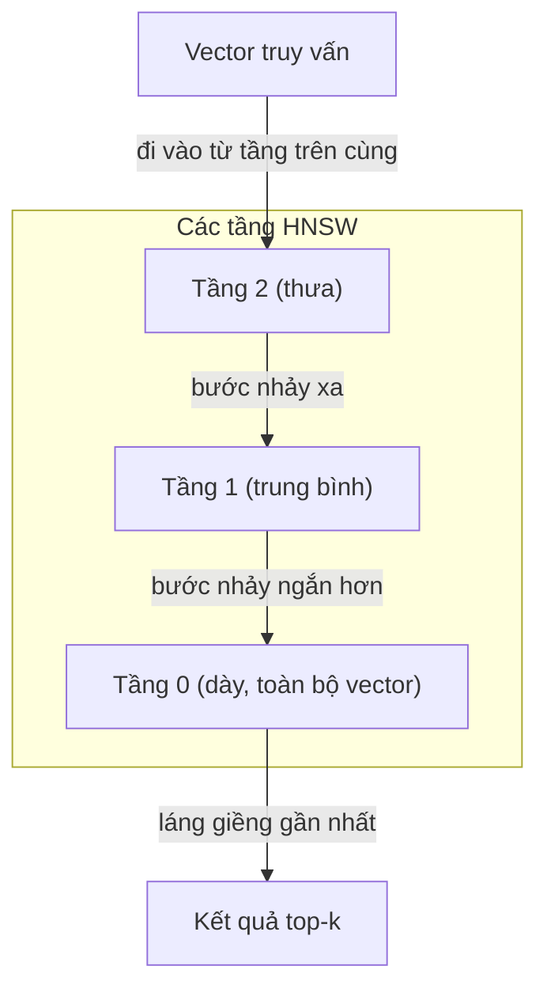
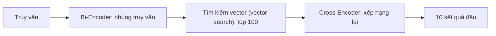

# Embedding & Biểu diễn Vector

> Văn bản là rời rạc. Toán học là liên tục. Mỗi lần bạn nhờ một LLM tìm tài liệu "tương tự", so sánh ý nghĩa, hay tìm kiếm vượt ra ngoài từ khoá, bạn đang dựa vào một cây cầu nối hai thế giới đó. Cây cầu ấy chính là embedding (vector nhúng). Nếu bạn không hiểu embedding, bạn không hiểu AI hiện đại. Bạn chỉ đang dùng nó mà thôi.

**Type:** Build
**Languages:** Python
**Prerequisites:** Giai đoạn 11, Bài 01 (Kỹ thuật viết prompt)
**Time:** ~75 phút
**Related:** Giai đoạn 5 · 22 (Đi sâu vào mô hình embedding) bao quát dense so với sparse so với multi-vector, cắt tỉa Matryoshka và cách chọn mô hình theo từng trục. Bài này tập trung vào pipeline production (vector DB, HNSW, toán tương đồng). Đọc Giai đoạn 5 · 22 trước khi chọn mô hình.

## Mục tiêu học tập

- Sinh embedding cho văn bản bằng các nhà cung cấp API và mô hình mã nguồn mở, rồi tính cosine similarity (độ tương đồng cosine) giữa chúng
- Giải thích vì sao embedding giải quyết bài toán lệch từ vựng mà tìm kiếm theo từ khoá không xử lý được
- Xây một chỉ mục semantic search (tìm kiếm ngữ nghĩa) truy xuất tài liệu theo ý nghĩa thay vì khớp đúng từ khoá
- Đánh giá chất lượng embedding bằng benchmark truy xuất (precision@k, recall) và chọn đúng mô hình embedding cho bài toán của bạn

## Vấn đề

Bạn có 10.000 ticket hỗ trợ. Một khách hàng viết "thanh toán của tôi không qua được". Bạn cần tìm những ticket tương tự trong quá khứ. Tìm kiếm theo từ khoá chỉ tìm ra các ticket chứa "thanh toán" và "không qua được". Nó bỏ sót "giao dịch thất bại", "thẻ bị từ chối" và "lỗi thanh toán". Những ticket đó mô tả đúng cùng một vấn đề bằng những từ hoàn toàn khác.

Đây là bài toán lệch từ vựng. Ngôn ngữ con người có hàng chục cách nói cùng một điều. Tìm kiếm theo từ khoá coi mỗi từ là một ký hiệu độc lập, không mang ý nghĩa. Nó không thể biết rằng "bị từ chối" và "không qua được" nói về cùng một khái niệm.

Bạn cần một cách biểu diễn văn bản mà ý nghĩa, chứ không phải chính tả, quyết định độ tương đồng. Bạn cần một cách đặt "thanh toán của tôi không qua được" và "giao dịch bị từ chối" gần nhau trong một không gian toán học nào đó, đồng thời đẩy "thanh toán của tôi đến đúng hạn" ra xa dù chúng cùng chứa từ "thanh toán".

Cách biểu diễn đó là embedding.

## Khái niệm

### Embedding là gì?

Embedding là một vector dày đặc gồm các số thực dấu phẩy động, biểu diễn ý nghĩa của văn bản. Chữ "dày đặc" ở đây rất quan trọng -- mỗi dimension (số chiều) đều mang thông tin, khác với các biểu diễn thưa (bag-of-words, TF-IDF) nơi hầu hết chiều đều bằng 0.

"Con mèo ngồi trên tấm thảm" trở thành một thứ như `[0.023, -0.041, 0.087, ..., 0.012]` -- danh sách 768 đến 3072 số tuỳ mô hình. Những số này mã hoá ý nghĩa. Bạn không bao giờ soi chúng trực tiếp. Bạn so sánh chúng.

### Bước ngoặt Word2Vec

Năm 2013, Tomas Mikolov và đồng nghiệp tại Google công bố Word2Vec. Ý tưởng cốt lõi: huấn luyện một mạng nơ-ron dự đoán một từ từ các từ lân cận (hoặc dự đoán các từ lân cận từ một từ), và trọng số của lớp ẩn trở thành biểu diễn vector có ý nghĩa.

Kết quả nổi tiếng:

```
king - man + woman = queen
```

Số học vector trên embedding từ ngữ nắm bắt được quan hệ ngữ nghĩa. Hướng từ "man" tới "woman" gần như trùng với hướng từ "king" tới "queen". Đó là khoảnh khắc cả ngành nhận ra hình học có thể mã hoá ý nghĩa.

Word2Vec tạo ra các vector 300 chiều. Mỗi từ chỉ có một vector, bất kể ngữ cảnh. "Bank" trong "river bank" và trong "bank account" có cùng một embedding. Chính hạn chế này đã thúc đẩy một thập kỷ nghiên cứu tiếp theo.

### Từ từ ngữ đến câu

Embedding từ ngữ biểu diễn từng token riêng lẻ. Hệ thống production cần nhúng cả câu, cả đoạn văn hoặc cả tài liệu. Bốn cách tiếp cận đã xuất hiện:

**Lấy trung bình**: lấy trung bình cộng vector của mọi từ trong câu. Rẻ, mất mát thông tin, nhưng với văn bản ngắn thì tốt đến bất ngờ. Mất hoàn toàn trật tự từ -- "chó cắn người" và "người cắn chó" cho ra embedding giống hệt nhau.

**Token CLS**: các mô hình transformer (BERT, 2018) xuất ra một embedding đặc biệt cho token [CLS] đại diện cho toàn bộ đầu vào. Tốt hơn lấy trung bình, nhưng token [CLS] được huấn luyện cho việc dự đoán câu tiếp theo, không phải cho độ tương đồng.

**Học tương phản**: huấn luyện mô hình một cách tường minh để kéo các cặp tương tự lại gần và đẩy các cặp khác nhau ra xa. Sentence-BERT (Reimers & Gurevych, 2019) dùng cách này và trở thành nền tảng cho các mô hình embedding hiện đại. Với "Làm sao để đặt lại mật khẩu?" và "Tôi cần đổi mật khẩu", mô hình học được rằng hai câu này nên có vector gần như trùng nhau.

**Embedding tinh chỉnh theo chỉ dẫn**: cách tiếp cận mới nhất. Các mô hình như E5 và GTE nhận một tiền tố nhiệm vụ ("search_query:", "search_document:") cho mô hình biết cần tạo loại embedding nào. Nhờ đó một mô hình có thể phục vụ nhiều nhiệm vụ.



### Các mô hình embedding hiện đại

Thị trường đã ổn định quanh một vài lựa chọn đủ chuẩn production (điểm MTEB tính đến đầu 2026, MTEB v2):

| Mô hình | Nhà cung cấp | Số chiều | MTEB | Ngữ cảnh | Chi phí / 1M token |
|-------|----------|-----------|------|---------|------------------|
| Gemini Embedding 2 | Google | 3072 (Matryoshka) | 67.7 (retrieval) | 8192 | $0.15 |
| embed-v4 | Cohere | 1024 (Matryoshka) | 65.2 | 128K | $0.12 |
| voyage-4 | Voyage AI | 1024/2048 (Matryoshka) | 66.8 | 32K | $0.12 |
| text-embedding-3-large | OpenAI | 3072 (Matryoshka) | 64.6 | 8192 | $0.13 |
| text-embedding-3-small | OpenAI | 1536 (Matryoshka) | 62.3 | 8192 | $0.02 |
| BGE-M3 | BAAI | 1024 (dense+sparse+ColBERT) | 63.0 đa ngôn ngữ | 8192 | Trọng số mở |
| Qwen3-Embedding | Alibaba | 4096 (Matryoshka) | 66.9 | 32K | Trọng số mở |
| Nomic-embed-v2 | Nomic | 768 (Matryoshka) | 63.1 | 8192 | Trọng số mở |

MTEB (Massive Text Embedding Benchmark) v2 bao gồm hơn 100 tác vụ thuộc truy xuất, phân loại, phân cụm, xếp hạng lại và tóm tắt. Điểm càng cao càng tốt. Đến 2026, các mô hình trọng số mở (Qwen3-Embedding, BGE-M3) đạt ngang hoặc vượt các mô hình đóng chạy dưới dạng dịch vụ trên phần lớn trục đánh giá. Gemini Embedding 2 dẫn đầu truy xuất thuần; Voyage/Cohere dẫn đầu ở một số lĩnh vực hẹp (tài chính, pháp lý, code). Luôn benchmark trên chính truy vấn của bạn trước khi chốt lựa chọn.

### Các thước đo tương đồng

Cho hai vector embedding, có ba cách đo mức tương đồng giữa chúng:

**Cosine similarity**: cosin của góc giữa hai vector. Nằm trong khoảng -1 (ngược hướng) đến 1 (cùng hướng). Bỏ qua độ lớn -- một câu 10 từ và một tài liệu 500 từ vẫn có thể đạt 1.0 nếu chúng cùng hướng. Đây là lựa chọn mặc định cho 90% trường hợp sử dụng.

```
cosine_sim(a, b) = dot(a, b) / (||a|| * ||b||)
```

**Dot product**: tích vô hướng thô của hai vector. Giống hệt cosine similarity khi các vector được chuẩn hoá (độ dài đơn vị). Tính nhanh hơn. Embedding của OpenAI đã được chuẩn hoá, nên dot product và cosine cho cùng một thứ hạng.

```
dot(a, b) = sum(a_i * b_i)
```

**Khoảng cách Euclid (L2)**: khoảng cách đường thẳng trong không gian vector. Nhỏ hơn = tương tự hơn. Nhạy với chênh lệch độ lớn. Dùng khi vị trí tuyệt đối trong không gian quan trọng, không chỉ hướng.

```
L2(a, b) = sqrt(sum((a_i - b_i)^2))
```

Khi nào dùng cái nào:

| Thước đo | Dùng khi | Tránh khi |
|--------|----------|------------|
| Cosine similarity | So sánh văn bản có độ dài khác nhau; hầu hết tác vụ truy xuất | Độ lớn mang thông tin |
| Dot product | Embedding đã được chuẩn hoá; cần tốc độ tối đa | Các vector có độ lớn khác nhau |
| Khoảng cách Euclid | Phân cụm; bài toán láng giềng gần nhất theo không gian | So sánh tài liệu có độ dài chênh lệch cực lớn |

### Cơ sở dữ liệu vector và HNSW

Tìm kiếm tương đồng brute-force so truy vấn với từng vector đã lưu. Với 1 triệu vector 1536 chiều, đó là 1,5 tỷ phép nhân-cộng cho mỗi truy vấn. Quá chậm.

Cơ sở dữ liệu vector giải bài toán này bằng các thuật toán Approximate Nearest Neighbor (láng giềng gần đúng, viết tắt ANN). Thuật toán thống trị là HNSW (Hierarchical Navigable Small World):

1. Dựng một đồ thị nhiều tầng của các vector
2. Các tầng trên thưa -- kết nối tầm xa giữa những cụm xa nhau
3. Các tầng dưới dày -- kết nối chi tiết giữa các vector lân cận
4. Tìm kiếm bắt đầu từ tầng trên cùng, đi tham lam xuống dần để tinh chỉnh
5. Trả về top-k gần đúng trong O(log n) thay vì O(n)

HNSW đánh đổi một chút độ chính xác (thường recall 95-99%) để lấy tốc độ nhanh hơn rất nhiều. Với 10 triệu vector, brute-force mất vài giây. HNSW mất vài mili giây.



Các lựa chọn production:

| Cơ sở dữ liệu | Loại | Phù hợp nhất | Quy mô tối đa |
|----------|------|----------|-----------|
| Pinecone | SaaS quản lý | Production không cần vận hành | Hàng tỷ |
| Weaviate | Mã nguồn mở | Tự vận hành, tìm kiếm lai | 100M+ |
| Qdrant | Mã nguồn mở | Hiệu năng cao, lọc | 100M+ |
| ChromaDB | Nhúng | Làm prototype, dev local | 1M |
| pgvector | Tiện ích Postgres | Đã dùng Postgres sẵn | 10M |
| FAISS | Thư viện | Trong tiến trình, nghiên cứu | 1B+ |

### Chiến lược chia đoạn

Tài liệu thường quá dài để nhúng thành một vector duy nhất. Một PDF 50 trang trải hàng chục chủ đề -- embedding của nó trở thành trung bình của tất cả và chẳng giống cụ thể điều gì. Bạn chia tài liệu thành các đoạn rồi nhúng từng đoạn.

**Chia theo kích thước cố định**: cắt mỗi N token với M token chồng lấn. Đơn giản và dễ đoán. Hiệu quả khi tài liệu không có cấu trúc rõ ràng. Đoạn 512 token chồng lấn 50 token: đoạn 1 là token 0-511, đoạn 2 là token 462-973.

**Chia theo câu**: cắt tại ranh giới câu, gom các câu lại cho đến khi chạm giới hạn token. Mỗi đoạn chứa ít nhất một câu trọn vẹn. Tốt hơn chia cố định vì bạn không bao giờ cắt đôi một ý.

**Chia đệ quy**: thử cắt tại ranh giới lớn nhất trước (tiêu đề mục). Nếu vẫn quá lớn, thử ranh giới đoạn văn. Rồi ranh giới câu. Rồi giới hạn ký tự. Đây chính là `RecursiveCharacterTextSplitter` của LangChain, và nó hiệu quả với kho văn bản đa định dạng.

**Chia theo ngữ nghĩa**: nhúng từng câu, rồi gom các câu liên tiếp có embedding tương tự nhau. Khi độ tương đồng embedding tụt xuống dưới ngưỡng, mở đoạn mới. Tốn kém (phải nhúng từng câu riêng lẻ) nhưng cho ra những đoạn mạch lạc nhất.

| Chiến lược | Độ phức tạp | Chất lượng | Phù hợp nhất |
|----------|-----------|---------|----------|
| Kích thước cố định | Thấp | Khá | Văn bản không cấu trúc, log |
| Theo câu | Thấp | Tốt | Bài viết, email |
| Đệ quy | Trung bình | Tốt | Markdown, HTML, tài liệu hỗn hợp |
| Theo ngữ nghĩa | Cao | Tốt nhất | Truy xuất chất lượng then chốt |

Điểm ngọt cho hầu hết hệ thống: đoạn 256-512 token với 50 token chồng lấn.

### Bi-Encoder so với Cross-Encoder

Bi-encoder nhúng truy vấn và tài liệu một cách độc lập, rồi so sánh vector. Nhanh -- bạn nhúng truy vấn một lần và so với embedding tài liệu đã tính sẵn. Đây là thứ bạn dùng để truy xuất.

Cross-encoder nhận truy vấn và một tài liệu như một đầu vào duy nhất rồi xuất ra điểm liên quan. Chậm -- nó đưa từng cặp truy vấn-tài liệu qua toàn bộ mô hình. Nhưng chính xác hơn nhiều vì nó có thể chú ý đồng thời trên token của truy vấn và của tài liệu.

Mẫu triển khai production: bi-encoder truy xuất 100 ứng viên đầu, cross-encoder xếp hạng lại chúng xuống còn 10. Đó là pipeline truy xuất-rồi-xếp-hạng-lại.



Các mô hình xếp hạng lại: Cohere Rerank 3.5 ($2 cho 1000 truy vấn), BGE-reranker-v2 (miễn phí, mã nguồn mở), Jina Reranker v2 (miễn phí, mã nguồn mở).

### Embedding Matryoshka

Embedding truyền thống là được ăn cả, ngã về không. Một vector 1536 chiều dùng 1536 số thực. Bạn không thể cắt xuống 256 chiều mà không huấn luyện lại.

Matryoshka Representation Learning (Kusupati và cộng sự, 2022) khắc phục điều này. Mô hình được huấn luyện sao cho N chiều đầu nắm được thông tin quan trọng nhất, như búp bê Nga lồng nhau. Cắt một embedding Matryoshka 1536 chiều xuống 256 chiều sẽ mất một ít độ chính xác nhưng vẫn dùng được.

text-embedding-3-small và text-embedding-3-large của OpenAI hỗ trợ cắt Matryoshka qua tham số `dimensions`. Yêu cầu 256 chiều thay vì 1536 giúp giảm 6 lần dung lượng lưu trữ, đổi lại mất khoảng 3-5% độ chính xác trên benchmark MTEB.

### Lượng tử hoá nhị phân

Một embedding 1536 chiều lưu dạng float32 dùng 6.144 byte. Nhân với 10 triệu tài liệu: 61 GB chỉ riêng phần vector.

Binary quantization (lượng tử hoá nhị phân) biến mỗi số thực thành một bit: giá trị dương thành 1, giá trị âm thành 0. Dung lượng giảm từ 6.144 byte xuống 192 byte -- giảm 32 lần. Độ tương đồng được tính bằng khoảng cách Hamming (đếm số bit khác nhau), thứ mà CPU có thể làm trong một lệnh duy nhất.

Mất mát độ chính xác khoảng 5-10% recall truy xuất. Mẫu phổ biến: lượng tử hoá nhị phân cho lượt tìm kiếm đầu tiên trên hàng triệu vector, rồi chấm lại 1000 kết quả đầu bằng vector độ chính xác đầy đủ. Cách này cho bạn hơn 95% độ chính xác của bản đầy đủ với bộ nhớ ít hơn 32 lần.

```figure
cosine-similarity
```

## Tự tay làm

Chúng ta xây một máy tìm kiếm ngữ nghĩa từ đầu. Không cơ sở dữ liệu vector. Không API embedding bên ngoài. Python thuần với numpy cho phần toán.

### Bước 1: Chia văn bản thành đoạn

```python
def chunk_text(text, chunk_size=200, overlap=50):
    words = text.split()
    chunks = []
    start = 0
    while start < len(words):
        end = start + chunk_size
        chunk = " ".join(words[start:end])
        chunks.append(chunk)
        start += chunk_size - overlap
    return chunks


def chunk_by_sentences(text, max_chunk_tokens=200):
    sentences = text.replace("\n", " ").split(".")
    sentences = [s.strip() + "." for s in sentences if s.strip()]
    chunks = []
    current_chunk = []
    current_length = 0
    for sentence in sentences:
        sentence_length = len(sentence.split())
        if current_length + sentence_length > max_chunk_tokens and current_chunk:
            chunks.append(" ".join(current_chunk))
            current_chunk = []
            current_length = 0
        current_chunk.append(sentence)
        current_length += sentence_length
    if current_chunk:
        chunks.append(" ".join(current_chunk))
    return chunks
```

### Bước 2: Tự dựng embedding từ đầu

Chúng ta cài một embedding dày đơn giản dùng TF-IDF với bước normalization (chuẩn hoá) L2. Đây không phải embedding nơ-ron, nhưng nó theo cùng một giao kèo: văn bản vào, vector kích thước cố định ra, văn bản tương tự cho vector tương tự.

```python
import math
import numpy as np
from collections import Counter

class SimpleEmbedder:
    def __init__(self):
        self.vocab = []
        self.idf = []
        self.word_to_idx = {}

    def fit(self, documents):
        vocab_set = set()
        for doc in documents:
            vocab_set.update(doc.lower().split())
        self.vocab = sorted(vocab_set)
        self.word_to_idx = {w: i for i, w in enumerate(self.vocab)}
        n = len(documents)
        self.idf = np.zeros(len(self.vocab))
        for i, word in enumerate(self.vocab):
            doc_count = sum(1 for doc in documents if word in doc.lower().split())
            self.idf[i] = math.log((n + 1) / (doc_count + 1)) + 1

    def embed(self, text):
        words = text.lower().split()
        count = Counter(words)
        total = len(words) if words else 1
        vec = np.zeros(len(self.vocab))
        for word, freq in count.items():
            if word in self.word_to_idx:
                tf = freq / total
                vec[self.word_to_idx[word]] = tf * self.idf[self.word_to_idx[word]]
        norm = np.linalg.norm(vec)
        if norm > 0:
            vec = vec / norm
        return vec
```

### Bước 3: Các hàm tương đồng

```python
def cosine_similarity(a, b):
    dot = np.dot(a, b)
    norm_a = np.linalg.norm(a)
    norm_b = np.linalg.norm(b)
    if norm_a == 0 or norm_b == 0:
        return 0.0
    return float(dot / (norm_a * norm_b))


def dot_product(a, b):
    return float(np.dot(a, b))


def euclidean_distance(a, b):
    return float(np.linalg.norm(a - b))
```

### Bước 4: Chỉ mục vector với tìm kiếm brute-force

```python
class VectorIndex:
    def __init__(self):
        self.vectors = []
        self.texts = []
        self.metadata = []

    def add(self, vector, text, meta=None):
        self.vectors.append(vector)
        self.texts.append(text)
        self.metadata.append(meta or {})

    def search(self, query_vector, top_k=5, metric="cosine"):
        scores = []
        for i, vec in enumerate(self.vectors):
            if metric == "cosine":
                score = cosine_similarity(query_vector, vec)
            elif metric == "dot":
                score = dot_product(query_vector, vec)
            elif metric == "euclidean":
                score = -euclidean_distance(query_vector, vec)
            else:
                raise ValueError(f"Unknown metric: {metric}")
            scores.append((i, score))
        scores.sort(key=lambda x: x[1], reverse=True)
        results = []
        for idx, score in scores[:top_k]:
            results.append({
                "text": self.texts[idx],
                "score": score,
                "metadata": self.metadata[idx],
                "index": idx
            })
        return results

    def size(self):
        return len(self.vectors)
```

### Bước 5: Máy tìm kiếm ngữ nghĩa

```python
class SemanticSearchEngine:
    def __init__(self, chunk_size=200, overlap=50):
        self.embedder = SimpleEmbedder()
        self.index = VectorIndex()
        self.chunk_size = chunk_size
        self.overlap = overlap

    def index_documents(self, documents, source_names=None):
        all_chunks = []
        all_sources = []
        for i, doc in enumerate(documents):
            chunks = chunk_text(doc, self.chunk_size, self.overlap)
            all_chunks.extend(chunks)
            name = source_names[i] if source_names else f"doc_{i}"
            all_sources.extend([name] * len(chunks))
        self.embedder.fit(all_chunks)
        for chunk, source in zip(all_chunks, all_sources):
            vec = self.embedder.embed(chunk)
            self.index.add(vec, chunk, {"source": source})
        return len(all_chunks)

    def search(self, query, top_k=5, metric="cosine"):
        query_vec = self.embedder.embed(query)
        return self.index.search(query_vec, top_k, metric)

    def search_with_scores(self, query, top_k=5):
        results = self.search(query, top_k)
        return [
            {
                "text": r["text"][:200],
                "source": r["metadata"].get("source", "unknown"),
                "score": round(r["score"], 4)
            }
            for r in results
        ]
```

### Bước 6: So sánh các thước đo tương đồng

```python
def compare_metrics(engine, query, top_k=3):
    results = {}
    for metric in ["cosine", "dot", "euclidean"]:
        hits = engine.search(query, top_k=top_k, metric=metric)
        results[metric] = [
            {"score": round(h["score"], 4), "preview": h["text"][:80]}
            for h in hits
        ]
    return results
```

## Áp dụng

Với một API embedding production, kiến trúc vẫn y nguyên. Chỉ phần embedder là thay đổi:

```python
from openai import OpenAI

client = OpenAI()

def openai_embed(texts, model="text-embedding-3-small", dimensions=None):
    kwargs = {"model": model, "input": texts}
    if dimensions:
        kwargs["dimensions"] = dimensions
    response = client.embeddings.create(**kwargs)
    return [item.embedding for item in response.data]
```

Cắt Matryoshka với OpenAI -- cùng mô hình, ít chiều hơn, lưu trữ ít hơn:

```python
full = openai_embed(["semantic search query"], dimensions=1536)
compact = openai_embed(["semantic search query"], dimensions=256)
```

Vector 256 chiều dùng ít hơn 6 lần dung lượng. Với 10 triệu tài liệu, đó là 10 GB so với 61 GB. Độ chính xác mất khoảng 3-5% trên các benchmark chuẩn.

Xếp hạng lại với Cohere:

```python
import cohere

co = cohere.ClientV2()

results = co.rerank(
    model="rerank-v3.5",
    query="What is the refund policy?",
    documents=["Full refund within 30 days...", "No refunds after 90 days..."],
    top_n=3
)
```

Embedding cục bộ, không phụ thuộc API:

```python
from sentence_transformers import SentenceTransformer

model = SentenceTransformer("BAAI/bge-small-en-v1.5")
embeddings = model.encode(["semantic search query", "another document"])
```

Lớp VectorIndex từ phần tự tay làm dùng được với bất kỳ lựa chọn nào ở trên. Chỉ cần đổi hàm nhúng, giữ nguyên logic tìm kiếm.

## Đóng gói

Bài này tạo ra:
- `outputs/prompt-embedding-advisor.md` -- một prompt để chọn mô hình embedding và chiến lược cho từng trường hợp sử dụng cụ thể
- `outputs/skill-embedding-patterns.md` -- một skill dạy agent cách dùng embedding hiệu quả trong production

## Bài tập

1. **So sánh thước đo**: chạy cùng 5 truy vấn trên các tài liệu mẫu với cosine similarity, dot product và khoảng cách Euclid. Ghi lại top-3 kết quả cho mỗi cách. Những truy vấn nào khiến các thước đo cho kết quả khác nhau? Vì sao?

2. **Thí nghiệm kích thước đoạn**: lập chỉ mục tài liệu mẫu với kích thước đoạn 50, 100, 200 và 500 từ. Với mỗi cấu hình, chạy 5 truy vấn và ghi lại điểm tương đồng top-1. Vẽ quan hệ giữa kích thước đoạn và chất lượng truy xuất. Tìm điểm mà đoạn lớn hơn bắt đầu gây hại.

3. **Mô phỏng Matryoshka**: dựng một SimpleEmbedder tạo ra vector 500 chiều. Cắt xuống 50, 100, 200 và 500 chiều. Đo mức recall truy xuất suy giảm ở mỗi lần cắt. Cách này mô phỏng hành vi Matryoshka mà không cần mẹo huấn luyện thật sự.

4. **Lượng tử hoá nhị phân**: lấy embedding từ máy tìm kiếm, chuyển chúng sang nhị phân (1 nếu dương, 0 nếu âm) và cài đặt tìm kiếm bằng khoảng cách Hamming. So top-10 kết quả với cosine similarity độ chính xác đầy đủ. Đo tỷ lệ trùng khớp.

5. **Chia đoạn theo câu**: thay cách chia kích thước cố định bằng `chunk_by_sentences`. Chạy lại các truy vấn và so điểm truy xuất. Việc tôn trọng ranh giới câu có cải thiện kết quả không?

## Thuật ngữ chính

| Thuật ngữ | Người ta thường nói | Ý nghĩa thực sự |
|------|----------------|----------------------|
| Embedding | "Văn bản thành số" | Một vector dày đặc trong đó khoảng cách hình học mã hoá độ tương đồng ngữ nghĩa |
| Word2Vec | "Ông tổ của embedding" | Mô hình 2013 học vector từ bằng cách dự đoán các từ ngữ cảnh; chứng minh số học vector mã hoá được ý nghĩa |
| Cosine similarity | "Hai vector giống nhau đến đâu" | Cosin của góc giữa hai vector; 1 = cùng hướng, 0 = vuông góc, -1 = ngược hướng |
| HNSW | "Tìm kiếm vector nhanh" | Đồ thị Hierarchical Navigable Small World -- cấu trúc nhiều tầng cho phép tìm kiếm láng giềng gần đúng trong O(log n) |
| Bi-encoder | "Nhúng riêng, so sánh nhanh" | Mã hoá truy vấn và tài liệu độc lập thành vector; cho phép tính trước và truy xuất nhanh |
| Cross-encoder | "Bộ xếp hạng lại chậm mà chính xác" | Xử lý cặp truy vấn-tài liệu cùng lúc qua toàn bộ mô hình; chính xác hơn, không tính trước được |
| Matryoshka embeddings | "Vector cắt được" | Embedding được huấn luyện sao cho N chiều đầu nắm thông tin quan trọng nhất, cho phép lưu trữ với kích thước thay đổi |
| Binary quantization | "Embedding 1 bit" | Chuyển vector số thực sang nhị phân (chỉ giữ bit dấu) để giảm 32 lần dung lượng, tìm kiếm bằng khoảng cách Hamming |
| Chunking | "Chia tài liệu để nhúng" | Cắt tài liệu thành các đoạn 256-512 token để mỗi đoạn được nhúng và truy xuất độc lập |
| Vector database | "Máy tìm kiếm cho embedding" | Kho dữ liệu tối ưu cho việc lưu vector và thực hiện tìm kiếm láng giềng gần đúng ở quy mô lớn |
| Contrastive learning | "Huấn luyện bằng so sánh" | Cách huấn luyện kéo embedding của các cặp tương tự lại gần và đẩy embedding của các cặp khác nhau ra xa |
| MTEB | "Bộ benchmark embedding" | Massive Text Embedding Benchmark -- 56 bộ dữ liệu trên 8 tác vụ; chuẩn để so sánh các mô hình embedding |

## Đọc thêm

- Mikolov và cộng sự, "Efficient Estimation of Word Representations in Vector Space" (2013) -- bài báo Word2Vec mở đầu cuộc cách mạng embedding với phép loại suy king-queen
- Reimers & Gurevych, "Sentence-BERT: Sentence Embeddings using Siamese BERT-Networks" (2019) -- cách huấn luyện bi-encoder cho độ tương đồng mức câu, nền tảng của các mô hình embedding hiện đại
- Kusupati và cộng sự, "Matryoshka Representation Learning" (2022) -- kỹ thuật đằng sau embedding có số chiều thay đổi mà OpenAI áp dụng cho text-embedding-3
- Malkov & Yashunin, "Efficient and Robust Approximate Nearest Neighbor using Hierarchical Navigable Small World Graphs" (2018) -- bài báo HNSW, thuật toán đứng sau hầu hết các hệ tìm kiếm vector trong production
- OpenAI Embeddings Guide (platform.openai.com/docs/guides/embeddings) -- tài liệu tham khảo thực dụng cho các mô hình text-embedding-3, gồm cả giảm chiều Matryoshka
- MTEB Leaderboard (huggingface.co/spaces/mteb/leaderboard) -- bảng xếp hạng cập nhật so sánh mọi mô hình embedding theo tác vụ và ngôn ngữ
- [Muennighoff và cộng sự, "MTEB: Massive Text Embedding Benchmark" (EACL 2023)](https://arxiv.org/abs/2210.07316) -- bộ benchmark định nghĩa 8 nhóm tác vụ (phân loại, phân cụm, phân loại cặp, xếp hạng lại, truy xuất, STS, tóm tắt, khai phá song ngữ) mà bảng xếp hạng báo cáo; đọc trước khi tin bất kỳ điểm MTEB đơn lẻ nào.
- [Tài liệu Sentence Transformers](https://www.sbert.net/) -- tài liệu chuẩn về bi-encoder so với cross-encoder, các chiến lược pooling, và pipeline RAG ingest-split-embed-store mà bài này cài đặt.

---

[← Bài trước: Đầu ra có cấu trúc: JSON, kiểm tra lược đồ, giải mã ràng buộc](../../03-structured-outputs/docs/vi.md) · [Bài sau: Kỹ nghệ ngữ cảnh: Cửa sổ, Ngân sách, Bộ nhớ và Truy hồi →](../../05-context-engineering/docs/vi.md)
