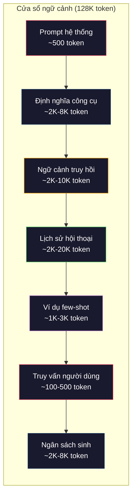
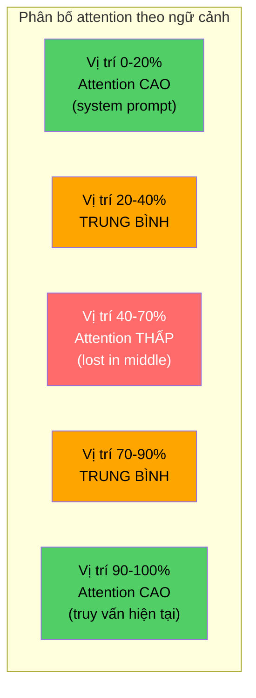
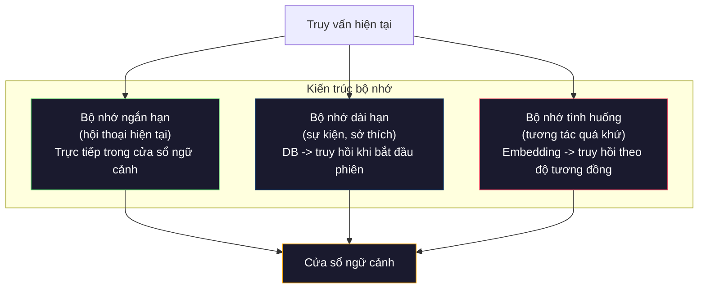

# Kỹ nghệ ngữ cảnh: Cửa sổ, Ngân sách, Bộ nhớ và Truy hồi

> Prompt engineering chỉ là một tập con. Kỹ nghệ ngữ cảnh (context engineering) mới là toàn bộ cuộc chơi. Prompt là một chuỗi bạn gõ vào. Ngữ cảnh là mọi thứ đi vào cửa sổ ngữ cảnh (context window) của model: chỉ dẫn hệ thống, tài liệu truy hồi, định nghĩa công cụ, lịch sử hội thoại, ví dụ few-shot, và chính bản thân prompt. Những kỹ sư AI giỏi nhất năm 2026 là những kỹ sư ngữ cảnh. Họ quyết định cái gì đi vào, cái gì để ngoài, và theo thứ tự nào.

**Type:** Build
**Languages:** Python
**Prerequisites:** Giai đoạn 10 (LLM from scratch), Giai đoạn 11, Bài 01-02
**Time:** ~90 phút
**Related:** Giai đoạn 11 · 15 (Prompt Caching) — cách bố cục thân thiện với cache là một phần mở rộng của kỹ nghệ ngữ cảnh. Giai đoạn 5 · 28 (Long-Context Evaluation) về cách đo lost-in-the-middle bằng NIAH/RULER.

## Mục tiêu học tập

- Tính ngân sách token trên mọi thành phần của cửa sổ ngữ cảnh (system prompt, công cụ, lịch sử, tài liệu truy hồi, phần dành cho sinh câu trả lời)
- Triển khai các chiến lược quản lý cửa sổ ngữ cảnh: cắt bớt, tóm tắt, và cửa sổ trượt cho lịch sử hội thoại
- Ưu tiên và sắp thứ tự các thành phần ngữ cảnh để tối đa hoá sự chú ý của model vào thông tin liên quan nhất
- Xây dựng bộ lắp ghép ngữ cảnh, phân bổ token linh động theo loại truy vấn và khoảng trống còn lại của cửa sổ

## Vấn đề

Claude Opus 4.7 có cửa sổ 200K token (1M ở bản beta). GPT-5 có 400K. Gemini 3 Pro có 2M. Llama 4 tuyên bố 10M. Những con số này nghe có vẻ khổng lồ cho tới khi bạn lấp đầy chúng.

Đây là bảng phân tách thật cho một trợ lý lập trình. System prompt: 500 token. Định nghĩa công cụ cho 50 công cụ: 8.000 token. Tài liệu truy hồi: 4.000 token. Lịch sử hội thoại (10 lượt): 6.000 token. Truy vấn hiện tại của người dùng: 200 token. Ngân sách sinh (output tối đa): 4.000 token. Tổng: 22.700 token. Đó chỉ mới là 18% của một cửa sổ 128K.

Nhưng attention không tăng tuyến tính theo độ dài ngữ cảnh. Model với 128K token ngữ cảnh phải trả chi phí attention bậc hai (O(n^2) trong transformer nguyên bản, dù hầu hết model production dùng các biến thể attention hiệu quả hơn). Quan trọng hơn, độ chính xác truy hồi (retrieval) giảm. Bài kiểm tra "Needle in a Haystack" cho thấy model gặp khó khi tìm thông tin đặt ở giữa ngữ cảnh dài (long context). Nghiên cứu của Liu et al. (2023) chỉ ra rằng LLM truy hồi thông tin ở đầu và cuối ngữ cảnh dài với độ chính xác gần như hoàn hảo, nhưng độ chính xác giảm 10-20% với thông tin đặt ở giữa (vị trí 40-70% của ngữ cảnh). Hiệu ứng "lost-in-the-middle" này thay đổi tuỳ model nhưng ảnh hưởng tới mọi kiến trúc hiện nay.

Bài học thực tế: có sẵn 200K token không có nghĩa là dùng 200K token sẽ hiệu quả. Một ngữ cảnh 10K token được chọn lọc kỹ thường vượt trội một ngữ cảnh 100K token bị nhồi nhét. Kỹ nghệ ngữ cảnh là kỷ luật tối đa hoá tỉ lệ tín hiệu trên nhiễu bên trong cửa sổ ngữ cảnh.

Mỗi token bạn đưa vào cửa sổ sẽ đẩy ra một token khác có thể mang thông tin liên quan hơn. Mỗi định nghĩa công cụ không liên quan, mỗi lượt hội thoại đã cũ, mỗi đoạn văn bản truy hồi về mà không trả lời câu hỏi -- mỗi thứ đều làm model kém đi một chút ở nhiệm vụ đó.

## Khái niệm

### Cửa sổ ngữ cảnh là một tài nguyên khan hiếm

Hãy nghĩ cửa sổ ngữ cảnh như RAM, không phải ổ đĩa. Nó nhanh và truy cập trực tiếp, nhưng có hạn. Bạn không thể nhét mọi thứ vào. Bạn phải chọn.



Mỗi thành phần tranh nhau không gian. Thêm định nghĩa công cụ nghĩa là bớt chỗ cho lịch sử hội thoại. Thêm ngữ cảnh truy hồi nghĩa là bớt chỗ cho ví dụ few-shot. Kỹ nghệ ngữ cảnh là nghệ thuật phân bổ ngân sách này để tối đa hoá hiệu năng nhiệm vụ.

### Lost-in-the-Middle

Phát hiện thực nghiệm quan trọng nhất trong kỹ nghệ ngữ cảnh. Model chú ý tốt hơn tới thông tin ở đầu và cuối ngữ cảnh. Thông tin ở giữa nhận điểm attention thấp hơn và dễ bị bỏ qua hơn.

Liu et al. (2023) đã kiểm tra điều này một cách hệ thống. Họ đặt một tài liệu liên quan giữa 20 tài liệu không liên quan ở nhiều vị trí khác nhau và đo độ chính xác của câu trả lời. Khi tài liệu liên quan nằm đầu tiên hoặc cuối cùng, độ chính xác là 85-90%. Khi nó nằm ở giữa (vị trí 10 trên 20), độ chính xác giảm còn 60-70%.

Điều này có hệ quả kỹ thuật trực tiếp:

- Đặt thông tin quan trọng nhất lên đầu (system prompt, các chỉ dẫn then chốt)
- Đặt truy vấn hiện tại và ngữ cảnh liên quan nhất xuống cuối (thiên lệch recency sẽ giúp)
- Coi phần giữa ngữ cảnh là vùng ưu tiên thấp nhất
- Nếu buộc phải đưa thông tin vào giữa, hãy lặp lại điểm then chốt ở cuối



### Các thành phần của ngữ cảnh

**System prompt**: đặt ra nhân vật, các ràng buộc và quy tắc hành vi. Nó đi đầu tiên và giữ nguyên qua mọi lượt. Claude Code dùng khoảng 6.000 token cho system prompt, gồm cả định nghĩa công cụ và chỉ dẫn hành vi. Hãy giữ nó thật gọn. Mỗi từ trong system prompt đều được lặp lại ở mọi lần gọi API.

**Định nghĩa công cụ**: mỗi công cụ thêm 50-200 token (tên, mô tả, schema tham số). 50 công cụ với 150 token mỗi cái là 7.500 token trước khi bất kỳ cuộc hội thoại nào bắt đầu. Chọn công cụ linh động -- chỉ gồm những công cụ liên quan tới truy vấn hiện tại -- có thể giảm 60-80% con số này.

**Ngữ cảnh truy hồi**: tài liệu từ cơ sở dữ liệu vector, kết quả tìm kiếm, nội dung file. Chất lượng truy hồi quyết định trực tiếp chất lượng câu trả lời. Truy hồi tồi còn tệ hơn không truy hồi -- nó nhồi nhiễu vào cửa sổ và chủ động làm model hiểu sai.

**Lịch sử hội thoại**: mọi tin nhắn trước đó của người dùng và câu trả lời của trợ lý. Tăng tuyến tính theo độ dài hội thoại. Một hội thoại 50 lượt với 200 token mỗi lượt là 10.000 token lịch sử. Phần lớn trong đó không liên quan gì tới truy vấn hiện tại.

**Ví dụ few-shot**: các cặp input/output minh hoạ hành vi mong muốn. Hai đến ba ví dụ được chọn kỹ thường cải thiện chất lượng đầu ra nhiều hơn hàng nghìn token chỉ dẫn. Nhưng chúng tốn chỗ.

**Ngân sách sinh**: lượng token dành riêng cho câu trả lời của model. Nếu bạn lấp đầy cửa sổ tới mức tối đa, model không còn chỗ để trả lời. Hãy dành ít nhất 2.000-4.000 token cho phần sinh.

### Các chiến lược nén ngữ cảnh

**Tóm tắt lịch sử**: thay vì giữ nguyên mọi lượt trước đó, hãy định kỳ tóm tắt cuộc hội thoại. "Chúng ta đã bàn về X, quyết định Y, và người dùng muốn Z" trong 100 token thay thế 10 lượt vốn tốn 2.000 token. Chạy tóm tắt khi lịch sử vượt một ngưỡng (ví dụ 5.000 token).

**Lọc theo độ liên quan**: chấm điểm từng tài liệu truy hồi so với truy vấn hiện tại và bỏ những tài liệu dưới ngưỡng. Nếu bạn truy hồi 10 đoạn mà chỉ 3 đoạn liên quan, hãy bỏ 7 đoạn còn lại. Thà có 3 đoạn rất liên quan còn hơn 10 đoạn tầm thường.

**Tỉa công cụ**: phân loại ý định của truy vấn người dùng và chỉ gồm những công cụ phù hợp với ý định đó. Một câu hỏi về code không cần công cụ lịch. Một câu hỏi về sắp lịch không cần công cụ hệ thống file. Cách này có thể giảm định nghĩa công cụ từ 8.000 token xuống 1.000.

**Tóm tắt đệ quy**: với tài liệu rất dài, hãy tóm tắt theo từng tầng. Đầu tiên tóm tắt từng phần, rồi tóm tắt các bản tóm tắt. Một tài liệu 50 trang trở thành một bản cô đọng 500 token giữ lại các ý chính.

### Hệ thống bộ nhớ

Kỹ nghệ ngữ cảnh trải trên ba chân trời thời gian.

**Bộ nhớ ngắn hạn**: cuộc hội thoại hiện tại. Được lưu trực tiếp trong cửa sổ ngữ cảnh. Lớn dần theo từng lượt. Được quản lý bằng tóm tắt và cắt bớt.

**Bộ nhớ dài hạn**: các sự kiện và sở thích tồn tại qua nhiều cuộc hội thoại. "Người dùng thích TypeScript." "Dự án dùng PostgreSQL." Được lưu trong cơ sở dữ liệu, truy hồi khi bắt đầu phiên. Claude Code lưu nó trong các file CLAUDE.md. ChatGPT lưu nó trong tính năng memory.

**Bộ nhớ tình huống**: những tương tác cụ thể trong quá khứ có thể liên quan. "Thứ Ba tuần trước, chúng ta đã gỡ lỗi một vấn đề tương tự trong module auth." Được lưu dưới dạng embedding, truy hồi khi cuộc hội thoại hiện tại khớp với một tình huống cũ.



### Lắp ghép ngữ cảnh linh động

Điểm cốt lõi: các truy vấn khác nhau cần ngữ cảnh khác nhau. Một system prompt cố định + công cụ cố định + lịch sử cố định là lãng phí. Những hệ thống tốt nhất lắp ghép ngữ cảnh linh động cho từng truy vấn.

1. Phân loại ý định của truy vấn
2. Chọn các công cụ liên quan (không phải toàn bộ công cụ)
3. Truy hồi các tài liệu liên quan (không phải một tập cố định)
4. Gồm các lượt lịch sử liên quan (không phải toàn bộ lịch sử)
5. Thêm các ví dụ few-shot khớp với loại nhiệm vụ
6. Sắp mọi thứ theo độ quan trọng: then chốt ở đầu, quan trọng ở cuối, tuỳ chọn ở giữa

Đây là điều phân biệt một ứng dụng AI tốt với một ứng dụng AI xuất sắc. Model vẫn thế. Ngữ cảnh là thứ tạo khác biệt.

```figure
lost-in-the-middle
```

## Tự tay làm

### Bước 1: Bộ đếm token

Bạn không thể lập ngân sách cho thứ mình không đo được. Hãy xây một bộ đếm token đơn giản (ước lượng bằng cách tách theo khoảng trắng, vì số lượng chính xác phụ thuộc tokenizer).

```python
import json
import numpy as np
from collections import OrderedDict

def count_tokens(text):
    if not text:
        return 0
    return int(len(text.split()) * 1.3)

def count_tokens_json(obj):
    return count_tokens(json.dumps(obj))
```

### Bước 2: Trình quản lý ngân sách ngữ cảnh

Đây là lớp trừu tượng cốt lõi. Một trình quản lý ngân sách theo dõi số token từng thành phần dùng và áp đặt giới hạn.

```python
class ContextBudget:
    def __init__(self, max_tokens=128000, generation_reserve=4000):
        self.max_tokens = max_tokens
        self.generation_reserve = generation_reserve
        self.available = max_tokens - generation_reserve
        self.allocations = OrderedDict()

    def allocate(self, component, content, max_tokens=None):
        tokens = count_tokens(content)
        if max_tokens and tokens > max_tokens:
            words = content.split()
            target_words = int(max_tokens / 1.3)
            content = " ".join(words[:target_words])
            tokens = count_tokens(content)

        used = sum(self.allocations.values())
        if used + tokens > self.available:
            allowed = self.available - used
            if allowed <= 0:
                return None, 0
            words = content.split()
            target_words = int(allowed / 1.3)
            content = " ".join(words[:target_words])
            tokens = count_tokens(content)

        self.allocations[component] = tokens
        return content, tokens

    def remaining(self):
        used = sum(self.allocations.values())
        return self.available - used

    def utilization(self):
        used = sum(self.allocations.values())
        return used / self.max_tokens

    def report(self):
        total_used = sum(self.allocations.values())
        lines = []
        lines.append(f"Context Budget Report ({self.max_tokens:,} token window)")
        lines.append("-" * 50)
        for component, tokens in self.allocations.items():
            pct = tokens / self.max_tokens * 100
            bar = "#" * int(pct / 2)
            lines.append(f"  {component:<25} {tokens:>6} tokens ({pct:>5.1f}%) {bar}")
        lines.append("-" * 50)
        lines.append(f"  {'Used':<25} {total_used:>6} tokens ({total_used/self.max_tokens*100:.1f}%)")
        lines.append(f"  {'Generation reserve':<25} {self.generation_reserve:>6} tokens")
        lines.append(f"  {'Remaining':<25} {self.remaining():>6} tokens")
        return "\n".join(lines)
```

### Bước 3: Sắp xếp lại theo lost-in-the-middle

Triển khai chiến lược sắp xếp lại: các mục quan trọng nhất đi đầu và đi cuối, các mục ít quan trọng nhất nằm ở giữa.

```python
def reorder_lost_in_middle(items, scores):
    paired = sorted(zip(scores, items), reverse=True)
    sorted_items = [item for _, item in paired]

    if len(sorted_items) <= 2:
        return sorted_items

    first_half = sorted_items[::2]
    second_half = sorted_items[1::2]
    second_half.reverse()

    return first_half + second_half

def score_relevance(query, documents):
    query_words = set(query.lower().split())
    scores = []
    for doc in documents:
        doc_words = set(doc.lower().split())
        if not query_words:
            scores.append(0.0)
            continue
        overlap = len(query_words & doc_words) / len(query_words)
        scores.append(round(overlap, 3))
    return scores
```

### Bước 4: Bộ nén lịch sử hội thoại

Tóm tắt các lượt hội thoại cũ để lấy lại ngân sách token.

```python
class ConversationManager:
    def __init__(self, max_history_tokens=5000):
        self.turns = []
        self.summaries = []
        self.max_history_tokens = max_history_tokens

    def add_turn(self, role, content):
        self.turns.append({"role": role, "content": content})
        self._compress_if_needed()

    def _compress_if_needed(self):
        total = sum(count_tokens(t["content"]) for t in self.turns)
        if total <= self.max_history_tokens:
            return

        while total > self.max_history_tokens and len(self.turns) > 4:
            old_turns = self.turns[:2]
            summary = self._summarize_turns(old_turns)
            self.summaries.append(summary)
            self.turns = self.turns[2:]
            total = sum(count_tokens(t["content"]) for t in self.turns)

    def _summarize_turns(self, turns):
        parts = []
        for t in turns:
            content = t["content"]
            if len(content) > 100:
                content = content[:100] + "..."
            parts.append(f"{t['role']}: {content}")
        return "Previous: " + " | ".join(parts)

    def get_context(self):
        parts = []
        if self.summaries:
            parts.append("[Conversation Summary]")
            for s in self.summaries:
                parts.append(s)
        parts.append("[Recent Conversation]")
        for t in self.turns:
            parts.append(f"{t['role']}: {t['content']}")
        return "\n".join(parts)

    def token_count(self):
        return count_tokens(self.get_context())
```

### Bước 5: Bộ chọn công cụ linh động

Chỉ gồm những công cụ liên quan tới truy vấn hiện tại. Phân loại ý định, rồi lọc.

```python
TOOL_REGISTRY = {
    "read_file": {
        "description": "Read contents of a file",
        "tokens": 120,
        "categories": ["code", "files"],
    },
    "write_file": {
        "description": "Write content to a file",
        "tokens": 150,
        "categories": ["code", "files"],
    },
    "search_code": {
        "description": "Search for patterns in codebase",
        "tokens": 130,
        "categories": ["code"],
    },
    "run_command": {
        "description": "Execute a shell command",
        "tokens": 140,
        "categories": ["code", "system"],
    },
    "create_calendar_event": {
        "description": "Create a new calendar event",
        "tokens": 180,
        "categories": ["calendar"],
    },
    "list_emails": {
        "description": "List recent emails",
        "tokens": 160,
        "categories": ["email"],
    },
    "send_email": {
        "description": "Send an email message",
        "tokens": 200,
        "categories": ["email"],
    },
    "web_search": {
        "description": "Search the web for information",
        "tokens": 140,
        "categories": ["research"],
    },
    "query_database": {
        "description": "Run a SQL query on the database",
        "tokens": 170,
        "categories": ["code", "data"],
    },
    "generate_chart": {
        "description": "Generate a chart from data",
        "tokens": 190,
        "categories": ["data", "visualization"],
    },
}

def classify_intent(query):
    query_lower = query.lower()

    intent_keywords = {
        "code": ["code", "function", "bug", "error", "file", "implement", "refactor", "debug", "test"],
        "calendar": ["meeting", "schedule", "calendar", "appointment", "event"],
        "email": ["email", "mail", "send", "inbox", "message"],
        "research": ["search", "find", "what is", "how does", "explain", "look up"],
        "data": ["data", "query", "database", "chart", "graph", "analytics", "sql"],
    }

    scores = {}
    for intent, keywords in intent_keywords.items():
        score = sum(1 for kw in keywords if kw in query_lower)
        if score > 0:
            scores[intent] = score

    if not scores:
        return ["code"]

    max_score = max(scores.values())
    return [intent for intent, score in scores.items() if score >= max_score * 0.5]

def select_tools(query, token_budget=2000):
    intents = classify_intent(query)
    relevant = {}
    total_tokens = 0

    for name, tool in TOOL_REGISTRY.items():
        if any(cat in intents for cat in tool["categories"]):
            if total_tokens + tool["tokens"] <= token_budget:
                relevant[name] = tool
                total_tokens += tool["tokens"]

    return relevant, total_tokens
```

### Bước 6: Toàn bộ pipeline lắp ghép ngữ cảnh

Nối mọi thứ lại. Cho một truy vấn, lắp ghép linh động ngữ cảnh tối ưu.

```python
class ContextEngine:
    def __init__(self, max_tokens=128000, generation_reserve=4000):
        self.budget = ContextBudget(max_tokens, generation_reserve)
        self.conversation = ConversationManager(max_history_tokens=5000)
        self.system_prompt = (
            "You are a helpful AI assistant. You have access to tools for "
            "code editing, file management, web search, and data analysis. "
            "Use the appropriate tools for each task. Be concise and accurate."
        )
        self.knowledge_base = [
            "Python 3.12 introduced type parameter syntax for generic classes using bracket notation.",
            "The project uses PostgreSQL 16 with pgvector for embedding storage.",
            "Authentication is handled by Supabase Auth with JWT tokens.",
            "The frontend is built with Next.js 15 using the App Router.",
            "API rate limits are set to 100 requests per minute per user.",
            "The deployment pipeline uses GitHub Actions with Docker multi-stage builds.",
            "Test coverage must be above 80% for all new modules.",
            "The codebase follows the repository pattern for data access.",
        ]

    def assemble(self, query):
        self.budget = ContextBudget(self.budget.max_tokens, self.budget.generation_reserve)

        system_content, _ = self.budget.allocate("system_prompt", self.system_prompt, max_tokens=1000)

        tools, tool_tokens = select_tools(query, token_budget=2000)
        tool_text = json.dumps(list(tools.keys()))
        tool_content, _ = self.budget.allocate("tools", tool_text, max_tokens=2000)

        relevance = score_relevance(query, self.knowledge_base)
        threshold = 0.1
        relevant_docs = [
            doc for doc, score in zip(self.knowledge_base, relevance)
            if score >= threshold
        ]

        if relevant_docs:
            doc_scores = [s for s in relevance if s >= threshold]
            reordered = reorder_lost_in_middle(relevant_docs, doc_scores)
            doc_text = "\n".join(reordered)
            doc_content, _ = self.budget.allocate("retrieved_context", doc_text, max_tokens=3000)

        history_text = self.conversation.get_context()
        if history_text.strip():
            history_content, _ = self.budget.allocate("conversation_history", history_text, max_tokens=5000)

        query_content, _ = self.budget.allocate("user_query", query, max_tokens=500)

        return self.budget

    def chat(self, query):
        self.conversation.add_turn("user", query)
        budget = self.assemble(query)
        response = f"[Response to: {query[:50]}...]"
        self.conversation.add_turn("assistant", response)
        return budget


def run_demo():
    print("=" * 60)
    print("  Context Engineering Pipeline Demo")
    print("=" * 60)

    engine = ContextEngine(max_tokens=128000, generation_reserve=4000)

    print("\n--- Query 1: Code task ---")
    budget = engine.chat("Fix the bug in the authentication module where JWT tokens expire too early")
    print(budget.report())

    print("\n--- Query 2: Research task ---")
    budget = engine.chat("What is the best approach for implementing vector search in PostgreSQL?")
    print(budget.report())

    print("\n--- Query 3: After conversation history builds up ---")
    for i in range(8):
        engine.conversation.add_turn("user", f"Follow-up question number {i+1} about the implementation details of the system")
        engine.conversation.add_turn("assistant", f"Here is the response to follow-up {i+1} with technical details about the architecture")

    budget = engine.chat("Now implement the changes we discussed")
    print(budget.report())

    print("\n--- Tool Selection Examples ---")
    test_queries = [
        "Fix the bug in auth.py",
        "Schedule a meeting with the team for Tuesday",
        "Show me the database query performance stats",
        "Search for best practices on error handling",
    ]

    for q in test_queries:
        tools, tokens = select_tools(q)
        intents = classify_intent(q)
        print(f"\n  Query: {q}")
        print(f"  Intents: {intents}")
        print(f"  Tools: {list(tools.keys())} ({tokens} tokens)")

    print("\n--- Lost-in-the-Middle Reordering ---")
    docs = ["Doc A (most relevant)", "Doc B (somewhat relevant)", "Doc C (least relevant)",
            "Doc D (relevant)", "Doc E (moderately relevant)"]
    scores = [0.95, 0.60, 0.20, 0.80, 0.50]
    reordered = reorder_lost_in_middle(docs, scores)
    print(f"  Original order: {docs}")
    print(f"  Scores:         {scores}")
    print(f"  Reordered:      {reordered}")
    print(f"  (Most relevant at start and end, least relevant in middle)")
```

## Áp dụng

### Ngữ cảnh do harness quản lý

Claude Code quản lý ngữ cảnh theo cách nhiều tầng. System prompt gồm các quy tắc hành vi và định nghĩa công cụ (~6K token). Khi bạn mở một file, nội dung của nó được chèn vào làm ngữ cảnh. Khi bạn tìm kiếm, kết quả được thêm vào. Các lượt hội thoại cũ được tóm tắt. CLAUDE.md cung cấp bộ nhớ dài hạn tồn tại qua các phiên.

Quyết định kỹ thuật then chốt: Claude Code không đổ toàn bộ codebase của bạn vào ngữ cảnh. Nó truy hồi các file liên quan theo nhu cầu. Đây chính là kỹ nghệ ngữ cảnh trong thực tế.

### Nạp ngữ cảnh linh động

Cursor đánh chỉ mục toàn bộ codebase của bạn thành embedding. Khi bạn gõ một truy vấn, nó truy hồi những file và khối code liên quan nhất bằng độ tương đồng vector. Chỉ những mảnh đó đi vào cửa sổ ngữ cảnh. Một codebase 500K dòng được nén thành 5-10 khối code liên quan nhất.

Đây là khuôn mẫu: nhúng mọi thứ, truy hồi theo nhu cầu, chỉ đưa vào những gì quan trọng.

### Bộ nhớ dài hạn của trợ lý

ChatGPT lưu sở thích và sự kiện của người dùng như bộ nhớ dài hạn. Mỗi lần bắt đầu hội thoại, các ký ức liên quan được truy hồi và đưa vào system prompt. "Người dùng thích Python" tốn 5 token nhưng tiết kiệm hàng trăm token chỉ dẫn lặp lại qua các cuộc hội thoại.

### RAG như một dạng kỹ nghệ ngữ cảnh

Retrieval-Augmented Generation là kỹ nghệ ngữ cảnh được hình thức hoá. Thay vì nhồi kiến thức vào trọng số của model (huấn luyện) hay vào system prompt (ngữ cảnh tĩnh), bạn truy hồi các tài liệu liên quan tại thời điểm truy vấn và chèn chúng vào cửa sổ ngữ cảnh. Toàn bộ pipeline RAG -- chia đoạn, nhúng, truy hồi, xếp hạng lại -- tồn tại để giải một bài toán: đưa đúng thông tin vào cửa sổ ngữ cảnh.

## Đóng gói

Bài học này tạo ra `outputs/prompt-context-optimizer.md` -- một prompt tái sử dụng để kiểm tra một chiến lược lắp ghép ngữ cảnh và đề xuất tối ưu. Đưa vào system prompt, số lượng công cụ, độ dài lịch sử trung bình và chiến lược truy hồi của bạn, nó sẽ chỉ ra chỗ lãng phí token và gợi ý cải thiện.

Nó cũng tạo ra `outputs/skill-context-engineering.md` -- một khung quyết định để thiết kế pipeline lắp ghép ngữ cảnh dựa trên loại nhiệm vụ, kích thước cửa sổ ngữ cảnh và ngân sách độ trễ.

## Bài tập

1. Thêm một "bộ phát hiện lãng phí token" vào lớp ContextBudget. Nó nên gắn cờ những thành phần dùng hơn 30% ngân sách và đề xuất chiến lược nén riêng cho từng loại thành phần (tóm tắt lịch sử, tỉa công cụ, xếp hạng lại tài liệu).

2. Triển khai khử trùng lặp theo ngữ nghĩa cho ngữ cảnh truy hồi. Nếu hai tài liệu truy hồi giống nhau hơn 80% (theo trùng lặp từ hoặc độ tương đồng cosine của embedding), chỉ giữ tài liệu có điểm cao hơn. Đo xem cách này thu lại được bao nhiêu ngân sách token.

3. Xây dựng một công cụ "phát lại ngữ cảnh". Cho một bản ghi hội thoại, phát lại nó qua ContextEngine và trực quan hoá cách phân bổ ngân sách thay đổi theo từng lượt. Vẽ đồ thị lượng token dùng cho từng thành phần theo thời gian. Xác định lượt mà ngữ cảnh bắt đầu bị nén.

4. Triển khai một bộ chọn công cụ dựa trên ưu tiên. Thay vì gồm/loại nhị phân, gán cho mỗi công cụ một điểm liên quan tới truy vấn hiện tại. Gồm công cụ theo thứ tự liên quan giảm dần cho tới khi hết ngân sách công cụ. So sánh hiệu năng nhiệm vụ với 5, 10, 20 và 50 công cụ được gồm.

5. Xây dựng một bộ nén ngữ cảnh đa chiến lược. Triển khai ba chiến lược nén (cắt bớt, tóm tắt, trích các câu then chốt) và đánh giá chúng trên một tập 20 tài liệu. Đo đánh đổi giữa tỉ lệ nén và lượng thông tin giữ lại (bản đã nén còn chứa câu trả lời cho truy vấn không?).

## Thuật ngữ chính

| Thuật ngữ | Người ta thường nói | Ý nghĩa thực sự |
|------|----------------|----------------------|
| Context window | "Model đọc được bao nhiêu" | Số token tối đa (input + output) mà model xử lý trong một lượt lan truyền xuôi -- 400K với GPT-5, 200K (1M beta) với Claude Opus 4.7, 2M với Gemini 3 Pro |
| Context engineering | "Prompt engineering nâng cao" | Kỷ luật quyết định cái gì đi vào cửa sổ ngữ cảnh, theo thứ tự nào và ưu tiên ra sao -- bao gồm truy hồi, nén, chọn công cụ và quản lý bộ nhớ |
| Lost-in-the-middle | "Model quên đồ ở giữa" | Phát hiện thực nghiệm rằng LLM chú ý tốt hơn tới đầu và cuối ngữ cảnh, với độ chính xác giảm 10-20% cho thông tin đặt ở giữa |
| Token budget | "Còn bao nhiêu token" | Một phân bổ tường minh dung lượng cửa sổ ngữ cảnh cho các thành phần (system prompt, công cụ, lịch sử, truy hồi, sinh câu trả lời) kèm giới hạn từng thành phần |
| Dynamic context | "Nạp đồ lúc chạy" | Lắp ghép cửa sổ ngữ cảnh khác nhau cho từng truy vấn dựa trên phân loại ý định, chọn công cụ liên quan và kết quả truy hồi |
| History summarization | "Nén cuộc hội thoại" | Thay các lượt hội thoại cũ nguyên văn bằng một bản tóm tắt ngắn gọn, giảm chi phí token mà vẫn giữ thông tin then chốt |
| Tool pruning | "Chỉ gồm công cụ liên quan" | Phân loại ý định truy vấn và chỉ gồm các định nghĩa công cụ phù hợp, giảm chi phí token cho công cụ 60-80% |
| Long-term memory | "Nhớ qua các phiên" | Các sự kiện và sở thích được lưu trong cơ sở dữ liệu và truy hồi khi bắt đầu phiên -- CLAUDE.md, ChatGPT Memory và các hệ thống tương tự |
| Episodic memory | "Nhớ các sự kiện cụ thể trong quá khứ" | Các tương tác quá khứ được lưu dưới dạng embedding và truy hồi khi truy vấn hiện tại giống với một cuộc hội thoại trước đó |
| Generation budget | "Chỗ cho câu trả lời" | Token dành riêng cho output của model -- nếu ngữ cảnh lấp đầy cửa sổ, model không còn chỗ để trả lời |

## Đọc thêm

- [Liu et al., 2023 -- "Lost in the Middle: How Language Models Use Long Contexts"](https://arxiv.org/abs/2307.03172) -- nghiên cứu kinh điển về attention phụ thuộc vị trí, cho thấy model gặp khó với thông tin ở giữa ngữ cảnh dài
- [Anthropic's Contextual Retrieval blog post](https://www.anthropic.com/news/contextual-retrieval) -- cách Anthropic tiếp cận truy hồi đoạn có nhận thức ngữ cảnh, giảm 49% lỗi truy hồi
- [Simon Willison's "Context Engineering"](https://simonwillison.net/2025/Jun/27/context-engineering/) -- bài blog đặt tên cho kỷ luật này và phân biệt nó với prompt engineering
- [LangChain documentation on RAG](https://python.langchain.com/docs/tutorials/rag/) -- triển khai thực tế retrieval-augmented generation như một khuôn mẫu kỹ nghệ ngữ cảnh
- [Greg Kamradt's Needle in a Haystack test](https://github.com/gkamradt/LLMTest_NeedleInAHaystack) -- bộ đánh giá phơi ra các lỗi truy hồi phụ thuộc vị trí ở mọi model lớn
- [Pope et al., "Efficiently Scaling Transformer Inference" (2022)](https://arxiv.org/abs/2211.05102) -- vì sao độ dài ngữ cảnh chi phối bộ nhớ và độ trễ, và cách KV cache, MQA, GQA thay đổi bài tính ngân sách.
- [Agrawal et al., "SARATHI: Efficient LLM Inference by Piggybacking Decodes with Chunked Prefills" (2023)](https://arxiv.org/abs/2308.16369) -- hai pha suy luận khiến prompt dài đắt ở TTFT nhưng rẻ ở TPOT; sự thật nền tảng phía sau các đánh đổi khi nhồi ngữ cảnh.
- [Ainslie et al., "GQA: Training Generalized Multi-Query Transformer Models from Multi-Head Checkpoints" (EMNLP 2023)](https://arxiv.org/abs/2305.13245) -- bài báo grouped-query attention đã cắt bộ nhớ KV 8× trong decoder production mà không mất chất lượng.

---

[← Bài trước: Embedding & Biểu diễn Vector](../../04-embeddings/docs/vi.md) · [Bài sau: RAG (Retrieval-Augmented Generation) →](../../06-rag/docs/vi.md)
