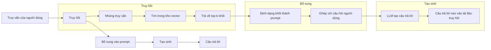
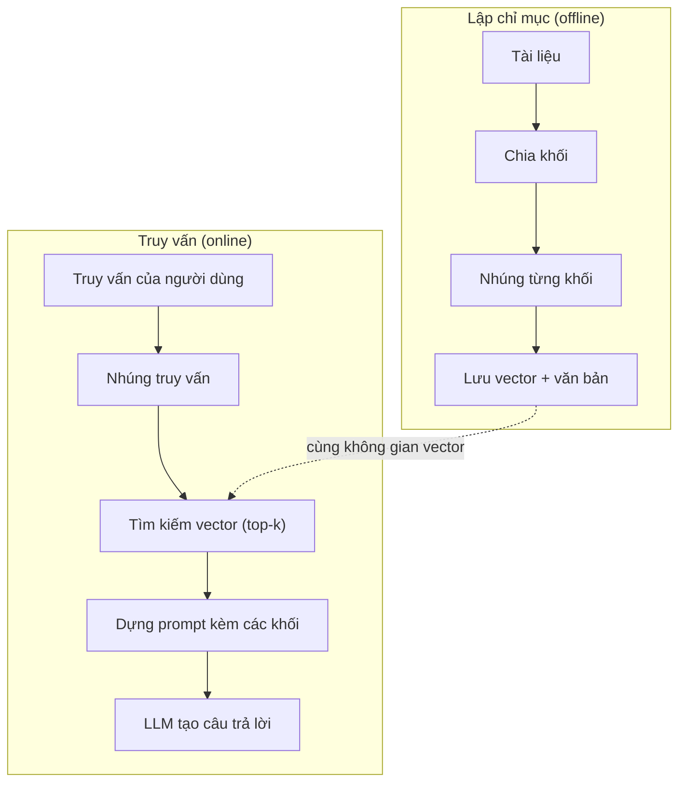

# RAG (Retrieval-Augmented Generation)

> LLM của bạn biết mọi thứ tính đến thời điểm cắt dữ liệu huấn luyện. Nó không biết gì về tài liệu của công ty bạn, codebase của bạn, hay biên bản họp tuần trước. RAG (retrieval-augmented generation – tạo sinh có truy hồi) giải quyết việc này bằng cách truy hồi các tài liệu liên quan rồi nhồi chúng vào prompt. Đây là mẫu được triển khai nhiều nhất trong AI production. Nếu chỉ làm một thứ từ khóa học này, hãy làm một pipeline RAG.

**Type:** Build
**Languages:** Python
**Prerequisites:** Giai đoạn 10 (LLM from scratch), Giai đoạn 11, Bài 01-05
**Time:** ~90 phút
**Related:** Giai đoạn 5 · 23 (Chunking Strategies for RAG) cho sáu thuật toán chia khối và khi nào mỗi thuật toán thắng. Giai đoạn 5 · 22 (Embedding Models Deep Dive) để chọn embedder. Giai đoạn 11 · 07 (Advanced RAG) cho tìm kiếm lai, reranking (xếp hạng lại) và biến đổi truy vấn.

## Mục tiêu học tập

- Xây một pipeline RAG hoàn chỉnh: nạp tài liệu, chunking (chia khối), embedding (embedding), lưu trữ vector, truy hồi và tạo sinh
- Cài đặt tìm kiếm ngữ nghĩa bằng vector database (ChromaDB, FAISS hoặc Pinecone) với chỉ mục đúng cách
- Giải thích vì sao RAG được ưu tiên hơn fine-tuning cho các ứng dụng dựa trên tri thức (chi phí, độ tươi mới, khả năng truy vết nguồn)
- Đánh giá chất lượng RAG bằng chỉ số truy hồi (precision, recall) và chỉ số tạo sinh (faithfulness, relevance)

## Vấn đề

Bạn xây một chatbot cho công ty mình. Một khách hàng hỏi "Chính sách hoàn tiền cho gói enterprise là gì?" LLM trả lời một đáp án chung chung về các chính sách hoàn tiền SaaS điển hình. Chính sách thật, nằm sâu trong wiki nội bộ 200 trang, nói rằng khách enterprise có cửa sổ 60 ngày với hoàn tiền theo tỷ lệ. LLM chưa từng thấy tài liệu này. Nó không thể biết thứ nó không được huấn luyện.

Fine-tuning là một giải pháp. Lấy LLM, huấn luyện nó trên tài liệu nội bộ của bạn, rồi triển khai mô hình đã cập nhật. Cách này chạy được nhưng có những vấn đề nghiêm trọng. Fine-tuning tốn hàng nghìn đô compute. Mô hình trở nên lỗi thời ngay khi một tài liệu thay đổi. Bạn không có cách nào biết mô hình lấy thông tin từ nguồn nào. Và nếu tháng sau công ty mua thêm một dòng sản phẩm, bạn lại phải fine-tuning.

RAG là giải pháp còn lại. Để mô hình nguyên vẹn. Khi có câu hỏi, tìm trong kho tài liệu những đoạn liên quan, dán chúng vào prompt trước câu hỏi, rồi để mô hình trả lời dựa trên các đoạn đó làm ngữ cảnh. Kho tài liệu có thể cập nhật trong vài phút. Bạn thấy chính xác tài liệu nào đã được truy hồi. Bản thân mô hình không bao giờ đổi. Đó là lý do RAG là mẫu thống trị trong production: rẻ hơn, tươi mới hơn, dễ kiểm toán hơn và dùng được với bất kỳ LLM nào.

## Khái niệm

### Mẫu RAG

Toàn bộ mẫu gói gọn trong bốn bước:



Truy vấn -> Truy hồi -> Bổ sung prompt -> Tạo sinh. Mọi hệ thống RAG đều đi theo mẫu này. Khác biệt giữa các hệ RAG production nằm ở chi tiết của từng bước: bạn chia khối thế nào, nhúng thế nào, tìm kiếm thế nào và dựng prompt thế nào.

### Vì sao RAG vượt fine-tuning

| Mối quan tâm | Fine-tuning | RAG |
|---------|------------|-----|
| Chi phí | 1.000-100.000+ USD mỗi lần huấn luyện | 0,01-0,10 USD mỗi truy vấn (embedding + LLM) |
| Độ tươi mới | Lỗi thời cho tới khi huấn luyện lại | Cập nhật trong vài phút bằng cách lập chỉ mục lại tài liệu |
| Khả năng kiểm toán | Không truy vết được câu trả lời về nguồn | Hiển thị được chính xác các đoạn đã truy hồi |
| Ảo giác (hallucination) | Vẫn ảo giác thoải mái | Neo vào tài liệu được truy hồi |
| Riêng tư dữ liệu | Dữ liệu huấn luyện bị nướng vào trọng số | Tài liệu ở lại trong kho vector của bạn |

Fine-tuning thay đổi trọng số của mô hình vĩnh viễn. RAG thay đổi ngữ cảnh của mô hình tạm thời. Với hầu hết ứng dụng, ngữ cảnh tạm thời là thứ bạn muốn.

Trường hợp duy nhất fine-tuning thắng: khi bạn cần mô hình có một phong cách, giọng điệu hay kiểu suy luận riêng mà chỉ dùng prompting không làm được. Với việc truy hồi tri thức sự thật, RAG luôn thắng.

### Mô hình embedding

Một mô hình embedding biến văn bản thành vector dày. Các văn bản tương tự tạo ra những vector gần nhau trong không gian nhiều chiều này. "Làm sao để đặt lại mật khẩu?" và "Tôi cần đổi mật khẩu" cho ra vector gần như giống nhau dù chỉ chung vài từ. "Con mèo ngồi trên chiếu" cho ra một vector rất khác.

Các mô hình embedding phổ biến (danh sách 2026 — xem Giai đoạn 5 · 22 để phân tích đầy đủ):

| Mô hình | Số chiều | Nhà cung cấp | Ghi chú |
|-------|-----------|----------|-------|
| text-embedding-3-small | 1536 (Matryoshka) | OpenAI | Giá/hiệu năng tốt nhất cho hầu hết trường hợp |
| text-embedding-3-large | 3072 (Matryoshka) | OpenAI | Độ chính xác cao hơn, cắt được về 256/512/1024 |
| Gemini Embedding 2 | 3072 (Matryoshka) | Google | Điểm truy hồi MTEB hàng đầu; ngữ cảnh 8K |
| voyage-4 | 1024/2048 (Matryoshka) | Voyage AI | Biến thể theo lĩnh vực (code, tài chính, pháp lý) |
| Cohere embed-v4 | 1024 (Matryoshka) | Cohere | Đa ngôn ngữ mạnh, ngữ cảnh 128K |
| BGE-M3 | 1024 (dense + sparse + ColBERT) | BAAI (open-weight) | Ba góc nhìn từ một mô hình |
| Qwen3-Embedding | 4096 (Matryoshka) | Alibaba (open-weight) | Điểm truy hồi open-weight cao nhất |
| all-MiniLM-L6-v2 | 384 | Open-weight (Sentence Transformers) | Mốc nền để thử nghiệm |

Trong bài này, chúng ta tự xây một embedding đơn giản bằng TF-IDF. Không phải vì TF-IDF là thứ hệ production dùng, mà vì nó làm khái niệm trở nên cụ thể: văn bản vào, vector ra, văn bản tương tự cho vector tương tự.

### Độ tương đồng vector

Cho hai vector, đo độ tương đồng thế nào? Ba lựa chọn:

**Cosine similarity**: cosin của góc giữa hai vector. Nằm trong khoảng -1 (ngược hướng) đến 1 (trùng nhau). Bỏ qua độ lớn, chỉ quan tâm hướng. Đây là mặc định cho RAG.

```
cosine_sim(a, b) = dot(a, b) / (||a|| * ||b||)
```

**Tích vô hướng**: tích trong thô. Vector lớn hơn được điểm cao hơn. Hữu ích khi độ lớn mang thông tin (tài liệu dài hơn có thể liên quan hơn).

```
dot(a, b) = sum(a_i * b_i)
```

**Khoảng cách L2 (Euclidean)**: khoảng cách đường thẳng trong không gian vector. Khoảng cách nhỏ hơn = tương đồng hơn. Nhạy với chênh lệch độ lớn.

```
L2(a, b) = sqrt(sum((a_i - b_i)^2))
```

Cosine similarity là chuẩn. Nó xử lý tài liệu dài ngắn khác nhau một cách mượt mà vì chuẩn hoá theo độ lớn. Khi ai nói "vector search", gần như luôn là cosine similarity.

### Chiến lược chia khối

Tài liệu quá dài để nhúng thành một vector duy nhất. Một PDF 50 trang có thể cho ra embedding rất tệ vì nó chứa hàng chục chủ đề. Thay vào đó, bạn chia tài liệu thành các khối và nhúng từng khối riêng.

**Chia khối theo kích thước cố định**: cứ N token thì cắt. Đơn giản và dễ đoán. Khối 512 token với phần chồng lấp 50 token nghĩa là khối 1 gồm token 0-511, khối 2 gồm token 462-973, và cứ thế. Phần chồng lấp bảo đảm bạn không cắt câu ở một ranh giới xui xẻo.

**Chia khối theo ngữ nghĩa**: cắt ở ranh giới tự nhiên. Đoạn văn, mục, hoặc heading markdown. Mỗi khối là một đơn vị nghĩa mạch lạc. Cài đặt phức tạp hơn nhưng cho truy hồi tốt hơn.

**Chia khối đệ quy**: thử cắt ở ranh giới lớn nhất trước (heading của mục). Nếu mục vẫn quá lớn, cắt ở ranh giới đoạn. Nếu đoạn vẫn quá lớn, cắt ở ranh giới câu. Đây là cách tiếp cận RecursiveCharacterTextSplitter của LangChain và nó chạy tốt trong thực tế.

Kích thước khối quan trọng hơn người ta tưởng:

- Quá nhỏ (64-128 token): mỗi khối thiếu ngữ cảnh. "Nó tăng 15% quý trước" chẳng có nghĩa gì nếu không biết "nó" là gì.
- Quá lớn (2048+ token): mỗi khối phủ nhiều chủ đề, làm loãng độ liên quan. Khi bạn tìm dữ liệu doanh thu, bạn nhận một khối chỉ 10% nói về doanh thu và 90% nói về số nhân sự.
- Điểm ngọt (256-512 token): đủ ngữ cảnh để tự đứng một mình, đủ tập trung để liên quan.

Hầu hết hệ RAG production dùng khối 256-512 token với phần chồng lấp 50 token. Hướng dẫn RAG của Anthropic cũng khuyến nghị khoảng này.

### Cơ sở dữ liệu vector

Khi đã có embedding, bạn cần một nơi để lưu và tìm kiếm chúng. Các lựa chọn:

| Cơ sở dữ liệu | Loại | Phù hợp nhất |
|----------|------|----------|
| FAISS | Thư viện (in-process) | Thử nghiệm, tập dữ liệu nhỏ đến vừa |
| Chroma | DB nhẹ | Phát triển cục bộ, triển khai nhỏ |
| Pinecone | Dịch vụ được quản lý | Production không muốn gánh vận hành |
| Weaviate | DB mã nguồn mở | Production tự vận hành |
| pgvector | Phần mở rộng Postgres | Đang dùng Postgres sẵn |
| Qdrant | DB mã nguồn mở | Tự vận hành hiệu năng cao |

Trong bài này, chúng ta xây một vector store (kho vector) đơn giản trong bộ nhớ. Nó lưu vector trong một list và tìm bằng cosine similarity vét cạn. Cách này tương đương FAISS với chỉ mục phẳng. Nó chịu được khoảng 100.000 vector trước khi chậm. Hệ production dùng các thuật toán hàng xóm gần đúng (ANN) như HNSW để tìm trong hàng triệu vector trong vài mili giây.

### Toàn bộ pipeline



Pha lập chỉ mục chạy một lần cho mỗi tài liệu (hoặc khi tài liệu cập nhật). Pha truy vấn chạy ở mỗi yêu cầu người dùng. Trong production, lập chỉ mục có thể xử lý hàng triệu tài liệu trong nhiều giờ. Truy vấn phải trả về dưới một giây.

### Các con số thực tế

Hầu hết hệ RAG production dùng các tham số sau:

- **k = 5 đến 10** khối được truy hồi cho mỗi truy vấn
- **Kích thước khối = 256 đến 512 token** với phần chồng lấp 50 token
- **Ngân sách ngữ cảnh**: 2.500-5.000 token nội dung truy hồi cho mỗi truy vấn
- **Tổng prompt**: ~8.000-16.000 token (system prompt + khối truy hồi + lịch sử hội thoại + câu hỏi người dùng)
- **Số chiều embedding**: 384-3072 tuỳ mô hình
- **Thông lượng lập chỉ mục**: 100-1.000 tài liệu mỗi giây với embedding qua API
- **Độ trễ truy vấn**: 50-200ms cho truy hồi, 500-3000ms cho tạo sinh

```figure
rag-chunking
```

## Tự tay làm

### Bước 1: Chia khối tài liệu

```python
def chunk_text(text, chunk_size=200, overlap=50):
    words = text.split()
    chunks = []
    start = 0
    while start < len(words):
        end = start + chunk_size
        chunk = " ".join(words[start:end])
        chunks.append(chunk)
        start += chunk_size - overlap
    return chunks
```

### Bước 2: Embedding TF-IDF

Chúng ta xây một hàm embedding đơn giản. TF-IDF (Term Frequency-Inverse Document Frequency) không phải embedding nơ-ron, nhưng nó biến văn bản thành vector theo cách nắm bắt tầm quan trọng của từ. Từ xuất hiện nhiều trong một tài liệu có TF cao hơn. Từ hiếm trong toàn bộ corpus có IDF cao hơn. Tích của chúng cho một vector trong đó các từ quan trọng và đặc trưng có giá trị cao.

```python
import math
from collections import Counter

def build_vocabulary(documents):
    vocab = set()
    for doc in documents:
        vocab.update(doc.lower().split())
    return sorted(vocab)

def compute_tf(text, vocab):
    words = text.lower().split()
    count = Counter(words)
    total = len(words)
    return [count.get(word, 0) / total for word in vocab]

def compute_idf(documents, vocab):
    n = len(documents)
    idf = []
    for word in vocab:
        doc_count = sum(1 for doc in documents if word in doc.lower().split())
        idf.append(math.log((n + 1) / (doc_count + 1)) + 1)
    return idf

def tfidf_embed(text, vocab, idf):
    tf = compute_tf(text, vocab)
    return [t * i for t, i in zip(tf, idf)]
```

### Bước 3: Tìm kiếm bằng cosine similarity

```python
def cosine_similarity(a, b):
    dot = sum(x * y for x, y in zip(a, b))
    norm_a = math.sqrt(sum(x * x for x in a))
    norm_b = math.sqrt(sum(x * x for x in b))
    if norm_a == 0 or norm_b == 0:
        return 0.0
    return dot / (norm_a * norm_b)

def search(query_embedding, stored_embeddings, top_k=5):
    scores = []
    for i, emb in enumerate(stored_embeddings):
        sim = cosine_similarity(query_embedding, emb)
        scores.append((i, sim))
    scores.sort(key=lambda x: x[1], reverse=True)
    return scores[:top_k]
```

### Bước 4: Dựng prompt

Đây là chỗ phần "augmented" trong RAG diễn ra. Lấy các khối đã truy hồi, định dạng chúng thành một prompt, rồi yêu cầu LLM trả lời dựa trên ngữ cảnh được cung cấp.

```python
def build_rag_prompt(query, retrieved_chunks):
    context = "\n\n---\n\n".join(
        f"[Source {i+1}]\n{chunk}"
        for i, chunk in enumerate(retrieved_chunks)
    )
    return f"""Answer the question based ONLY on the following context.
If the context doesn't contain enough information, say "I don't have enough information to answer that."

Context:
{context}

Question: {query}

Answer:"""
```

### Bước 5: Pipeline RAG hoàn chỉnh

```python
class RAGPipeline:
    def __init__(self):
        self.chunks = []
        self.embeddings = []
        self.vocab = []
        self.idf = []

    def index(self, documents):
        all_chunks = []
        for doc in documents:
            all_chunks.extend(chunk_text(doc))
        self.chunks = all_chunks
        self.vocab = build_vocabulary(all_chunks)
        self.idf = compute_idf(all_chunks, self.vocab)
        self.embeddings = [
            tfidf_embed(chunk, self.vocab, self.idf)
            for chunk in all_chunks
        ]

    def query(self, question, top_k=5):
        query_emb = tfidf_embed(question, self.vocab, self.idf)
        results = search(query_emb, self.embeddings, top_k)
        retrieved = [(self.chunks[i], score) for i, score in results]
        prompt = build_rag_prompt(
            question, [chunk for chunk, _ in retrieved]
        )
        return prompt, retrieved
```

### Bước 6: Tạo sinh (mô phỏng)

Trong production, đây là chỗ bạn gọi API của LLM. Với bài này, chúng ta mô phỏng tạo sinh bằng cách trích câu liên quan nhất từ ngữ cảnh đã truy hồi.

```python
def simple_generate(prompt, retrieved_chunks):
    query_words = set(prompt.lower().split("question:")[-1].split())
    best_sentence = ""
    best_score = 0
    for chunk in retrieved_chunks:
        for sentence in chunk.split("."):
            sentence = sentence.strip()
            if not sentence:
                continue
            words = set(sentence.lower().split())
            overlap = len(query_words & words)
            if overlap > best_score:
                best_score = overlap
                best_sentence = sentence
    return best_sentence if best_sentence else "I don't have enough information."
```

## Áp dụng

Với mô hình embedding thật và LLM thật, code gần như không đổi:

```python
from openai import OpenAI

client = OpenAI()

def embed(text):
    response = client.embeddings.create(
        model="text-embedding-3-small",
        input=text
    )
    return response.data[0].embedding

def generate(prompt):
    response = client.chat.completions.create(
        model="gpt-4o-mini",
        messages=[{"role": "user", "content": prompt}],
        temperature=0
    )
    return response.choices[0].message.content
```

Hoặc với Anthropic:

```python
import anthropic

client = anthropic.Anthropic()

def generate(prompt):
    response = client.messages.create(
        model="claude-sonnet-5",
        max_tokens=1024,
        messages=[{"role": "user", "content": prompt}]
    )
    return response.content[0].text
```

Pipeline vẫn vậy. Đổi hàm embedding. Đổi hàm tạo sinh. Logic truy hồi, chia khối, dựng prompt -- tất cả giống nhau bất kể bạn dùng mô hình nào.

Để lưu vector ở quy mô lớn, thay tìm kiếm vét cạn bằng một vector database đúng nghĩa:

```python
import chromadb

client = chromadb.Client()
collection = client.create_collection("my_docs")

collection.add(
    documents=chunks,
    ids=[f"chunk_{i}" for i in range(len(chunks))]
)

results = collection.query(
    query_texts=["What is the refund policy?"],
    n_results=5
)
```

Chroma tự xử lý embedding bên trong (mặc định nó dùng all-MiniLM-L6-v2) và lưu vector trong một database cục bộ. Cùng một mẫu, khác đường ống.

## Đóng gói

Bài này tạo ra:
- `outputs/prompt-rag-architect.md` -- một prompt để thiết kế hệ RAG cho từng trường hợp sử dụng cụ thể
- `outputs/skill-rag-pipeline.md` -- một skill dạy agent cách xây và gỡ lỗi pipeline RAG

## Bài tập

1. Thay embedding TF-IDF bằng cách tiếp cận bag-of-words đơn giản (nhị phân: 1 nếu từ có mặt, 0 nếu không). So sánh chất lượng truy hồi trên bộ tài liệu mẫu. TF-IDF sẽ tốt hơn vì nó cho từ hiếm trọng số cao hơn.

2. Thử nghiệm kích thước khối: thử 50, 100, 200 và 500 từ trên cùng một bộ tài liệu. Với mỗi kích thước, chạy cùng 5 truy vấn và đếm xem bao nhiêu truy vấn trả về một khối liên quan trong top-3. Tìm điểm ngọt nơi chất lượng truy hồi đạt đỉnh.

3. Thêm metadata vào mỗi khối (tên tài liệu nguồn, vị trí khối). Sửa mẫu prompt để có ghi nguồn, nhờ đó LLM trích dẫn nguồn của nó.

4. Cài một phép đánh giá đơn giản: cho 10 cặp hỏi-đáp, chạy từng câu hỏi qua pipeline RAG, và đo tỷ lệ phần trăm các khối được truy hồi có chứa đáp án. Đó là recall truy hồi tại k.

5. Xây pipeline RAG biết đến hội thoại: giữ lịch sử 3 lượt trao đổi gần nhất và đưa chúng vào prompt cùng với các khối đã truy hồi. Thử với câu hỏi nối tiếp như "Còn gói enterprise thì sao?" sau khi đã hỏi về giá.

## Thuật ngữ chính

| Thuật ngữ | Người ta thường nói | Ý nghĩa thực sự |
|------|----------------|----------------------|
| RAG | "AI biết đọc tài liệu của bạn" | Truy hồi tài liệu liên quan, dán chúng vào prompt, rồi tạo câu trả lời neo vào những tài liệu đó |
| Embedding | "Biến văn bản thành số" | Biểu diễn vector dày của văn bản, trong đó nghĩa tương tự cho ra vector tương tự |
| Vector database | "Công cụ tìm kiếm cho AI" | Kho dữ liệu được tối ưu để lưu vector và tìm các hàng xóm gần nhất theo độ tương đồng |
| Chunking | "Cắt tài liệu thành mảnh" | Chia tài liệu thành các đoạn nhỏ hơn (thường 256-512 token) để mỗi đoạn được nhúng và truy hồi độc lập |
| Cosine similarity | "Hai vector giống nhau đến đâu" | Cosin của góc giữa hai vector; 1 = cùng hướng, 0 = trực giao, -1 = ngược hướng |
| Top-k retrieval | "Lấy k kết quả khớp nhất" | Trả về k khối giống truy vấn nhất từ kho vector |
| Context window | "Lượng văn bản LLM nhìn thấy" | Số token tối đa LLM xử lý trong một yêu cầu; các khối truy hồi phải nằm trong giới hạn này |
| Augmented generation | "Trả lời dựa trên ngữ cảnh cho sẵn" | Tạo câu trả lời dùng tài liệu đã truy hồi làm ngữ cảnh thay vì chỉ dựa vào tri thức đã huấn luyện |
| TF-IDF | "Chấm điểm độ quan trọng của từ" | Term Frequency nhân Inverse Document Frequency; cho từ trọng số theo mức đặc trưng của nó trong corpus |
| Indexing | "Chuẩn bị tài liệu để tìm kiếm" | Quá trình offline chia khối, nhúng và lưu tài liệu để có thể tìm được lúc truy vấn |

## Đọc thêm

- Lewis et al., "Retrieval-Augmented Generation for Knowledge-Intensive NLP Tasks" (2020) -- bài báo RAG gốc của Facebook AI Research, bài đã chính thức hoá mẫu truy hồi-rồi-tạo-sinh
- Tài liệu RAG của Anthropic (docs.anthropic.com) -- hướng dẫn thực hành về kích thước khối, dựng prompt và đánh giá
- Pinecone Learning Center, "What is RAG?" -- giải thích trực quan, rõ ràng về pipeline RAG kèm các cân nhắc production
- Sentence-BERT: Reimers & Gurevych (2019) -- bài báo đứng sau các mô hình embedding all-MiniLM, chỉ cách huấn luyện bi-encoder cho độ tương đồng ngữ nghĩa
- [Karpukhin et al., "Dense Passage Retrieval for Open-Domain Question Answering" (EMNLP 2020)](https://arxiv.org/abs/2004.04906) -- bài DPR chứng minh truy hồi bi-encoder dày thắng BM25 trên QA mở và đặt mẫu cho các retriever (bộ truy hồi) RAG hiện đại.
- [LlamaIndex High-Level Concepts](https://docs.llamaindex.ai/en/stable/getting_started/concepts.html) -- những khái niệm chính cần biết khi xây pipeline RAG: data loader, node parser, index, retriever, response synthesizer.
- [LangChain RAG tutorial](https://python.langchain.com/docs/tutorials/rag/) -- orchestrator theo hướng ngược lại; góc nhìn chain-of-runnables của cùng mẫu truy hồi-rồi-tạo-sinh.

---

[← Bài trước: Kỹ nghệ ngữ cảnh: Cửa sổ, Ngân sách, Bộ nhớ và Truy hồi](../../05-context-engineering/docs/vi.md) · [Bài sau: RAG nâng cao (chunking, reranking, hybrid search) →](../../07-advanced-rag/docs/vi.md)
