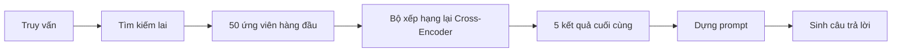
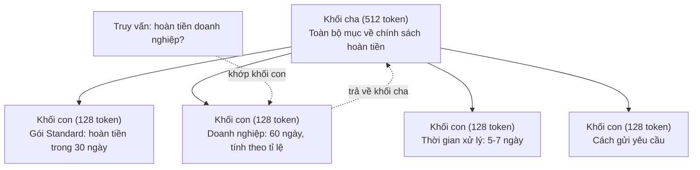
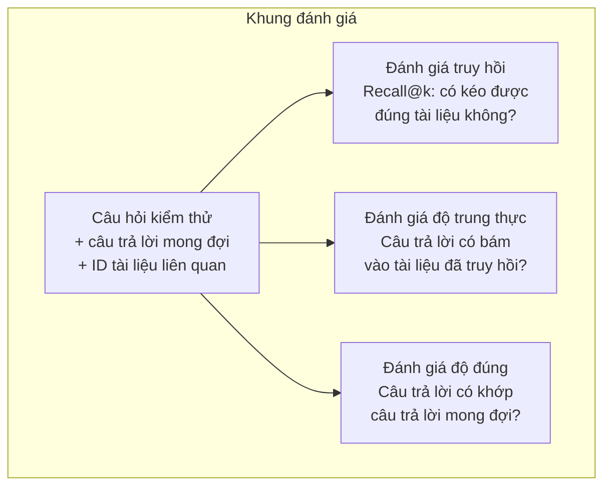

# RAG nâng cao (chunking, reranking, hybrid search)

> RAG cơ bản truy hồi top-k chunk (khối) giống nhất. Cách đó đủ cho câu hỏi đơn giản. Nó sụp đổ với suy luận nhiều bước, truy vấn mơ hồ và kho tài liệu lớn. RAG nâng cao là khác biệt giữa một demo chạy được trên 10 tài liệu và một hệ thống chạy được trên 10 triệu tài liệu.

**Type:** Build
**Languages:** Python
**Prerequisites:** Giai đoạn 11, Bài 06 (RAG)
**Time:** ~90 phút
**Related:** Giai đoạn 5 · 23 (Chunking Strategies for RAG) bao quát cả sáu thuật toán chunking — recursive, semantic, sentence, parent-document, late chunking, contextual retrieval — kèm benchmark của Vectara/Anthropic. Bài này xây tiếp lên trên: tìm kiếm lai, xếp hạng lại, biến đổi truy vấn.

## Mục tiêu học tập

- Triển khai các chiến lược chunking nâng cao (semantic, recursive, parent-child) giữ được cấu trúc và ngữ cảnh của tài liệu
- Xây pipeline hybrid search (tìm kiếm lai) kết hợp khớp từ khoá BM25 với tìm kiếm vector ngữ nghĩa và một reranker (bộ xếp hạng lại) cross-encoder
- Áp dụng các kỹ thuật biến đổi truy vấn (HyDE, multi-query, step-back) để cải thiện truy hồi với câu hỏi mơ hồ hoặc phức tạp
- Chẩn đoán và sửa các lỗi RAG thường gặp: truy hồi sai chunk, câu trả lời không nằm trong ngữ cảnh, suy luận nhiều bước bị đứt

## Vấn đề

Bạn đã dựng một pipeline RAG cơ bản ở Bài 06. Nó chạy tốt với câu hỏi đơn giản trên kho tài liệu nhỏ. Giờ thử mấy trường hợp sau:

**Truy vấn mơ hồ**: "Doanh thu quý trước là bao nhiêu?" Tìm kiếm ngữ nghĩa trả về các chunk nói về chiến lược doanh thu, dự báo doanh thu, và suy nghĩ của CFO về tăng trưởng doanh thu. Tất cả đều tương đồng ngữ nghĩa với từ "revenue". Không chunk nào chứa con số thật. Chunk đúng ghi "$47.2M in Q3 2025" nhưng dùng từ "earnings" thay vì "revenue". Mô hình embedding nghĩ "revenue strategy" gần truy vấn hơn "Q3 earnings were $47.2M."

**Câu hỏi nhiều bước**: "Đội nào có mức cải thiện điểm hài lòng khách hàng cao nhất?" Việc này đòi hỏi tìm điểm hài lòng của từng đội, so sánh chúng rồi xác định giá trị lớn nhất. Không chunk đơn lẻ nào chứa câu trả lời. Thông tin nằm rải rác trong báo cáo của từng đội.

**Vấn đề kho tài liệu lớn**: Bạn có 2 triệu chunk. Câu trả lời đúng nằm ở chunk #1,847,293. Truy hồi top-5 của bạn kéo ra chunk #14, #89,201, #1,200,000, #44 và #901,333. Gần nhau trong không gian embedding, nhưng không cái nào chứa câu trả lời. Ở quy mô này, tìm kiếm láng giềng gần đúng (approximate nearest neighbor) đưa vào đủ sai số để các kết quả liên quan bị đẩy ra khỏi top-k.

RAG cơ bản thất bại vì tương đồng vector không đồng nghĩa với tính liên quan. Một chunk có thể tương đồng ngữ nghĩa với truy vấn mà vẫn vô ích để trả lời. RAG nâng cao xử lý việc này bằng bốn kỹ thuật: tìm kiếm lai (thêm khớp từ khoá), xếp hạng lại (chấm điểm ứng viên kỹ hơn), biến đổi truy vấn (sửa truy vấn trước khi tìm kiếm), và chunking tốt hơn (truy hồi ở đúng độ chi tiết).

## Khái niệm

### Tìm kiếm lai: ngữ nghĩa + từ khoá

Tìm kiếm ngữ nghĩa (tương đồng vector) giỏi hiểu ý nghĩa. "Làm sao huỷ gói đăng ký của tôi?" khớp với "Steps to terminate your plan" dù hai câu không chung từ nào. Nhưng nó bỏ sót các khớp chính xác. "Error code E-4021" có thể không khớp một chunk chứa "E-4021" nếu mô hình embedding coi đó là nhiễu.

Tìm kiếm từ khoá (BM25) thì ngược lại. Nó xuất sắc ở khớp chính xác. "E-4021" khớp hoàn hảo. Nhưng "cancel my subscription" trả về 0 kết quả nếu tài liệu ghi "terminate your plan."

Tìm kiếm lai chạy cả hai, rồi hợp kết quả lại.

**BM25** (Best Matching 25) là thuật toán tìm kiếm từ khoá tiêu chuẩn. Nó là xương sống của các search engine từ thập niên 1990. Công thức:

```
BM25(q, d) = sum over terms t in q:
    IDF(t) * (tf(t,d) * (k1 + 1)) / (tf(t,d) + k1 * (1 - b + b * |d| / avgdl))
```

Trong đó tf(t,d) là tần suất của t trong tài liệu d, IDF(t) là nghịch đảo tần suất tài liệu, |d| là độ dài tài liệu, avgdl là độ dài tài liệu trung bình, k1 điều khiển độ bão hoà tần suất từ (mặc định 1.2), và b điều khiển chuẩn hoá độ dài (mặc định 0.75).

Nói đơn giản: BM25 chấm điểm tài liệu cao hơn khi chúng chứa từ của truy vấn (nhất là từ hiếm), nhưng lợi ích giảm dần với từ lặp lại. Tài liệu có từ "revenue" 50 lần không liên quan gấp 50 lần tài liệu có nó 1 lần.

### Reciprocal Rank Fusion (RRF)

Bạn có hai danh sách đã xếp hạng: một từ tìm kiếm vector, một từ BM25. Kết hợp chúng thế nào? Reciprocal Rank Fusion (kết hợp thứ hạng nghịch đảo) là cách tiếp cận chuẩn.

```
RRF_score(d) = sum over rankings R:
    1 / (k + rank_R(d))
```

Trong đó k là hằng số (thường là 60) ngăn kết quả hạng nhất lấn át các kết quả khác.

Một tài liệu xếp #1 ở tìm kiếm vector và #5 ở BM25 được: 1/(60+1) + 1/(60+5) = 0.0164 + 0.0154 = 0.0318

Một tài liệu xếp #3 ở tìm kiếm vector và #2 ở BM25 được: 1/(60+3) + 1/(60+2) = 0.0159 + 0.0161 = 0.0320

RRF tự cân bằng hai tín hiệu. Tài liệu xếp hạng cao ở cả hai danh sách được điểm tốt nhất. Tài liệu xếp #1 ở một danh sách nhưng vắng mặt ở danh sách kia chỉ được điểm vừa phải. Cách này bền vì nó dùng thứ hạng chứ không dùng điểm thô, nên khác biệt phân phối điểm giữa hai hệ thống không ảnh hưởng.

### Xếp hạng lại

Truy hồi (dù vector, từ khoá hay lai) thì nhanh nhưng thiếu chính xác. Nó dùng bi-encoder: truy vấn và từng tài liệu được embedding độc lập, rồi so sánh. Embedding được tính một lần và cache lại. Cách này mở rộng tới hàng triệu tài liệu.

Xếp hạng lại dùng cross-encoder: truy vấn và tài liệu ứng viên được đưa cùng nhau vào một mô hình xuất ra điểm liên quan. Mô hình thấy cả hai văn bản cùng lúc và bắt được tương tác chi tiết giữa chúng. Cross-encoder hiểu được "What were Q3 earnings?" rất liên quan tới chunk chứa "$47.2M in Q3" kể cả khi bi-encoder bỏ lỡ liên hệ đó.

Đánh đổi: cross-encoder chậm hơn bi-encoder 100-1000 lần vì chúng xử lý cặp truy vấn-tài liệu cùng lúc. Bạn không thể tính trước điểm cross-encoder cho một triệu tài liệu. Giải pháp: truy hồi tập ứng viên lớn hơn (top-50 từ tìm kiếm lai), rồi xếp hạng lại bằng cross-encoder để lấy top-5 cuối cùng.



Các mô hình xếp hạng lại phổ biến (đội hình 2026):
- Cohere Rerank 3.5: API quản lý, đa ngôn ngữ, mức tăng recall (độ phủ) tốt nhất trên kho tài liệu hỗn hợp
- Voyage rerank-2.5: API quản lý, độ trễ thấp nhất trong các lựa chọn tự host
- Jina-Reranker-v2 Multilingual: trọng số mở, hơn 100 ngôn ngữ
- bge-reranker-v2-m3: trọng số mở, baseline mạnh
- cross-encoder/ms-marco-MiniLM-L-6-v2: trọng số mở, chạy trên CPU để làm thử
- ColBERTv2 / Jina-ColBERT-v2: reranker đa vector tương tác muộn — O(tokens) chứ không phải O(docs) khi chấm điểm

### Biến đổi truy vấn

Đôi khi vấn đề không phải ở truy hồi mà ở chính truy vấn. "Cái vụ thay đổi chính sách mới ấy là gì nhỉ?" là một truy vấn tìm kiếm tồi. Nó không có từ cụ thể nào. Embedding mơ hồ. Không hệ truy hồi nào tìm được tài liệu đúng từ đó.

**Query rewriting** (viết lại truy vấn): diễn đạt lại truy vấn của người dùng thành một truy vấn tìm kiếm tốt hơn. Một LLM làm được việc này:

```
User: "What was that thing about the new policy change?"
Rewritten: "Recent policy changes and updates"
```

**HyDE (Hypothetical Document Embeddings)**: thay vì tìm kiếm bằng truy vấn, hãy sinh một câu trả lời giả định, embedding nó, rồi tìm các tài liệu thật tương tự.

```
Query: "What is the refund policy for enterprise?"
Hypothetical answer: "Enterprise customers are eligible for a full refund
within 60 days of purchase. Refunds are pro-rated based on the remaining
subscription period and processed within 5-7 business days."
```

Embed câu trả lời giả định rồi tìm các tài liệu thật tương tự nó. Trực giác: câu trả lời giả định nằm gần câu trả lời thật trong không gian embedding hơn câu hỏi gốc. Câu hỏi và câu trả lời có cấu trúc ngôn ngữ khác nhau. Bằng cách sinh một câu trả lời giả định, bạn bắc cầu giữa "không gian câu hỏi" và "không gian câu trả lời" trong embedding.

HyDE thêm một lần gọi LLM trước khi truy hồi. Việc này tăng độ trễ 500-2000ms. Đáng làm khi chất lượng truy hồi trên truy vấn thô kém.

### Chunking cha-con

Chunking tiêu chuẩn buộc phải đánh đổi: chunk nhỏ để truy hồi chính xác, chunk lớn để đủ ngữ cảnh. Parent-child chunking (truy hồi cha-con) xoá bỏ đánh đổi này.

Đánh index các chunk nhỏ (128 token) để truy hồi. Khi một chunk nhỏ được truy hồi, trả về chunk cha của nó (512 token) cho prompt. Chunk nhỏ khớp truy vấn chính xác. Chunk cha cung cấp đủ ngữ cảnh để LLM sinh câu trả lời tốt.



Truy vấn "enterprise refund?" khớp chính xác chunk con C2. Nhưng prompt nhận toàn bộ chunk cha P, gồm cả ngữ cảnh xung quanh về thời gian xử lý và quy trình gửi yêu cầu.

### Lọc theo metadata

Trước khi chạy tìm kiếm vector, hãy lọc kho tài liệu theo metadata: ngày, nguồn, danh mục, tác giả, ngôn ngữ. Việc này thu hẹp không gian tìm kiếm và ngăn các kết quả không liên quan.

"Chính sách bảo mật tháng trước thay đổi gì?" chỉ nên tìm trong tài liệu của 30 ngày gần nhất thuộc danh mục bảo mật. Không lọc metadata, bạn tìm khắp kho và có thể kéo ra một tài liệu bảo mật 2 năm trước tình cờ tương đồng ngữ nghĩa.

Hệ RAG production lưu metadata cạnh từng chunk: tài liệu nguồn, ngày tạo, danh mục, tác giả, phiên bản. Các vector database hỗ trợ lọc trước theo metadata trước khi tìm kiếm tương đồng, điều này rất quan trọng cho hiệu năng ở quy mô lớn.

### Đánh giá

Bạn đã dựng một hệ RAG. Làm sao biết nó có chạy không? Ba chỉ số:

**Độ liên quan của truy hồi (Recall@k)**: với một tập câu hỏi kiểm thử đã biết tài liệu liên quan, bao nhiêu phần trăm tài liệu liên quan xuất hiện trong top-k? Nếu câu trả lời nằm ở chunk #47, chunk #47 có xuất hiện trong top-5 không?

**Độ trung thực**: câu trả lời sinh ra có bám vào tài liệu đã truy hồi không? Nếu chunk truy hồi nói "60-day refund window" mà mô hình nói "90-day refund window", đó là lỗi trung thực. Mô hình ảo giác dù đã có ngữ cảnh đúng.

**Độ đúng của câu trả lời**: câu trả lời sinh ra có khớp câu trả lời mong đợi không? Đây là chỉ số đầu-cuối. Nó kết hợp chất lượng truy hồi và chất lượng sinh.

Một kiểm tra trung thực đơn giản: lấy từng khẳng định trong câu trả lời sinh ra và xác minh nó có xuất hiện (về nội dung) trong các chunk đã truy hồi. Nếu câu trả lời chứa một dữ kiện không có trong bất kỳ chunk nào, khả năng cao đó là ảo giác.



```figure
agentic-rag-loop
```

## Tự tay làm

### Bước 1: Triển khai BM25

```python
import math
from collections import Counter

class BM25:
    def __init__(self, k1=1.2, b=0.75):
        self.k1 = k1
        self.b = b
        self.docs = []
        self.doc_lengths = []
        self.avg_dl = 0
        self.doc_freqs = {}
        self.n_docs = 0

    def index(self, documents):
        self.docs = documents
        self.n_docs = len(documents)
        self.doc_lengths = []
        self.doc_freqs = {}

        for doc in documents:
            words = doc.lower().split()
            self.doc_lengths.append(len(words))
            unique_words = set(words)
            for word in unique_words:
                self.doc_freqs[word] = self.doc_freqs.get(word, 0) + 1

        self.avg_dl = sum(self.doc_lengths) / self.n_docs if self.n_docs else 1

    def score(self, query, doc_idx):
        query_words = query.lower().split()
        doc_words = self.docs[doc_idx].lower().split()
        doc_len = self.doc_lengths[doc_idx]
        word_counts = Counter(doc_words)
        score = 0.0

        for term in query_words:
            if term not in word_counts:
                continue
            tf = word_counts[term]
            df = self.doc_freqs.get(term, 0)
            idf = math.log((self.n_docs - df + 0.5) / (df + 0.5) + 1)
            numerator = tf * (self.k1 + 1)
            denominator = tf + self.k1 * (1 - self.b + self.b * doc_len / self.avg_dl)
            score += idf * numerator / denominator

        return score

    def search(self, query, top_k=10):
        scores = [(i, self.score(query, i)) for i in range(self.n_docs)]
        scores.sort(key=lambda x: x[1], reverse=True)
        return scores[:top_k]
```

### Bước 2: Reciprocal Rank Fusion

```python
def reciprocal_rank_fusion(ranked_lists, k=60):
    scores = {}
    for ranked_list in ranked_lists:
        for rank, (doc_id, _) in enumerate(ranked_list):
            if doc_id not in scores:
                scores[doc_id] = 0.0
            scores[doc_id] += 1.0 / (k + rank + 1)
    fused = sorted(scores.items(), key=lambda x: x[1], reverse=True)
    return fused
```

### Bước 3: Pipeline tìm kiếm lai

```python
def hybrid_search(query, chunks, vector_embeddings, vocab, idf, bm25_index, top_k=5, fusion_k=60):
    query_emb = tfidf_embed(query, vocab, idf)
    vector_results = search(query_emb, vector_embeddings, top_k=top_k * 3)
    bm25_results = bm25_index.search(query, top_k=top_k * 3)
    fused = reciprocal_rank_fusion([vector_results, bm25_results], k=fusion_k)
    return fused[:top_k]
```

### Bước 4: Reranker đơn giản

Trong production, bạn sẽ dùng một mô hình cross-encoder. Ở đây ta xây một reranker chấm điểm liên quan truy vấn-tài liệu dựa trên trùng từ, độ quan trọng của từ và khớp cụm.

```python
def rerank(query, candidates, chunks):
    query_words = set(query.lower().split())
    stop_words = {"the", "a", "an", "is", "are", "was", "were", "what", "how",
                  "why", "when", "where", "do", "does", "for", "of", "in", "to",
                  "and", "or", "on", "at", "by", "it", "its", "this", "that",
                  "with", "from", "be", "has", "have", "had", "not", "but"}
    query_terms = query_words - stop_words

    scored = []
    for doc_id, initial_score in candidates:
        chunk = chunks[doc_id].lower()
        chunk_words = set(chunk.split())

        term_overlap = len(query_terms & chunk_words)

        query_bigrams = set()
        q_list = [w for w in query.lower().split() if w not in stop_words]
        for i in range(len(q_list) - 1):
            query_bigrams.add(q_list[i] + " " + q_list[i + 1])
        bigram_matches = sum(1 for bg in query_bigrams if bg in chunk)

        position_boost = 0
        for term in query_terms:
            pos = chunk.find(term)
            if pos != -1 and pos < len(chunk) // 3:
                position_boost += 0.5

        rerank_score = (
            term_overlap * 1.0
            + bigram_matches * 2.0
            + position_boost
            + initial_score * 5.0
        )
        scored.append((doc_id, rerank_score))

    scored.sort(key=lambda x: x[1], reverse=True)
    return scored
```

### Bước 5: HyDE (Hypothetical Document Embeddings)

```python
def hyde_generate_hypothesis(query):
    templates = {
        "what": "The answer to '{query}' is as follows: Based on our documentation, {topic} involves specific policies and procedures that define how the process works.",
        "how": "To address '{query}': The process involves several steps. First, you need to initiate the request. Then, the system processes it according to the defined rules.",
        "default": "Regarding '{query}': Our records indicate specific details and policies related to this topic that provide a comprehensive answer."
    }
    query_lower = query.lower()
    if query_lower.startswith("what"):
        template = templates["what"]
    elif query_lower.startswith("how"):
        template = templates["how"]
    else:
        template = templates["default"]

    topic_words = [w for w in query.lower().split()
                   if w not in {"what", "is", "the", "how", "do", "does", "a", "an",
                                "for", "of", "to", "in", "on", "at", "by", "and", "or"}]
    topic = " ".join(topic_words) if topic_words else "this topic"

    return template.format(query=query, topic=topic)


def hyde_search(query, chunks, vector_embeddings, vocab, idf, top_k=5):
    hypothesis = hyde_generate_hypothesis(query)
    hypothesis_emb = tfidf_embed(hypothesis, vocab, idf)
    results = search(hypothesis_emb, vector_embeddings, top_k)
    return results, hypothesis
```

### Bước 6: Chunking cha-con

```python
def create_parent_child_chunks(text, parent_size=200, child_size=50):
    words = text.split()
    parents = []
    children = []
    child_to_parent = {}

    parent_idx = 0
    start = 0
    while start < len(words):
        parent_end = min(start + parent_size, len(words))
        parent_text = " ".join(words[start:parent_end])
        parents.append(parent_text)

        child_start = start
        while child_start < parent_end:
            child_end = min(child_start + child_size, parent_end)
            child_text = " ".join(words[child_start:child_end])
            child_idx = len(children)
            children.append(child_text)
            child_to_parent[child_idx] = parent_idx
            child_start += child_size

        parent_idx += 1
        start += parent_size

    return parents, children, child_to_parent
```

### Bước 7: Đánh giá độ trung thực

```python
def evaluate_faithfulness(answer, retrieved_chunks):
    answer_sentences = [s.strip() for s in answer.split(".") if len(s.strip()) > 10]
    if not answer_sentences:
        return 1.0, []

    grounded = 0
    ungrounded = []
    context = " ".join(retrieved_chunks).lower()

    for sentence in answer_sentences:
        words = set(sentence.lower().split())
        stop_words = {"the", "a", "an", "is", "are", "was", "were", "and", "or",
                      "to", "of", "in", "for", "on", "at", "by", "it", "this", "that"}
        content_words = words - stop_words
        if not content_words:
            grounded += 1
            continue

        matched = sum(1 for w in content_words if w in context)
        ratio = matched / len(content_words) if content_words else 0

        if ratio >= 0.5:
            grounded += 1
        else:
            ungrounded.append(sentence)

    score = grounded / len(answer_sentences) if answer_sentences else 1.0
    return score, ungrounded


def evaluate_retrieval_recall(queries_with_relevant, retrieval_fn, k=5):
    total_recall = 0.0
    results = []

    for query, relevant_indices in queries_with_relevant:
        retrieved = retrieval_fn(query, k)
        retrieved_indices = set(idx for idx, _ in retrieved)
        relevant_set = set(relevant_indices)
        hits = len(retrieved_indices & relevant_set)
        recall = hits / len(relevant_set) if relevant_set else 1.0
        total_recall += recall
        results.append({
            "query": query,
            "recall": recall,
            "hits": hits,
            "total_relevant": len(relevant_set)
        })

    avg_recall = total_recall / len(queries_with_relevant) if queries_with_relevant else 0
    return avg_recall, results
```

## Áp dụng

Với một cross-encoder thật để xếp hạng lại:

```python
from sentence_transformers import CrossEncoder

reranker = CrossEncoder("cross-encoder/ms-marco-MiniLM-L-6-v2")

def rerank_with_cross_encoder(query, candidates, chunks, top_k=5):
    pairs = [(query, chunks[doc_id]) for doc_id, _ in candidates]
    scores = reranker.predict(pairs)
    scored = list(zip([doc_id for doc_id, _ in candidates], scores))
    scored.sort(key=lambda x: x[1], reverse=True)
    return scored[:top_k]
```

Với reranker API quản lý của Cohere:

```python
import cohere

co = cohere.Client()

def rerank_with_cohere(query, candidates, chunks, top_k=5):
    docs = [chunks[doc_id] for doc_id, _ in candidates]
    response = co.rerank(
        model="rerank-english-v3.0",
        query=query,
        documents=docs,
        top_n=top_k
    )
    return [(candidates[r.index][0], r.relevance_score) for r in response.results]
```

Với HyDE dùng một LLM thật:

```python
import anthropic

client = anthropic.Anthropic()

def hyde_with_llm(query):
    response = client.messages.create(
        model="claude-sonnet-5",
        max_tokens=256,
        messages=[{
            "role": "user",
            "content": f"Write a short paragraph that would be a good answer to this question. Do not say you don't know. Just write what the answer would look like.\n\nQuestion: {query}"
        }]
    )
    return response.content[0].text
```

Với tìm kiếm lai production dùng Weaviate:

```python
import weaviate

client = weaviate.connect_to_local()

collection = client.collections.get("Documents")
response = collection.query.hybrid(
    query="enterprise refund policy",
    alpha=0.5,
    limit=10
)
```

Tham số alpha điều khiển cân bằng: 0.0 = thuần từ khoá (BM25), 1.0 = thuần vector, 0.5 = trọng số bằng nhau. Hầu hết hệ production dùng alpha trong khoảng 0.3 đến 0.7.

## Đóng gói

Bài này tạo ra:
- `outputs/prompt-advanced-rag-debugger.md` -- một prompt để chẩn đoán và sửa các vấn đề chất lượng RAG
- `outputs/skill-advanced-rag.md` -- một skill để xây RAG cấp production với tìm kiếm lai và xếp hạng lại

## Bài tập

1. So sánh BM25 với tìm kiếm vector và tìm kiếm lai trên các tài liệu mẫu. Với mỗi câu trong 5 truy vấn kiểm thử, ghi lại cách tiếp cận nào trả về chunk liên quan nhất ở vị trí #1. Tìm kiếm lai nên thắng ít nhất 3 trên 5.

2. Triển khai một bộ lọc metadata. Thêm trường "category" cho mỗi tài liệu (security, billing, api, product). Trước khi chạy tìm kiếm vector, lọc chunk chỉ còn danh mục liên quan. Kiểm thử với "What encryption is used?" và xác minh nó chỉ tìm trong các chunk thuộc danh mục security.

3. Xây một pipeline HyDE đầy đủ dùng hàm sinh đơn giản từ Bài 06. So sánh chất lượng truy hồi (độ liên quan top-3) giữa tìm trực tiếp bằng truy vấn và tìm bằng HyDE trên cả 5 truy vấn kiểm thử. HyDE nên cải thiện kết quả với các truy vấn mơ hồ.

4. Triển khai chiến lược chunking cha-con trên các tài liệu mẫu. Dùng child_size=30 và parent_size=100. Tìm bằng chunk con nhưng trả chunk cha vào prompt. So sánh câu trả lời sinh ra với chunking tiêu chuẩn dùng chunk_size=50.

5. Tạo một tập dữ liệu đánh giá: 10 câu hỏi kèm chunk chứa đáp án đã biết. Đo Recall@3, Recall@5 và Recall@10 cho (a) chỉ tìm kiếm vector, (b) chỉ BM25, (c) tìm kiếm lai, (d) lai + xếp hạng lại. Vẽ kết quả và xác định nơi xếp hạng lại giúp nhiều nhất.

## Thuật ngữ chính

| Thuật ngữ | Người ta thường nói | Ý nghĩa thực sự |
|------|----------------|----------------------|
| BM25 | "Tìm kiếm từ khoá" | Thuật toán xếp hạng xác suất chấm điểm tài liệu theo tần suất từ, nghịch đảo tần suất tài liệu và chuẩn hoá độ dài tài liệu |
| Hybrid search | "Tốt nhất của cả hai thế giới" | Chạy song song tìm kiếm ngữ nghĩa (vector) và tìm kiếm từ khoá (BM25), rồi hợp kết quả bằng fusion theo thứ hạng |
| Reciprocal Rank Fusion | "Hợp các danh sách đã xếp hạng" | Kết hợp nhiều danh sách đã xếp hạng bằng cách cộng 1/(k + rank) cho mỗi tài liệu trên tất cả danh sách |
| Reranking | "Chấm điểm lượt hai" | Dùng một mô hình cross-encoder đắt hơn để chấm lại điểm tập ứng viên từ truy hồi ban đầu |
| Cross-encoder | "Mô hình truy vấn-tài liệu chung" | Mô hình nhận truy vấn và tài liệu như một đầu vào duy nhất, xuất ra điểm liên quan; chính xác hơn bi-encoder nhưng quá chậm để tìm khắp kho |
| Bi-encoder | "Mô hình embedding độc lập" | Mô hình embedding truy vấn và tài liệu độc lập; nhanh vì embedding được tính trước, nhưng kém chính xác hơn cross-encoder |
| HyDE | "Tìm bằng một đáp án giả" | Sinh một câu trả lời giả định cho truy vấn, embedding nó, rồi tìm các tài liệu thật tương tự |
| Parent-child chunking | "Tìm nhỏ, ngữ cảnh lớn" | Đánh index chunk nhỏ để truy hồi chính xác nhưng trả chunk cha lớn hơn để có đủ ngữ cảnh |
| Metadata filtering | "Thu hẹp trước khi tìm" | Lọc tài liệu theo thuộc tính (ngày, nguồn, danh mục) trước khi chạy tìm kiếm vector để giảm không gian tìm kiếm |
| Faithfulness | "Có bám nguồn không" | Câu trả lời sinh ra có được tài liệu đã truy hồi hỗ trợ hay không, thay vì bịa ra từ dữ liệu huấn luyện của mô hình |

## Đọc thêm

- Robertson & Zaragoza, "The Probabilistic Relevance Framework: BM25 and Beyond" (2009) -- tài liệu tham chiếu dứt khoát về BM25, giải thích nền tảng xác suất phía sau công thức
- Cormack et al., "Reciprocal Rank Fusion Outperforms Condorcet and Individual Rank Learning Methods" (2009) -- bài báo gốc về RRF, cho thấy nó vượt các phương pháp hợp phức tạp hơn
- Gao et al., "Precise Zero-Shot Dense Retrieval without Relevance Labels" (2022) -- bài báo HyDE chứng minh rằng embedding tài liệu giả định cải thiện truy hồi mà không cần dữ liệu huấn luyện
- Nogueira & Cho, "Passage Re-ranking with BERT" (2019) -- cho thấy xếp hạng lại bằng cross-encoder trên BM25 cải thiện đáng kể chất lượng truy hồi
- [Khattab et al., "DSPy: Compiling Declarative Language Model Calls into Self-Improving Pipelines" (2023)](https://arxiv.org/abs/2310.03714) -- coi việc dựng prompt và chọn trọng số như một bài toán tối ưu trên pipeline truy hồi; đọc bài này để hiểu "lập trình LLM" thay vì "prompt LLM."
- [Edge et al., "From Local to Global: A Graph RAG Approach to Query-Focused Summarization" (Microsoft Research 2024)](https://arxiv.org/abs/2404.16130) -- bài báo GraphRAG: trích xuất thực thể-quan hệ + phát hiện cộng đồng Leiden cho tóm tắt theo truy vấn; phân biệt truy hồi toàn cục và cục bộ.
- [Asai et al., "Self-RAG: Learning to Retrieve, Generate, and Critique through Self-Reflection" (ICLR 2024)](https://arxiv.org/abs/2310.11511) -- RAG tự đánh giá với reflection token; biên giới agentic vượt qua mô hình truy hồi-rồi-sinh tĩnh.
- [LangChain Query Construction blog](https://blog.langchain.dev/query-construction/) -- cách chuyển truy vấn ngôn ngữ tự nhiên thành truy vấn database có cấu trúc (Text-to-SQL, Cypher) như một bước trước truy hồi.

---

[← Bài trước: RAG (Retrieval-Augmented Generation)](../../06-rag/docs/vi.md) · [Bài sau: Tinh chỉnh với LoRA & QLoRA →](../../08-fine-tuning-lora/docs/vi.md)
