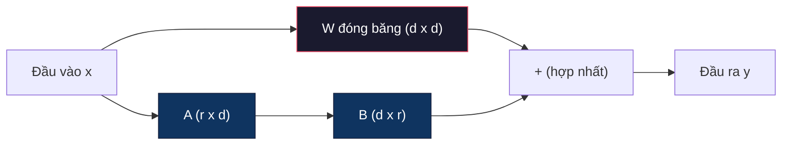
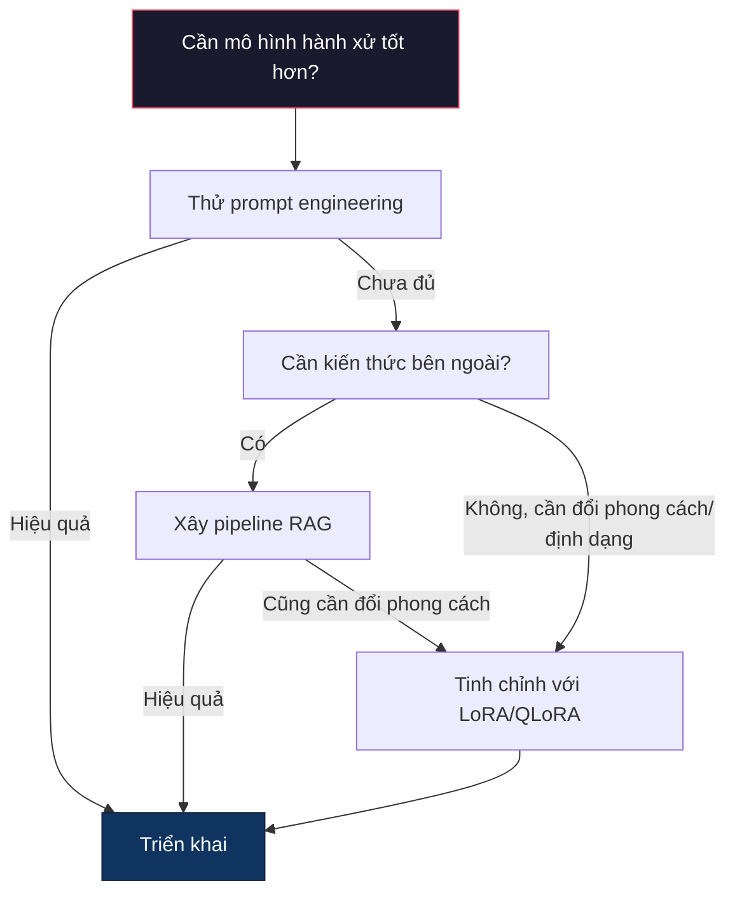

# Tinh chỉnh với LoRA & QLoRA

> Tinh chỉnh (fine-tuning) toàn phần một mô hình 7B cần 56GB VRAM. Bạn không có ngần ấy. Hầu hết công ty cũng vậy. LoRA cho phép bạn tinh chỉnh cùng mô hình đó trong 6GB bằng cách huấn luyện chưa tới 1% tham số. Đây không phải là một thoả hiệp -- nó đạt chất lượng ngang tinh chỉnh toàn phần trên hầu hết tác vụ. Toàn bộ hệ sinh thái tinh chỉnh mã nguồn mở vận hành trên đúng một mẹo này.

**Type:** Build
**Languages:** Python
**Prerequisites:** Giai đoạn 10, Bài 06 (Tinh chỉnh theo chỉ dẫn / SFT)
**Time:** ~75 phút
**Related:** Giai đoạn 10 đi qua các vòng lặp SFT/DPO từ đầu. Bài này nối chúng vào bộ công cụ PEFT của năm 2026 (PEFT, TRL, Unsloth, Axolotl, LLaMA-Factory).

## Mục tiêu học tập

- Triển khai LoRA (low-rank adaptation, tức thích ứng hạng thấp) bằng cách tiêm các ma trận adapter (bộ thích ứng) hạng thấp A và B vào các tầng attention của một mô hình đã huấn luyện trước
- Tính mức tiết kiệm tham số của LoRA so với tinh chỉnh toàn phần: với hạng (rank) r và số chiều d_model, bạn huấn luyện 2*r*d tham số thay vì d^2
- Tinh chỉnh một mô hình bằng QLoRA -- lượng tử hoá (quantization) nền xuống 4-bit cộng adapter LoRA -- để vừa với bộ nhớ GPU phổ thông
- Hợp nhất trọng số (merge weights) LoRA trở lại mô hình nền để triển khai và so sánh tốc độ suy luận khi có và không có adapter

## Vấn đề

Bạn có một mô hình nền. Llama 3 8B. Bạn muốn nó trả lời phiếu hỗ trợ khách hàng theo giọng của công ty bạn. SFT là câu trả lời. Nhưng SFT có vấn đề về chi phí.

Tinh chỉnh toàn phần cập nhật mọi tham số trong mô hình. Llama 3 8B có 8 tỉ tham số. Ở fp16, mỗi tham số chiếm 2 byte. Chỉ để nạp trọng số đã là 16GB. Khi huấn luyện, bạn còn cần gradient (16GB), trạng thái optimizer cho Adam (32GB cho momentum + variance), và activation. Tổng cộng: khoảng 56GB VRAM cho một mô hình 8B duy nhất.

Một chiếc A100 80GB vừa đủ chứa. Hai A100 tốn $3-4/giờ trên các nhà cung cấp cloud. Huấn luyện 3 epoch trên 50,000 mẫu mất 6-10 giờ. Tức $30-40 mỗi thí nghiệm. Chạy 10 thí nghiệm để chỉnh hyperparameter (siêu tham số) cho đúng và bạn đã tiêu $400 trước khi triển khai bất cứ thứ gì.

Nhân lên với Llama 3 70B và các con số trở nên vô lý. Riêng trọng số đã 140GB. Bạn cần cả một cluster. $100+ mỗi thí nghiệm.

Còn một vấn đề sâu hơn. Tinh chỉnh toàn phần sửa mọi trọng số trong mô hình. Nếu bạn tinh chỉnh trên dữ liệu hỗ trợ khách hàng, bạn có thể làm suy giảm năng lực tổng quát của mô hình. Người ta gọi đó là quên thảm khốc (catastrophic forgetting). Mô hình giỏi hơn ở tác vụ của bạn và tệ đi ở mọi thứ khác.

Bạn cần một phương pháp huấn luyện ít tham số hơn, dùng ít bộ nhớ hơn, và không phá huỷ kiến thức sẵn có của mô hình.

## Khái niệm

### LoRA: Low-Rank Adaptation

Edward Hu và các đồng nghiệp tại Microsoft công bố LoRA vào tháng 6 năm 2021. Nhận định của bài báo: các cập nhật trọng số trong quá trình tinh chỉnh có hạng nội tại thấp. Bạn không cần cập nhật cả 16.7 triệu tham số trong một ma trận trọng số 4096x4096. Phần thông tin hữu ích trong cập nhật có thể được gói trong một ma trận hạng 16 hoặc 32.

Đây là phần toán. Một tầng tuyến tính chuẩn tính:

```
y = Wx
```

Trong đó W là một ma trận d_out x d_in. Với một phép chiếu attention 4096x4096, đó là 16,777,216 tham số.

LoRA đóng băng W và thêm một phân rã hạng thấp:

```
y = Wx + BAx
```

Trong đó B là (d_out x r) và A là (r x d_in). Hạng r nhỏ hơn d nhiều -- thường là 8, 16, hoặc 32.

Với r=16 trên một tầng 4096x4096:
- Tham số gốc: 4096 x 4096 = 16,777,216
- Tham số LoRA: (4096 x 16) + (16 x 4096) = 65,536 + 65,536 = 131,072
- Mức giảm: 131,072 / 16,777,216 = 0.78%

Bạn đang huấn luyện 0.78% tham số và nhận được 95-100% chất lượng.



A được khởi tạo bằng Gaussian ngẫu nhiên. B được khởi tạo bằng 0. Nghĩa là đóng góp của LoRA bắt đầu từ 0 -- mô hình khởi đầu với hành vi gốc và dần học phần thích ứng.

### Hệ số tỉ lệ: Alpha

LoRA đưa vào một hệ số tỉ lệ alpha điều khiển mức ảnh hưởng của cập nhật hạng thấp lên đầu ra:

```
y = Wx + (alpha / r) * BAx
```

Khi alpha = r, hệ số tỉ lệ là 1x. Khi alpha = 2r (giá trị mặc định phổ biến), hệ số là 2x. Siêu tham số này điều khiển tốc độ học của nhánh LoRA độc lập với tốc độ học của phần nền.

Hướng dẫn thực dụng:
- alpha = 2 * rank là quy ước phổ biến trong cộng đồng (bài báo gốc dùng alpha = rank trong hầu hết thí nghiệm)
- alpha = rank cho hệ số 1x, thận trọng nhưng ổn định
- alpha cao hơn nghĩa là cập nhật lớn hơn mỗi bước, có thể tăng tốc hội tụ hoặc gây bất ổn định

### Đặt LoRA ở đâu

Một transformer có nhiều tầng tuyến tính. Bạn không cần thêm LoRA vào tất cả. Bài báo gốc đã thử nhiều tổ hợp:

| Tầng mục tiêu | Tham số huấn luyện (7B) | Chất lượng |
|--------------|----------------------|---------|
| chỉ q_proj | 4.7M | Tốt |
| q_proj + v_proj | 9.4M | Tốt hơn |
| q_proj + k_proj + v_proj + o_proj | 18.9M | Tốt nhất cho attention |
| Toàn bộ tuyến tính (attention + MLP) | 37.7M | Lợi ích biên, gấp đôi tham số |

Điểm ngọt cho hầu hết tác vụ: q_proj + v_proj. Cách này nhắm vào phép chiếu query và value trong self-attention, vốn điều khiển việc mô hình chú ý tới gì và trích xuất thông tin gì. Thêm các tầng MLP hữu ích cho tác vụ phức tạp như sinh mã nhưng làm gấp đôi số tham số để đổi lấy lợi ích giảm dần trên các tác vụ đơn giản.

### Chọn hạng

Hạng r điều khiển mức biểu đạt của phần thích ứng:

| Hạng | Tham số huấn luyện (mỗi tầng) | Phù hợp nhất cho |
|------|---------------------------|----------|
| 4 | 32,768 | Phân loại đơn giản, cảm xúc |
| 8 | 65,536 | Hỏi đáp một miền, tóm tắt |
| 16 | 131,072 | Tác vụ đa miền, tuân theo chỉ dẫn |
| 32 | 262,144 | Suy luận phức tạp, sinh mã |
| 64 | 524,288 | Lợi ích giảm dần với hầu hết tác vụ |
| 128 | 1,048,576 | Hiếm khi đáng |

Hu et al. chỉ ra rằng r=4 đã nắm được phần lớn thích ứng cho các tác vụ đơn giản. r=8 và r=16 là lựa chọn phổ biến nhất trong thực tế. Vượt quá r=64 hiếm khi cải thiện chất lượng và bắt đầu làm mất lợi thế bộ nhớ của LoRA.

### QLoRA: Lượng tử hoá 4-bit + LoRA

Tim Dettmers và các đồng nghiệp tại Đại học Washington công bố QLoRA vào tháng 5 năm 2023. Ý tưởng: lượng tử hoá mô hình nền đã đóng băng xuống độ chính xác 4-bit, rồi gắn các adapter LoRA ở fp16 lên trên.

Điều này thay đổi phương trình bộ nhớ một cách ấn tượng:

| Phương pháp | Bộ nhớ trọng số (7B) | Bộ nhớ huấn luyện (7B) | GPU cần |
|--------|-------------------|---------------------|-------------|
| Tinh chỉnh toàn phần (fp16) | 14GB | ~56GB | 1x A100 80GB |
| LoRA (nền fp16) | 14GB | ~18GB | 1x A100 40GB |
| QLoRA (nền 4-bit) | 3.5GB | ~6GB | 1x RTX 3090 24GB |

QLoRA đóng góp ba điểm kỹ thuật:

**NF4 (Normal Float 4-bit)**: Một kiểu dữ liệu mới được thiết kế riêng cho trọng số mạng nơ-ron. Trọng số mạng nơ-ron tuân theo phân phối gần chuẩn. NF4 đặt 16 mức lượng tử hoá của nó tại các phân vị của một phân phối chuẩn tắc. Đây là tối ưu theo lý thuyết thông tin cho dữ liệu có phân phối chuẩn. Nó mất ít thông tin hơn lượng tử hoá 4-bit đều (INT4) hoặc Float4 chuẩn.

**Lượng tử hoá kép**: Bản thân các hằng số lượng tử hoá cũng chiếm bộ nhớ. Mỗi khối 64 trọng số cần một scale factor fp32 (4 byte). Với mô hình 7B, đó là thêm 0.4GB. Lượng tử hoá kép lượng tử hoá các hằng số này xuống fp8, giảm chi phí phụ xuống 0.1GB. Nhỏ nhưng cộng dồn lại thì đáng kể.

**Paged optimizers**: Trong huấn luyện, trạng thái optimizer (momentum và variance của Adam) có thể vượt quá bộ nhớ GPU trên các chuỗi dài. Paged optimizer dùng bộ nhớ hợp nhất của NVIDIA để tự động đẩy trạng thái optimizer sang RAM CPU khi bộ nhớ GPU cạn, và nạp lại khi cần. Cách này ngăn crash OOM với cái giá là một phần thông lượng.

### Câu hỏi về chất lượng

Giảm tham số hay lượng tử hoá mô hình nền có làm hại chất lượng không? Kết quả từ nhiều bài báo:

| Phương pháp | MMLU (5-shot) | MT-Bench | HumanEval |
|--------|--------------|----------|-----------|
| Tinh chỉnh toàn phần (Llama 2 7B) | 48.3 | 6.72 | 14.6 |
| LoRA r=16 | 47.9 | 6.68 | 14.0 |
| QLoRA r=16 (NF4) | 47.5 | 6.61 | 13.4 |
| QLoRA r=64 (NF4) | 48.1 | 6.70 | 14.2 |

LoRA ở r=16 nằm trong khoảng 1% so với tinh chỉnh toàn phần trên hầu hết benchmark. QLoRA ở r=16 mất thêm một phần nhỏ của phần trăm. QLoRA ở r=64 gần như ngang tinh chỉnh toàn phần mà chỉ dùng ít hơn 90% bộ nhớ.

### Chi phí thực tế

Tinh chỉnh Llama 3 8B trên 50,000 mẫu (3 epoch):

| Phương pháp | GPU | Thời gian | Chi phí |
|--------|-----|------|------|
| Tinh chỉnh toàn phần | 2x A100 80GB | 8 giờ | ~$32 |
| LoRA r=16 | 1x A100 40GB | 4 giờ | ~$8 |
| QLoRA r=16 | 1x RTX 4090 24GB | 6 giờ | ~$5 |
| QLoRA r=16 (Unsloth) | 1x RTX 4090 24GB | 2.5 giờ | ~$2 |
| QLoRA r=16 | 1x T4 16GB | 12 giờ | ~$4 |

QLoRA trên một GPU phổ thông rẻ hơn một bữa trưa. Đó là lý do cộng đồng tinh chỉnh mô hình mở bùng nổ năm 2023 và lý do mọi framework huấn luyện dưới đây đều mặc định có QLoRA vào năm 2026.

### Bộ công cụ PEFT năm 2026

| Framework | Nó là gì | Chọn khi |
|-----------|-----------|-----------|
| **Hugging Face PEFT** | Thư viện chuẩn cho LoRA/QLoRA/DoRA/IA3 | Bạn muốn kiểm soát thô và vòng huấn luyện đã chạy trên `transformers.Trainer` |
| **TRL** | Bộ trainer học tăng cường từ phản hồi của HF (SFT, DPO, GRPO, PPO, ORPO) | Bạn cần DPO/GRPO sau SFT; xây trên nền PEFT |
| **Unsloth** | Viết lại lượt forward/backward bằng kernel Triton | Bạn muốn nhanh gấp 2-5 lần và nửa VRAM mà không mất độ chính xác; dòng Llama/Mistral/Qwen |
| **Axolotl** | Lớp bọc cấu hình YAML trên PEFT + TRL + DeepSpeed + Unsloth | Bạn muốn các lần huấn luyện tái lập được và có quản lý phiên bản |
| **LLaMA-Factory** | GUI/CLI/API trên PEFT + TRL | Bạn muốn tinh chỉnh không cần viết mã; hỗ trợ hơn 100 họ mô hình |
| **torchtune** | Công thức PyTorch gốc, không phụ thuộc `transformers` | Bạn muốn tối thiểu phụ thuộc và tổ chức đã chuẩn hoá trên PyTorch |

Quy tắc ngón tay cái: nghiên cứu hoặc thí nghiệm một lần → PEFT. Pipeline sản xuất lặp lại → Axolotl với kernel Unsloth bật. Prototype dùng một lần → LLaMA-Factory.

### Hợp nhất adapter

Sau khi huấn luyện, bạn có hai thứ: mô hình nền đã đóng băng và một adapter LoRA nhỏ (thường 10-100MB). Bạn có thể:

1. **Giữ riêng**: Nạp mô hình nền, nạp adapter lên trên. Đổi adapter cho các tác vụ khác nhau. Đây là cách bạn phục vụ nhiều biến thể đã tinh chỉnh từ một mô hình nền.

2. **Hợp nhất vĩnh viễn**: Tính W' = W + (alpha/r) * BA và lưu kết quả thành một mô hình đầy đủ mới. Mô hình đã hợp nhất có cùng kích thước với bản gốc. Không chi phí suy luận. Không cần quản lý adapter.

Để phục vụ nhiều tác vụ (adapter hỗ trợ khách hàng, adapter mã, adapter dịch), hãy giữ riêng. Để triển khai một mô hình chuyên biệt duy nhất, hãy hợp nhất.

Kỹ thuật hợp nhất nâng cao để kết hợp nhiều adapter:

- **TIES-Merging** (Yadav et al. 2023): Cắt bớt các tham số biên độ nhỏ, xử lý xung đột dấu, rồi hợp nhất. Giảm nhiễu giữa các adapter.
- **DARE** (Yu et al. 2023): Bỏ ngẫu nhiên tham số adapter trước khi hợp nhất và tái tỉ lệ phần còn lại. Hiệu quả bất ngờ trong việc kết hợp năng lực.
- **Task arithmetic**: Chỉ cần cộng hoặc trừ trọng số adapter. Cộng một adapter "mã" và một adapter "toán" thường cho ra mô hình giỏi cả hai.

### Khi nào KHÔNG nên tinh chỉnh

Tinh chỉnh là lựa chọn thứ ba, không phải đầu tiên.

**Đầu tiên: prompt engineering.** Viết một system prompt tốt hơn. Thêm ví dụ few-shot. Dùng chain-of-thought. Việc này không tốn gì và mất vài phút. Nếu prompt đã đưa bạn tới 80% chặng đường, có lẽ bạn không cần tinh chỉnh.

**Thứ hai: RAG.** Nếu mô hình cần biết về dữ liệu riêng của bạn (tài liệu, knowledge base, danh mục sản phẩm), truy xuất rẻ hơn và dễ bảo trì hơn là nướng nó vào trọng số. Xem Bài 06.

**Thứ ba: tinh chỉnh.** Dùng khi bạn cần mô hình theo một phong cách, định dạng, hoặc mẫu suy luận cụ thể mà prompt không làm được. Khi bạn cần đầu ra có cấu trúc nhất quán. Khi bạn cần chưng cất một mô hình lớn vào một mô hình nhỏ hơn. Khi độ trễ quan trọng và bạn không đủ ngân sách cho số token thêm của few-shot prompting.



```figure
lora-params
```

## Tự tay làm

Chúng ta triển khai LoRA từ số 0 bằng PyTorch thuần. Không thư viện. Không phép thuật. Bạn sẽ xây tầng LoRA, tiêm nó vào mô hình, huấn luyện, và hợp nhất trọng số trở lại.

### Bước 1: Tầng LoRA

```python
import torch
import torch.nn as nn
import math

class LoRALayer(nn.Module):
    def __init__(self, in_features, out_features, rank=8, alpha=16):
        super().__init__()
        self.rank = rank
        self.alpha = alpha
        self.scaling = alpha / rank

        self.A = nn.Parameter(torch.randn(in_features, rank) * (1 / math.sqrt(rank)))
        self.B = nn.Parameter(torch.zeros(rank, out_features))

    def forward(self, x):
        return (x @ self.A @ self.B) * self.scaling
```

A được khởi tạo bằng các giá trị ngẫu nhiên có tỉ lệ. B được khởi tạo bằng 0. Tích BA bắt đầu từ 0, nên mô hình khởi đầu với hành vi gốc.

### Bước 2: Tầng tuyến tính bọc LoRA

```python
class LinearWithLoRA(nn.Module):
    def __init__(self, linear, rank=8, alpha=16):
        super().__init__()
        self.linear = linear
        self.lora = LoRALayer(
            linear.in_features, linear.out_features, rank, alpha
        )

        for param in self.linear.parameters():
            param.requires_grad = False

    def forward(self, x):
        return self.linear(x) + self.lora(x)
```

Tầng tuyến tính gốc bị đóng băng. Chỉ các tham số LoRA (A và B) là được huấn luyện.

### Bước 3: Tiêm LoRA vào mô hình

```python
def inject_lora(model, target_modules, rank=8, alpha=16):
    for param in model.parameters():
        param.requires_grad = False

    lora_layers = {}
    for name, module in model.named_modules():
        if isinstance(module, nn.Linear):
            if any(t in name for t in target_modules):
                parent_name = ".".join(name.split(".")[:-1])
                child_name = name.split(".")[-1]
                parent = dict(model.named_modules())[parent_name]
                lora_linear = LinearWithLoRA(module, rank, alpha)
                setattr(parent, child_name, lora_linear)
                lora_layers[name] = lora_linear
    return lora_layers
```

Đầu tiên, đóng băng mọi tham số trong mô hình. Sau đó duyệt cây mô hình, tìm các tầng tuyến tính khớp tên mục tiêu, và thay chúng bằng phiên bản bọc LoRA. Ma trận A và B của LoRA là những tham số duy nhất được huấn luyện trong toàn bộ mô hình.

### Bước 4: Đếm tham số

```python
def count_parameters(model):
    total = sum(p.numel() for p in model.parameters())
    trainable = sum(p.numel() for p in model.parameters() if p.requires_grad)
    frozen = total - trainable
    return {
        "total": total,
        "trainable": trainable,
        "frozen": frozen,
        "trainable_pct": 100 * trainable / total if total > 0 else 0
    }
```

### Bước 5: Hợp nhất trọng số trở lại

```python
def merge_lora_weights(model):
    for name, module in model.named_modules():
        if isinstance(module, LinearWithLoRA):
            with torch.no_grad():
                merged = (
                    module.lora.A @ module.lora.B
                ) * module.lora.scaling
                module.linear.weight.data += merged.T
            parent_name = ".".join(name.split(".")[:-1])
            child_name = name.split(".")[-1]
            if parent_name:
                parent = dict(model.named_modules())[parent_name]
            else:
                parent = model
            setattr(parent, child_name, module.linear)
```

Sau khi hợp nhất, các tầng LoRA biến mất. Mô hình có cùng kích thước như bản gốc với phần thích ứng đã nằm trong trọng số. Không chi phí suy luận.

### Bước 6: Mô phỏng lượng tử hoá QLoRA

```python
def quantize_to_nf4(tensor, block_size=64):
    blocks = tensor.reshape(-1, block_size)
    scales = blocks.abs().max(dim=1, keepdim=True).values / 7.0
    scales = torch.clamp(scales, min=1e-8)
    quantized = torch.round(blocks / scales).clamp(-8, 7).to(torch.int8)
    return quantized, scales

def dequantize_from_nf4(quantized, scales, original_shape):
    dequantized = quantized.float() * scales
    return dequantized.reshape(original_shape)
```

Phần này mô phỏng lượng tử hoá 4-bit bằng cách ánh xạ trọng số vào 16 mức rời rạc trong các khối 64. QLoRA trong môi trường sản xuất dùng thư viện bitsandbytes để có NF4 thật trên GPU.

### Bước 7: Vòng huấn luyện

```python
def train_lora(model, data, epochs=5, lr=1e-3, batch_size=4):
    optimizer = torch.optim.AdamW(
        [p for p in model.parameters() if p.requires_grad], lr=lr
    )
    criterion = nn.MSELoss()

    losses = []
    for epoch in range(epochs):
        epoch_loss = 0.0
        n_batches = 0
        indices = torch.randperm(len(data["inputs"]))

        for i in range(0, len(indices), batch_size):
            batch_idx = indices[i:i + batch_size]
            x = data["inputs"][batch_idx]
            y = data["targets"][batch_idx]

            output = model(x)
            loss = criterion(output, y)

            optimizer.zero_grad()
            loss.backward()
            optimizer.step()

            epoch_loss += loss.item()
            n_batches += 1

        avg_loss = epoch_loss / n_batches
        losses.append(avg_loss)

    return losses
```

### Bước 8: Demo đầy đủ

```python
def demo():
    torch.manual_seed(42)
    d_model = 256
    n_classes = 10

    model = nn.Sequential(
        nn.Linear(d_model, 512),
        nn.ReLU(),
        nn.Linear(512, 512),
        nn.ReLU(),
        nn.Linear(512, n_classes),
    )

    n_samples = 500
    x = torch.randn(n_samples, d_model)
    y = torch.randint(0, n_classes, (n_samples,))
    y_onehot = torch.zeros(n_samples, n_classes).scatter_(1, y.unsqueeze(1), 1.0)

    data = {"inputs": x, "targets": y_onehot}

    params_before = count_parameters(model)

    lora_layers = inject_lora(
        model, target_modules=["0", "2"], rank=8, alpha=16
    )

    params_after = count_parameters(model)

    losses = train_lora(model, data, epochs=20, lr=1e-3)

    merge_lora_weights(model)
    params_merged = count_parameters(model)

    return {
        "params_before": params_before,
        "params_after": params_after,
        "params_merged": params_merged,
        "losses": losses,
    }
```

Demo tạo một mô hình nhỏ, tiêm LoRA vào hai tầng, huấn luyện nó, và hợp nhất trọng số trở lại. Số tham số huấn luyện giảm từ toàn bộ xuống còn ~1% trong lúc huấn luyện LoRA, rồi trở lại kiến trúc gốc sau khi hợp nhất.

## Áp dụng

Với hệ sinh thái Hugging Face, LoRA trên một mô hình thật chỉ tốn khoảng 20 dòng:

```python
from transformers import AutoModelForCausalLM, AutoTokenizer
from peft import LoraConfig, get_peft_model, TaskType

model = AutoModelForCausalLM.from_pretrained("meta-llama/Llama-3.1-8B")
tokenizer = AutoTokenizer.from_pretrained("meta-llama/Llama-3.1-8B")

lora_config = LoraConfig(
    task_type=TaskType.CAUSAL_LM,
    r=16,
    lora_alpha=32,
    lora_dropout=0.05,
    target_modules=["q_proj", "v_proj"],
)

model = get_peft_model(model, lora_config)
model.print_trainable_parameters()
```

Với QLoRA, thêm lượng tử hoá bitsandbytes:

```python
from transformers import BitsAndBytesConfig

bnb_config = BitsAndBytesConfig(
    load_in_4bit=True,
    bnb_4bit_quant_type="nf4",
    bnb_4bit_compute_dtype=torch.bfloat16,
    bnb_4bit_use_double_quant=True,
)

model = AutoModelForCausalLM.from_pretrained(
    "meta-llama/Llama-3.1-8B",
    quantization_config=bnb_config,
    device_map="auto",
)

model = get_peft_model(model, lora_config)
```

Hết. Cùng vòng huấn luyện. Cùng pipeline dữ liệu. Mô hình nền giờ sống ở 4-bit, adapter LoRA huấn luyện ở fp16, và tất cả vừa trong 6GB.

Để huấn luyện với Hugging Face Trainer:

```python
from transformers import TrainingArguments, Trainer
from datasets import load_dataset

dataset = load_dataset("tatsu-lab/alpaca", split="train[:5000]")

training_args = TrainingArguments(
    output_dir="./lora-llama",
    num_train_epochs=3,
    per_device_train_batch_size=4,
    gradient_accumulation_steps=4,
    learning_rate=2e-4,
    fp16=True,
    logging_steps=10,
    save_strategy="epoch",
    optim="paged_adamw_8bit",
)

trainer = Trainer(
    model=model,
    args=training_args,
    train_dataset=dataset,
)

trainer.train()

model.save_pretrained("./lora-adapter")
```

Adapter đã lưu có kích thước 10-100MB. Mô hình nền giữ nguyên. Bạn có thể chia sẻ adapter trên Hugging Face Hub mà không phải phân phối lại toàn bộ mô hình.

## Đóng gói

Bài này tạo ra:
- `outputs/prompt-lora-advisor.md` -- một prompt giúp bạn quyết định hạng LoRA, các module mục tiêu, và siêu tham số cho tác vụ cụ thể của bạn
- `outputs/skill-fine-tuning-guide.md` -- một skill dạy agent cây quyết định khi nào và làm sao để tinh chỉnh

## Bài tập

1. **Nghiên cứu ablation theo hạng.** Chạy demo với các hạng 2, 4, 8, 16, 32, và 64. Vẽ loss cuối cùng theo hạng. Tìm điểm lợi ích giảm dần, nơi tăng gấp đôi hạng không còn giảm một nửa loss. Với một tác vụ phân loại đơn giản trên đặc trưng 256 chiều, điểm này thường quanh r=8-16.

2. **So sánh module mục tiêu.** Sửa inject_lora để chỉ nhắm tầng "0", chỉ tầng "2", chỉ tầng "4", và cả ba. Huấn luyện mỗi biến thể trong 20 epoch. So sánh tốc độ hội tụ và loss cuối. Việc này phản chiếu quyết định thật giữa nhắm q_proj, v_proj, hay toàn bộ các tầng tuyến tính.

3. **Phân tích lỗi lượng tử hoá.** Lấy ma trận trọng số của mô hình đã huấn luyện trước và sau quantize_to_nf4 / dequantize_from_nf4. Tính mean squared error, sai số tuyệt đối lớn nhất, và tương quan giữa trọng số gốc và trọng số tái tạo. Thử với các giá trị block_size 32, 64, 128, và 256.

4. **Phục vụ nhiều adapter.** Huấn luyện hai adapter LoRA trên các tập con dữ liệu khác nhau (chỉ số chẵn so với chỉ số lẻ). Lưu cả hai adapter. Nạp mô hình nền một lần, rồi đổi adapter và kiểm chứng mỗi adapter cho đầu ra khác nhau trên cùng một đầu vào. Đây là cách hệ thống sản xuất phục vụ nhiều mô hình đã tinh chỉnh từ một nền.

5. **Suy luận trước và sau hợp nhất.** So sánh đầu ra của mô hình LoRA trước và sau merge_lora_weights trên cùng 100 đầu vào. Kiểm chứng các đầu ra giống hệt nhau (trong dung sai dấu phẩy động 1e-5). Rồi benchmark tốc độ suy luận cho cả hai -- bản đã hợp nhất sẽ nhanh hơn một chút vì chỉ còn một phép nhân ma trận thay vì hai.

## Thuật ngữ chính

| Thuật ngữ | Người ta thường nói | Ý nghĩa thực sự |
|------|----------------|----------------------|
| LoRA | "Tinh chỉnh hiệu quả" | Low-Rank Adaptation: đóng băng trọng số nền, huấn luyện hai ma trận nhỏ A và B mà tích của chúng xấp xỉ cập nhật trọng số đầy đủ |
| QLoRA | "Tinh chỉnh trên laptop" | Quantized LoRA: nạp mô hình nền ở 4-bit NF4, huấn luyện adapter LoRA ở fp16 bên trên, cho phép tinh chỉnh 7B trong 6GB VRAM |
| Rank (r) | "Mô hình học được bao nhiêu" | Số chiều trong của ma trận A và B; điều khiển mức biểu đạt so với số tham số |
| Alpha | "Tốc độ học của LoRA" | Hệ số tỉ lệ áp lên đầu ra LoRA; alpha/r tỉ lệ đóng góp của phần thích ứng vào đầu ra cuối |
| NF4 | "Lượng tử hoá 4-bit" | Normal Float 4: kiểu dữ liệu 4-bit với các mức lượng tử hoá tại phân vị của phân phối chuẩn, tối ưu cho trọng số mạng nơ-ron |
| Adapter | "Phần nhỏ được huấn luyện" | Ma trận A và B của LoRA được lưu thành một tệp riêng (10-100MB), nạp được lên trên bất kỳ bản sao nào của mô hình nền |
| Target modules | "LoRA tầng nào" | Các tầng tuyến tính cụ thể (q_proj, v_proj, ...) nơi adapter LoRA được tiêm vào |
| Merging | "Nướng luôn vào trọng số" | Tính W + (alpha/r) * BA và thay trọng số gốc, loại bỏ chi phí adapter khi suy luận |
| Paged optimizers | "Đừng OOM khi huấn luyện" | Đẩy trạng thái optimizer (momentum, variance của Adam) sang CPU khi bộ nhớ GPU cạn |
| Catastrophic forgetting | "Tinh chỉnh làm hỏng mọi thứ khác" | Khi cập nhật mọi trọng số khiến mô hình mất đi các năng lực đã học trước đó |

## Đọc thêm

- Hu et al., "LoRA: Low-Rank Adaptation of Large Language Models" (2021) -- bài báo gốc giới thiệu phương pháp phân rã hạng thấp, được thử trên GPT-3 175B với hạng thấp tới 4
- Dettmers et al., "QLoRA: Efficient Finetuning of Quantized Language Models" (2023) -- giới thiệu NF4, lượng tử hoá kép, và paged optimizer, cho phép tinh chỉnh 65B trên một GPU 48GB
- Tài liệu thư viện PEFT (huggingface.co/docs/peft) -- thư viện chuẩn cho LoRA, QLoRA, và các phương pháp hiệu quả tham số khác trong hệ sinh thái Hugging Face
- Yadav et al., "TIES-Merging: Resolving Interference When Merging Models" (2023) -- kỹ thuật kết hợp nhiều adapter LoRA mà không làm giảm chất lượng
- [Rafailov et al., "Direct Preference Optimization: Your Language Model is Secretly a Reward Model" (NeurIPS 2023)](https://arxiv.org/abs/2305.18290) -- dẫn xuất DPO; giai đoạn tinh chỉnh theo sở thích diễn ra sau SFT, không cần reward model.
- [Tài liệu TRL](https://huggingface.co/docs/trl/) -- tham chiếu chính thức cho `SFTTrainer`, `DPOTrainer`, `KTOTrainer`, và bề mặt tích hợp với PEFT/bitsandbytes/Unsloth.
- [Tài liệu Unsloth](https://docs.unsloth.ai/) -- các kernel hợp nhất giúp gấp đôi thông lượng tinh chỉnh và giảm nửa bộ nhớ; lớp hiệu năng bên dưới TRL.
- [Tài liệu Axolotl](https://axolotl-ai-cloud.github.io/axolotl/) -- trainer SFT/DPO/QLoRA đa GPU cấu hình bằng YAML; lựa chọn cấu hình-như-mã thay cho script viết tay.

---

[← Bài trước: RAG nâng cao (chunking, reranking, hybrid search)](../../07-advanced-rag/docs/vi.md) · [Bài sau: Gọi hàm & Dùng công cụ →](../../09-function-calling/docs/vi.md)
