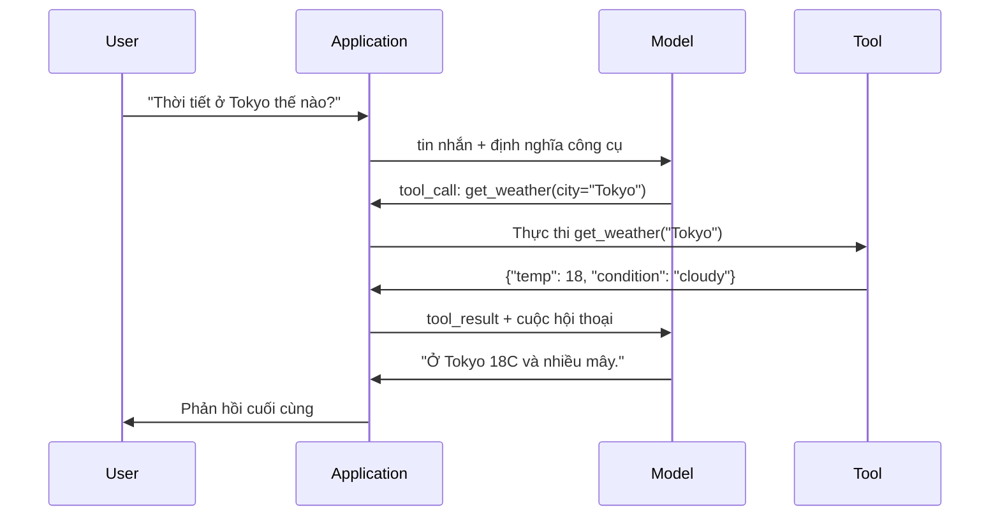

# Gọi hàm & Dùng công cụ

> LLM không làm được gì cả. Chúng sinh văn bản. Đó là toàn bộ năng lực. Chúng không kiểm tra được thời tiết, truy vấn cơ sở dữ liệu, gửi email, chạy code hay đọc file. Mọi "AI agent" bạn từng thấy đều là một LLM sinh ra JSON nói cần gọi hàm nào -- rồi code của bạn mới thực sự gọi nó. Mô hình là bộ não. Công cụ là đôi tay. Function calling (gọi hàm) là hệ thần kinh nối chúng lại.

**Type:** Build
**Languages:** Python
**Prerequisites:** Giai đoạn 11, Bài 03 (Đầu ra có cấu trúc)
**Time:** ~75 phút
**Related:** Giai đoạn 11 · 14 (Model Context Protocol) — khi một công cụ được chia sẻ giữa nhiều host, hãy nâng cấp từ function calling nội tuyến sang một MCP server. Bài này nói về trường hợp nội tuyến; MCP nói về trường hợp giao thức.

## Mục tiêu học tập

- Triển khai một vòng gọi hàm: định nghĩa tool schema (lược đồ công cụ), phân tích JSON lời gọi công cụ của mô hình, thực thi hàm, rồi trả kết quả về
- Thiết kế tool schema với mô tả rõ ràng và tham số có kiểu để mô hình gọi được một cách đáng tin cậy
- Xây dựng vòng agent nhiều lượt, nối nhiều lời gọi hàm để trả lời các truy vấn phức tạp
- Xử lý các trường hợp biên của function calling: parallel tool calls (gọi công cụ song song), lan truyền lỗi, và ngăn vòng lặp công cụ vô hạn

## Vấn đề

Bạn xây một chatbot. Người dùng hỏi: "Thời tiết ở Tokyo lúc này thế nào?"

Mô hình đáp: "Tôi không có quyền truy cập dữ liệu thời tiết thời gian thực, nhưng dựa vào mùa này, Tokyo có lẽ khoảng 15 độ C..."

Đó là một ảo giác khoác áo một lời từ chối trách nhiệm. Mô hình không biết thời tiết. Nó sẽ không bao giờ biết. Thời tiết đổi mỗi giờ. Dữ liệu huấn luyện của mô hình đã cũ vài tháng.

Câu trả lời đúng đòi hỏi gọi API OpenWeatherMap, lấy nhiệt độ hiện tại, và trả về con số thật. Mô hình không gọi được API. Code của bạn thì gọi được. Mảnh còn thiếu: một giao thức có cấu trúc cho phép mô hình nói "tôi cần gọi API thời tiết với những đối số này", còn code của bạn thực thi và đưa kết quả trở lại.

Đó là function calling. Mô hình xuất ra JSON có cấu trúc mô tả hàm nào cần gọi với đối số nào. Ứng dụng của bạn thực thi hàm. Kết quả quay lại cuộc hội thoại. Mô hình dùng kết quả để tạo câu trả lời cuối cùng.

Không có function calling, LLM là những cuốn bách khoa toàn thư. Có nó, chúng trở thành agent.

## Khái niệm

### Vòng gọi hàm

Mọi tương tác tool use (dùng công cụ) đều theo cùng một vòng 5 bước.



Bước 1: người dùng gửi một tin nhắn. Bước 2: mô hình nhận tin nhắn cùng với định nghĩa công cụ (JSON Schema mô tả các hàm có sẵn). Bước 3: thay vì trả lời bằng văn bản, mô hình xuất ra một lời gọi công cụ -- một đối tượng JSON có cấu trúc gồm tên hàm và các đối số. Bước 4: code của bạn thực thi hàm và ghi lại kết quả. Bước 5: kết quả quay lại mô hình, giờ đã có dữ liệu thật để tạo câu trả lời cuối cùng.

Mô hình không bao giờ thực thi gì cả. Nó chỉ quyết định gọi cái gì và với đối số nào. Code của bạn là bên thực thi.

### Định nghĩa công cụ: Hợp đồng JSON Schema

Mỗi công cụ được định nghĩa bằng một JSON Schema cho mô hình biết hàm làm gì, nhận đối số gì, và các đối số đó phải thuộc kiểu nào.

```json
{
  "type": "function",
  "function": {
    "name": "get_weather",
    "description": "Get current weather for a city. Returns temperature in Celsius and conditions.",
    "parameters": {
      "type": "object",
      "properties": {
        "city": {
          "type": "string",
          "description": "City name, e.g. 'Tokyo' or 'San Francisco'"
        },
        "units": {
          "type": "string",
          "enum": ["celsius", "fahrenheit"],
          "description": "Temperature units"
        }
      },
      "required": ["city"]
    }
  }
}
```

Trường `description` là phần then chốt. Mô hình đọc chúng để quyết định khi nào và dùng công cụ thế nào. Một mô tả mơ hồ như "lấy thời tiết" cho kết quả chọn công cụ tệ hơn "Get current weather for a city. Returns temperature in Celsius and conditions." Bản thân phần mô tả cũng là một prompt cho việc chọn công cụ.

### So sánh các nhà cung cấp

Mọi nhà cung cấp lớn đều hỗ trợ function calling, nhưng bề mặt API thì khác nhau.

| Nhà cung cấp | Tham số API | Định dạng lời gọi công cụ | Gọi song song | Gọi bắt buộc |
|----------|--------------|-----------------|---------------|----------------|
| OpenAI (GPT-5, o4) | `tools` | `tool_calls[].function` | Có (nhiều lời gọi mỗi lượt) | `tool_choice="required"` |
| Anthropic (Claude 4.6/4.7) | `tools` | `content[].type="tool_use"` | Có (nhiều block) | `tool_choice={"type":"any"}` |
| Google (Gemini 3) | `function_declarations` | `functionCall` | Có | `function_calling_config` |
| Open-weight (Llama 4, Qwen3, DeepSeek-V3) | `tools` gốc trên Llama 4; Hermes hoặc ChatML trên các mô hình khác | Hỗn hợp | Tuỳ mô hình | Dựa trên prompt hoặc `tool_choice` nếu được hỗ trợ |

Đến năm 2026, ba nhà cung cấp đóng đã hội tụ về những định dạng dựa trên JSON Schema gần như giống hệt nhau. Llama 4 có sẵn trường `tools` gốc khớp với hình dạng của OpenAI. Các bản fine-tune open-weight vẫn khác nhau -- định dạng Hermes (NousResearch) là phổ biến nhất cho các bản fine-tune của bên thứ ba. Với công cụ dùng chung giữa nhiều host, hãy ưu tiên MCP (Giai đoạn 11 · 14) hơn function calling nội tuyến -- server là như nhau cho tất cả.

### Chọn công cụ: Tự động, Bắt buộc, Chỉ định

Bạn kiểm soát thời điểm mô hình dùng công cụ.

**Auto** (mặc định): mô hình tự quyết định gọi công cụ hay trả lời trực tiếp. "2+2 bằng mấy?" -- trả lời trực tiếp. "Thời tiết thế nào?" -- gọi công cụ.

**Required**: mô hình buộc phải gọi ít nhất một công cụ. Dùng khi bạn biết ý định của người dùng đòi hỏi một công cụ. Cách này ngăn mô hình đoán thay vì tra dữ liệu thật.

**Specific function**: ép mô hình gọi một hàm cụ thể. `tool_choice={"type":"function", "function": {"name": "get_weather"}}` bảo đảm công cụ thời tiết được gọi, bất kể truy vấn là gì. Dùng cho routing -- khi logic phía trước đã xác định cần công cụ nào.

### Gọi hàm song song

GPT-4o và Claude có thể gọi nhiều hàm trong một lượt. Người dùng hỏi: "Thời tiết ở Tokyo và New York thế nào?" Mô hình xuất đồng thời hai lời gọi công cụ:

```json
[
  {"name": "get_weather", "arguments": {"city": "Tokyo"}},
  {"name": "get_weather", "arguments": {"city": "New York"}}
]
```

Code của bạn thực thi cả hai (lý tưởng là đồng thời), trả về cả hai kết quả, và mô hình tổng hợp thành một phản hồi duy nhất. Cách này cắt số vòng khứ hồi từ 2 xuống 1. Với agent có 5-10 lời gọi công cụ mỗi truy vấn, gọi song song giảm độ trễ 60-80%.

### Đầu ra có cấu trúc vs Gọi hàm

Bài 03 đã nói về structured outputs. Function calling dùng cùng bộ máy JSON Schema, nhưng cho mục đích khác.

**Đầu ra có cấu trúc**: buộc mô hình tạo dữ liệu theo một hình dạng nhất định. Đầu ra là sản phẩm cuối. Ví dụ: trích thông tin sản phẩm từ văn bản thành `{name, price, in_stock}`.

**Function calling**: mô hình tuyên bố ý định thực hiện một hành động. Đầu ra là một bước trung gian. Ví dụ: `get_weather(city="Tokyo")` -- mô hình đang yêu cầu một hành động, chứ không tạo câu trả lời cuối.

Dùng structured outputs khi bạn muốn trích xuất dữ liệu. Dùng function calling khi bạn muốn mô hình tương tác với hệ thống bên ngoài.

### Bảo mật: Những quy tắc không thể thương lượng

Function calling là năng lực nguy hiểm nhất bạn có thể trao cho một LLM. Mô hình chọn cái gì để thực thi. Nếu bộ công cụ của bạn có truy vấn cơ sở dữ liệu, mô hình sẽ dựng các truy vấn đó. Nếu có lệnh shell, mô hình sẽ viết chúng.

**Quy tắc 1: Không bao giờ đưa SQL do mô hình sinh trực tiếp vào cơ sở dữ liệu.** Mô hình có thể và sẽ sinh DROP TABLE, chèn UNION, hoặc truy vấn trả về mọi dòng. Luôn tham số hoá. Luôn kiểm tra hợp lệ. Luôn dùng danh sách cho phép các thao tác.

**Quy tắc 2: Dùng allowlist cho hàm.** Mô hình chỉ gọi được những hàm bạn định nghĩa rõ ràng. Không bao giờ dựng một công cụ chung kiểu "thực thi hàm bất kỳ theo tên". Nếu bạn có 50 hàm nội bộ, chỉ mở ra 5 hàm người dùng cần.

**Quy tắc 3: Kiểm tra hợp lệ đối số.** Mô hình có thể truyền tên thành phố là `"; DROP TABLE users; --"`. Hãy kiểm tra mọi đối số theo kiểu, miền giá trị và định dạng mong đợi trước khi thực thi.

**Quy tắc 4: Làm sạch kết quả công cụ (tool result).** Nếu một công cụ trả về dữ liệu nhạy cảm (API key, PII, lỗi nội bộ), hãy lọc bỏ trước khi gửi lại cho mô hình. Mô hình sẽ đưa kết quả công cụ vào phản hồi của nó nguyên văn.

**Quy tắc 5: Giới hạn tần suất gọi công cụ.** Một mô hình trong vòng lặp có thể gọi công cụ hàng trăm lần. Đặt mức tối đa (10-20 lời gọi mỗi cuộc hội thoại là hợp lý). Phá vỡ những vòng lặp vô hạn.

### Xử lý lỗi

Công cụ hỏng. API hết giờ. Cơ sở dữ liệu sập. File không tồn tại. Mô hình cần biết khi nào một công cụ lỗi và vì sao.

Hãy trả lỗi dưới dạng kết quả công cụ có cấu trúc, không phải exception:

```json
{
  "error": true,
  "message": "City 'Toky' not found. Did you mean 'Tokyo'?",
  "code": "CITY_NOT_FOUND"
}
```

Mô hình đọc thông tin này, điều chỉnh đối số, và thử lại. Mô hình giỏi tự sửa từ những thông báo lỗi có cấu trúc. Chúng kém trong việc phục hồi từ phản hồi rỗng hay lỗi chung chung kiểu "đã có lỗi xảy ra".

### MCP: Model Context Protocol

MCP là chuẩn mở của Anthropic cho khả năng tương tác công cụ. Thay vì mỗi ứng dụng tự định nghĩa công cụ riêng, MCP cung cấp một giao thức chung: công cụ do MCP server phục vụ, do MCP client (như Claude Code, Cursor, hay ứng dụng của bạn) tiêu thụ.

Một MCP server có thể mở công cụ cho bất kỳ client tương thích nào. Một MCP server Postgres cho bất kỳ agent tương thích MCP quyền truy cập cơ sở dữ liệu. Một MCP server GitHub cho bất kỳ agent nào quyền truy cập kho mã. Công cụ định nghĩa một lần, dùng ở mọi nơi.

MCP với function calling giống như HTTP với mạng máy tính. Nó chuẩn hoá tầng vận chuyển để công cụ trở nên di động.

```figure
mx-tool-call-loop
```

## Tự tay làm

### Bước 1: Định nghĩa sổ đăng ký công cụ

Xây một sổ đăng ký lưu định nghĩa công cụ và phần triển khai của chúng. Mỗi công cụ có một định nghĩa JSON Schema (thứ mô hình thấy) và một hàm Python (thứ code của bạn thực thi).

```python
import ast
import json
import math
import time
import hashlib


TOOL_REGISTRY = {}


def register_tool(name, description, parameters, function):
    TOOL_REGISTRY[name] = {
        "definition": {
            "type": "function",
            "function": {
                "name": name,
                "description": description,
                "parameters": parameters,
            },
        },
        "function": function,
    }
```

### Bước 2: Triển khai 5 công cụ

Xây một máy tính, tra thời tiết, giả lập tìm kiếm web, đọc file, và chạy code.

```python
def calculator(expression, precision=2):
    allowed = set("0123456789+-*/.() ")
    if not all(c in allowed for c in expression):
        return {"error": True, "message": f"Invalid characters in expression: {expression}"}
    try:
        result = eval(expression, {"__builtins__": {}}, {"math": math})
        return {"result": round(float(result), precision), "expression": expression}
    except Exception as e:
        return {"error": True, "message": str(e)}


WEATHER_DB = {
    "tokyo": {"temp_c": 18, "condition": "cloudy", "humidity": 72, "wind_kph": 14},
    "new york": {"temp_c": 22, "condition": "sunny", "humidity": 45, "wind_kph": 8},
    "london": {"temp_c": 12, "condition": "rainy", "humidity": 88, "wind_kph": 22},
    "san francisco": {"temp_c": 16, "condition": "foggy", "humidity": 80, "wind_kph": 18},
    "sydney": {"temp_c": 25, "condition": "sunny", "humidity": 55, "wind_kph": 10},
}


def get_weather(city, units="celsius"):
    key = city.lower().strip()
    if key not in WEATHER_DB:
        suggestions = [c for c in WEATHER_DB if c.startswith(key[:3])]
        return {
            "error": True,
            "message": f"City '{city}' not found.",
            "suggestions": suggestions,
            "code": "CITY_NOT_FOUND",
        }
    data = WEATHER_DB[key].copy()
    if units == "fahrenheit":
        data["temp_f"] = round(data["temp_c"] * 9 / 5 + 32, 1)
        del data["temp_c"]
    data["city"] = city
    return data


SEARCH_DB = {
    "python function calling": [
        {"title": "OpenAI Function Calling Guide", "url": "https://platform.openai.com/docs/guides/function-calling", "snippet": "Learn how to connect LLMs to external tools."},
        {"title": "Anthropic Tool Use", "url": "https://docs.anthropic.com/en/docs/tool-use", "snippet": "Claude can interact with external tools and APIs."},
    ],
    "MCP protocol": [
        {"title": "Model Context Protocol", "url": "https://modelcontextprotocol.io", "snippet": "An open standard for connecting AI models to data sources."},
    ],
    "weather API": [
        {"title": "OpenWeatherMap API", "url": "https://openweathermap.org/api", "snippet": "Free weather API with current, forecast, and historical data."},
    ],
}


def web_search(query, max_results=3):
    key = query.lower().strip()
    for db_key, results in SEARCH_DB.items():
        if db_key in key or key in db_key:
            return {"query": query, "results": results[:max_results], "total": len(results)}
    return {"query": query, "results": [], "total": 0}


FILE_SYSTEM = {
    "data/config.json": '{"model": "gpt-4o", "temperature": 0.7, "max_tokens": 4096}',
    "data/users.csv": "name,email,role\nAlice,alice@example.com,admin\nBob,bob@example.com,user",
    "README.md": "# My Project\nA tool-use agent built from scratch.",
}


def read_file(path):
    if ".." in path or path.startswith("/"):
        return {"error": True, "message": "Path traversal not allowed.", "code": "FORBIDDEN"}
    if path not in FILE_SYSTEM:
        available = list(FILE_SYSTEM.keys())
        return {"error": True, "message": f"File '{path}' not found.", "available_files": available, "code": "NOT_FOUND"}
    content = FILE_SYSTEM[path]
    return {"path": path, "content": content, "size_bytes": len(content), "lines": content.count("\n") + 1}


def run_code(code, language="python"):
    if language != "python":
        return {"error": True, "message": f"Language '{language}' not supported. Only 'python' is available."}
    try:
        tree = ast.parse(code)
    except SyntaxError as e:
        return {"error": True, "message": f"SyntaxError: {e}", "code": "SYNTAX_ERROR"}
    unsafe_names = {"exec", "eval", "compile", "__import__", "open", "globals", "locals", "vars", "getattr", "setattr", "delattr"}
    for node in ast.walk(tree):
        if isinstance(node, (ast.Import, ast.ImportFrom)):
            return {"error": True, "message": "Forbidden operation: import is not allowed", "code": "SECURITY_VIOLATION"}
        if isinstance(node, ast.Attribute) and node.attr.startswith("__") and node.attr.endswith("__"):
            return {"error": True, "message": "Forbidden operation: dunder attribute access is not allowed", "code": "SECURITY_VIOLATION"}
        if isinstance(node, ast.Name) and node.id in unsafe_names:
            return {"error": True, "message": f"Forbidden operation: {node.id} is not allowed", "code": "SECURITY_VIOLATION"}
    try:
        local_vars = {}
        exec(code, {"__builtins__": {"print": print, "range": range, "len": len, "str": str, "int": int, "float": float, "list": list, "dict": dict, "sum": sum, "min": min, "max": max, "abs": abs, "round": round, "sorted": sorted, "enumerate": enumerate, "zip": zip, "map": map, "filter": filter, "math": math}}, local_vars)
        result = local_vars.get("result", None)
        return {"success": True, "result": result, "variables": {k: str(v) for k, v in local_vars.items() if not k.startswith("_")}}
    except Exception as e:
        return {"error": True, "message": f"{type(e).__name__}: {e}"}
```

Một danh sách chặn theo chuỗi con đọc code như văn bản, nên nó bỏ sót mọi thứ mà phép so khớp chuỗi không đánh vần nguyên văn. Phân tích code thành cây cú pháp rồi duyệt cây cho phép bộ chặn loại bỏ câu lệnh `import`, truy cập thuộc tính dunder (những chuỗi `__class__` và `__globals__` dẫn ngược về trình thông dịch thật), và các tên builtin không an toàn theo cấu trúc thay vì theo cách viết. Dẫu vậy, hãy coi đây là một bộ lọc dạy học, không phải ranh giới thật. Mọi bộ chặn trong cùng tiến trình đều chia sẻ trình thông dịch với đoạn code mà nó chạy, và một kẻ gọi kiên trì vẫn tìm được những đối tượng có thể chạm tới. Hệ thống production chạy code không tin cậy trong một tiến trình hoặc container riêng (một subprocess đã hạ quyền, gVisor, Firecracker, hay dịch vụ chạy code thuê ngoài), nơi một vụ thoát ra chỉ đưa kẻ tấn công vào một chiếc hộp dùng một lần thay vì dịch vụ của bạn.

### Bước 3: Đăng ký mọi công cụ

```python
def register_all_tools():
    register_tool(
        "calculator", "Evaluate a mathematical expression. Supports +, -, *, /, parentheses, and decimals. Returns the numeric result.",
        {"type": "object", "properties": {"expression": {"type": "string", "description": "Math expression, e.g. '(10 + 5) * 3'"}, "precision": {"type": "integer", "description": "Decimal places in result", "default": 2}}, "required": ["expression"]},
        calculator,
    )
    register_tool(
        "get_weather", "Get current weather for a city. Returns temperature, condition, humidity, and wind speed.",
        {"type": "object", "properties": {"city": {"type": "string", "description": "City name, e.g. 'Tokyo' or 'San Francisco'"}, "units": {"type": "string", "enum": ["celsius", "fahrenheit"], "description": "Temperature units, defaults to celsius"}}, "required": ["city"]},
        get_weather,
    )
    register_tool(
        "web_search", "Search the web for information. Returns a list of results with title, URL, and snippet.",
        {"type": "object", "properties": {"query": {"type": "string", "description": "Search query"}, "max_results": {"type": "integer", "description": "Maximum results to return", "default": 3}}, "required": ["query"]},
        web_search,
    )
    register_tool(
        "read_file", "Read the contents of a file. Returns the file content, size, and line count.",
        {"type": "object", "properties": {"path": {"type": "string", "description": "Relative file path, e.g. 'data/config.json'"}}, "required": ["path"]},
        read_file,
    )
    register_tool(
        "run_code", "Run a small Python snippet behind a static-analysis guard and a restricted interpreter. This is a teaching filter, not real isolation. Set a 'result' variable to return output.",
        {"type": "object", "properties": {"code": {"type": "string", "description": "Python code to execute"}, "language": {"type": "string", "enum": ["python"], "description": "Programming language"}}, "required": ["code"]},
        run_code,
    )
```

### Bước 4: Xây vòng gọi hàm

Đây là động cơ lõi. Nó giả lập việc mô hình quyết định gọi công cụ nào, thực thi công cụ đó, và đưa kết quả trở lại.

```python
def simulate_model_decision(user_message, tools, conversation_history):
    msg = user_message.lower()

    if any(word in msg for word in ["weather", "temperature", "forecast"]):
        cities = []
        for city in WEATHER_DB:
            if city in msg:
                cities.append(city)
        if not cities:
            for word in msg.split():
                if word.capitalize() in [c.title() for c in WEATHER_DB]:
                    cities.append(word)
        if not cities:
            cities = ["tokyo"]
        calls = []
        for city in cities:
            calls.append({"name": "get_weather", "arguments": {"city": city.title()}})
        return calls

    if any(word in msg for word in ["calculate", "compute", "math", "what is", "how much"]):
        for token in msg.split():
            if any(c in token for c in "+-*/"):
                return [{"name": "calculator", "arguments": {"expression": token}}]
        if "+" in msg or "-" in msg or "*" in msg or "/" in msg:
            expr = "".join(c for c in msg if c in "0123456789+-*/.() ")
            if expr.strip():
                return [{"name": "calculator", "arguments": {"expression": expr.strip()}}]
        return [{"name": "calculator", "arguments": {"expression": "0"}}]

    if any(word in msg for word in ["search", "find", "look up", "google"]):
        query = msg.replace("search for", "").replace("look up", "").replace("find", "").strip()
        return [{"name": "web_search", "arguments": {"query": query}}]

    if any(word in msg for word in ["read", "file", "open", "cat", "show"]):
        for path in FILE_SYSTEM:
            if path.split("/")[-1].split(".")[0] in msg:
                return [{"name": "read_file", "arguments": {"path": path}}]
        return [{"name": "read_file", "arguments": {"path": "README.md"}}]

    if any(word in msg for word in ["run", "execute", "code", "python"]):
        return [{"name": "run_code", "arguments": {"code": "result = 'Hello from the sandbox!'", "language": "python"}}]

    return []


def execute_tool_call(tool_call):
    name = tool_call["name"]
    args = tool_call["arguments"]

    if name not in TOOL_REGISTRY:
        return {"error": True, "message": f"Unknown tool: {name}", "code": "UNKNOWN_TOOL"}

    tool = TOOL_REGISTRY[name]
    func = tool["function"]
    start = time.time()

    try:
        result = func(**args)
    except TypeError as e:
        result = {"error": True, "message": f"Invalid arguments: {e}"}

    elapsed_ms = round((time.time() - start) * 1000, 2)
    return {"tool": name, "result": result, "execution_time_ms": elapsed_ms}


def run_function_calling_loop(user_message, max_iterations=5):
    conversation = [{"role": "user", "content": user_message}]
    tool_definitions = [t["definition"] for t in TOOL_REGISTRY.values()]
    all_tool_results = []

    for iteration in range(max_iterations):
        tool_calls = simulate_model_decision(user_message, tool_definitions, conversation)

        if not tool_calls:
            break

        results = []
        for call in tool_calls:
            result = execute_tool_call(call)
            results.append(result)

        conversation.append({"role": "assistant", "content": None, "tool_calls": tool_calls})

        for result in results:
            conversation.append({"role": "tool", "content": json.dumps(result["result"]), "tool_name": result["tool"]})

        all_tool_results.extend(results)
        break

    return {"conversation": conversation, "tool_results": all_tool_results, "iterations": iteration + 1 if tool_calls else 0}
```

### Bước 5: Kiểm tra hợp lệ đối số

Xây một bộ kiểm tra đối chiếu đối số của lời gọi công cụ với JSON Schema trước khi thực thi.

```python
def validate_tool_arguments(tool_name, arguments):
    if tool_name not in TOOL_REGISTRY:
        return [f"Unknown tool: {tool_name}"]

    schema = TOOL_REGISTRY[tool_name]["definition"]["function"]["parameters"]
    errors = []

    if not isinstance(arguments, dict):
        return [f"Arguments must be an object, got {type(arguments).__name__}"]

    for required_field in schema.get("required", []):
        if required_field not in arguments:
            errors.append(f"Missing required argument: {required_field}")

    properties = schema.get("properties", {})
    for arg_name, arg_value in arguments.items():
        if arg_name not in properties:
            errors.append(f"Unknown argument: {arg_name}")
            continue

        prop_schema = properties[arg_name]
        expected_type = prop_schema.get("type")

        type_checks = {"string": str, "integer": int, "number": (int, float), "boolean": bool, "array": list, "object": dict}
        if expected_type in type_checks:
            if not isinstance(arg_value, type_checks[expected_type]):
                errors.append(f"Argument '{arg_name}': expected {expected_type}, got {type(arg_value).__name__}")

        if "enum" in prop_schema and arg_value not in prop_schema["enum"]:
            errors.append(f"Argument '{arg_name}': '{arg_value}' not in {prop_schema['enum']}")

    return errors
```

### Bước 6: Chạy demo

```python
def run_demo():
    register_all_tools()

    print("=" * 60)
    print("  Function Calling & Tool Use Demo")
    print("=" * 60)

    print("\n--- Registered Tools ---")
    for name, tool in TOOL_REGISTRY.items():
        desc = tool["definition"]["function"]["description"][:60]
        params = list(tool["definition"]["function"]["parameters"].get("properties", {}).keys())
        print(f"  {name}: {desc}...")
        print(f"    params: {params}")

    print(f"\n--- Argument Validation ---")
    validation_tests = [
        ("get_weather", {"city": "Tokyo"}, "Valid call"),
        ("get_weather", {}, "Missing required arg"),
        ("get_weather", {"city": "Tokyo", "units": "kelvin"}, "Invalid enum value"),
        ("calculator", {"expression": 123}, "Wrong type (int for string)"),
        ("unknown_tool", {"x": 1}, "Unknown tool"),
    ]
    for tool_name, args, label in validation_tests:
        errors = validate_tool_arguments(tool_name, args)
        status = "VALID" if not errors else f"ERRORS: {errors}"
        print(f"  {label}: {status}")

    print(f"\n--- Tool Execution ---")
    direct_tests = [
        {"name": "calculator", "arguments": {"expression": "(10 + 5) * 3 / 2"}},
        {"name": "get_weather", "arguments": {"city": "Tokyo"}},
        {"name": "get_weather", "arguments": {"city": "Mars"}},
        {"name": "web_search", "arguments": {"query": "python function calling"}},
        {"name": "read_file", "arguments": {"path": "data/config.json"}},
        {"name": "read_file", "arguments": {"path": "../etc/passwd"}},
        {"name": "run_code", "arguments": {"code": "result = sum(range(1, 101))"}},
        {"name": "run_code", "arguments": {"code": "import os; os.system('rm -rf /')"}},
    ]
    for call in direct_tests:
        result = execute_tool_call(call)
        print(f"\n  {call['name']}({json.dumps(call['arguments'])})")
        print(f"    -> {json.dumps(result['result'], indent=None)[:100]}")
        print(f"    time: {result['execution_time_ms']}ms")

    print(f"\n--- Full Function Calling Loop ---")
    test_queries = [
        "What's the weather in Tokyo?",
        "Calculate (100 + 250) * 0.15",
        "Search for MCP protocol",
        "Read the config file",
        "Run some Python code",
        "Tell me a joke",
    ]
    for query in test_queries:
        print(f"\n  User: {query}")
        result = run_function_calling_loop(query)
        if result["tool_results"]:
            for tr in result["tool_results"]:
                print(f"    Tool: {tr['tool']} ({tr['execution_time_ms']}ms)")
                print(f"    Result: {json.dumps(tr['result'], indent=None)[:90]}")
        else:
            print(f"    [No tool called -- direct response]")
        print(f"    Iterations: {result['iterations']}")

    print(f"\n--- Parallel Tool Calls ---")
    multi_city_query = "What's the weather in tokyo and london?"
    print(f"  User: {multi_city_query}")
    result = run_function_calling_loop(multi_city_query)
    print(f"  Tool calls made: {len(result['tool_results'])}")
    for tr in result["tool_results"]:
        city = tr["result"].get("city", "unknown")
        temp = tr["result"].get("temp_c", "N/A")
        print(f"    {city}: {temp}C, {tr['result'].get('condition', 'N/A')}")

    print(f"\n--- Security Checks ---")
    security_tests = [
        ("read_file", {"path": "../../etc/passwd"}),
        ("run_code", {"code": "import subprocess; subprocess.run(['ls'])"}),
        ("calculator", {"expression": "__import__('os').system('ls')"}),
    ]
    for tool_name, args in security_tests:
        result = execute_tool_call({"name": tool_name, "arguments": args})
        blocked = result["result"].get("error", False)
        print(f"  {tool_name}({list(args.values())[0][:40]}): {'BLOCKED' if blocked else 'ALLOWED'}")
```

## Áp dụng

### Gọi hàm với OpenAI

```python
# from openai import OpenAI
#
# client = OpenAI()
#
# tools = [{
#     "type": "function",
#     "function": {
#         "name": "get_weather",
#         "description": "Get current weather for a city",
#         "parameters": {
#             "type": "object",
#             "properties": {
#                 "city": {"type": "string"},
#                 "units": {"type": "string", "enum": ["celsius", "fahrenheit"]}
#             },
#             "required": ["city"]
#         }
#     }
# }]
#
# response = client.chat.completions.create(
#     model="gpt-4o",
#     messages=[{"role": "user", "content": "Weather in Tokyo?"}],
#     tools=tools,
#     tool_choice="auto",
# )
#
# tool_call = response.choices[0].message.tool_calls[0]
# args = json.loads(tool_call.function.arguments)
# result = get_weather(**args)
#
# final = client.chat.completions.create(
#     model="gpt-4o",
#     messages=[
#         {"role": "user", "content": "Weather in Tokyo?"},
#         response.choices[0].message,
#         {"role": "tool", "tool_call_id": tool_call.id, "content": json.dumps(result)},
#     ],
# )
# print(final.choices[0].message.content)
```

OpenAI trả các lời gọi công cụ dưới dạng `response.choices[0].message.tool_calls`. Mỗi lời gọi có một `id` mà bạn phải kèm theo khi trả kết quả. Mô hình dùng ID này để khớp kết quả với lời gọi. GPT-4o có thể trả nhiều lời gọi công cụ trong một phản hồi -- hãy lặp và thực thi tất cả.

### Dùng công cụ với Anthropic

```python
# import anthropic
#
# client = anthropic.Anthropic()
#
# response = client.messages.create(
#     model="claude-sonnet-5",
#     max_tokens=1024,
#     tools=[{
#         "name": "get_weather",
#         "description": "Get current weather for a city",
#         "input_schema": {
#             "type": "object",
#             "properties": {
#                 "city": {"type": "string"},
#                 "units": {"type": "string", "enum": ["celsius", "fahrenheit"]}
#             },
#             "required": ["city"]
#         }
#     }],
#     messages=[{"role": "user", "content": "Weather in Tokyo?"}],
# )
#
# tool_block = next(b for b in response.content if b.type == "tool_use")
# result = get_weather(**tool_block.input)
#
# final = client.messages.create(
#     model="claude-sonnet-5",
#     max_tokens=1024,
#     tools=[...],
#     messages=[
#         {"role": "user", "content": "Weather in Tokyo?"},
#         {"role": "assistant", "content": response.content},
#         {"role": "user", "content": [{"type": "tool_result", "tool_use_id": tool_block.id, "content": json.dumps(result)}]},
#     ],
# )
```

Anthropic trả lời gọi công cụ dưới dạng các content block với `type: "tool_use"`. Kết quả công cụ nằm trong một tin nhắn của người dùng với `type: "tool_result"`. Chú ý khác biệt then chốt: Anthropic dùng `input_schema` để định nghĩa tham số công cụ, còn OpenAI dùng `parameters`.

### Tích hợp MCP

```python
# MCP servers expose tools over a standardized protocol.
# Any MCP-compatible client can discover and call these tools.
#
# Example: connecting to a Postgres MCP server
#
# from mcp import ClientSession, StdioServerParameters
# from mcp.client.stdio import stdio_client
#
# server_params = StdioServerParameters(
#     command="npx",
#     args=["-y", "@modelcontextprotocol/server-postgres", "postgresql://localhost/mydb"],
# )
#
# async with stdio_client(server_params) as (read, write):
#     async with ClientSession(read, write) as session:
#         await session.initialize()
#         tools = await session.list_tools()
#         result = await session.call_tool("query", {"sql": "SELECT count(*) FROM users"})
```

MCP tách phần triển khai công cụ khỏi phần tiêu thụ công cụ. Server Postgres biết SQL. Server GitHub biết API. Agent của bạn chỉ việc khám phá và gọi công cụ -- nó không cần code riêng cho từng nhà cung cấp ở mỗi tích hợp.

## Đóng gói

Bài này tạo ra `outputs/prompt-tool-designer.md` -- một mẫu prompt tái sử dụng để thiết kế định nghĩa công cụ. Đưa vào mô tả việc bạn muốn công cụ làm, nó sẽ tạo định nghĩa JSON Schema đầy đủ với mô tả, kiểu, và ràng buộc.

Nó cũng tạo ra `outputs/skill-function-calling-patterns.md` -- một khung quyết định để triển khai function calling trong production, bao gồm thiết kế công cụ, xử lý lỗi, bảo mật, và các mẫu đặc thù theo từng nhà cung cấp.

## Bài tập

1. **Thêm công cụ thứ 6: truy vấn cơ sở dữ liệu.** Triển khai một công cụ SQL giả lập với bảng nằm trong bộ nhớ. Công cụ nhận tên bảng và điều kiện lọc (không nhận SQL thô). Kiểm tra rằng tên bảng nằm trong allowlist và các toán tử lọc chỉ được là `=`, `>`, `<`, `>=`, `<=`. Trả các dòng khớp dưới dạng JSON.

2. **Triển khai thử lại kèm phản hồi lỗi.** Khi một lời gọi công cụ lỗi (ví dụ không tìm thấy thành phố), đưa thông báo lỗi trở lại hàm quyết định của mô hình và để nó sửa đối số. Theo dõi số lần thử lại của mỗi lời gọi. Đặt tối đa 3 lần thử lại cho mỗi lời gọi công cụ.

3. **Xây một agent nhiều bước.** Có những truy vấn cần nối các lời gọi công cụ: "Đọc file cấu hình và cho tôi biết mô hình nào đang được cấu hình, rồi tìm trên web giá của mô hình đó." Triển khai một vòng chạy tới khi mô hình quyết định không cần công cụ nào nữa, truyền kết quả tích luỹ vào mỗi bước quyết định. Giới hạn 10 vòng để tránh vòng lặp vô hạn.

4. **Đo độ chính xác khi chọn công cụ.** Tạo 30 truy vấn kiểm thử kèm tên công cụ mong đợi. Chạy hàm quyết định trên cả 30 và đo tỉ lệ chọn đúng công cụ. Xác định những truy vấn gây nhầm lẫn nhiều nhất giữa các công cụ.

5. **Triển khai cache lời gọi công cụ.** Nếu cùng một công cụ được gọi với đối số giống hệt trong vòng 60 giây, trả kết quả trong cache thay vì chạy lại. Dùng một dict với khoá `(tool_name, frozenset(args.items()))`. Đo tỉ lệ cache hit qua một cuộc hội thoại 20 truy vấn.

## Thuật ngữ chính

| Thuật ngữ | Người ta thường nói | Ý nghĩa thực sự |
|------|----------------|----------------------|
| Function calling | "Dùng công cụ" | Mô hình xuất JSON có cấu trúc mô tả một hàm cần gọi với đối số cụ thể -- code của bạn thực thi, không phải mô hình |
| Tool definition | "Lược đồ hàm" | Một đối tượng JSON Schema mô tả tên, mục đích, tham số và kiểu của công cụ -- mô hình đọc nó để quyết định khi nào và dùng thế nào |
| Tool choice | "Chế độ gọi" | Kiểm soát việc mô hình buộc phải gọi công cụ (required), có thể gọi (auto), hay phải gọi một công cụ cụ thể (named) |
| Parallel calling | "Đa công cụ" | Mô hình xuất nhiều lời gọi công cụ trong một lượt, giảm số vòng khứ hồi -- GPT-4o và Claude đều hỗ trợ |
| Tool result | "Đầu ra hàm" | Giá trị trả về từ việc thực thi một công cụ, được gửi lại cho mô hình như một tin nhắn để nó dùng dữ liệu thật trong phản hồi |
| Argument validation | "Kiểm tra đầu vào" | Xác minh rằng đối số do mô hình sinh khớp kiểu, miền giá trị và ràng buộc mong đợi trước khi thực thi công cụ |
| MCP | "Giao thức công cụ" | Model Context Protocol -- chuẩn mở của Anthropic để mở công cụ qua các server mà bất kỳ client tương thích nào cũng khám phá và gọi được |
| Agent loop | "Vòng ReAct" | Chu trình lặp: mô hình quyết định công cụ, code thực thi công cụ, kết quả đưa ngược lại, cho tới khi mô hình có đủ thông tin để trả lời |
| Tool poisoning | "Prompt injection qua công cụ" | Một cuộc tấn công trong đó kết quả công cụ chứa chỉ dẫn thao túng hành vi mô hình -- hãy làm sạch mọi đầu ra công cụ |
| Rate limiting | "Ngân sách lời gọi" | Đặt số lời gọi công cụ tối đa mỗi cuộc hội thoại để tránh vòng lặp vô hạn và chi phí API vượt kiểm soát |

## Đọc thêm

- [OpenAI Function Calling Guide](https://platform.openai.com/docs/guides/function-calling) -- tài liệu tham chiếu chuẩn cho tool use với GPT-4o, gồm gọi song song, gọi bắt buộc, và đối số có cấu trúc
- [Anthropic Tool Use Guide](https://docs.anthropic.com/en/docs/tool-use) -- cách Claude triển khai tool use với input_schema, phản hồi nhiều công cụ, và cấu hình tool_choice
- [Model Context Protocol Specification](https://modelcontextprotocol.io) -- chuẩn mở cho khả năng tương tác công cụ giữa các ứng dụng AI, với kiến trúc server/client
- [Schick et al., 2023 -- "Toolformer: Language Models Can Teach Themselves to Use Tools"](https://arxiv.org/abs/2302.04761) -- bài báo nền tảng về huấn luyện LLM quyết định khi nào và gọi công cụ bên ngoài thế nào
- [Patil et al., 2023 -- "Gorilla: Large Language Model Connected with Massive APIs"](https://arxiv.org/abs/2305.15334) -- fine-tune LLM để gọi API chính xác trên 1.645 API và giảm ảo giác
- [Berkeley Function Calling Leaderboard](https://gorilla.cs.berkeley.edu/leaderboard.html) -- bảng xếp hạng so sánh độ chính xác gọi hàm theo thời gian thực giữa GPT-4o, Claude, Gemini và các mô hình mở
- [Yao et al., "ReAct: Synergizing Reasoning and Acting in Language Models" (ICLR 2023)](https://arxiv.org/abs/2210.03629) -- vòng Thought-Action-Observation, chính là vòng agent bọc ngoài mọi lời gọi công cụ; nơi bài này kết thúc là nơi Giai đoạn 14 tiếp tục.
- [Anthropic — Building effective agents (Dec 2024)](https://www.anthropic.com/research/building-effective-agents) -- năm mẫu có thể ghép (prompt chaining, routing, parallelization, orchestrator-workers, evaluator-optimizer) dựng từ một nguyên thuỷ tool use duy nhất.

---

[← Bài trước: Tinh chỉnh với LoRA & QLoRA](../../08-fine-tuning-lora/docs/vi.md) · [Bài sau: Đánh giá & kiểm thử ứng dụng LLM →](../../10-evaluation/docs/vi.md)
