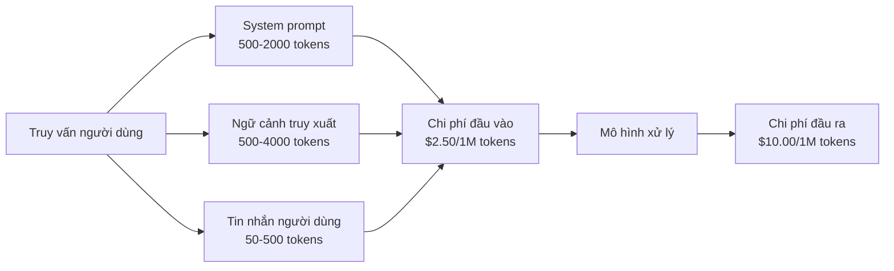
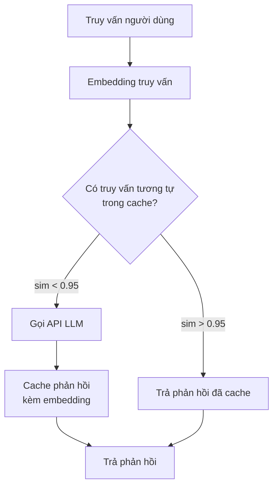
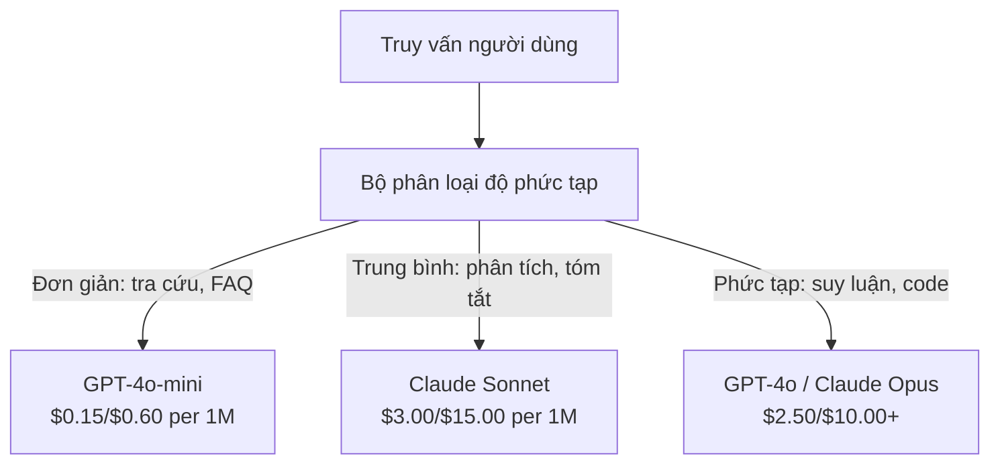

# Bộ nhớ đệm, giới hạn tần suất & tối ưu chi phí

> Phần lớn startup AI không chết vì mô hình tệ. Họ chết vì kinh tế đơn vị tệ. Một lần gọi GPT-4o chỉ tốn vài phần trăm xu. Nhưng 10.000 người dùng, mỗi ngày 10 lần gọi, đã ngốn $250 chỉ riêng token đầu vào -- trước khi bạn thu được một đô la nào. Những công ty sống sót là những công ty coi mỗi lần gọi API là một giao dịch tài chính, chứ không phải một lời gọi hàm.

**Type:** Build
**Languages:** Python
**Prerequisites:** Giai đoạn 11, Bài 09 (Function calling)
**Time:** ~45 phút
**Related:** Giai đoạn 11 · 15 (Prompt caching) — bài này nói về caching (bộ nhớ đệm) ở tầng ứng dụng (semantic cache, exact hash cache, model routing). Bài 15 nói về prompt caching ở tầng nhà cung cấp (Anthropic cache_control, OpenAI tự động, Gemini CachedContent). Kết hợp cả hai để giảm 50-95% chi phí.

## Mục tiêu học tập

- Triển khai semantic caching phục vụ các truy vấn lặp lại hoặc tương tự từ cache thay vì tạo một lần gọi API mới
- Tính chi phí từng yêu cầu trên nhiều nhà cung cấp, triển khai giới hạn tần suất có đếm token (token counting) và cảnh báo ngân sách
- Xây lớp tối ưu chi phí với nén prompt, định tuyến mô hình (đắt vs rẻ) và cache phản hồi
- Thiết kế chiến lược cache nhiều tầng dùng khớp chính xác, tương đồng ngữ nghĩa và prefix caching cho các loại truy vấn khác nhau

## Vấn đề

Bạn xây một chatbot RAG. Nó chạy rất đẹp. Người dùng mê nó.

Rồi hoá đơn tới.

GPT-5 tính $5 mỗi triệu token đầu vào và $15 mỗi triệu token đầu ra -- đó là chi phí mỗi token (cost per token) mà bạn phải trả. Claude Opus 4.7 là $15 đầu vào / $75 đầu ra. Gemini 3 Pro là $1.25 đầu vào / $5 đầu ra. GPT-5-mini là $0.25/$2. Giá bên dưới chỉ để minh hoạ; luôn kiểm tra trang giá hiện tại của nhà cung cấp.

Đây là phép toán giết chết các startup:

- 10.000 người dùng hoạt động hằng ngày
- 10 truy vấn mỗi người mỗi ngày
- 1.000 token đầu vào mỗi truy vấn (system prompt + ngữ cảnh + tin nhắn người dùng)
- 500 token đầu ra mỗi phản hồi

**Chi phí đầu vào mỗi ngày:** 10,000 x 10 x 1,000 / 1,000,000 x $2.50 = **$250/ngày**
**Chi phí đầu ra mỗi ngày:** 10,000 x 10 x 500 / 1,000,000 x $10.00 = **$500/ngày**
**Tổng mỗi tháng:** **$22,500/tháng**

Đó mới chỉ là LLM. Cộng thêm embedding, hosting vector database, hạ tầng. Bạn đang nhìn vào $30,000/tháng cho một chatbot.

Phần phũ phàng: 40-60% trong số truy vấn đó là gần trùng lặp. Người dùng hỏi cùng câu hỏi bằng từ ngữ hơi khác. System prompt của bạn -- giống hệt nhau ở mọi yêu cầu -- bị tính tiền mỗi lần. Tài liệu ngữ cảnh mà RAG truy xuất lặp lại giữa những người dùng hỏi cùng chủ đề.

Bạn đang trả giá đầy đủ cho phần tính toán dư thừa.

## Khái niệm

### Giải phẫu chi phí của một lần gọi LLM

Mỗi lần gọi API có năm thành phần chi phí.



System prompt là kẻ giết người thầm lặng. Một system prompt 1.500 token gửi kèm mỗi yêu cầu tốn $3.75 mỗi triệu yêu cầu chỉ riêng cho phần tiền tố đó. Với 100K yêu cầu một ngày, tức $375/ngày -- $11,250/tháng -- cho đoạn văn bản không bao giờ thay đổi.

### Prompt caching ở phía nhà cung cấp: ưu đãi có sẵn

Cả ba nhà cung cấp lớn đều có prompt caching phía nhà cung cấp vào năm 2026, nhưng cơ chế khác nhau. Xem Giai đoạn 11 · 15 để đi sâu.

| Nhà cung cấp | Cơ chế | Mức giảm | Ngưỡng tối thiểu | Thời gian cache |
|----------|-----------|----------|---------|----------------|
| Anthropic | Marker cache_control tường minh | 90% khi trúng đệm (trả thêm 25% khi ghi) | 1,024 tokens (Sonnet/Opus), 2,048 (Haiku) | 5 phút mặc định; 1h mở rộng (phí ghi 2x) |
| OpenAI | Khớp tiền tố tự động | 50% khi trúng đệm | 1,024 tokens | Cố gắng hết mức, tối đa 1 giờ |
| Google Gemini | API CachedContent tường minh | giảm ~75% (cộng phí lưu trữ) | 4,096 (Flash) / 32,768 (Pro) | TTL do người dùng đặt |

**Cách của Anthropic** là tường minh. Bạn đánh dấu các đoạn prompt bằng `cache_control: {"type": "ephemeral"}`. Yêu cầu đầu tiên trả thêm 25% phí ghi. Các yêu cầu sau với cùng tiền tố được giảm 90%. Một system prompt 2.000 token bình thường tốn $0.005 sẽ chỉ còn $0.000625 khi trúng đệm. Với 100K yêu cầu, tiết kiệm $437.50/ngày.

**Cách của OpenAI** là tự động. Bất kỳ tiền tố prompt nào khớp với yêu cầu trước đó đều được giảm 50%. Không cần marker. Đánh đổi: giảm ít hơn, kiểm soát ít hơn, nhưng không tốn công triển khai.

### Semantic caching: tầng tuỳ chỉnh của bạn

Cache của nhà cung cấp chỉ hoạt động với tiền tố giống hệt. Semantic caching xử lý trường hợp khó hơn: các truy vấn khác nhau nhưng cùng ý nghĩa.

"What is the return policy?" và "How do I return an item?" là hai chuỗi khác nhau nhưng cùng ý định. Một semantic cache embedding cả hai truy vấn, tính cosine similarity, và trả phản hồi đã cache nếu độ tương đồng vượt ngưỡng (thường 0.92-0.95).



Chi phí embedding không đáng kể. text-embedding-3-small của OpenAI giá $0.02 mỗi triệu token. Kiểm tra cache gần như miễn phí so với một lần gọi LLM đầy đủ.

### Exact caching: băm và khớp

Với các lần gọi tất định (temperature=0, cùng mô hình, cùng prompt), exact caching đơn giản và nhanh hơn. Băm toàn bộ prompt, tra cache, trả về nếu tìm thấy.

Cách này hoàn hảo cho:
- System prompt + ngữ cảnh cố định + truy vấn người dùng giống hệt
- Function calling với định nghĩa công cụ giống hệt
- Xử lý theo lô khi cùng một tài liệu được xử lý nhiều lần

### Giới hạn tần suất: bảo vệ ngân sách của bạn

Giới hạn tần suất không chỉ là chuyện công bằng. Đó là chuyện sống còn.

**Thuật toán token bucket:** mỗi người dùng có một xô N token, được nạp lại với tốc độ R mỗi giây. Một yêu cầu tiêu token từ xô. Nếu xô rỗng, yêu cầu bị từ chối. Cách này cho phép bùng nổ (dùng hết xô một lúc) trong khi vẫn áp tốc độ trung bình.

**Hạn mức theo người dùng:** đặt giới hạn token ngày/tháng theo hạng người dùng.

| Hạng | Giới hạn token mỗi ngày | Số yêu cầu tối đa mỗi phút | Quyền truy cập mô hình |
|------|------------------|------------------|-------------|
| Free | 50,000 | 10 | Chỉ GPT-4o-mini |
| Pro | 500,000 | 60 | GPT-4o, Claude Sonnet |
| Enterprise | 5,000,000 | 300 | Tất cả mô hình |

### Định tuyến mô hình: đúng việc thì đúng mô hình

Không phải truy vấn nào cũng cần GPT-4o.

"What time does the store close?" không cần một mô hình $10/M đầu ra. GPT-4o-mini với $0.60/M đầu ra xử lý hoàn hảo. Claude Haiku với $1.25/M đầu ra cũng xử lý được. Một bộ phân loại đơn giản đưa truy vấn rẻ sang mô hình rẻ và truy vấn phức tạp sang mô hình đắt.



Một router được tinh chỉnh tốt tiết kiệm 40-70% chỉ riêng chi phí mô hình.

### Theo dõi chi phí: biết tiền đi đâu

Bạn không thể tối ưu cái bạn không đo. Ghi log mọi lần gọi API với:

- Dấu thời gian
- Tên mô hình
- Token đầu vào
- Token đầu ra
- Độ trễ (ms)
- Chi phí tính được ($)
- ID người dùng
- Trúng đệm (cache hit) / trượt đệm (cache miss)
- Loại yêu cầu

Dữ liệu này chỉ ra tính năng nào đắt, người dùng nào tiêu nhiều, và cache có tác động lớn nhất ở đâu.

### Xử lý theo lô: ưu đãi số lượng lớn

Batch API (API theo lô) của OpenAI xử lý yêu cầu bất đồng bộ với mức giảm 50%. Bạn gửi một lô tối đa 50.000 yêu cầu, và kết quả trả về trong 24 giờ.

Dùng batch cho:
- Xử lý tài liệu ban đêm
- Phân loại hàng loạt
- Các lượt đánh giá
- Pipeline làm giàu dữ liệu

Không dùng cho: truy vấn người dùng thời gian thực (độ trễ quan trọng).

### Cảnh báo ngân sách và cầu dao

Cầu dao (circuit breaker) dừng chi tiêu khi bạn chạm hạn mức ngân sách (budget). Không có nó, một lỗi hoặc hành vi lạm dụng có thể đốt hết ngân sách tháng của bạn trong vài giờ.

Đặt ba ngưỡng:
1. **Cảnh báo** (70% ngân sách): gửi thông báo
2. **Van tiết lưu** (85% ngân sách): chỉ chuyển sang mô hình rẻ hơn
3. **Dừng** (95% ngân sách): từ chối yêu cầu mới, chỉ trả phản hồi đã cache

### Chồng lớp tối ưu

Áp dụng các kỹ thuật này theo thứ tự. Mỗi lớp cộng dồn lên các lớp trước.

| Lớp | Kỹ thuật | Tiết kiệm điển hình | Công sức triển khai |
|-------|-----------|----------------|----------------------|
| 1 | Prompt caching ở nhà cung cấp | 30-50% | Thấp (thêm marker cache) |
| 2 | Exact caching | 10-20% | Thấp (hash + dict) |
| 3 | Semantic caching | 15-30% | Trung bình (embedding + độ tương đồng) |
| 4 | Định tuyến mô hình | 40-70% | Trung bình (bộ phân loại) |
| 5 | Giới hạn tần suất | Bảo vệ ngân sách | Thấp (token bucket) |
| 6 | Nén prompt | 10-30% | Trung bình (viết lại prompt) |
| 7 | Xử lý theo lô | 50% trên phần đủ điều kiện | Thấp (batch API) |

Một ứng dụng RAG áp dụng lớp 1-5 thường giảm chi phí từ $22,500/tháng xuống $4,000-6,000/tháng. Đó là khác biệt giữa đốt runway và xây một doanh nghiệp.

### Tiết kiệm thật: trước và sau

Đây là bản phân rã thật cho một chatbot RAG phục vụ 10.000 DAU.

| Chỉ số | Trước tối ưu | Sau tối ưu | Tiết kiệm |
|--------|--------------------|--------------------|---------|
| Chi phí LLM mỗi tháng | $22,500 | $5,200 | 77% |
| Chi phí trung bình mỗi truy vấn | $0.0075 | $0.0017 | 77% |
| Tỷ lệ trúng đệm | 0% | 52% | -- |
| Truy vấn được định tuyến sang mini | 0% | 65% | -- |
| Độ trễ P95 | 2,800ms | 900ms (trúng đệm: 50ms) | 68% |
| Chi phí embedding mỗi tháng | $0 | $180 | (chi phí mới) |
| Tổng chi phí mỗi tháng | $22,500 | $5,380 | 76% |

Chi phí embedding cho semantic caching ($180/tháng) tự trả cho nó ngay trong giờ đầu tiên có trúng đệm.

```figure
semantic-cache
```

## Tự tay làm

### Bước 1: Máy tính chi phí

Xây một máy tính chi phí token biết giá hiện tại của các mô hình chính.

```python
import hashlib
import time
import json
import math
from dataclasses import dataclass, field


MODEL_PRICING = {
    "gpt-4o": {"input": 2.50, "output": 10.00, "cached_input": 1.25},
    "gpt-4o-mini": {"input": 0.15, "output": 0.60, "cached_input": 0.075},
    "gpt-4.1": {"input": 2.00, "output": 8.00, "cached_input": 0.50},
    "gpt-4.1-mini": {"input": 0.40, "output": 1.60, "cached_input": 0.10},
    "gpt-4.1-nano": {"input": 0.10, "output": 0.40, "cached_input": 0.025},
    "o3": {"input": 2.00, "output": 8.00, "cached_input": 0.50},
    "o3-mini": {"input": 1.10, "output": 4.40, "cached_input": 0.55},
    "o4-mini": {"input": 1.10, "output": 4.40, "cached_input": 0.275},
    "claude-opus-4": {"input": 15.00, "output": 75.00, "cached_input": 1.50},
    "claude-sonnet-4": {"input": 3.00, "output": 15.00, "cached_input": 0.30},
    "claude-haiku-3.5": {"input": 0.80, "output": 4.00, "cached_input": 0.08},
    "gemini-2.5-pro": {"input": 1.25, "output": 10.00, "cached_input": 0.3125},
    "gemini-2.5-flash": {"input": 0.15, "output": 0.60, "cached_input": 0.0375},
}


def calculate_cost(model, input_tokens, output_tokens, cached_input_tokens=0):
    if model not in MODEL_PRICING:
        return {"error": f"Unknown model: {model}"}
    pricing = MODEL_PRICING[model]
    non_cached = input_tokens - cached_input_tokens
    input_cost = (non_cached / 1_000_000) * pricing["input"]
    cached_cost = (cached_input_tokens / 1_000_000) * pricing["cached_input"]
    output_cost = (output_tokens / 1_000_000) * pricing["output"]
    total = input_cost + cached_cost + output_cost
    return {
        "model": model,
        "input_tokens": input_tokens,
        "output_tokens": output_tokens,
        "cached_input_tokens": cached_input_tokens,
        "input_cost": round(input_cost, 6),
        "cached_input_cost": round(cached_cost, 6),
        "output_cost": round(output_cost, 6),
        "total_cost": round(total, 6),
    }
```

### Bước 2: Cache chính xác

Băm toàn bộ prompt và trả phản hồi đã cache cho các yêu cầu giống hệt.

```python
class ExactCache:
    def __init__(self, max_size=1000, ttl_seconds=3600):
        self.cache = {}
        self.max_size = max_size
        self.ttl = ttl_seconds
        self.hits = 0
        self.misses = 0

    def _hash(self, model, messages, temperature):
        key_data = json.dumps({"model": model, "messages": messages, "temperature": temperature}, sort_keys=True)
        return hashlib.sha256(key_data.encode()).hexdigest()

    def get(self, model, messages, temperature=0.0):
        if temperature > 0:
            self.misses += 1
            return None
        key = self._hash(model, messages, temperature)
        if key in self.cache:
            entry = self.cache[key]
            if time.time() - entry["timestamp"] < self.ttl:
                self.hits += 1
                entry["access_count"] += 1
                return entry["response"]
            del self.cache[key]
        self.misses += 1
        return None

    def put(self, model, messages, temperature, response):
        if temperature > 0:
            return
        if len(self.cache) >= self.max_size:
            oldest_key = min(self.cache, key=lambda k: self.cache[k]["timestamp"])
            del self.cache[oldest_key]
        key = self._hash(model, messages, temperature)
        self.cache[key] = {
            "response": response,
            "timestamp": time.time(),
            "access_count": 1,
        }

    def stats(self):
        total = self.hits + self.misses
        return {
            "hits": self.hits,
            "misses": self.misses,
            "hit_rate": round(self.hits / total, 4) if total > 0 else 0,
            "cache_size": len(self.cache),
        }
```

### Bước 3: Cache ngữ nghĩa

Embedding truy vấn và trả phản hồi đã cache khi độ tương đồng vượt ngưỡng.

```python
def simple_embed(text):
    words = text.lower().split()
    vocab = {}
    for w in words:
        vocab[w] = vocab.get(w, 0) + 1
    norm = math.sqrt(sum(v * v for v in vocab.values()))
    if norm == 0:
        return {}
    return {k: v / norm for k, v in vocab.items()}


def cosine_similarity(a, b):
    if not a or not b:
        return 0.0
    all_keys = set(a) | set(b)
    dot = sum(a.get(k, 0) * b.get(k, 0) for k in all_keys)
    return dot


class SemanticCache:
    def __init__(self, similarity_threshold=0.85, max_size=500, ttl_seconds=3600):
        self.entries = []
        self.threshold = similarity_threshold
        self.max_size = max_size
        self.ttl = ttl_seconds
        self.hits = 0
        self.misses = 0

    def get(self, query):
        query_embedding = simple_embed(query)
        now = time.time()
        best_match = None
        best_sim = 0.0
        for entry in self.entries:
            if now - entry["timestamp"] > self.ttl:
                continue
            sim = cosine_similarity(query_embedding, entry["embedding"])
            if sim > best_sim:
                best_sim = sim
                best_match = entry
        if best_match and best_sim >= self.threshold:
            self.hits += 1
            best_match["access_count"] += 1
            return {"response": best_match["response"], "similarity": round(best_sim, 4), "original_query": best_match["query"]}
        self.misses += 1
        return None

    def put(self, query, response):
        if len(self.entries) >= self.max_size:
            self.entries.sort(key=lambda e: e["timestamp"])
            self.entries.pop(0)
        self.entries.append({
            "query": query,
            "embedding": simple_embed(query),
            "response": response,
            "timestamp": time.time(),
            "access_count": 1,
        })

    def stats(self):
        total = self.hits + self.misses
        return {
            "hits": self.hits,
            "misses": self.misses,
            "hit_rate": round(self.hits / total, 4) if total > 0 else 0,
            "cache_size": len(self.entries),
        }
```

### Bước 4: Bộ giới hạn tần suất

Bộ giới hạn tần suất token bucket với hạn mức theo từng người dùng.

```python
class TokenBucketRateLimiter:
    def __init__(self):
        self.buckets = {}
        self.tiers = {
            "free": {"capacity": 50_000, "refill_rate": 500, "max_requests_per_min": 10},
            "pro": {"capacity": 500_000, "refill_rate": 5_000, "max_requests_per_min": 60},
            "enterprise": {"capacity": 5_000_000, "refill_rate": 50_000, "max_requests_per_min": 300},
        }

    def _get_bucket(self, user_id, tier="free"):
        if user_id not in self.buckets:
            tier_config = self.tiers.get(tier, self.tiers["free"])
            self.buckets[user_id] = {
                "tokens": tier_config["capacity"],
                "capacity": tier_config["capacity"],
                "refill_rate": tier_config["refill_rate"],
                "last_refill": time.time(),
                "request_timestamps": [],
                "max_rpm": tier_config["max_requests_per_min"],
                "tier": tier,
                "total_tokens_used": 0,
            }
        return self.buckets[user_id]

    def _refill(self, bucket):
        now = time.time()
        elapsed = now - bucket["last_refill"]
        refill = int(elapsed * bucket["refill_rate"])
        if refill > 0:
            bucket["tokens"] = min(bucket["capacity"], bucket["tokens"] + refill)
            bucket["last_refill"] = now

    def check(self, user_id, tokens_needed, tier="free"):
        bucket = self._get_bucket(user_id, tier)
        self._refill(bucket)
        now = time.time()
        bucket["request_timestamps"] = [t for t in bucket["request_timestamps"] if now - t < 60]
        if len(bucket["request_timestamps"]) >= bucket["max_rpm"]:
            return {"allowed": False, "reason": "rate_limit", "retry_after_seconds": 60 - (now - bucket["request_timestamps"][0])}
        if bucket["tokens"] < tokens_needed:
            deficit = tokens_needed - bucket["tokens"]
            wait = deficit / bucket["refill_rate"]
            return {"allowed": False, "reason": "token_limit", "tokens_available": bucket["tokens"], "retry_after_seconds": round(wait, 1)}
        return {"allowed": True, "tokens_available": bucket["tokens"]}

    def consume(self, user_id, tokens_used, tier="free"):
        bucket = self._get_bucket(user_id, tier)
        bucket["tokens"] -= tokens_used
        bucket["request_timestamps"].append(time.time())
        bucket["total_tokens_used"] += tokens_used

    def get_usage(self, user_id):
        if user_id not in self.buckets:
            return {"error": "User not found"}
        b = self.buckets[user_id]
        return {
            "user_id": user_id,
            "tier": b["tier"],
            "tokens_remaining": b["tokens"],
            "capacity": b["capacity"],
            "total_tokens_used": b["total_tokens_used"],
            "utilization": round(b["total_tokens_used"] / b["capacity"], 4) if b["capacity"] else 0,
        }
```

### Bước 5: Theo dõi chi phí

Ghi log mọi lần gọi và tính tổng luỹ tiến.

```python
class CostTracker:
    def __init__(self, monthly_budget=1000.0):
        self.logs = []
        self.monthly_budget = monthly_budget
        self.alerts = []

    def log_call(self, model, input_tokens, output_tokens, cached_input_tokens=0, latency_ms=0, user_id="anonymous", cache_status="miss"):
        cost = calculate_cost(model, input_tokens, output_tokens, cached_input_tokens)
        entry = {
            "timestamp": time.time(),
            "model": model,
            "input_tokens": input_tokens,
            "output_tokens": output_tokens,
            "cached_input_tokens": cached_input_tokens,
            "latency_ms": latency_ms,
            "cost": cost["total_cost"],
            "user_id": user_id,
            "cache_status": cache_status,
        }
        self.logs.append(entry)
        self._check_budget()
        return entry

    def _check_budget(self):
        total = self.total_cost()
        pct = total / self.monthly_budget if self.monthly_budget > 0 else 0
        if pct >= 0.95 and not any(a["level"] == "stop" for a in self.alerts):
            self.alerts.append({"level": "stop", "message": f"Budget 95% consumed: ${total:.2f}/${self.monthly_budget:.2f}", "timestamp": time.time()})
        elif pct >= 0.85 and not any(a["level"] == "throttle" for a in self.alerts):
            self.alerts.append({"level": "throttle", "message": f"Budget 85% consumed: ${total:.2f}/${self.monthly_budget:.2f}", "timestamp": time.time()})
        elif pct >= 0.70 and not any(a["level"] == "warning" for a in self.alerts):
            self.alerts.append({"level": "warning", "message": f"Budget 70% consumed: ${total:.2f}/${self.monthly_budget:.2f}", "timestamp": time.time()})

    def total_cost(self):
        return round(sum(e["cost"] for e in self.logs), 6)

    def cost_by_model(self):
        by_model = {}
        for e in self.logs:
            m = e["model"]
            if m not in by_model:
                by_model[m] = {"calls": 0, "cost": 0, "input_tokens": 0, "output_tokens": 0}
            by_model[m]["calls"] += 1
            by_model[m]["cost"] = round(by_model[m]["cost"] + e["cost"], 6)
            by_model[m]["input_tokens"] += e["input_tokens"]
            by_model[m]["output_tokens"] += e["output_tokens"]
        return by_model

    def cache_savings(self):
        cache_hits = [e for e in self.logs if e["cache_status"] == "hit"]
        if not cache_hits:
            return {"saved": 0, "cache_hits": 0}
        saved = 0
        for e in cache_hits:
            full_cost = calculate_cost(e["model"], e["input_tokens"], e["output_tokens"])
            saved += full_cost["total_cost"]
        return {"saved": round(saved, 4), "cache_hits": len(cache_hits)}

    def summary(self):
        if not self.logs:
            return {"total_calls": 0, "total_cost": 0}
        total_latency = sum(e["latency_ms"] for e in self.logs)
        cache_hits = sum(1 for e in self.logs if e["cache_status"] == "hit")
        return {
            "total_calls": len(self.logs),
            "total_cost": self.total_cost(),
            "avg_cost_per_call": round(self.total_cost() / len(self.logs), 6),
            "avg_latency_ms": round(total_latency / len(self.logs), 1),
            "cache_hit_rate": round(cache_hits / len(self.logs), 4),
            "cost_by_model": self.cost_by_model(),
            "cache_savings": self.cache_savings(),
            "budget_remaining": round(self.monthly_budget - self.total_cost(), 2),
            "budget_utilization": round(self.total_cost() / self.monthly_budget, 4) if self.monthly_budget > 0 else 0,
            "alerts": self.alerts,
        }
```

### Bước 6: Bộ định tuyến mô hình

Định tuyến truy vấn tới mô hình rẻ nhất có thể xử lý được.

```python
SIMPLE_KEYWORDS = ["what time", "hours", "address", "phone", "price", "return policy", "hello", "hi", "thanks", "yes", "no"]
COMPLEX_KEYWORDS = ["analyze", "compare", "explain why", "write code", "debug", "architect", "design", "trade-off", "evaluate"]


def classify_complexity(query):
    q = query.lower()
    if len(q.split()) <= 5 or any(kw in q for kw in SIMPLE_KEYWORDS):
        return "simple"
    if any(kw in q for kw in COMPLEX_KEYWORDS):
        return "complex"
    return "medium"


def route_model(query, tier="pro"):
    complexity = classify_complexity(query)
    routing_table = {
        "simple": {"free": "gpt-4.1-nano", "pro": "gpt-4o-mini", "enterprise": "gpt-4o-mini"},
        "medium": {"free": "gpt-4o-mini", "pro": "claude-sonnet-4", "enterprise": "claude-sonnet-4"},
        "complex": {"free": "gpt-4o-mini", "pro": "gpt-4o", "enterprise": "claude-opus-4"},
    }
    model = routing_table[complexity].get(tier, "gpt-4o-mini")
    return {"query": query, "complexity": complexity, "model": model, "tier": tier}
```

### Bước 7: Chạy demo

```python
def simulate_llm_call(model, query):
    input_tokens = len(query.split()) * 4 + 500
    output_tokens = 150 + (len(query.split()) * 2)
    latency = 200 + (output_tokens * 2)
    return {
        "model": model,
        "response": f"[Simulated {model} response to: {query[:50]}...]",
        "input_tokens": input_tokens,
        "output_tokens": output_tokens,
        "latency_ms": latency,
    }


def run_demo():
    print("=" * 60)
    print("  Caching, Rate Limiting & Cost Optimization Demo")
    print("=" * 60)

    print("\n--- Model Pricing ---")
    for model, pricing in list(MODEL_PRICING.items())[:6]:
        cost_1k = calculate_cost(model, 1000, 500)
        print(f"  {model}: ${cost_1k['total_cost']:.6f} per 1K in + 500 out")

    print("\n--- Cost Comparison: 100K Requests ---")
    for model in ["gpt-4o", "gpt-4o-mini", "claude-sonnet-4", "claude-haiku-3.5"]:
        cost = calculate_cost(model, 1000 * 100_000, 500 * 100_000)
        print(f"  {model}: ${cost['total_cost']:.2f}")

    print("\n--- Anthropic Cache Savings ---")
    no_cache = calculate_cost("claude-sonnet-4", 2000, 500, 0)
    with_cache = calculate_cost("claude-sonnet-4", 2000, 500, 1500)
    saving = no_cache["total_cost"] - with_cache["total_cost"]
    print(f"  Without cache: ${no_cache['total_cost']:.6f}")
    print(f"  With 1500 cached tokens: ${with_cache['total_cost']:.6f}")
    print(f"  Savings per call: ${saving:.6f} ({saving/no_cache['total_cost']*100:.1f}%)")

    exact_cache = ExactCache(max_size=100, ttl_seconds=300)
    semantic_cache = SemanticCache(similarity_threshold=0.75, max_size=100)
    rate_limiter = TokenBucketRateLimiter()
    tracker = CostTracker(monthly_budget=100.0)

    print("\n--- Exact Cache ---")
    messages_1 = [{"role": "user", "content": "What is the return policy?"}]
    result = exact_cache.get("gpt-4o-mini", messages_1, 0.0)
    print(f"  First lookup: {'HIT' if result else 'MISS'}")
    exact_cache.put("gpt-4o-mini", messages_1, 0.0, "You can return items within 30 days.")
    result = exact_cache.get("gpt-4o-mini", messages_1, 0.0)
    print(f"  Second lookup: {'HIT' if result else 'MISS'} -> {result}")
    result = exact_cache.get("gpt-4o-mini", messages_1, 0.7)
    print(f"  With temp=0.7: {'HIT' if result else 'MISS (non-deterministic, skip cache)'}")
    print(f"  Stats: {exact_cache.stats()}")

    print("\n--- Semantic Cache ---")
    test_queries = [
        ("What is the return policy?", "Items can be returned within 30 days with receipt."),
        ("How do I return an item?", None),
        ("What are your store hours?", "We are open 9am-9pm Monday through Saturday."),
        ("When does the store open?", None),
        ("Tell me about quantum computing", "Quantum computers use qubits..."),
        ("Explain quantum mechanics", None),
    ]
    for query, response in test_queries:
        cached = semantic_cache.get(query)
        if cached:
            print(f"  '{query[:40]}' -> CACHE HIT (sim={cached['similarity']}, original='{cached['original_query'][:40]}')")
        elif response:
            semantic_cache.put(query, response)
            print(f"  '{query[:40]}' -> MISS (stored)")
        else:
            print(f"  '{query[:40]}' -> MISS (no match)")
    print(f"  Stats: {semantic_cache.stats()}")

    print("\n--- Rate Limiting ---")
    for i in range(12):
        check = rate_limiter.check("user_1", 1000, "free")
        if check["allowed"]:
            rate_limiter.consume("user_1", 1000, "free")
        status = "OK" if check["allowed"] else f"BLOCKED ({check['reason']})"
        if i < 5 or not check["allowed"]:
            print(f"  Request {i+1}: {status}")
    print(f"  Usage: {rate_limiter.get_usage('user_1')}")

    print("\n--- Model Routing ---")
    routing_queries = [
        "What time do you close?",
        "Summarize this quarterly earnings report",
        "Analyze the trade-offs between microservices and monoliths",
        "Hello",
        "Write code for a binary search tree with deletion",
    ]
    for q in routing_queries:
        route = route_model(q, "pro")
        print(f"  '{q[:50]}' -> {route['model']} ({route['complexity']})")

    print("\n--- Full Pipeline: Before vs After Optimization ---")
    queries = [
        "What is the return policy?",
        "How do I return something?",
        "What are your hours?",
        "When do you open?",
        "Explain the difference between TCP and UDP",
        "Compare TCP vs UDP protocols",
        "Hello",
        "What is your phone number?",
        "Write a Python function to sort a list",
        "Analyze the pros and cons of serverless architecture",
    ]

    print("\n  [Before: no caching, single model (gpt-4o)]")
    tracker_before = CostTracker(monthly_budget=1000.0)
    for q in queries:
        result = simulate_llm_call("gpt-4o", q)
        tracker_before.log_call("gpt-4o", result["input_tokens"], result["output_tokens"], latency_ms=result["latency_ms"], cache_status="miss")
    before = tracker_before.summary()
    print(f"  Total cost: ${before['total_cost']:.6f}")
    print(f"  Avg cost/call: ${before['avg_cost_per_call']:.6f}")
    print(f"  Avg latency: {before['avg_latency_ms']}ms")

    print("\n  [After: caching + routing + rate limiting]")
    exact_c = ExactCache()
    semantic_c = SemanticCache(similarity_threshold=0.75)
    tracker_after = CostTracker(monthly_budget=1000.0)

    for q in queries:
        messages = [{"role": "user", "content": q}]
        cached = exact_c.get("gpt-4o", messages, 0.0)
        if cached:
            tracker_after.log_call("gpt-4o-mini", 0, 0, latency_ms=5, cache_status="hit")
            continue
        sem_cached = semantic_c.get(q)
        if sem_cached:
            tracker_after.log_call("gpt-4o-mini", 0, 0, latency_ms=15, cache_status="hit")
            continue
        route = route_model(q)
        result = simulate_llm_call(route["model"], q)
        tracker_after.log_call(route["model"], result["input_tokens"], result["output_tokens"], latency_ms=result["latency_ms"], cache_status="miss")
        exact_c.put(route["model"], messages, 0.0, result["response"])
        semantic_c.put(q, result["response"])

    after = tracker_after.summary()
    print(f"  Total cost: ${after['total_cost']:.6f}")
    print(f"  Avg cost/call: ${after['avg_cost_per_call']:.6f}")
    print(f"  Avg latency: {after['avg_latency_ms']}ms")
    print(f"  Cache hit rate: {after['cache_hit_rate']:.0%}")

    if before["total_cost"] > 0:
        savings_pct = (1 - after["total_cost"] / before["total_cost"]) * 100
        print(f"\n  SAVINGS: {savings_pct:.1f}% cost reduction")
        print(f"  Latency improvement: {(1 - after['avg_latency_ms'] / before['avg_latency_ms']) * 100:.1f}% faster")

    print("\n--- Budget Alerts Demo ---")
    alert_tracker = CostTracker(monthly_budget=0.01)
    for i in range(5):
        alert_tracker.log_call("gpt-4o", 5000, 2000, latency_ms=500)
    print(f"  Total spent: ${alert_tracker.total_cost():.6f} / ${alert_tracker.monthly_budget}")
    for alert in alert_tracker.alerts:
        print(f"  ALERT [{alert['level'].upper()}]: {alert['message']}")

    print("\n--- Cost Breakdown by Model ---")
    multi_tracker = CostTracker(monthly_budget=500.0)
    for _ in range(50):
        multi_tracker.log_call("gpt-4o-mini", 800, 200, latency_ms=150)
    for _ in range(30):
        multi_tracker.log_call("claude-sonnet-4", 1500, 500, latency_ms=400)
    for _ in range(10):
        multi_tracker.log_call("gpt-4o", 2000, 800, latency_ms=600)
    for _ in range(10):
        multi_tracker.log_call("claude-opus-4", 3000, 1000, latency_ms=1200)
    breakdown = multi_tracker.cost_by_model()
    for model, data in sorted(breakdown.items(), key=lambda x: x[1]["cost"], reverse=True):
        print(f"  {model}: {data['calls']} calls, ${data['cost']:.6f}, {data['input_tokens']:,} in / {data['output_tokens']:,} out")
    print(f"  Total: ${multi_tracker.total_cost():.6f}")

    print("\n" + "=" * 60)
    print("  Demo complete.")
    print("=" * 60)


if __name__ == "__main__":
    run_demo()
```

## Áp dụng

### Prompt caching của Anthropic

```python
# import anthropic
#
# client = anthropic.Anthropic()
#
# response = client.messages.create(
#     model="claude-sonnet-5",
#     max_tokens=1024,
#     system=[
#         {
#             "type": "text",
#             "text": "You are a helpful customer support agent for Acme Corp...",
#             "cache_control": {"type": "ephemeral"},
#         }
#     ],
#     messages=[{"role": "user", "content": "What is the return policy?"}],
# )
#
# print(f"Input tokens: {response.usage.input_tokens}")
# print(f"Cache creation tokens: {response.usage.cache_creation_input_tokens}")
# print(f"Cache read tokens: {response.usage.cache_read_input_tokens}")
```

Lần gọi đầu ghi vào cache (phụ phí 25%). Mọi lần gọi sau với cùng tiền tố system prompt đều đọc từ cache (giảm 90%). Cache tồn tại 5 phút và đặt lại đồng hồ mỗi lần trúng đệm.

### Cache tự động của OpenAI

```python
# from openai import OpenAI
#
# client = OpenAI()
#
# response = client.chat.completions.create(
#     model="gpt-4o",
#     messages=[
#         {"role": "system", "content": "You are a helpful customer support agent..."},
#         {"role": "user", "content": "What is the return policy?"},
#     ],
# )
#
# print(f"Prompt tokens: {response.usage.prompt_tokens}")
# print(f"Cached tokens: {response.usage.prompt_tokens_details.cached_tokens}")
# print(f"Completion tokens: {response.usage.completion_tokens}")
```

OpenAI cache tự động. Bất kỳ tiền tố prompt nào từ 1,024 token trở lên khớp với một yêu cầu gần đây đều được giảm 50%. Không cần đổi code -- chỉ cần kiểm tra `prompt_tokens_details.cached_tokens` trong phản hồi để xác nhận nó đang chạy.

### Batch API của OpenAI

```python
# import json
# from openai import OpenAI
#
# client = OpenAI()
#
# requests = []
# for i, query in enumerate(queries):
#     requests.append({
#         "custom_id": f"request-{i}",
#         "method": "POST",
#         "url": "/v1/chat/completions",
#         "body": {
#             "model": "gpt-4o-mini",
#             "messages": [{"role": "user", "content": query}],
#         },
#     })
#
# with open("batch_input.jsonl", "w") as f:
#     for r in requests:
#         f.write(json.dumps(r) + "\n")
#
# batch_file = client.files.create(file=open("batch_input.jsonl", "rb"), purpose="batch")
# batch = client.batches.create(input_file_id=batch_file.id, endpoint="/v1/chat/completions", completion_window="24h")
# print(f"Batch ID: {batch.id}, Status: {batch.status}")
```

Batch API giảm phẳng 50% trên mọi token. Kết quả về trong 24 giờ. Hoàn hảo cho các việc không cần thời gian thực: đánh giá, gán nhãn dữ liệu, tóm tắt hàng loạt.

### Semantic cache cho production với Redis

```python
# import redis
# import numpy as np
# from openai import OpenAI
#
# r = redis.Redis()
# client = OpenAI()
#
# def get_embedding(text):
#     response = client.embeddings.create(model="text-embedding-3-small", input=text)
#     return response.data[0].embedding
#
# def semantic_cache_lookup(query, threshold=0.95):
#     query_emb = np.array(get_embedding(query))
#     keys = r.keys("cache:emb:*")
#     best_sim, best_key = 0, None
#     for key in keys:
#         stored_emb = np.frombuffer(r.get(key), dtype=np.float32)
#         sim = np.dot(query_emb, stored_emb) / (np.linalg.norm(query_emb) * np.linalg.norm(stored_emb))
#         if sim > best_sim:
#             best_sim, best_key = sim, key
#     if best_sim >= threshold and best_key:
#         response_key = best_key.decode().replace("cache:emb:", "cache:resp:")
#         return r.get(response_key).decode()
#     return None
```

Trong production, thay quét tuyến tính bằng một vector index (Redis Vector Search, Pinecone, hoặc pgvector). Quét tuyến tính chỉ ổn với <1,000 mục. Vượt con số đó, dùng ANN (approximate nearest neighbor) để tra cứu O(log n).

## Đóng gói

Bài này tạo ra `outputs/prompt-cost-optimizer.md` -- một prompt dùng lại được, phân tích ứng dụng LLM của bạn và đề xuất các tối ưu chi phí cụ thể kèm mức tiết kiệm dự kiến.

Nó cũng tạo ra `outputs/skill-cost-patterns.md` -- một khung quyết định để chọn chiến lược cache, cấu hình giới hạn tần suất và quy tắc định tuyến mô hình phù hợp với trường hợp của bạn.

## Bài tập

1. **Cài đặt cơ chế loại bỏ LRU cho semantic cache.** Thay cách loại bỏ cũ-nhất bằng ít-dùng-gần-đây-nhất. Theo dõi thời điểm truy cập cuối của mỗi mục và loại mục có thời điểm truy cập cũ nhất khi cache đầy. So sánh tỷ lệ trúng đệm giữa hai chiến lược trên 100 truy vấn.

2. **Xây công cụ dự phóng chi phí.** Cho một log các lần gọi API (log của CostTracker), dự phóng chi phí tháng dựa trên trung bình 7 ngày gần nhất. Tính đến mẫu ngày thường/cuối tuần. Bắn cảnh báo nếu chi phí tháng dự phóng vượt ngân sách hơn 20%.

3. **Cài đặt semantic caching nhiều tầng.** Dùng hai ngưỡng tương đồng: 0.98 cho trúng đệm độ tin cậy cao (trả ngay) và 0.90 cho trúng đệm độ tin cậy trung bình (trả kèm lưu ý: "Dựa trên một câu hỏi tương tự trước đó..."). Theo dõi mỗi lần trúng đến từ tầng nào và đo khác biệt về mức độ hài lòng của người dùng.

4. **Xây bộ phân loại định tuyến mô hình.** Thay bộ phân loại theo từ khoá bằng bộ phân loại dựa trên embedding. Embedding 50 truy vấn đã gán nhãn (đơn giản/trung bình/phức tạp), rồi phân loại truy vấn mới bằng cách tìm ví dụ đã gán nhãn gần nhất. Đo độ chính xác phân loại trên tập kiểm thử 20 truy vấn.

5. **Cài đặt cầu dao với các mức hạ cấp.** Ở 70% ngân sách, ghi cảnh báo. Ở 85%, tự động chuyển toàn bộ định tuyến sang mô hình rẻ nhất (gpt-4o-mini). Ở 95%, chỉ phục vụ phản hồi đã cache và từ chối truy vấn mới. Kiểm thử bằng cách mô phỏng 1.000 yêu cầu với ngân sách $1.00 và xác nhận mỗi ngưỡng kích hoạt đúng.

## Thuật ngữ chính

| Thuật ngữ | Người ta thường nói | Ý nghĩa thực sự |
|------|----------------|----------------------|
| Prompt caching | "Cache system prompt đi" | Cache ở tầng nhà cung cấp, nơi tiền tố prompt lặp lại được giảm giá (90% với Anthropic, 50% với OpenAI) -- không cần đổi code với OpenAI, cần marker tường minh với Anthropic |
| Semantic caching | "Cache thông minh" | Embedding truy vấn, tính độ tương đồng với các truy vấn trước, và trả phản hồi đã cache nếu độ tương đồng vượt ngưỡng -- bắt được các cách diễn đạt khác nhau mà khớp chính xác bỏ sót |
| Exact caching | "Cache bằng hash" | Băm toàn bộ prompt (model + messages + temperature) và trả phản hồi đã cache cho đầu vào giống hệt -- chỉ dùng được với các lần gọi tất định temperature=0 |
| Token bucket | "Rate limiter" | Thuật toán trong đó mỗi người dùng có một xô N token, nạp lại với tốc độ R mỗi giây -- cho phép bùng nổ tới N trong khi vẫn áp tốc độ trung bình R |
| Model routing | "Định tuyến tiết kiệm" | Dùng bộ phân loại đưa truy vấn đơn giản sang mô hình rẻ (GPT-4o-mini, Haiku) và truy vấn phức tạp sang mô hình đắt (GPT-4o, Opus) -- tiết kiệm 40-70% chi phí mô hình |
| Cost tracking | "Đo đếm" | Ghi log mọi lần gọi API kèm model, token, độ trễ, chi phí và ID người dùng để bạn biết chính xác tiền đi đâu và tính năng nào đắt |
| Circuit breaker | "Công tắc ngắt" | Tự động hạ cấp dịch vụ (mô hình rẻ hơn, chỉ trả cache) hoặc dừng hẳn yêu cầu khi chi tiêu tiến gần hạn mức ngân sách |
| Batch API | "Giảm giá số lượng lớn" | Xử lý bất đồng bộ của OpenAI với mức giảm 50% -- gửi tối đa 50.000 yêu cầu, nhận kết quả trong 24 giờ |
| Prompt compression | "Ăn kiêng token" | Viết lại system prompt và ngữ cảnh để dùng ít token hơn mà vẫn giữ nghĩa -- prompt ngắn hơn tốn ít hơn và thường chạy tốt hơn |
| Cache hit rate | "Hiệu quả cache" | Tỷ lệ yêu cầu được phục vụ từ cache thay vì gọi LLM -- 40-60% là điển hình với chatbot production, tiết kiệm chi phí tương ứng |

## Đọc thêm

- [Anthropic Prompt Caching Guide](https://docs.anthropic.com/en/docs/build-with-claude/prompt-caching) -- tài liệu chính thức về marker cache_control tường minh của Anthropic, giá, và hành vi vòng đời cache
- [OpenAI Prompt Caching](https://platform.openai.com/docs/guides/prompt-caching) -- cache tự động của OpenAI, cách xác nhận trúng đệm qua các trường usage, và độ dài tiền tố tối thiểu
- [OpenAI Batch API](https://platform.openai.com/docs/guides/batch) -- giảm 50% cho xử lý bất đồng bộ, định dạng JSONL, cửa sổ hoàn thành 24 giờ, và giới hạn 50K yêu cầu
- [GPTCache](https://github.com/zilliztech/GPTCache) -- thư viện semantic caching mã nguồn mở hỗ trợ nhiều backend embedding, vector store và chính sách loại bỏ
- [Martian Model Router](https://docs.withmartian.com) -- định tuyến mô hình cho production, tự động chọn mô hình rẻ nhất có thể xử lý mỗi truy vấn
- [Not Diamond](https://www.notdiamond.ai) -- router mô hình dựa trên ML, học từ mẫu lưu lượng của bạn để tối ưu đánh đổi chi phí/chất lượng giữa các nhà cung cấp
- [Helicone](https://www.helicone.ai) -- nền tảng quan sát LLM với theo dõi chi phí, cache, giới hạn tần suất và cảnh báo ngân sách dưới dạng lớp proxy
- [Dean & Barroso, "The Tail at Scale" (CACM 2013)](https://research.google/pubs/the-tail-at-scale/) -- độ trễ, thông lượng, phân vị TTFT/TPOT và hedged requests; mô hình chi phí đằng sau "chọn mô hình rẻ nhất vẫn đạt P95."
- [Kwon et al., "Efficient Memory Management for Large Language Model Serving with PagedAttention" (SOSP 2023)](https://arxiv.org/abs/2309.06180) -- bài báo vLLM; tại sao paged KV-cache + continuous batching nhanh hơn server thường 24× về thông lượng, tầng hạ tầng bên dưới "caching và chi phí."
- [Dao et al., "FlashAttention-2: Faster Attention with Better Parallelism and Work Partitioning" (ICLR 2024)](https://arxiv.org/abs/2307.08691) -- giảm chi phí ở tầng kernel, trực giao với prompt caching; đọc cùng speculative decoding và GQA để có bức tranh đầy đủ về đường cong chi phí.

---

[← Bài trước: Đánh giá & kiểm thử ứng dụng LLM](../../10-evaluation/docs/vi.md) · [Bài sau: Guardrail (rào chắn), An toàn & Lọc nội dung →](../../12-guardrails/docs/vi.md)
