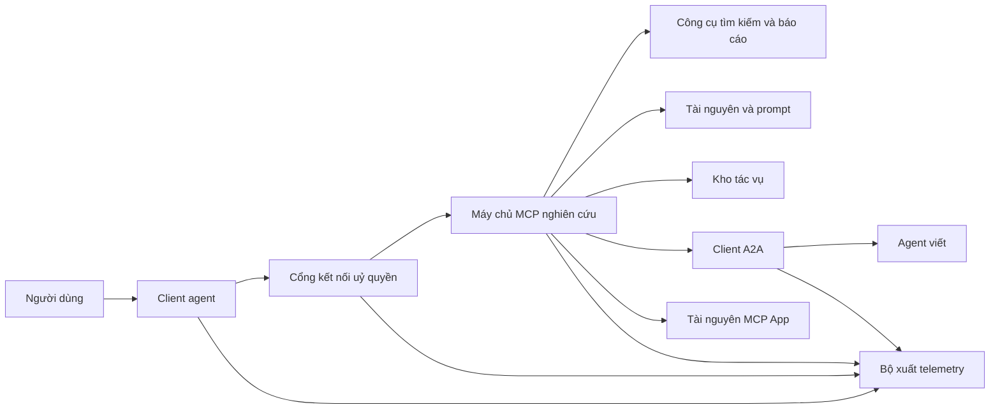
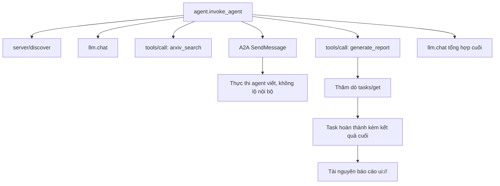
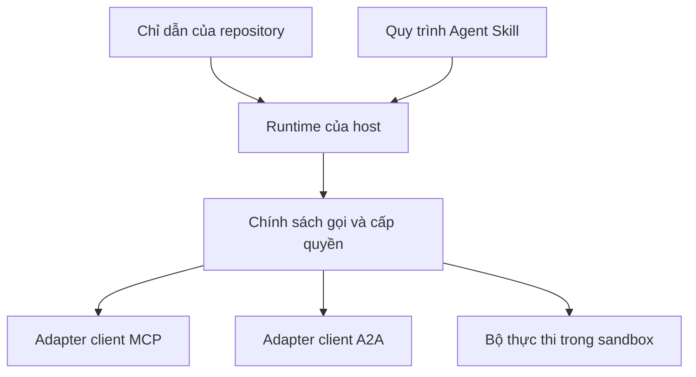

# Bài tổng kết (capstone): Hệ sinh thái công cụ (tool ecosystem) không trạng thái

> Một hệ thống agent chạy production là một tập các ranh giới, không phải một đống tính năng. Bài tổng kết này tách một bản mô phỏng trong tiến trình dễ đọc khỏi những thứ mà một triển khai thật vẫn cần: các client giao thức, máy chủ uỷ quyền, sandbox, và bộ xuất telemetry.

**Type:** Build
**Languages:** Python (stdlib, in-process simulation)
**Prerequisites:** Giai đoạn 13, Bài 01-22, theo bản MCP 2026-07-28
**Time:** ~120 phút

## Mục tiêu học tập

- Ghép lời gọi công cụ, kết quả có hình dạng tác vụ, công việc uỷ thác, tài nguyên UI, chính sách uỷ quyền, và bản ghi trace thành một luồng duy nhất.
- Mang theo phiên bản giao thức, danh tính client, và các năng lực trên mọi yêu cầu MCP thay vì dựa vào một phiên kết nối.
- Khám phá máy chủ trước khi dùng và điều khiển công việc dài thông qua phần mở rộng Tasks chính thức.
- Phân biệt một bản mô phỏng có hình dạng giao thức với một triển khai MCP, A2A, OAuth, hay OpenTelemetry thật.
- Ánh xạ từng ranh giới mô phỏng sang thành phần production phải thay thế nó.
- Giữ `AGENTS.md`, một Agent Skill, các adapter runtime, công cụ, và chính sách bảo mật đúng vai trò của chúng.
- Giải thích được khẳng định nào kiểm chứng được từ output cục bộ và khẳng định nào cần kiểm thử tích hợp thật.

## Vấn đề

Thiết kế một hệ thống nghiên cứu và báo cáo. Người dùng hỏi về các bài báo nói về giao thức agent. Hệ thống tìm trong một danh mục bài báo, uỷ thác việc tóm tắt, tạo báo cáo, trả về một tài nguyên UI, và ghi lại đường đi qua hệ thống.

Câu đó che giấu nhiều hợp đồng (contract) độc lập:

- một schema công cụ hướng tới model;
- một envelope yêu cầu không trạng thái và hợp đồng khám phá máy chủ;
- một quyết định của cổng kết nối (gateway) về actor, phạm vi, và danh tính công cụ;
- một hợp đồng cho thao tác chạy dài;
- một giao thức uỷ thác;
- một cầu nối từ host sang app;
- lan truyền và xuất trace;
- một quy trình vận hành có thể tái sử dụng.

`code/main.py` giữ những ranh giới đó hiển thị rõ bằng các hàm Python và dict thông thường. Nó không mở transport, không gọi arXiv, không thực hiện OAuth, không gọi một máy chủ A2A, không render một MCP App, và không xuất telemetry. Nhờ vậy luồng điều khiển dễ soi, mà không trình bày một bản mô phỏng như thể đó là một dịch vụ đúng chuẩn.

## Khái niệm

### Kiến trúc đích



Kiến trúc này là một cách ghép mang tính khái niệm từ các mẫu giao thức công khai. Nó không phải khẳng định về nội bộ riêng tư của bất kỳ sản phẩm nào.

### Trace đích



Trong một triển khai thật, mỗi chặng đều lan truyền ngữ cảnh trace. Tên span và thuộc tính phải tuân theo quy ước ngữ nghĩa OpenTelemetry mà phiên bản instrumentation bạn chọn hỗ trợ. Chỉ có một trace identifier dùng chung thì không đủ chứng minh quan hệ cha-con đúng, việc xuất trace, hay việc backend tiếp nhận dữ liệu.

### Các bề mặt giao thức hiện tại

Dùng tên phương thức do giao thức hiện tại định nghĩa, không dùng tên nhớ từ một bản nháp cũ:

| Ranh giới | Bề mặt hiện tại | Bài tổng kết mô phỏng gì |
|---|---|---|
| Khám phá MCP | `server/discover` bắt buộc | Một hàm trực tiếp trả về phiên bản, năng lực, và danh tính máy chủ |
| Ngữ cảnh yêu cầu MCP | Phiên bản, năng lực, và danh tính client trong mọi `params._meta` | Metadata yêu cầu mới được truyền vào từng lời gọi mô phỏng |
| Lời gọi công cụ MCP | `tools/call` | Điều phối hàm Python trực tiếp |
| Thăm dò tác vụ MCP | `io.modelcontextprotocol/tasks` với `tasks/get` | Một handle đang chạy, sau đó là một tác vụ hoàn thành mang kết quả cuối |
| Uỷ thác A2A | `SendMessage` trong gRPC và JSON-RPC; `POST /message:send` trong HTTP+JSON | Một span lồng nhau, không gọi từ xa và không tạo độ trễ nhân tạo |
| MCP App gọi công cụ của máy chủ | `app.callServerTool({ name, arguments })` | Một chuỗi HTML, không có cầu nối sống |
| Uỷ quyền OAuth | Máy chủ uỷ quyền, metadata tài nguyên được bảo vệ, kiểm tra audience và phạm vi | Tra cứu token tĩnh và kiểm tra tư cách thành viên phạm vi |
| OpenTelemetry | SDK, propagator, exporter, và collector hoặc backend | Các dict span trong bộ nhớ |

Tên giao thức mới chỉ là lớp đầu tiên. Kiểm thử production phải chạy qua serialization, lỗi xác thực, huỷ bỏ, timeout, thử lại, và tương thích phiên bản trên đường truyền thật.

### MCP không trạng thái thay đổi ranh giới tích hợp

Bản `2026-07-28` bỏ các phiên giao thức và bỏ handshake `initialize` / `notifications/initialized`. Bản này cũng bỏ `Mcp-Session-Id`. Mỗi yêu cầu mang các trường `_meta` có không gian tên sau:

```json
{
  "io.modelcontextprotocol/protocolVersion": "2026-07-28",
  "io.modelcontextprotocol/clientCapabilities": {
    "extensions": {
      "io.modelcontextprotocol/tasks": {}
    }
  },
  "io.modelcontextprotocol/clientInfo": {
    "name": "capstone-client",
    "version": "1.0.0"
  }
}
```

Máy chủ phải triển khai `server/discover`. Kết quả thông thường dùng `resultType: "complete"`; một handle tác vụ dùng `resultType: "task"`. Mỗi kết quả nên định danh máy chủ trong `_meta.io.modelcontextprotocol/serverInfo`.

Phần mở rộng tác vụ có `tasks/get`, `tasks/update`, và `tasks/cancel`. Một công cụ có thể trả về `resultType: "task"` trước; bản thân `tasks/get` trả về `resultType: "complete"`, và `Task` đã hoàn thành chứa kết quả cuối. Các phương thức cũ `tasks/result` và `tasks/list` không thuộc phần mở rộng hiện tại. Client phải quảng bá `io.modelcontextprotocol/tasks` trong đúng yêu cầu có thể nhận được handle tác vụ. Nếu không, máy chủ trả `-32021` với `requiredCapabilities` có hình dạng của object năng lực client còn thiếu, bao gồm `extensions.io.modelcontextprotocol/tasks`.

### Tư thế bảo mật

Triển khai dự định dùng phòng thủ nhiều lớp:

- uỷ quyền OAuth kèm PKCE ở nơi loại client yêu cầu;
- ràng buộc tài nguyên và audience cho access token được cấp;
- RBAC ở cổng kết nối để kiểm tra công cụ và phạm vi được yêu cầu;
- thông tin xác thực phía upstream giữ ngoài ngữ cảnh model nhìn thấy;
- một manifest mô tả công cụ đã được ghim hoặc đã được rà soát;
- rà soát theo Rule of Two cho đầu vào không đáng tin, dữ liệu nhạy cảm, và hành động có hệ quả;
- một sandbox thực thi với giới hạn filesystem, tiến trình, mạng, thông tin xác thực, và tài nguyên được thực thi bên ngoài skill.

Bản demo chỉ triển khai token tĩnh, kiểm tra phạm vi, và hash mô tả. Nó hữu ích cho luồng chính sách, không phải để kiểm định bảo mật.

### Skill là quy trình, không phải transport

Một Agent Skill có thể nói cho runtime biết cách chạy quy trình nghiên cứu, cần chờ những hợp đồng công cụ nào, lưu bằng chứng gì, và dừng khi nào. Nó không thể làm một máy chủ MCP tồn tại, thiết lập tương thích A2A, cấp phạm vi, hay tạo sandbox.



Hãy đóng gói cả thư mục skill khi quy trình có tham chiếu tới các file đi kèm. Artifact dạng file phẳng trong bài tổng kết cũ này là một bản thiết kế khoá học, không phải bằng chứng rằng một host bảo toàn được gói di động. Bài 24 đến 27 xây và kiểm thử toàn bộ vòng đời của gói.

### Metadata artifact của khoá học là một adapter cục bộ

Danh mục khoá học và bộ cài nhận diện các file phẳng tên `skill-*.md`, nhưng đó là quy ước của repository chứ không phải hợp đồng gói Agent Skills di động. Bộ phân tích frontmatter tối giản của chúng chỉ đọc các khoá ở cấp cao nhất. Vì vậy bài này giữ các trường định danh di động và các trường danh mục khoá học ở cùng một cấp:

```yaml
---
name: ecosystem-blueprint
description: Produce a full Phase 13 ecosystem architecture for a product need.
version: "1.0.0"
phase: "13"
lesson: "23"
tags: [mcp, capstone, ecosystem, architecture, a2a, otel]
---
```

`name` và `description` là các trường định danh di động. `version`, `phase`, `lesson`, và `tags` là phần mở rộng danh mục riêng của khoá học. Bộ phân tích của khoá học yêu cầu `tags` là danh sách inline để `--tag capstone` khớp được.

Một skill dạng thư mục di động có thể dùng map `metadata` tuỳ chọn cho dữ liệu mở rộng kiểu chuỗi. Điều đó không làm `metadata` trở nên tương đương với schema danh mục của repository này. Nếu file phẳng này lồng `version` hoặc `tags` bên dưới `metadata`, bộ phân tích tối giản sẽ bỏ qua các khoá thụt lề đó, danh mục ghi nhận phiên bản rỗng, và lọc theo tag không tìm thấy artifact. Host production nên dùng một YAML parser an toàn và kiểm tra schema do chính nó tài liệu hoá.

### Mô phỏng so với production

| Lớp | `code/main.py` | Thành phần production thay thế | Bằng chứng bắt buộc |
|---|---|---|---|
| Khám phá | `server_discover()` cộng `TOOLS` tĩnh | `server/discover` rồi `tools/list` có nhận biết cache | Bản ghi đường truyền, thứ tự tất định, và kiểm tra schema |
| Xác thực | Dict khoá theo token | Uỷ quyền OAuth và kiểm tra ở máy chủ tài nguyên | Kiểm thử issuer, audience, phạm vi, thời hạn, và các trường hợp lỗi |
| Uỷ quyền | Tư cách thành viên phạm vi | Chính sách cổng kết nối ràng buộc actor, công cụ, đích, và tenant | Các ca audit cho phép và từ chối |
| Tìm kiếm | Fixture bài báo tĩnh | API tìm kiếm hoặc máy chủ MCP | Nguồn gốc dữ liệu, xếp hạng, và kiểm thử lỗi |
| Tác vụ | Handle cục bộ cộng `tasks/get` tức thời | Kho `io.modelcontextprotocol/tasks` bền vững với `tasks/get`, `tasks/update`, `tasks/cancel`, và TTL | Kiểm thử chuyển trạng thái, đầu vào, huỷ bỏ, và phục hồi |
| Uỷ thác | Sleep cộng span lồng nhau | Client A2A và Agent Card từ xa | Kiểm thử hợp đồng, timeout, thử lại, và tính không trong suốt |
| App | Chuỗi HTML và URI | Tài nguyên MCP Apps và cầu nối `App` | Kiểm thử CSP, quyền, lời gọi công cụ, và trình duyệt |
| Telemetry | Danh sách trong bộ nhớ | SDK OTel và exporter | Collector xác nhận đã nhận và kiểm tra quan hệ cha của trace |
| Sandbox | Không có | Bộ thực thi cô lập do host thực thi | Kiểm thử thoát khỏi sandbox, lưu lượng ra ngoài, bí mật, và giới hạn tài nguyên |

Bảng này là ranh giới bàn giao. Một lần chạy cục bộ màu xanh chỉ xác nhận bản mô phỏng.

### Bản đồ Giai đoạn 13

| Bài | Đóng góp |
|---|---|
| 01-05 | Giao diện công cụ, lời gọi, schema, kết quả có cấu trúc, và kiểm tra tất định |
| 06-14 | Envelope yêu cầu MCP không trạng thái, khám phá, transport, tài nguyên, prompt, phần mở rộng, và Apps |
| 15-18 | Phòng chống đầu độc, OAuth, cổng kết nối, sổ đăng ký (registry), và xác thực production |
| 19 | Uỷ thác thông điệp và tác vụ A2A |
| 20 | Thiết kế trace OpenTelemetry GenAI |
| 21 | Định tuyến theo nhà cung cấp model |
| 22 | Hợp đồng skill di động và ranh giới runtime |

```figure
t3-capstone-chain
```

## Tự tay làm

Chạy bộ khung trong tiến trình:

```bash
cd phases/13-tools-and-protocols/23-capstone-tool-ecosystem
python3 code/main.py
```

Soi năm thứ:

1. `server/discover` quảng bá bản `2026-07-28` và phần mở rộng Tasks.
2. Alice đọc được và tạo được báo cáo, còn lời gọi có phạm vi ghi của Bob bị từ chối.
3. Mọi span cục bộ trong một lần chạy orchestrator chia sẻ một trace identifier và ghi lại các span identifier cha.
4. Báo cáo bắt đầu như một handle tác vụ. `tasks/get` trả về một tác vụ hoàn thành mà kết quả cuối chứa văn bản và một tham chiếu `ui://`.
5. Agent viết được uỷ thác vẫn không lộ nội bộ vì orchestrator chỉ ghi span ở ranh giới.
6. Không output nào khẳng định đã có kết nối mạng, trao đổi OAuth, xuất lên collector, render trên trình duyệt, hay thực thi trong sandbox.

Script chạy hai lần, nên nó tạo ra hai root trace. Các mục audit chỉ tồn tại trong tiến trình và được đặt lại ở lần chạy sau.

## Áp dụng

Nâng cấp từng lớp một:

1. Thay `server_discover()` và danh sách công cụ tĩnh bằng lời gọi `server/discover` và `tools/list` thật. Gửi phiên bản, danh tính, và năng lực trong mọi yêu cầu.
2. Thay token tĩnh bằng máy chủ uỷ quyền và kiểm tra ở tài nguyên được bảo vệ.
3. Triển khai phần mở rộng `io.modelcontextprotocol/tasks` và kiểm thử `tasks/get`, `tasks/update`, `tasks/cancel`, timeout, TTL, và phục hồi sau khởi động lại. Đừng thêm `tasks/result` hay `tasks/list`.
4. Thay stub uỷ thác bằng một client A2A biết phân giải Agent Card và gửi thông điệp.
5. Xây App bằng SDK chính thức và gọi công cụ của máy chủ qua `app.callServerTool`.
6. Xuất span lên một test collector và khẳng định quan hệ cha tại nơi nhận.
7. Chạy thực thi công cụ và script bên trong hợp đồng sandbox từ Bài 26.
8. Đóng gói quy trình thành một gói thư mục đầy đủ và vượt qua cổng phát hành của Bài 27.

Mỗi lần nâng cấp cần một kiểm thử tích hợp đi qua ranh giới mới. Đừng xoá các kiểm thử chính sách cấp thấp hơn khi đường truyền đã thành thật.

## Đóng gói

Bài này tạo ra `outputs/skill-ecosystem-blueprint.md`, một artifact khoá học một file kiểu cũ. Nó yêu cầu một kiến trúc dài một trang bao quát primitive, bảo mật, uỷ thác, telemetry, đóng gói, và rủi ro vận hành khó nhất. Các trường danh mục cấp cao nhất của nó được bộ phân tích danh mục và bộ cài thật của repository kiểm tra.

Vì không phải một gói thư mục, nó không mang được tham chiếu, script, asset, hay fixture eval. Hãy dùng định dạng gói từ Bài 22 và Bài 24 đến 27 khi phát hành một skill tái sử dụng bên ngoài khoá học này.

## Bài tập

1. Chạy `code/main.py`. Tách những sự thật được output chứng minh khỏi những khẳng định production vẫn cần bằng chứng tích hợp.
2. Thêm một backend tĩnh thứ hai và định nghĩa quy tắc xung đột cho hai công cụ cùng tên. Sau đó thay cả hai danh sách bằng lời gọi `tools/list` thật.
3. Thay stub agent viết bằng một máy chủ A2A thử nghiệm. Ghi lại Agent Card, yêu cầu thông điệp, nhánh timeout, và artifact trả về.
4. Thêm một kho tác vụ sống sót qua lần khởi động lại tiến trình. Chứng minh client có thể tiếp tục bằng `tasks/get`, tôn trọng `pollIntervalMs`, và đọc kết quả cuối của tác vụ đã hoàn thành mà không cần `tasks/result`.
5. Xây một MCP App tối giản và kiểm chứng `app.callServerTool` trên trình duyệt với CSP chặt và quyền được khai báo rõ ràng.
6. Xuất các span mô phỏng qua SDK OTel lên một collector cục bộ. Khẳng định việc nhận dữ liệu, trace identifier, quan hệ cha, và trạng thái lỗi.
7. Viết `AGENTS.md` cho các quy tắc bảo trì toàn repository và một gói skill riêng cho quy trình nghiên cứu tái sử dụng. Giải thích vì sao không file nào trong hai file đó cấp quyền dùng công cụ.

## Thuật ngữ chính

| Thuật ngữ | Người ta thường nói | Ý nghĩa thực sự |
|---|---|---|
| Capstone | "Mọi thứ được nối với nhau" | Một tích hợp theo từng bước, trong đó ranh giới mô phỏng và ranh giới thật vẫn được nêu rõ |
| Protocol-shaped simulation | "Nó cơ bản là MCP" | Dữ liệu và lời gọi cục bộ trông giống một giao thức nhưng không triển khai hợp đồng đường truyền của nó |
| Tasks extension | "Một lời gọi công cụ dài" | Vòng đời `io.modelcontextprotocol/tasks` tuỳ chọn với danh tính bền vững, thăm dò, đầu vào từ client, kết quả cuối, và ngữ nghĩa huỷ bỏ |
| Opacity boundary | "Agent kia lo việc đó" | Bên gọi chỉ thấy giao diện và artifact đã khai báo, không thấy suy luận riêng tư hay trạng thái nội bộ |
| Runtime adapter | "Tích hợp skill" | Mã host ánh xạ quy trình di động sang khám phá, gọi, công cụ, chính sách, và ngữ cảnh |
| Integration evidence | "Nó chạy qua rồi" | Một bản ghi đường truyền, một artifact, hay quan sát phía nơi nhận chứng minh ranh giới thật đã bị vượt qua |

## Đọc thêm

- [Đặc tả MCP 2026-07-28](https://modelcontextprotocol.io/specification/2026-07-28) cho yêu cầu không trạng thái, khám phá, công cụ, uỷ quyền, và hành vi transport.
- [Những thay đổi chính của MCP 2026-07-28](https://modelcontextprotocol.io/specification/2026-07-28/changelog) cho việc bỏ phiên, metadata theo từng yêu cầu, MRTR, phần mở rộng, và các nội dung bị loại bỏ.
- [Phần mở rộng MCP Tasks](https://tasks.extensions.modelcontextprotocol.io/specification/draft/tasks) cho `tasks/get`, `tasks/update`, `tasks/cancel`, và kết quả cuối do tác vụ kết thúc mang theo.
- [SDK MCP Apps](https://github.com/modelcontextprotocol/ext-apps/blob/main/docs/overview.md) cho `App` và `app.callServerTool`.
- [Giao thức A2A](https://a2a-protocol.org/latest/) cho Agent Card, gửi thông điệp, tác vụ, artifact, và các ràng buộc transport.
- [Quy ước ngữ nghĩa OpenTelemetry GenAI](https://opentelemetry.io/docs/specs/semconv/gen-ai/) cho quy ước trace và thuộc tính.
- [Đặc tả Agent Skills](https://agentskills.io/specification) cho hợp đồng gói di động mà lớp quy trình sử dụng.

---

[← Bài trước: Agent Skills: hợp đồng portable và ranh giới thực thi](../../22-skills-and-agent-sdks/docs/vi.md) · [Bài sau: Khám phá skill và tiết lộ dần →](../../24-skill-discovery-and-progressive-disclosure/docs/vi.md)
