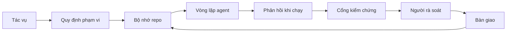

# Kỹ thuật workbench cho agent: Vì sao model giỏi vẫn thất bại

> Một model giỏi là chưa đủ. Agent đáng tin cậy cần một workbench: chỉ dẫn, trạng thái, phạm vi, phản hồi, kiểm chứng, rà soát và bàn giao. Bỏ những thứ đó đi, ngay cả model hàng đầu cũng tạo ra sản phẩm không an toàn để bàn giao.

**Type:** Learn + Build
**Languages:** Python (stdlib)
**Prerequisites:** Giai đoạn 14 · 01 (Vòng lặp Agent), Giai đoạn 14 · 26 (Các kiểu thất bại)
**Time:** ~45 phút

## Mục tiêu học tập

- Phân biệt năng lực của model với độ tin cậy khi thực thi.
- Kể tên bảy thành phần workbench quyết định liệu agent có bàn giao được sản phẩm hay không.
- So sánh lượt chạy chỉ có prompt với lượt chạy được workbench hướng dẫn trên một tác vụ repo nhỏ.
- Tạo báo cáo về các kiểu thất bại, liên hệ từng thành phần bị thiếu với triệu chứng mà nó gây ra.

## Vấn đề

Bạn đưa một model hàng đầu vào repo thực và yêu cầu nó thêm bước kiểm tra dữ liệu đầu vào. Nó mở bốn tệp, viết mã trông hợp lý, tuyên bố thành công rồi dừng lại. Bạn chạy các bài test. Hai bài thất bại. Một tệp thứ ba không liên quan đến việc kiểm tra dữ liệu cũng bị sửa. Không có ghi chép nào về những gì agent đã giả định, đã thử trước tiên, hay còn phải làm.

Model không sai về Python. Nó hiểu sai công việc. Nó không biết thế nào là hoàn thành, được phép ghi vào đâu, bài test nào là căn cứ quyết định, hay phiên tiếp theo phải tiếp tục ra sao.

Đây không phải lỗi của model. Đây là lỗi của workbench (môi trường làm việc của agent). Môi trường quanh agent thiếu những phần biến một lần sinh kết quả thành công việc kỹ thuật đáng tin cậy và có thể tiếp tục.

## Khái niệm

Workbench là môi trường vận hành bao quanh model trong lúc làm tác vụ. Nó có bảy thành phần:

| Thành phần | Thông tin nó chứa | Điều xảy ra khi thiếu |
|---------|-----------------|----------------------|
| Chỉ dẫn | Quy tắc khởi động, hành động bị cấm, tiêu chí hoàn thành | Agent tự đoán thế nào là đủ để bàn giao |
| Trạng thái | Tác vụ hiện tại, tệp đã sửa, trở ngại, hành động tiếp theo | Mỗi phiên đều phải bắt đầu lại từ đầu |
| Phạm vi | Tệp được phép sửa, tệp bị cấm, tiêu chí chấp nhận | Chỉnh sửa lan sang mã không liên quan |
| Phản hồi | Kết quả lệnh thực tế được đưa vào vòng lặp | Agent tuyên bố thành công dù nhận lỗi 400 |
| Kiểm chứng | Bài test, lint, chạy thử, kiểm tra phạm vi | Kết quả “trông ổn” được đưa vào main |
| Rà soát | Lượt kiểm tra thứ hai với vai trò khác | Người viết tự chấm bài của mình |
| Bàn giao | Những gì đã thay đổi, lý do, việc còn lại | Phiên tiếp theo phải tìm hiểu lại mọi thứ |

Workbench không phụ thuộc vào model. Bạn có thể thay model mà vẫn giữ các thành phần này. Bạn không thể bỏ các thành phần đó mà vẫn giữ được độ tin cậy.



Vòng lặp khép lại ở tệp trạng thái, không phải lịch sử chat. Chat có thể mất đi. Repo là nguồn ghi nhận chính thức.

### Workbench so với kỹ thuật viết prompt

Prompt cho model biết bạn muốn gì ở lượt này. Workbench cho model biết cách làm việc qua nhiều lượt và nhiều phiên. Phần lớn câu chuyện về agent thất bại thực chất là lỗi workbench đội lốt lỗi viết prompt.

### Workbench so với framework

Framework cung cấp môi trường chạy (LangGraph, AutoGen, Agents SDK). Workbench cung cấp nơi để agent làm việc trong môi trường đó. Bạn cần cả hai. Nhánh bài học ngắn này nói về phần thứ hai.

### Suy luận từ các thành phần nền tảng, không phải cách phân loại của nhà cung cấp

Hiện có rất nhiều bài viết về “harness engineering”. Addy Osmani, OpenAI, Anthropic, LangChain, Martin Fowler, MongoDB, HumanLayer, Augment Code, Thoughtworks, danh sách awesome của walkinglabs, cùng các bài viết liên tục xuất hiện trên Medium và Hacker News đều đang bàn về chủ đề này. Họ không thống nhất ranh giới của harness, phạm vi của nó hay bộ thuật ngữ cần dùng. Chúng ta không cần chọn phe. Bảy thành phần là lớp trải nghiệm cho người dùng; bên dưới mọi workbench là cùng một bộ thành phần nền tảng của hệ thống phân tán, vốn nâng đỡ mọi hệ thống backend đáng tin cậy.

Tạm bỏ nhãn agent sang một bên. Một lượt chạy của agent là quá trình tính toán trải dài qua thời gian, các tiến trình và các máy. Để quá trình đó đáng tin cậy, bạn cần những thành phần nền tảng giống như bất kỳ hệ thống production nào.

| Thành phần nền tảng | Bản chất | Vai trò đối với agent |
|-----------|------------|------------------------------|
| Function | Bộ xử lý có kiểu dữ liệu xác định. Thuần hàm khi có thể. Tự quản lý đầu vào và đầu ra. | Lệnh gọi công cụ, phép kiểm tra quy tắc, bước kiểm chứng, lần gọi model |
| Worker | Tiến trình chạy lâu dài, quản lý một hoặc nhiều function và vòng đời của chúng | Agent xây dựng, người rà soát, bộ kiểm chứng, máy chủ MCP |
| Trigger | Nguồn sự kiện kích hoạt một function | Nhịp chạy của vòng lặp agent, yêu cầu HTTP, thông điệp trong hàng đợi, cron, thay đổi tệp, hook |
| Runtime | Ranh giới quyết định tác vụ chạy ở đâu, với thời hạn và tài nguyên nào | Tiến trình của Claude Code, runtime của LangGraph, container chạy worker |
| HTTP / RPC | Kênh giao tiếp giữa bên gọi và worker | Giao thức gọi công cụ, yêu cầu MCP, API của model |
| Queue | Bộ đệm bền vững giữa trigger và worker; kiểm soát tải, thử lại, tính lũy đẳng | Bảng tác vụ, nhật ký phản hồi, hộp thư chờ rà soát |
| Session persistence | Trạng thái tồn tại qua sự cố, lần khởi động lại và lần thay model | `agent_state.json`, checkpoint, kho KV, chính repo |
| Authorization policy | Quy định ai được gọi function nào trong phạm vi nào | Tệp được phép/bị cấm, ranh giới cần phê duyệt, danh sách quyền của MCP |

Giờ hãy ánh xạ bảy thành phần workbench vào những thành phần nền tảng đó.

- **Chỉ dẫn** — chính sách + thông tin mô tả function. Quy tắc là các phép kiểm tra (function). Bộ định tuyến (`AGENTS.md`) là chính sách gắn với lúc runtime khởi động.
- **Trạng thái** — cơ chế lưu trạng thái phiên. Một kho dữ liệu có khóa mà runtime đọc ở mỗi bước. Tệp, KV hay DB đều được; điều quan trọng là cách dữ liệu được duy trì, không phải hệ thống lưu trữ.
- **Phạm vi** — chính sách phân quyền cho từng tác vụ. Các glob chỉ tệp được phép/bị cấm là một ACL. Các yêu cầu phê duyệt tạo thành hệ phân cấp quyền.
- **Phản hồi** — nhật ký lệnh gọi được ghi vào hàng đợi. Mỗi lệnh shell là một bản ghi bền vững, có thể phát lại.
- **Kiểm chứng** — một function. Cho kết quả xác định từ đầu vào. Được kích hoạt khi đóng tác vụ. Nếu không đạt thì chặn.
- **Rà soát** — một worker riêng, chỉ có quyền đọc sản phẩm của agent xây dựng và chỉ có quyền ghi báo cáo rà soát.
- **Bàn giao** — bản ghi bền vững do trigger kết thúc phiên tạo ra. Trigger khởi động của phiên tiếp theo sẽ đọc nó.

Bản thân vòng lặp agent là một worker nhận sự kiện (tin nhắn người dùng, kết quả công cụ, nhịp hẹn giờ), gọi function (model, rồi các công cụ model chọn), ghi bản ghi (trạng thái, phản hồi) và phát trigger (kiểm chứng, rà soát, bàn giao). Không có gì bí ẩn; nó có cùng cấu trúc với một bộ xử lý công việc.

### Các mô hình đang được dùng, nhìn qua thành phần nền tảng

Mọi mô hình harness phổ biến đều quy về tám thành phần nền tảng. Bảng đối chiếu dưới đây cho thấy điều đó.

| Mô hình của nhà cung cấp hoặc cộng đồng | Bản chất thực sự |
|------------------------------|--------------------|
| Ralph Loop (Claude Code, Codex, agentic_harness book) — đưa lại mục tiêu ban đầu vào cửa sổ ngữ cảnh mới khi agent định dừng quá sớm | Một trigger đưa tác vụ trở lại hàng đợi với ngữ cảnh sạch; trạng thái được duy trì qua các phiên mang mục tiêu sang phiên sau |
| Plan / Execute / Verify (PEV) | Ba worker, mỗi worker một vai trò, giao tiếp qua trạng thái và hàng đợi giữa các giai đoạn |
| Harness-compute separation (OpenAI Agents SDK, April 2026) — tách mặt phẳng điều khiển khỏi mặt phẳng thực thi | Cách diễn đạt lại phân tách mặt phẳng điều khiển / mặt phẳng dữ liệu. Ý tưởng này có từ nhiều thập kỷ trước khi xuất hiện nhãn agent |
| Open Agent Passport (OAP, March 2026) — ký và kiểm tra mọi lệnh gọi công cụ theo chính sách khai báo trước khi thực thi | Chính sách phân quyền do worker chạy trước hành động thực thi, kèm hàng đợi nhật ký kiểm toán có chữ ký |
| Guides and Sensors (Birgitta Böckeler / Thoughtworks) — quy tắc định hướng trước + khả năng quan sát phản hồi | Chính sách phân quyền + function kiểm chứng + dấu vết quan sát |
| Progressive compaction, 5-stage (Claude Code reverse engineering, April 2026) | Worker quản lý trạng thái, chạy định kỳ kiểu cron trên dữ liệu phiên được lưu để giữ dữ liệu trong giới hạn |
| Hooks / middleware (LangChain, Claude Code) — chặn các lệnh gọi model và công cụ để xử lý | Trigger + function bọc quanh đường đi của lệnh gọi trong runtime |
| Skills as Markdown with progressive disclosure (Anthropic, Flue) | Kho đăng ký function, trong đó thông tin mô tả function chỉ được nạp vào ngữ cảnh khi cần |
| Sandbox agents (Codex, Sandcastle, Vercel Sandbox) | Mặt phẳng tính toán: runtime có hệ thống tệp, mạng và vòng đời được cô lập |
| MCP servers | Các worker cung cấp function qua RPC ổn định, với danh sách quyền làm cơ chế phân quyền |

Mỗi mục trong bảng là một trường hợp cộng đồng agent tìm đến thành phần nền tảng vốn đã có tên trong hệ thống phân tán, rồi đặt cho nó tên mới. Nhãn mới có ích cho tiếp thị, không có ích làm ngôn ngữ kỹ thuật.

### Các số liệu thực tế nói gì

Giờ đã có số liệu hậu thuẫn cho nhận định rằng harness quan trọng hơn model. Bạn nên biết chúng, vì đó cũng là lập luận trung thực duy nhất để phản bác câu “cứ chờ model thông minh hơn”.

- Terminal Bench 2.0 — với cùng một model, thay đổi harness đưa một agent viết mã từ ngoài top 30 lên hạng năm (LangChain, *Anatomy of an Agent Harness*).
- Vercel — bỏ 80% công cụ của agent; tỷ lệ thành công tăng từ 80% lên 100% (MongoDB).
- Harvey — độ chính xác của agent pháp lý tăng hơn gấp đôi chỉ nhờ tối ưu harness (MongoDB).
- 88% dự án AI agent trong doanh nghiệp không đi vào production. Các thất bại tập trung ở runtime, không phải khả năng suy luận (preprints.org, *Harness Engineering for Language Agents*, March 2026).
- Một nghiên cứu benchmark năm 2025 trên ba framework mã nguồn mở phổ biến ghi nhận tỷ lệ hoàn thành tác vụ khoảng ~50%; WebAgent với ngữ cảnh dài giảm từ 40-50% xuống dưới 10% trong điều kiện ngữ cảnh dài, chủ yếu do vòng lặp vô hạn và đánh mất mục tiêu (được nhiều bài viết đầu năm 2026 nhắc tới).

Kết luận không phải là “harness sẽ thắng mãi mãi”. Theo thời gian, model sẽ hấp thụ các kỹ thuật của harness. Điều cần rút ra là hiện nay, phần kỹ thuật gánh vác độ tin cậy nằm quanh model chứ không ở bên trong nó, và các thành phần chịu tải đó chính là những thứ mọi hệ thống production vẫn luôn cần.

### Những điều bài viết của nhà cung cấp chưa nói tới

Ở phần này, bạn không cần nói giảm nói tránh.

- *Anatomy of an Agent Harness* của LangChain liệt kê mười một thành phần — prompt, công cụ, hook, sandbox, điều phối, bộ nhớ, skill, subagent và runtime với “vòng lặp đơn giản”. Bài viết không nhắc đến hàng đợi, worker như một đơn vị triển khai, ngữ nghĩa của trigger, việc duy trì trạng thái phiên như một mối quan tâm riêng, hay chính sách phân quyền. Nó xem harness là một đối tượng để cấu hình, không phải một hệ thống để triển khai.
- *Agent Harness Engineering* của Addy Osmani đưa ra cách nhìn `Agent = Model + Harness` và mô hình ratchet, nhưng chưa nói harness được xây từ những gì. Nó giống một quan điểm hơn là một bản đặc tả.
- Anthropic và OpenAI đi sâu nhất vào các thành phần nhưng vẫn giới hạn trong runtime của họ. Thông báo về “harness-compute separation” trong Agents SDK vào April 2026 là bài đầu tiên từ nhà cung cấp công khai ủng hộ việc tách mặt phẳng điều khiển / mặt phẳng dữ liệu. Đó là một ý tưởng nền tảng, không phải ý tưởng mới.
- Cuốn agentic_harness xem harness là một đối tượng cấu hình (*Agentic Engineering* của Jaymin West, chương 6), và câu sắc nhất trong đó là “harness là ranh giới bảo mật chính trong hệ thống agent”. Nói cách khác, đó là chính sách phân quyền.
- Các cuộc thảo luận trên Hacker News liên tục đi đến cùng một điểm. Chủ đề *The agent harness belongs outside the sandbox* vào April 2026 lập luận rằng harness nên nằm “giống một hypervisor ở bên ngoài mọi thứ và cấp quyền truy cập dựa trên ngữ cảnh cùng người dùng”. Một lần nữa, đó là chính sách phân quyền trên một mặt phẳng riêng.

Bạn không cần phản đối bài viết nào để nhận ra khoảng trống đó. Họ đang mô tả trải nghiệm sử dụng của một hệ thống đã tồn tại. Chúng ta đang xây dựng hệ thống ấy. Khi hệ thống được xây đúng, bảy thành phần sẽ hình thành từ các thành phần nền tảng. Khi nó được xây sai, đánh bóng `AGENTS.md` đến đâu cũng không bù được hàng đợi bị thiếu.

Vì vậy, khi nghe ai đó nói “harness engineering”, hãy quy nó về các thành phần nền tảng. Prompt và quy tắc là chính sách và function. Bộ khung hỗ trợ là runtime. Rào chắn là phân quyền + kiểm chứng. Hook là trigger. Bộ nhớ là việc duy trì trạng thái phiên. Ralph Loop là đưa tác vụ trở lại hàng đợi. Subagent là worker. Sandbox là mặt phẳng tính toán. Từ ngữ thay đổi; công việc kỹ thuật thì không. Workbench là trải nghiệm làm việc dành cho agent; còn harness, theo nghĩa vẫn đứng vững qua lần đổi cách diễn đạt tiếp theo của nhà cung cấp, là function, worker, trigger, runtime, hàng đợi, cơ chế lưu trạng thái và chính sách được kết nối đúng cách.

```figure
wb-seven-surfaces
```

## Tự tay làm

`code/main.py` chạy một tác vụ repo nhỏ hai lần. Lần đầu chỉ dùng prompt, lần sau có đủ bảy thành phần. Cùng model, cùng tác vụ. Script đếm các thành phần bị thiếu trong lượt chạy thất bại và in báo cáo về các kiểu thất bại.

Tác vụ repo được cố ý giữ nhỏ: thêm bước kiểm tra dữ liệu đầu vào cho một handler kiểu FastAPI trong một tệp và viết một bài test chạy thành công.

Chạy lệnh sau:

```
python3 code/main.py
```

Kết quả: nhật ký đặt hai lượt chạy cạnh nhau, tệp `failure_modes.json` tóm tắt lượt chạy chỉ dùng prompt, và kết luận một dòng cho lượt chạy có workbench.

Agent ở đây là một bản mô phỏng nhỏ hoạt động theo quy tắc; trọng tâm là các thành phần, không phải model. Trong phần còn lại của nhánh bài học ngắn này, bạn sẽ xây lại từng thành phần thành một sản phẩm thực sự có thể tái sử dụng.

## Áp dụng

Ba nơi đã có các thành phần workbench trong thực tế, dù không ai gọi chúng bằng tên đó:

- **Claude Code, Codex, Cursor.** `AGENTS.md` và `CLAUDE.md` là thành phần chỉ dẫn. Lệnh slash là phạm vi. Hook là kiểm chứng.
- **LangGraph, OpenAI Agents SDK.** Checkpoint và kho lưu phiên là thành phần trạng thái. Handoff là thành phần bàn giao.
- **CI trên repo thực.** Bài test, lint và kiểm tra kiểu dữ liệu là kiểm chứng. Mẫu PR là bàn giao. CODEOWNERS là rà soát.

Kỹ thuật workbench là việc xác định rõ và tái sử dụng các thành phần đó, thay vì để mỗi nhóm tự tìm ra chúng từ đầu.

## Đóng gói

`outputs/skill-workbench-audit.md` là một skill có thể mang sang nơi khác để kiểm tra bảy thành phần workbench của một repo hiện có và báo cáo thành phần nào bị thiếu, chưa hoàn chỉnh hoặc đã hoạt động tốt. Đặt nó cạnh bất kỳ cấu hình agent nào; nó sẽ cho bạn biết cần sửa gì trước.

## Bài tập

1. Chọn một repo mà bạn đã dùng agent. Chấm bảy thành phần từ 0 (thiếu) đến 2 (hoạt động tốt). Thành phần yếu nhất của bạn là gì?
2. Mở rộng `main.py` để lượt chạy chỉ dùng prompt cũng đưa ra một tuyên bố “thành công” giả. Kiểm tra xem cổng kiểm chứng có phát hiện được không.
3. Thêm thành phần thứ tám cho sản phẩm của bạn. Giải thích vì sao nó không thể gộp vào một trong bảy thành phần hiện có.
4. Chạy lại script với một agent mô phỏng khác tưởng tượng ra thao tác ghi vào một tệp ngoài dự kiến. Thành phần nào phát hiện trước?
5. Ánh xạ năm kiểu thất bại thường gặp trong ngành từ Giai đoạn 14 · 26 vào bảy thành phần. Mỗi thành phần được thiết kế để ngăn kiểu thất bại nào?

## Thuật ngữ chính

| Thuật ngữ | Người ta thường nói | Ý nghĩa thực sự |
|------|----------------|------------------------|
| Workbench | “Phần thiết lập” | Các thành phần được thiết kế quanh model để công việc đáng tin cậy |
| Surface | “Một tài liệu” hoặc “một script” | Đầu vào có tên, máy đọc được, mà agent đọc hoặc ghi ở mỗi lượt |
| System of record | “Các ghi chú” | Tệp mà agent coi là nguồn thông tin đúng khi lịch sử chat không còn |
| Definition of done | “Tiêu chí chấp nhận” | Danh sách kiểm tra khách quan, được lưu trong tệp, mà agent không thể giả vờ đã đạt |
| Workbench audit | “Kiểm tra repo đã sẵn sàng chưa” | Lượt kiểm tra bảy thành phần để đánh dấu những phần còn thiếu trước khi bắt đầu công việc |

## Đọc thêm

Hãy đọc những tài liệu này như các góc nhìn tham khảo, không phải chân lý. Mỗi tài liệu chỉ đưa ra một cách phân loại chưa đầy đủ. Hãy quy mọi khái niệm về một thành phần nền tảng (function, worker, trigger, runtime, HTTP/RPC, hàng đợi, cơ chế lưu trạng thái, chính sách) trước khi quyết định áp dụng.

Cách nhìn của các nhà cung cấp:

- [Addy Osmani, Agent Harness Engineering](https://addyosmani.com/blog/agent-harness-engineering/) — `Agent = Model + Harness` và mô hình ratchet; ít bàn về hạ tầng
- [LangChain, The Anatomy of an Agent Harness](https://blog.langchain.com/the-anatomy-of-an-agent-harness/) — mười một thành phần: prompt, công cụ, hook, điều phối, sandbox, bộ nhớ, skill, subagent, runtime; bỏ qua hàng đợi, triển khai, phân quyền
- [OpenAI, Harness engineering: leveraging Codex in an agent-first world](https://openai.com/index/harness-engineering/) — góc nhìn của nhóm Codex về các thành phần quanh runtime của họ
- [OpenAI, Unrolling the Codex agent loop](https://openai.com/index/unrolling-the-codex-agent-loop/) — rút gọn vòng lặp agent thành một vòng `while` gọi các function
- [Anthropic, Effective harnesses for long-running agents](https://www.anthropic.com/engineering/effective-harnesses-for-long-running-agents) — các thành phần phục vụ tác vụ dài hạn trong một runtime cụ thể
- [Anthropic, Harness design for long-running application development](https://www.anthropic.com/engineering/harness-design-long-running-apps) — ghi chú thiết kế mang tính ứng dụng
- [LangChain Deep Agents harness capabilities](https://docs.langchain.com/oss/python/deepagents/harness) — thành phần cấu hình runtime

Bài viết của người thực hành có chi tiết hữu ích:

- [Martin Fowler / Birgitta Böckeler, Harness engineering for coding agent users](https://martinfowler.com/articles/harness-engineering.html) — định hướng trước (feedforward) + cảm biến phản hồi (feedback); cách diễn giải theo lý thuyết điều khiển rõ ràng nhất
- [HumanLayer, Skill Issue: Harness Engineering for Coding Agents](https://www.humanlayer.dev/blog/skill-issue-harness-engineering-for-coding-agents) — “vấn đề không nằm ở model mà ở cấu hình”
- [MongoDB, The Agent Harness: Why the LLM Is the Smallest Part of Your Agent System](https://www.mongodb.com/company/blog/technical/agent-harness-why-llm-is-smallest-part-of-your-agent-system) — số liệu: Vercel từ 80% lên 100%, độ chính xác của Harvey tăng 2 lần, Terminal Bench từ ngoài top 30 lên top 5
- [Augment Code, Harness Engineering for AI Coding Agents](https://www.augmentcode.com/guides/harness-engineering-ai-coding-agents) — hướng dẫn từng bước, bắt đầu từ các ràng buộc
- [Sequoia podcast, Harrison Chase on Context Engineering Long-Horizon Agents](https://sequoiacap.com/podcast/context-engineering-our-way-to-long-horizon-agents-langchains-harrison-chase/) — chú trọng các vấn đề của runtime hơn các vấn đề của model

Sách, bài nghiên cứu và bản triển khai tham khảo:

- [Jaymin West, Agentic Engineering — Chapter 6: Harnesses](https://www.jayminwest.com/agentic-engineering-book/6-harnesses) — phân tích dài như một chương sách, xem harness là ranh giới bảo mật chính
- [preprints.org, Harness Engineering for Language Agents (March 2026)](https://www.preprints.org/manuscript/202603.1756) — cách nhìn học thuật theo điều khiển / quyền chủ động / runtime
- [walkinglabs/awesome-harness-engineering](https://github.com/walkinglabs/awesome-harness-engineering) — danh sách tài liệu chọn lọc về ngữ cảnh, đánh giá, khả năng quan sát, điều phối
- [ai-boost/awesome-harness-engineering](https://github.com/ai-boost/awesome-harness-engineering) — danh sách chọn lọc khác (công cụ, đánh giá, bộ nhớ, MCP, quyền)
- [HKUDS/OpenHarness](https://github.com/HKUDS/OpenHarness) — harness agent mở, tích hợp sẵn agent cá nhân

Các chủ đề trên Hacker News đáng đọc để hiểu những điểm bất đồng, không phải để tìm sự đồng thuận:

- [HN: Effective harnesses for long-running agents](https://news.ycombinator.com/item?id=46081704)
- [HN: Improving 15 LLMs at Coding in One Afternoon. Only the Harness Changed](https://news.ycombinator.com/item?id=46988596)
- [HN: The agent harness belongs outside the sandbox](https://news.ycombinator.com/item?id=47990675) — lập luận rằng phân quyền nên nằm trên một mặt phẳng riêng

Các bài liên quan trong chương trình học này:

- Giai đoạn 14 · 23 — Các quy ước OpenTelemetry GenAI: lớp quan sát mà tài liệu về cảm biến hướng tới
- Giai đoạn 14 · 26 — Danh mục các kiểu thất bại mà bảy thành phần được thiết kế để ngăn chặn
- Giai đoạn 14 · 27 — Các biện pháp chống prompt injection nằm ở thành phần nền tảng là chính sách phân quyền
- Giai đoạn 14 · 29 — Runtime production (hàng đợi, sự kiện, cron): nơi các thành phần nền tảng trong bài này hoạt động khi triển khai

---

[← Bài trước: Phát triển agent dựa trên đánh giá](../../30-eval-driven-agent-development/docs/vi.md) · [Bài sau: Bộ công cụ tối thiểu cho agent →](../../32-minimal-agent-workbench/docs/vi.md)
