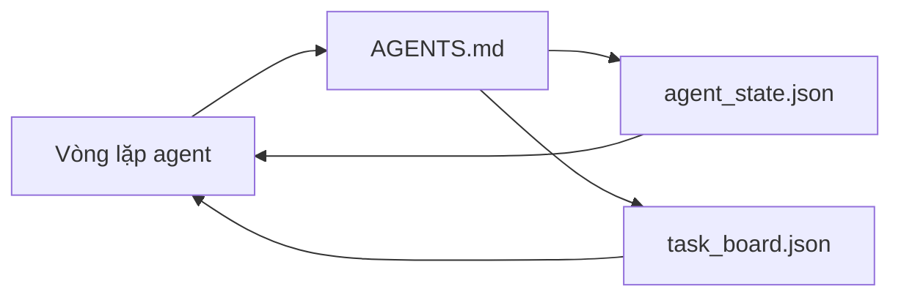

# Bộ công cụ tối thiểu cho agent

> Bộ công cụ hữu ích nhỏ nhất gồm ba tệp: một tệp gốc chỉ dẫn agent tìm đúng tài liệu, một tệp trạng thái và một bảng tác vụ. Mọi thứ khác đều được xây thêm trên nền tảng này. Nếu repo không duy trì nổi ba tệp đó, không mô hình nào cứu được nó.

**Type:** Build
**Languages:** Python (stdlib)
**Prerequisites:** Giai đoạn 14 · 31 (Vì sao các mô hình mạnh vẫn thất bại)
**Time:** ~45 phút

## Mục tiêu học tập

- Xác định ba tệp tạo nên bộ công cụ tối thiểu có thể dùng được.
- Giải thích vì sao một tệp gốc ngắn để định hướng agent hiệu quả hơn một `AGENTS.md` dài chứa tất cả chỉ dẫn.
- Tạo tệp trạng thái mà agent có thể đọc ở mỗi lượt và cập nhật khi kết thúc.
- Tạo bảng tác vụ giúp công việc kéo dài qua nhiều phiên mà không cần lịch sử trò chuyện.

## Vấn đề

Nhiều nhóm bắt đầu xây bộ công cụ bằng cách viết một tệp `AGENTS.md` dài 3000 dòng rồi coi như xong. Mô hình nạp tệp đó, bỏ qua những phần nó không thể tóm tắt, và vẫn thất bại ở đúng những chỗ cũ.

Bạn cần làm ngược lại. Một tệp gốc nhỏ, chỉ dẫn agent tìm đến các tệp chi tiết hơn khi cần. Trạng thái bền vững để agent đọc trước khi làm và cập nhật sau khi làm. Một bảng tác vụ cho biết việc nào đang thực hiện, việc nào bị chặn và việc nào tiếp theo.

Ba tệp. Mỗi tệp có một nhiệm vụ. Mỗi tệp đủ dễ để máy đọc, nhờ đó sau này có thể phát triển thành một hệ thống hoàn chỉnh.

## Khái niệm



### AGENTS.md là tệp định hướng, không phải sách hướng dẫn

Một tệp `AGENTS.md` tốt phải ngắn. Nó chỉ agent đến:

- Tệp trạng thái (bạn đang ở đâu).
- Bảng tác vụ (còn việc gì).
- Các quy tắc chi tiết hơn (trong `docs/agent-rules.md`).
- Lệnh kiểm chứng (làm sao biết mọi thứ hoạt động).

Nội dung dài hơn nên đặt trong tài liệu chi tiết và chỉ nạp khi cần. Sách hướng dẫn dài dễ bị bỏ qua. Tệp định hướng ngắn dễ được làm theo.

### agent_state.json là nguồn ghi nhận chính thức

Trạng thái lưu: id của tác vụ đang làm, các tệp đã chỉnh sửa, những giả định đã đưa ra, các trở ngại và hành động tiếp theo. Agent đọc nó ở mỗi lượt. Phiên sau đọc tệp này thay vì phải xem lại cuộc trò chuyện.

Trạng thái nằm trong tệp vì lịch sử trò chuyện không đáng tin cậy. Phiên làm việc có thể kết thúc. Cuộc trò chuyện có thể bị cắt bớt. Tệp thì vẫn còn.

### task_board.json là hàng đợi

Bảng tác vụ lưu mọi tác vụ với trạng thái `todo | in_progress | done | blocked`. Agent lấy việc từ hàng đợi này khi tệp trạng thái trống; bạn cũng xem nó để biết agent có đang đi đúng hướng không.

Mỗi tác vụ trên bảng có id, mục tiêu, người phụ trách (`builder`, `reviewer` hoặc `human`) và tiêu chí chấp nhận. Bảng được cố ý giữ gọn: khi nó dài quá một màn hình, vấn đề nằm ở khâu lập kế hoạch chứ không phải ở bảng.

### Ba tệp là mức tối thiểu, không phải giới hạn

Các bài sau sẽ bổ sung thỏa thuận về phạm vi, công cụ chạy phản hồi, bước kiểm chứng bắt buộc, danh sách kiểm tra cho người rà soát và gói bàn giao. Tất cả đều dựa trên ba tệp ở đây.

```figure
wb-three-files
```

## Tự tay làm

`code/main.py` tạo bộ công cụ tối thiểu trong một repo trống và minh họa một lượt làm việc của agent:

1. Đọc `agent_state.json`.
2. Lấy tác vụ tiếp theo từ `task_board.json` nếu tệp trạng thái trống.
3. Chỉnh sửa một tệp duy nhất trong phạm vi cho phép.
4. Ghi lại trạng thái đã cập nhật.

Chạy lệnh:

```
python3 code/main.py
```

Script tạo `workdir/` bên cạnh chính nó, đặt ba tệp vào đó, chạy một lượt rồi in ra phần thay đổi. Chạy lại để xem lượt thứ hai tiếp tục từ điểm lượt đầu dừng lại.

## Áp dụng

Trong các sản phẩm agent dùng thực tế, ba tệp này xuất hiện dưới những tên khác nhau:

- **Claude Code:** `AGENTS.md` hoặc `CLAUDE.md` làm tệp định hướng, các kho lưu kiểu `.claude/state.json` để giữ trạng thái, và hook cho bảng tác vụ.
- **Codex / Cursor:** quy tắc workspace làm tệp định hướng, bộ nhớ phiên làm việc để giữ trạng thái, và các tác vụ xếp hàng trong thanh bên của cuộc trò chuyện làm bảng tác vụ.
- **Agent Python tự xây:** chính những tệp bạn vừa tạo.

Tên gọi thay đổi. Cấu trúc thì không.

## Các cách triển khai thực tế

Bộ công cụ tối thiểu vẫn dùng được trong các monorepo thực tế khi bạn bổ sung ba cách triển khai sau. Chúng độc lập với nhau; hãy chọn những cách repo của bạn thực sự cần.

**Các tệp `AGENTS.md` lồng nhau, ưu tiên tệp gần nhất.** OpenAI dùng 88 tệp `AGENTS.md` trong repo chính, mỗi thành phần con một tệp. Codex, Cursor, Claude Code và Copilot đều đi từ tệp đang làm việc lên thư mục gốc của repo và ghép mọi tệp `AGENTS.md` tìm thấy trên đường đi. Tệp trong thư mục con bổ sung cho tệp gốc. Codex có thêm `AGENTS.override.md` để thay thế thay vì bổ sung; cơ chế ghi đè này chỉ có ở Codex, nên tránh dùng khi làm việc với nhiều công cụ. Kết quả đo của Augment Code là điều đáng chú ý: những tệp `AGENTS.md` tốt nhất nâng chất lượng tương đương việc chuyển từ Haiku lên Opus; những tệp tệ nhất khiến đầu ra còn kém hơn khi không có tệp nào.

**Những cách làm sai cần tránh, dù trông có vẻ đầy đủ.** Chỉ dẫn mâu thuẫn âm thầm khiến agent chuyển từ chế độ tương tác sang chế độ tham lam (ICLR 2026 AMBIG-SWE: tỷ lệ giải quyết 48.8% → 28%); hãy đánh số thứ tự ưu tiên thay vì xếp các chỉ dẫn ngang hàng. Quy tắc về phong cách không thể kiểm chứng ("follow the Google Python Style Guide") mà không có lệnh thực thi sẽ khiến agent tự cho là mình đã tuân thủ; hãy ghép mỗi quy tắc với đúng lệnh lint tương ứng. Đặt phong cách trước các lệnh sẽ chôn vùi cách kiểm chứng; đặt lệnh trước, phong cách sau. Viết cho con người thay vì cho agent sẽ lãng phí dung lượng ngữ cảnh; ngắn gọn là một ưu điểm.

**Symlink dùng chung cho nhiều công cụ.** Một tệp gốc duy nhất cùng các symlink (`ln -s AGENTS.md CLAUDE.md`, `ln -s AGENTS.md .github/copilot-instructions.md`, `ln -s AGENTS.md .cursorrules`) giúp mọi agent viết code dùng chung một nguồn thông tin chuẩn. `nx ai-setup` của Nx tự động thiết lập việc này cho Claude Code, Cursor, Copilot, Gemini, Codex và OpenCode từ một cấu hình duy nhất.

## Đóng gói

`outputs/skill-minimal-workbench.md` tạo bộ công cụ ba tệp cho bất kỳ repo mới nào: một tệp định hướng `AGENTS.md` phù hợp với dự án, một `agent_state.json` có các khóa cần thiết và một `task_board.json` chứa sẵn các việc đang chờ.

## Bài tập

1. Thêm dấu thời gian `last_run` vào `agent_state.json`. Từ chối chạy nếu tệp đã quá 24 giờ, trừ khi người vận hành xác nhận.
2. Thêm trường `priority` vào bảng tác vụ và sửa phần lấy việc để luôn chọn tác vụ `todo` có độ ưu tiên cao nhất.
3. Chuyển `task_board.json` sang JSON Lines để mỗi tác vụ nằm trên một dòng và phần thay đổi hiển thị rõ trong hệ thống quản lý phiên bản.
4. Viết `lint_workbench.py` để báo lỗi nếu `AGENTS.md` dài quá 80 dòng hoặc tham chiếu đến tệp không tồn tại.
5. Quyết định mất tệp nào trong ba tệp sẽ gây hại nhất. Bảo vệ lựa chọn của bạn.

## Thuật ngữ chính

| Thuật ngữ | Người ta thường nói | Ý nghĩa thực sự |
|------|----------------|------------------------|
| Router | `AGENTS.md` | Tệp gốc ngắn chỉ agent đến các tài liệu và tệp chi tiết hơn |
| State file | "Ghi chú" | Bản ghi mà máy có thể đọc, cho biết agent đang ở đâu và được cập nhật mỗi lượt |
| Task board | "Danh sách việc cần làm" | Hàng đợi công việc dạng JSON, có trạng thái, người phụ trách và tiêu chí chấp nhận |
| System of record | "Nguồn thông tin chuẩn" | Tệp mà bộ công cụ coi là có thẩm quyền khi cuộc trò chuyện không còn |

## Đọc thêm

- [agents.md — đặc tả mở](https://agents.md/) — được Cursor, Codex, Claude Code, Copilot, Gemini và OpenCode áp dụng
- [Augment Code, A good AGENTS.md is a model upgrade. A bad one is worse than no docs at all](https://www.augmentcode.com/blog/how-to-write-good-agents-dot-md-files) — các mức cải thiện chất lượng đã được đo lường
- [Blake Crosley, AGENTS.md Patterns: What Actually Changes Agent Behavior](https://blakecrosley.com/blog/agents-md-patterns) — điều gì hiệu quả trên thực tế và điều gì không
- [Datadog Frontend, Steering AI Agents in Monorepos with AGENTS.md](https://dev.to/datadog-frontend-dev/steering-ai-agents-in-monorepos-with-agentsmd-13g0) — cách áp dụng thứ tự ưu tiên giữa các tệp lồng nhau
- [Nx Blog, Teach Your AI Agent How to Work in a Monorepo](https://nx.dev/blog/nx-ai-agent-skills) — tạo cấu hình cho sáu công cụ từ một nguồn duy nhất
- [The Prompt Shelf, AGENTS.md Best Practices: Structure, Scope, and Real Examples](https://thepromptshelf.dev/blog/agents-md-best-practices/) — thứ tự các phần vẫn phù hợp sau khi rà soát
- [Anthropic, Claude Code subagents](https://code.claude.com/docs/en/sub-agents)
- Giai đoạn 14 · 31 — những kiểu thất bại mà bộ công cụ tối thiểu này giúp khắc phục
- Giai đoạn 14 · 34 — cấu trúc trạng thái bền vững được giới thiệu sơ bộ trong bài này

---

[← Bài trước: Kỹ thuật workbench cho agent: Vì sao model giỏi vẫn thất bại](../../31-agent-workbench-why-models-fail/docs/vi.md) · [Bài sau: Chỉ dẫn cho agent dưới dạng ràng buộc có thể thực thi →](../../33-instructions-as-executable-constraints/docs/vi.md)
