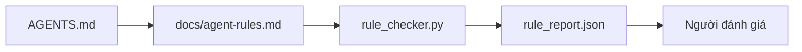

# Chỉ dẫn cho agent dưới dạng ràng buộc có thể thực thi

> Chỉ dẫn viết bằng văn xuôi chỉ là mong muốn. Chỉ dẫn viết thành ràng buộc là những phép kiểm tra. Workbench biến mỗi quy tắc thành điều agent có thể kiểm tra khi chạy và người đánh giá có thể xác minh sau đó.

**Type:** Build
**Languages:** Python (stdlib)
**Prerequisites:** Giai đoạn 14 · 32 (Minimal Workbench)
**Time:** ~50 phút

## Mục tiêu học tập

- Tách phần hướng dẫn định tuyến khỏi các quy tắc vận hành.
- Diễn đạt quy tắc khởi động, hành động bị cấm, tiêu chí hoàn thành, cách xử lý khi chưa chắc chắn và ranh giới cần phê duyệt thành các ràng buộc có thể kiểm tra bằng máy.
- Xây dựng bộ kiểm tra quy tắc để đánh giá một lượt chạy theo bộ quy tắc.
- Viết bộ quy tắc sao cho dễ xem thay đổi qua diff.

## Vấn đề

Một tệp `AGENTS.md` điển hình giống tài liệu hướng dẫn người mới. Nó bảo agent “hãy cẩn thận”, “kiểm thử kỹ” và “hãy hỏi nếu không chắc”. Ba ngày sau, agent bàn giao một thay đổi không có kiểm thử, ghi vào thư mục bị cấm và chẳng hỏi ai vì nó không hề biết ranh giới nằm ở đâu.

Chỉ dẫn có tác dụng khi chúng quy định hành động cụ thể, và kém hiệu quả khi chỉ nêu mong muốn. Cách khắc phục là viết quy tắc để workbench có thể diễn giải và người đánh giá có thể chấm mức tuân thủ.

## Khái niệm

Các quy tắc nằm trong `docs/agent-rules.md`, tách khỏi tệp định tuyến ngắn ở thư mục gốc. Mỗi quy tắc có tên, nhóm và phép kiểm tra.



### Năm nhóm bao quát hầu hết các quy tắc

| Nhóm | Câu hỏi mà quy tắc trả lời | Ví dụ |
|----------|---------------------------|---------|
| Khởi động | Điều gì phải đúng trước khi bắt đầu công việc? | “tệp trạng thái tồn tại và còn mới” |
| Điều cấm | Điều gì tuyệt đối không được xảy ra? | “không chỉnh sửa `scripts/release.sh`” |
| Tiêu chí hoàn thành | Điều gì chứng minh tác vụ đã hoàn tất? | “pytest thoát với mã 0 và dòng tiêu chí chấp nhận đạt yêu cầu” |
| Khi chưa chắc chắn | Agent làm gì khi không chắc? | “ghi lại câu hỏi thay vì đoán” |
| Phê duyệt | Việc gì cần con người phê duyệt? | “mọi dependency mới, mọi thao tác ghi vào môi trường production” |

Một quy tắc không thuộc một trong năm nhóm này thường cần được tách thành hai quy tắc. Hãy tách nó ra.

### Quy tắc có thể được máy đọc

Mỗi quy tắc có một slug (định danh ngắn), một nhóm, một dòng mô tả và trường `check` chỉ đến một hàm trong `rule_checker.py`. Thêm quy tắc nghĩa là thêm phép kiểm tra; bộ kiểm tra lớn lên cùng workbench.

### Quy tắc dễ xem thay đổi qua diff

Mỗi quy tắc nằm dưới một heading riêng trong cùng một tệp markdown. Việc đổi tên hiện rõ trong diff. Quy tắc mới được đặt ở đầu nhóm tương ứng. Quy tắc lỗi thời bị xóa chứ không được biến thành comment, vì workbench là nguồn thông tin chuẩn, không phải nhật ký trò chuyện ghi lại cảm nhận của nhóm vào quý trước.

### Quy tắc so với các cơ chế bảo vệ của framework

Các cơ chế bảo vệ của framework (guardrail của OpenAI Agents SDK, interrupt của LangGraph) thực thi quy tắc ở cấp runtime. Bộ quy tắc trong bài này là bản cam kết dễ đọc, dễ đánh giá mà các cơ chế đó triển khai. Bạn cần cả hai: runtime phát hiện vi phạm ngay trong một lượt hoạt động, còn bộ quy tắc giúp xác minh runtime đang làm đúng việc.

### Cung cấp thông tin theo từng lớp: bản đồ, không phải bách khoa toàn thư

Lý do `AGENTS.md` ngày càng dài là mỗi sự cố lại thêm một quy tắc mà không có sự cố nào khiến một quy tắc bị gỡ bỏ. Sau một năm, tệp dài hai nghìn dòng; agent đọc màn hình đầu tiên, cạn khả năng tập trung rồi chỉ làm theo một phần những gì được dặn. Một tệp chỉ dẫn khổng lồ thất bại vì cùng lý do tài liệu hướng dẫn người mới dài bốn mươi trang thất bại: người đọc lướt qua một lần rồi không bao giờ quay lại phần quan trọng.

Cách khắc phục không phải là một tệp ngắn hơn, mà là tổ chức theo lớp. Tệp định tuyến ở thư mục gốc đủ ngắn để đọc trong mọi phiên và chỉ chứa các đường dẫn tham chiếu. Nội dung chi tiết nằm trong các tệp theo chủ đề, agent chỉ tải khi tác vụ liên quan. Hãy đưa agent một tấm bản đồ, không phải cả bộ bách khoa toàn thư, rồi để nó tìm đến trang cần thiết.

```
AGENTS.md                  # router, < 50 lines: what this repo is, where to look, the 5 hard rules
docs/
  agent-rules.md           # the full rule set (this lesson)
  architecture.md          # loaded when the task touches module boundaries
  testing.md               # loaded when the task writes or runs tests
  deploy.md                # loaded only for release work, gated behind an approval rule
feature_list.json          # the backlog (Phase 14 · 36)
```

| Tầng | Nằm trong | Đọc khi | Giới hạn độ dài |
|------|----------|-----------|-------------|
| Tệp định tuyến | `AGENTS.md` | Luôn đọc trong mọi phiên | Dưới ~50 dòng |
| Quy tắc | `docs/agent-rules.md` | Khi bắt đầu mọi phiên | Mỗi nhóm gói gọn trong một màn hình |
| Tài liệu theo chủ đề | `docs/<topic>.md` | Chỉ khi tác vụ liên quan đến chủ đề đó | Chi tiết đến mức cần thiết |

Hai phép kiểm tra giúp cách chia lớp này giữ đúng mục đích. Kiểm tra khả năng tìm đến quy tắc: agent phải tìm được bất kỳ quy tắc nào trong tối đa hai bước từ tệp định tuyến, nên tệp định tuyến phải liên kết đến từng tài liệu chủ đề bằng đường dẫn, không chỉ mô tả bằng văn xuôi. Kiểm tra độ cập nhật: tệp định tuyến đủ ngắn để người đánh giá đọc lại trong mỗi PR; đó là cách duy nhất ngăn nó âm thầm phình trở lại thành bộ bách khoa toàn thư mà nó thay thế. Một đường dẫn tham chiếu không còn truy cập được còn tệ hơn một quy tắc bị thiếu, nên liên kết hỏng trong tệp định tuyến tự nó đã là vi phạm phép kiểm tra khởi động.

```figure
wb-rule-checkoff
```

## Tự tay làm

`code/main.py` cung cấp:

- Bộ phân tích cú pháp `agent-rules.md` để nạp các quy tắc vào một dataclass.
- Các hàm kiểm tra theo kiểu `rule_checker.py`, mỗi tham chiếu `check` có một hàm.
- Một lượt chạy agent minh họa vi phạm hai quy tắc và một lượt kiểm tra phát hiện cả hai.

Chạy bằng lệnh:

```
python3 code/main.py
```

Đầu ra: bộ quy tắc đã phân tích, dấu vết lượt chạy, kết quả đạt/không đạt cho từng quy tắc và tệp `rule_report.json` được lưu cạnh script.

## Các cách triển khai trong thực tế

Ba cách làm phân biệt một bộ quy tắc dùng tốt suốt một quý với bộ quy tắc xuống cấp chỉ sau một tuần.

**Gắn mức độ nghiêm trọng ngay khi viết.** Mỗi quy tắc có trường `severity`: `block`, `warn` hoặc `info`. Bộ kiểm tra báo cáo cả ba; runtime chỉ từ chối khi gặp `block`. Ban đầu, nhiều nhóm đánh giá mức độ quá cao rồi âm thầm hạ xuống khi bị áp lực thời hạn; gắn mức độ ngay khi viết buộc họ cân nhắc từ đầu. Kết hợp với cổng xác minh (Giai đoạn 14 · 38), nơi ghi mọi lần cho phép bỏ qua quy tắc `block` vào nhật ký kiểm toán `overrides.jsonl`.

**Ngày hết hạn buộc quy tắc phải được xem lại.** Mỗi quy tắc có ngày `expires_at` (mặc định là 90 ngày sau khi viết). Bộ kiểm tra phát cảnh báo khi một quy tắc chưa hết hạn không có vi phạm nào trong 60 ngày liên tiếp; đến đợt rà soát quý tiếp theo, nhóm phải giải thích lý do giữ lại, hạ xuống `info` hoặc xóa quy tắc đó. Dữ liệu AI Code Review trong môi trường production của Cloudflare (tháng 4 năm 2026, 131,246 lượt đánh giá trên 5,169 repo trong 30 ngày) cho thấy các bộ quy tắc có ngày hết hạn rõ ràng giữ được mức dưới 30 quy tắc mỗi repo; những bộ không có ngày hết hạn tăng lên hơn 80 quy tắc, phần lớn không bao giờ được kích hoạt.

**Markdown là nguồn, JSON là cache.** `agent-rules.md` là tệp được biên soạn; `agent-rules.lock.json` là cache mà bộ kiểm tra đọc trên đường xử lý thường xuyên. Một hook pre-commit tạo lại tệp lock. Diff của Markdown dễ đánh giá; không cần phân tích cú pháp JSON trong mỗi lượt. Cấu trúc này tương tự `package.json` / `package-lock.json` và `Cargo.toml` / `Cargo.lock`.

## Áp dụng

Trong môi trường production:

- Claude Code, Codex, Cursor đọc quy tắc khi bắt đầu phiên và trích dẫn chúng khi từ chối hành động. Bộ kiểm tra chạy lại các quy tắc trong CI để phát hiện sự sai lệch âm thầm.
- Guardrail của OpenAI Agents SDK đăng ký cùng các phép kiểm tra làm guardrail đầu vào và đầu ra. Markdown là phần tài liệu; SDK là phần thực thi lúc chạy.
- Interrupt của LangGraph được kích hoạt khi một node đang chạy vi phạm quy tắc. Bộ xử lý interrupt đọc quy tắc, hỏi con người rồi tiếp tục.

Bộ quy tắc dùng được với cả ba vì nó chỉ gồm markdown và tên hàm.

## Đóng gói

`outputs/skill-rule-set-builder.md` trao đổi với chủ dự án, phân loại các chỉ dẫn văn xuôi hiện có vào năm nhóm, rồi tạo một tệp `agent-rules.md` có phiên bản cùng bộ khung kiểm tra.

## Bài tập

1. Thêm nhóm thứ sáu nếu sản phẩm của bạn thực sự cần. Giải thích vì sao nhóm đó không thể gộp vào một trong năm nhóm.
2. Mở rộng bộ kiểm tra để quy tắc có thể mang mức độ nghiêm trọng (`block`, `warn`, `info`) và báo cáo tổng hợp theo mức độ.
3. Tích hợp bộ kiểm tra vào CI: cho bản build thất bại nếu một quy tắc ở mức chặn không đạt trong lượt chạy agent mới nhất.
4. Thêm trường “expiry” cho mỗi quy tắc. Sau 90 ngày không có lần kiểm tra thất bại, quy tắc cần được xem lại.
5. Tìm một tệp `AGENTS.md` thực tế và viết lại thành quy tắc thuộc năm nhóm. Bao nhiêu dòng trong đó quy định hành động cụ thể? Bao nhiêu dòng chỉ nêu mong muốn?

## Thuật ngữ chính

| Thuật ngữ | Người ta thường nói | Ý nghĩa thực sự |
|------|----------------|------------------------|
| Operational rule | “Một chỉ dẫn thực sự” | Quy tắc mà workbench có thể kiểm tra khi chạy |
| Aspirational rule | “Hãy cẩn thận” | Quy tắc không có phép kiểm tra; hãy xóa hoặc viết lại để có thể kiểm tra |
| Definition of done | “Tiêu chí chấp nhận” | Bằng chứng khách quan, được ghi trong tệp, cho thấy tác vụ đã hoàn tất |
| Block severity | “Quy tắc bắt buộc” | Vi phạm khiến lượt chạy dừng lại; không thể bỏ qua nếu không có người vận hành |
| Rule expiry | “Rà soát quy tắc lỗi thời” | Quy tắc không có lần kiểm tra thất bại nào trong N ngày cần được xem xét cho ngừng áp dụng |

## Đọc thêm

- [Guardrail của OpenAI Agents SDK](https://openai.github.io/openai-agents-python/guardrails/)
- [Interrupt của LangGraph](https://langchain-ai.github.io/langgraph/how-tos/human_in_the_loop/breakpoints/)
- [Anthropic, Building Effective Agents](https://www.anthropic.com/research/building-effective-agents)
- [Rick Hightower, Agent RuleZ: A Deterministic Policy Engine](https://medium.com/@richardhightower/agent-rulez-a-deterministic-policy-engine-for-ai-coding-agents-9489e0561edf) — các mức độ nghiêm trọng block/warn/info trong môi trường production
- [Cloudflare, Orchestrating AI Code Review at Scale](https://blog.cloudflare.com/ai-code-review/) — 131k lượt đánh giá, bài học về cách kết hợp quy tắc
- [microservices.io, GenAI development platform — part 1: guardrails](https://microservices.io/post/architecture/2026/03/09/genai-development-platform-part-1-development-guardrails.html) — nhiều lớp bảo vệ giữa quy tắc và CI
- [Type-Checked Compliance: Deterministic Guardrails (arXiv 2604.01483)](https://arxiv.org/pdf/2604.01483) — Lean 4 cho thấy mức độ chặt chẽ cao nhất khi biến quy tắc thành phép kiểm tra
- [logi-cmd/agent-guardrails](https://github.com/logi-cmd/agent-guardrails) — cách triển khai cổng hợp nhất: phạm vi, kiểm thử đột biến, giới hạn vi phạm
- Giai đoạn 14 · 32 — workbench tối giản mà bộ quy tắc này được đưa vào
- Giai đoạn 14 · 38 — cổng xác minh sử dụng báo cáo quy tắc
- Giai đoạn 14 · 39 — agent đánh giá chấm mức độ tuân thủ quy tắc

---

[← Bài trước: Bộ công cụ tối thiểu cho agent](../../32-minimal-agent-workbench/docs/vi.md) · [Bài sau: Bộ nhớ repo và trạng thái bền vững →](../../34-repo-memory-and-state/docs/vi.md)
