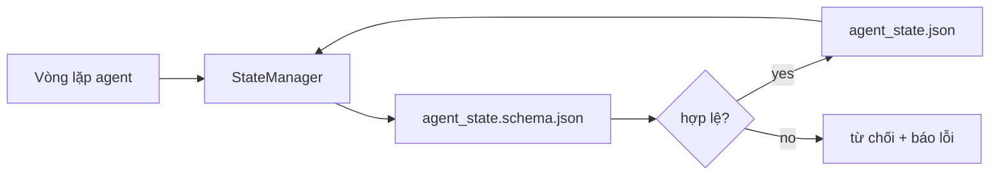

# Bộ nhớ repo và trạng thái bền vững

> Lịch sử chat có thể mất đi. Repo thì bền vững. Workbench lưu trạng thái agent trong các tệp có quản lý phiên bản để phiên tiếp theo, agent tiếp theo và người rà soát tiếp theo đều đọc cùng một nguồn thông tin đáng tin cậy.

**Type:** Build
**Languages:** Python (stdlib + `jsonschema` optional)
**Prerequisites:** Giai đoạn 14 · 32 (Workbench tối giản)
**Time:** ~60 phút

## Mục tiêu học tập

- Xác định nội dung nào thuộc bộ nhớ repo và nội dung nào thuộc lịch sử chat.
- Viết JSON Schema cho `agent_state.json` và `task_board.json`.
- Xây dựng trình quản lý trạng thái có thể tải, xác thực, cập nhật và lưu trạng thái theo cách nguyên tử.
- Dùng schema để từ chối thao tác ghi không hợp lệ trước khi chúng làm hỏng workbench.

## Vấn đề

Agent kết thúc một phiên. Cuộc chat đóng lại. Phiên tiếp theo bắt đầu và hỏi nên làm gì trước. Model nói “để tôi kiểm tra các tệp”, đọc những ghi chú đã cũ rồi làm lại việc đã hoàn thành. Tệ hơn, nó viết lại một tệp đã xong vì không ai cho nó biết tệp đó đã hoàn tất.

Cách khắc phục trong workbench là bộ nhớ repo: trạng thái nằm trong các tệp JSON thuộc repo, được ghi theo schema, lưu theo cách nguyên tử và dễ xem khác biệt khi rà soát code. Chat là luồng thông tin tạm thời; repo là nơi lưu bản ghi chính thức.

## Khái niệm



### Nội dung nào thuộc bộ nhớ repo

| Nên lưu | Không nên lưu |
|---------|-----------------|
| ID tác vụ đang thực hiện | Toàn bộ bản ghi chat |
| Các tệp đã chỉnh sửa trong phiên này | Dấu vết suy luận ở cấp token |
| Các giả định agent đã đưa ra | “Người dùng có vẻ bực bội” |
| Các trở ngại chưa giải quyết | Các câu trả lời được lấy mẫu |
| Hành động tiếp theo | ID model riêng của từng nhà cung cấp |

Tiêu chí là tính hữu ích lâu dài: thông tin này có còn hữu ích khi chạy lại CI sau ba tháng không? Nếu có, hãy lưu trong repo. Nếu không, hãy đưa vào dữ liệu theo dõi.

### Trạng thái được thiết kế từ schema

JSON Schema là bản quy ước. Không có nó, mỗi agent tự nghĩ ra các trường mới, mỗi người rà soát phải học một cấu trúc mới và mỗi script CI phải xử lý riêng các phiên bản cũ. Có schema, thao tác ghi không hợp lệ sẽ bị từ chối.

Schema quy định:

- Các khóa bắt buộc.
- Các giá trị `status` được phép.
- Các giá trị bị cấm (ví dụ: `null` đối với mảng).
- Ràng buộc về mẫu (ID tác vụ khớp `T-\d{3,}`).
- Trường phiên bản để phục vụ việc chuyển đổi.

### Ghi nguyên tử

Việc ghi trạng thái phải chịu được lỗi xảy ra giữa chừng: ghi vào tệp tạm, fsync, rồi đổi tên đè lên tệp đích. Tệp trạng thái là nguồn thông tin đáng tin cậy; một tệp chỉ được ghi dở còn tệ hơn là không có tệp nào.

### Chuyển đổi phiên bản

Khi schema thay đổi, hãy đưa kèm script chuyển đổi với lần tăng phiên bản schema. Tệp trạng thái có trường `schema_version`; trình quản lý từ chối tải tệp thuộc phiên bản mà nó không thể chuyển đổi.

```figure
wb-state-persist
```

## Tự tay làm

`code/main.py` triển khai:

- `agent_state.schema.json` và `task_board.schema.json`.
- Trình xác thực chỉ dùng thư viện chuẩn (một phần của JSON Schema: required, type, enum, pattern, items).
- `StateManager.load`, `StateManager.update`, `StateManager.commit` với cách ghi nguyên tử bằng tệp tạm rồi đổi tên.
- Một bản demo cập nhật trạng thái, lưu, tải lại và chứng minh dữ liệu vẫn nguyên vẹn sau chu trình đó.

Chạy bằng lệnh:

```
python3 code/main.py
```

Script ghi `workdir/agent_state.json` và `workdir/task_board.json`, cập nhật chúng qua hai lượt rồi in trạng thái đã xác thực ở mỗi bước.

## Các cách làm trong môi trường production

Bốn cách làm sau giúp biến mức tối thiểu của bài học thành thứ có thể hoạt động ổn định trong một monorepo nhiều agent.

**Ghi vào tệp tạm rồi đổi tên nguyên tử là bắt buộc.** Một báo cáo lỗi của dự án Hive vào tháng 3 năm 2026 mô tả rõ cách sự cố xảy ra: `state.json` được ghi bằng `write_text()`, còn các ngoại lệ thì bị bắt và bỏ qua. Những lần ghi dở khiến các phiên tiếp tục từ trạng thái hỏng mà không có cảnh báo. Cách khắc phục luôn là: dùng `tempfile.mkstemp` trong cùng thư mục với tệp đích, ghi, `fsync`, rồi `os.replace` (đổi tên nguyên tử trên POSIX và Windows). Hàm `atomic_write` của bài này làm đúng như vậy.

**Dùng khóa chống thực hiện lặp cho mọi lệnh gọi công cụ không an toàn khi lặp lại.** Nếu agent gặp sự cố sau khi gọi công cụ nhưng trước khi lưu kết quả vào checkpoint, quá trình khôi phục sẽ gọi lại công cụ. Việc này an toàn khi đọc, nhưng nguy hiểm với email, thao tác chèn vào DB hoặc tải tệp lên. Cách làm là ghi ID của mỗi lệnh gọi công cụ vào `pending_calls.jsonl` trước khi thực thi. Khi thử lại, hãy kiểm tra ID; nếu đã có, bỏ qua lệnh gọi và dùng kết quả đã lưu trong cache. Cả Anthropic và LangChain đều nhấn mạnh điều này trong hướng dẫn năm 2026; checkpointer của LangGraph lưu các thao tác ghi đang chờ vì cùng lý do.

**Tách các sản phẩm dữ liệu lớn khỏi trạng thái.** Đừng lưu CSV, bản ghi hội thoại dài hoặc tệp được tạo ra trong `agent_state.json`. Hãy lưu chúng thành tệp riêng (hoặc tải lên kho lưu trữ đối tượng) và chỉ giữ đường dẫn trong trạng thái. Checkpoint sẽ nhỏ và xử lý nhanh; các tệp kia có thể tăng kích thước độc lập.

**Dùng nhật ký sự kiện để kiểm tra, snapshot để tiếp tục.** Ghi thêm vào nhật ký sự kiện (`state.events.jsonl`) sau mỗi lần cập nhật; định kỳ lưu snapshot vào `state.json`. Khi tiếp tục, hệ thống đọc snapshot rồi phát lại mọi sự kiện sau mốc thời gian của snapshot. Cách này tốn thêm dung lượng đĩa nhưng cho phép bạn phát lại nguyên trạng các quyết định của agent — điều thiết yếu khi gỡ lỗi những lượt chạy kéo dài. Đây cũng là cấu trúc Postgres dùng bên trong cho WAL.

**Chuyển đổi schema hoặc từ chối tải.** Số nguyên `schema_version` là bản quy ước. Khi trình quản lý tải một tệp có phiên bản không xác định, nó từ chối đọc. Hãy đưa kèm script chuyển đổi với lần tăng phiên bản schema; `tools/migrate_state.py` chạy an toàn khi lặp lại mỗi lần khởi động.

## Áp dụng

Trong môi trường production:

- **Checkpointer của LangGraph.** Cùng ý tưởng, cách lưu trữ khác. Checkpointer lưu trạng thái graph vào SQLite, Postgres hoặc một backend tùy chỉnh. Schema trong bài này là thứ bạn cần khi checkpointer ngừng hoạt động và bạn phải tự đọc trạng thái.
- **Các khối bộ nhớ của Letta.** Các khối lưu bền với schema có cấu trúc (Giai đoạn 14 · 08). Cùng cách làm nghiêm ngặt ấy, áp dụng cho các persona hoạt động lâu dài.
- **Kho lưu phiên của OpenAI Agents SDK.** Có thể thay backend và nhận biết schema. Tệp trạng thái trong bài này là backend dùng tệp cục bộ.

## Đóng gói

`outputs/skill-state-schema.md` tạo một cặp JSON Schema dành riêng cho dự án (trạng thái + bảng tác vụ), một `StateManager` Python dùng cách ghi nguyên tử và bộ khung chuyển đổi để lần tăng phiên bản schema tiếp theo không làm hỏng workbench.

## Bài tập

1. Thêm dấu thời gian `last_human_touch`. Từ chối mọi thao tác ghi của agent trong vòng năm giây sau khi con người chỉnh sửa.
2. Mở rộng trình xác thực để hỗ trợ `oneOf`, cho phép một tác vụ là tác vụ xây dựng hoặc tác vụ rà soát, với các trường bắt buộc khác nhau.
3. Thêm trường `schema_version` và viết phần chuyển đổi từ v1 sang v2 (đổi tên `blockers` thành `risks`).
4. Chuyển backend lưu trữ từ tệp cục bộ sang SQLite. Giữ nguyên API của `StateManager`.
5. Cho hai agent cùng làm việc với một tệp trạng thái trong điều kiện tranh ghi cách nhau 50 ms. Điều gì xảy ra và việc đổi tên nguyên tử giúp bạn ra sao?

## Thuật ngữ chính

| Thuật ngữ | Người ta thường nói | Ý nghĩa thực sự |
|------|----------------|------------------------|
| Repo memory | “Tệp ghi chú” | Trạng thái được lưu trong các tệp có theo dõi phiên bản ở repo, theo schema |
| Schema-first | “Xác thực đầu vào” | Xác định bản quy ước trước khi viết phần ghi dữ liệu, từ chối những thay đổi lệch khỏi quy ước |
| Atomic write | “Chỉ cần đổi tên” | Ghi vào tệp tạm, fsync rồi đổi tên để lỗi giữa chừng không thể làm hỏng dữ liệu |
| Migration | “Tăng phiên bản schema” | Script chuyển trạng thái vN thành trạng thái v(N+1) |
| System of record | “Nguồn thông tin đáng tin cậy” | Tệp mà workbench xem là bản ghi có thẩm quyền |

## Đọc thêm

- [Đặc tả JSON Schema](https://json-schema.org/specification.html)
- [Checkpointer của LangGraph](https://langchain-ai.github.io/langgraph/concepts/persistence/)
- [Các khối bộ nhớ của Letta](https://docs.letta.com/v1-sdk/memory/memory-blocks)
- [Fast.io, AI Agent State Checkpointing: A Practical Guide](https://fast.io/resources/ai-agent-state-checkpointing/) — lưu checkpoint theo schema với khóa chống thực hiện lặp
- [Fast.io, AI Agent Workflow State Persistence: Best Practices 2026](https://fast.io/resources/ai-agent-workflow-state-persistence/) — kiểm soát truy cập đồng thời, TTL, ghi nhật ký sự kiện
- [Hive Issue #6263 — non-atomic state.json writes silently ignored](https://github.com/aden-hive/hive/issues/6263) — cách sự cố xảy ra trong một dự án thực tế
- [eunomia, Checkpoint/Restore Systems: Evolution, Techniques, Applications](https://eunomia.dev/blog/2025/05/11/checkpointrestore-systems-evolution-techniques-and-applications-in-ai-agents/) — áp dụng các cơ chế checkpoint/khôi phục từ lịch sử hệ điều hành cho agent
- [Indium, 7 State Persistence Strategies for Long-Running AI Agents in 2026](https://www.indium.tech/blog/7-state-persistence-strategies-ai-agents-2026/)
- [Microsoft Agent Framework, Compaction](https://learn.microsoft.com/en-us/agent-framework/agents/conversations/compaction) — trình quản lý checkpoint của nhà cung cấp
- Giai đoạn 14 · 08 — các khối bộ nhớ và tính toán trong thời gian nghỉ
- Giai đoạn 14 · 32 — bộ ba tệp tối thiểu mà bài học này xây dựng schema cho
- Giai đoạn 14 · 40 — các gói bàn giao đọc từ cùng schema

---

[← Bài trước: Chỉ dẫn cho agent dưới dạng ràng buộc có thể thực thi](../../33-instructions-as-executable-constraints/docs/vi.md) · [Bài sau: Tập lệnh khởi tạo cho agent →](../../35-initialization-scripts/docs/vi.md)
