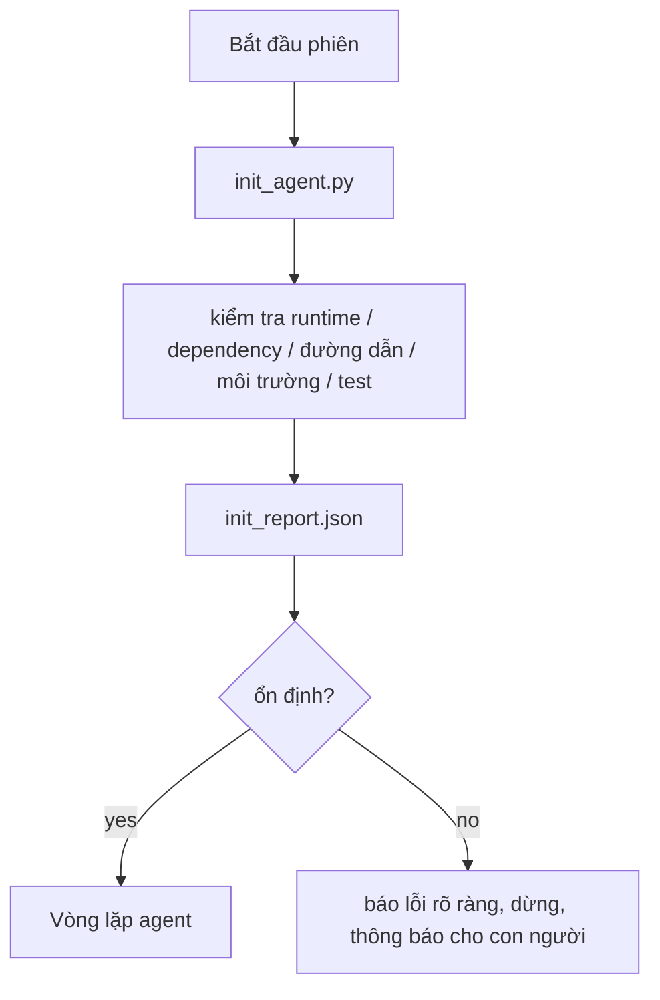

# Tập lệnh khởi tạo cho agent

> Mỗi phiên bắt đầu từ đầu đều phải trả một khoản phí. Agent đọc lại cùng những tệp, thử lại cùng những phép kiểm tra và tìm lại cùng những đường dẫn. Một tập lệnh khởi tạo làm việc đó một lần rồi ghi kết quả vào state.

**Type:** Build
**Languages:** Python (stdlib)
**Prerequisites:** Giai đoạn 14 · 32 (Bàn làm việc tối giản), Giai đoạn 14 · 34 (Bộ nhớ repo)
**Time:** ~45 phút

## Mục tiêu học tập

- Xác định những việc agent không nên phải làm lại trong mỗi phiên.
- Xây dựng tập lệnh khởi tạo có kết quả xác định để kiểm tra runtime, dependency và tình trạng repo.
- Lưu kết quả kiểm tra để agent đọc thay vì chạy lại.
- Khi khởi tạo thất bại, báo lỗi rõ ràng, dừng sớm và chỉ ra một nơi để xem nguyên nhân.

## Vấn đề

Mở một phiên làm việc. Agent đoán phiên bản Python. Đoán lệnh chạy test. Liệt kê thư mục gốc của repo năm lần để tìm điểm vào. Thử import một package chưa được cài. Hỏi người dùng tệp config nằm ở đâu. Đến khi thực sự sửa mã, nó đã tiêu tốn mười nghìn token cho việc thiết lập vốn chỉ cần một tập lệnh.

Cách khắc phục là một tập lệnh khởi tạo chạy trước mọi việc khác của agent và ghi tệp `init_report.json` để agent đọc khi bắt đầu.

## Khái niệm



### Tập lệnh khởi tạo kiểm tra những gì

| Hạng mục kiểm tra | Vì sao quan trọng |
|-------|----------------|
| Phiên bản runtime | Sai phiên bản Python hoặc Node có thể gây lỗi âm thầm do khác phiên bản |
| Khả năng sử dụng dependency | Phát hiện package bị thiếu ngay bây giờ đỡ tốn công gấp mười lần so với phát hiện sau |
| Lệnh chạy test | Agent phải biết cách kiểm chứng; thiếu lệnh này nghĩa là bàn làm việc chưa sẵn sàng |
| Đường dẫn trong repo | Đường dẫn viết cố định có thể không còn đúng; hãy xác định một lần rồi lưu lại |
| Biến môi trường | Thiếu `OPENAI_API_KEY` là một lỗi cần báo rõ, không phải điều bí ẩn khi chạy |
| Độ mới của state + board | State cũ từ một phiên bị lỗi có thể gây rắc rối |
| Commit tốt gần nhất | Mốc tham chiếu để tạo diff bàn giao cuối phiên |

### Báo lỗi rõ ràng, dừng sớm, chỉ một nơi để xem

Nếu một phép kiểm tra thất bại, hãy dừng và thông báo cho con người. Đừng nghĩ rằng “agent sẽ tự tìm ra cách”. Mục đích của bước khởi tạo là từ chối bắt đầu khi bàn làm việc chưa sẵn sàng.

### Chạy lặp lại an toàn

Chạy hai lần liên tiếp. Lần thứ hai không nên thay đổi gì ngoài dấu thời gian mới. Tính chất này cho phép bạn gắn tập lệnh vào CI, hook hoặc lệnh tắt chạy trước tác vụ.

### Khởi tạo so với quy tắc lúc bắt đầu

Các quy tắc (Giai đoạn 14 · 33) mô tả những điều kiện phải đúng trước khi hành động. Tập lệnh khởi tạo thiết lập cách kiểm tra các điều kiện đó. Có quy tắc mà không có bước khởi tạo thì chỉ còn là lời nhắc “hãy cẩn thận”. Có bước khởi tạo mà không có quy tắc thì chỉ tạo ra một lỗi được trình bày đẹp mắt.

```figure
wb-init-probes
```

## Tự tay làm

`code/main.py` triển khai `init_agent.py`:

- Năm phép kiểm tra: phiên bản Python, các dependency được liệt kê qua `importlib.util.find_spec`, khả năng tìm được lệnh chạy test, các biến môi trường bắt buộc và độ mới của tệp state.
- Mỗi phép kiểm tra trả về `(name, status, detail)`.
- Tập lệnh ghi đầy đủ kết quả kiểm tra vào `init_report.json` và thoát với mã khác không nếu bất kỳ phép kiểm tra nào có mức độ chặn bị thất bại.

Chạy tập lệnh:

```
python3 code/main.py
```

Tập lệnh in bảng kết quả kiểm tra, ghi `init_report.json` và thoát với mã không khi mọi việc suôn sẻ; nếu không, nó thoát với mã khác không cùng danh sách các phép kiểm tra thất bại.

## Các mẫu triển khai trong thực tế

Ba mẫu sau phân biệt một tập lệnh khởi tạo hữu ích với một thủ tục hình thức.

**Dùng commit tốt gần nhất làm mốc.** Kiểm tra commit hiện tại so với tệp `LKG` được ghi sau lần merge thành công gần nhất. Nếu diff vượt ngưỡng (mặc định 50 tệp), hãy từ chối bắt đầu và yêu cầu con người xác nhận mốc mới. Cloudflare's AI Code Review dùng cách này để xác định phạm vi cho các agent đánh giá mã: mỗi phiên đánh giá đều dựa trên cùng một commit tốt gần nhất và không để sai lệch tích lũy qua các phiên.

**Tệp khóa có TTL (thời gian tồn tại).** Ghi `prereqs.lock` sau lượt kiểm tra thành công đầu tiên. Những lần chạy sau tin vào tệp khóa trong N giờ (mặc định 24h) và bỏ qua các phép kiểm tra tốn kém. Tập lệnh khởi tạo đọc tệp khóa trước; nếu tệp còn mới và hash của danh sách dependency khớp, nó bỏ qua phần kiểm tra còn lại. Đây cũng là mẫu Docker dùng cho cache các layer: phép kiểm tra có thể chạy lặp lại + hash nội dung = bỏ qua.

**Không gọi mạng, không dùng LLM, không có bất ngờ trên luồng chạy chính.** Các phép kiểm tra lúc khởi tạo là phần thiết lập có kết quả xác định. Một phép kiểm tra gọi LLM để phân loại lỗi hoặc truy cập dịch vụ bên ngoài để kiểm tra giấy phép không còn là phép kiểm tra; đó là một quy trình làm việc. Nếu một phép kiểm tra mất hơn ba giây khi chạy thử, hãy xem đó là dấu hiệu bàn làm việc có vấn đề và chuyển nó ra khỏi bước khởi tạo hoặc lưu kết quả vào cache.

## Áp dụng

Trong môi trường production:

- **Claude Code hooks.** Hook `pre-task` gọi tập lệnh khởi tạo và từ chối chạy agent nếu tập lệnh thất bại.
- **GitHub Actions.** Một job `setup-agent` chạy tập lệnh khởi tạo; job của agent phụ thuộc vào job đó.
- **Docker entrypoint.** Container của agent chạy tập lệnh khởi tạo trước khi exec runtime của agent; lỗi sẽ hiện trong log.

Tập lệnh khởi tạo có thể dùng ở nhiều nơi vì không gọi framework cụ thể nào. Bash, Make hoặc tệp tác vụ đều có thể gọi nó.

## Đóng gói

`outputs/skill-init-script.md` tìm hiểu dự án, phân loại công việc thiết lập thành các phép kiểm tra, rồi tạo `init_agent.py` riêng cho dự án cùng một workflow CI chạy tập lệnh đó trước mọi bước của agent.

## Bài tập

1. Thêm phép kiểm tra so sánh commit hiện tại với commit tốt gần nhất và từ chối bắt đầu nếu có hơn 50 tệp thay đổi.
2. Cho tập lệnh ghi tệp `prereqs.lock` và từ chối bắt đầu nếu tệp khóa đã cũ hơn bảy ngày.
3. Thêm cờ `--fix` để tự cài các dependency phát triển còn thiếu nhưng không bao giờ sửa dependency runtime khi chưa được chấp thuận.
4. Chuyển các phép kiểm tra từ những hàm viết cố định sang một registry YAML. Giải thích sự đánh đổi.
5. Đặt giới hạn thời gian cho từng phép kiểm tra. Phép kiểm tra chạy quá ba giây là dấu hiệu bàn làm việc có vấn đề.

## Thuật ngữ chính

| Thuật ngữ | Người ta thường nói | Ý nghĩa thực sự |
|------|----------------|------------------------|
| Probe | “Một bước kiểm tra” | Hàm có kết quả xác định, trả về `(name, status, detail)` |
| Init report | “Kết quả thiết lập” | Tệp JSON ghi cạnh state, chứa kết quả các phép kiểm tra |
| Idempotent | “Chạy lại vẫn an toàn” | Hai lần chạy liên tiếp tạo báo cáo giống nhau, trừ dấu thời gian |
| Fail loud | “Đừng bỏ qua lỗi” | Dừng và thông báo cho con người; không âm thầm dùng phương án dự phòng |
| Setup tax | “Chi phí khởi động” | Số token agent tiêu tốn mỗi phiên để tìm lại những điều vốn đã rõ |

## Đọc thêm

- [Anthropic, Effective harnesses for long-running agents](https://www.anthropic.com/engineering/effective-harnesses-for-long-running-agents)
- [GitHub Actions, composite actions for setup](https://docs.github.com/en/actions/sharing-automations/creating-actions/creating-a-composite-action)
- [microservices.io, GenAI dev platform: guardrails](https://microservices.io/post/architecture/2026/03/09/genai-development-platform-part-1-development-guardrails.html) — kiểm tra trước commit và trong CI như một bước khởi tạo
- [Augment Code, How to Build Your AGENTS.md (2026)](https://www.augmentcode.com/guides/how-to-build-agents-md) — những yêu cầu đối với bước khởi tạo
- [Codex Blog, Codex CLI Context Compaction](https://codex.danielvaughan.com/2026/03/31/codex-cli-context-compaction-architecture/) — khởi đầu phiên có tính đến việc nén ngữ cảnh
- Giai đoạn 14 · 33 — bộ quy tắc mà tập lệnh này giúp thực thi
- Giai đoạn 14 · 34 — tệp state mà tập lệnh này tạo dữ liệu ban đầu
- Giai đoạn 14 · 38 — bước kiểm chứng nhận dữ liệu từ tập lệnh khởi tạo
- Giai đoạn 14 · 40 — bước bàn giao sử dụng commit tốt gần nhất trong báo cáo khởi tạo

---

[← Bài trước: Bộ nhớ repo và trạng thái bền vững](../../34-repo-memory-and-state/docs/vi.md) · [Bài sau: Hợp đồng phạm vi và ranh giới tác vụ →](../../36-scope-contracts/docs/vi.md)
