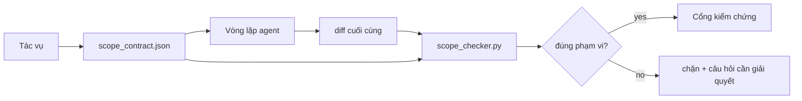

# Hợp đồng phạm vi và ranh giới tác vụ

> Mô hình không biết công việc kết thúc ở đâu. Hợp đồng phạm vi là một tệp cho từng tác vụ, xác định công việc bắt đầu ở đâu, kết thúc ở đâu và cách hoàn tác nếu vượt quá giới hạn. Hợp đồng biến lời nhắc “hãy làm đúng phạm vi” thành điều có thể kiểm tra.

**Type:** Build
**Languages:** Python (stdlib)
**Prerequisites:** Giai đoạn 14 · 32 (Bàn làm việc tối giản), Giai đoạn 14 · 33 (Quy tắc dưới dạng ràng buộc)
**Time:** ~50 phút

## Mục tiêu học tập

- Viết hợp đồng phạm vi để agent đọc khi bắt đầu tác vụ và bộ kiểm tra đọc khi tác vụ kết thúc.
- Xác định các tệp được phép sửa, các tệp bị cấm sửa, tiêu chí chấp nhận, kế hoạch hoàn tác và ranh giới phê duyệt.
- Xây dựng bộ kiểm tra phạm vi so sánh diff với hợp đồng và đánh dấu các vi phạm.
- Khiến việc vượt phạm vi trở nên dễ nhận thấy, được kiểm tra tự động và có thể xem xét.

## Vấn đề

Agent dễ vượt phạm vi. Tác vụ là “sửa lỗi đăng nhập”. Nhưng diff lại đụng đến tuyến đăng nhập, hàm hỗ trợ email, trình điều khiển cơ sở dữ liệu, README và tập lệnh phát hành. Mỗi thay đổi đều có lý do nghe hợp lý vào lúc đó. Gộp lại, chúng tạo thành một thay đổi khác với thay đổi đã được xem xét.

Vượt phạm vi là kiểu lỗi ít được giám sát nhất khi làm việc với agent, vì agent giải thích từng bước một cách thành thực. Cách khắc phục không phải là viết prompt nghiêm ngặt hơn. Cách khắc phục là lưu hợp đồng trên đĩa, ghi rõ những gì đã cam kết, rồi kiểm tra kết quả so với cam kết đó.

## Khái niệm



### Hợp đồng phạm vi gồm những gì

| Trường | Mục đích |
|-------|---------|
| `task_id` | Liên kết với tác vụ trên bảng theo dõi |
| `goal` | Một câu mà người xem xét có thể kiểm chứng |
| `allowed_files` | Các mẫu glob xác định tệp agent được phép ghi |
| `forbidden_files` | Các mẫu glob xác định tệp agent không được đụng đến, kể cả do vô ý |
| `acceptance_criteria` | Lệnh kiểm thử hoặc các dòng khẳng định chứng minh tác vụ đã hoàn thành |
| `rollback_plan` | Một đoạn hướng dẫn để người vận hành làm theo nếu cần dừng và hoàn tác |
| `approvals_required` | Những hành động ngoài phạm vi cần được con người phê duyệt rõ ràng |

Hợp đồng không có `forbidden_files` là chưa đầy đủ. Những gì bị loại trừ chiếm một nửa nội dung hợp đồng.

### Dùng glob, không dùng đường dẫn cố định

Các tệp trong repo thực tế có thể được di chuyển. Hãy dùng mẫu glob (`app/**/*.py`, `tests/test_signup*.py`) trong hợp đồng để một lần tái cấu trúc giữa các phiên không làm hợp đồng mất hiệu lực.

### Hoàn tác là một phần của phạm vi

Việc ghi rõ cách hoàn tác buộc người viết hợp đồng phải nghĩ đến những điều có thể xảy ra sai sót. Nếu không thể hoàn tác, hợp đồng đó không nên được phê duyệt.

### Kiểm tra phạm vi là kiểm tra diff

Agent tạo ra một diff. Bộ kiểm tra đọc diff, các mẫu glob được phép, các mẫu glob bị cấm và danh sách lệnh kiểm tra chấp nhận đã chạy. Mỗi vi phạm trở thành một phát hiện có nhãn để cổng kiểm chứng có thể từ chối.

### Hai cấp độ phạm vi: danh sách tính năng và hợp đồng tác vụ

Hợp đồng phạm vi giới hạn một tác vụ, không giới hạn cả dự án. Agent có thể tuân thủ hoàn toàn hợp đồng sửa lỗi đăng nhập nhưng ở lượt tiếp theo lại quyết định dự án cũng cần trang cài đặt, nút chuyển chế độ tối và viết lại bộ định tuyến. Hợp đồng chỉ được dùng để xác định tệp nào thuộc phạm vi tác vụ, chứ không được dùng để xác định công việc nào thuộc phạm vi dự án.

Cấp độ thứ hai cần một thành phần riêng: `feature_list.json` mà agent đọc khi bắt đầu phiên. Đây là danh sách công việc của dự án, được lưu thành một tệp có thứ tự và máy có thể đọc. Agent chọn đúng một tính năng có `status` là `todo`, ghi `id` của tính năng đó vào hợp đồng phạm vi đang dùng và không được bắt đầu tính năng thứ hai trong cùng phiên. “Mỗi lần chỉ làm một tính năng” không còn là một dòng trong prompt mà agent có thể viện lý do để bỏ qua; nó trở thành một giá trị agent đọc từ đĩa và một quy tắc được cổng kiểm tra thực thi.

```json
{
  "project": "knowledge-base",
  "active": "import-pdf",
  "features": [
    { "id": "import-pdf",   "status": "in_progress", "goal": "import a PDF into the library",        "done_when": "pytest tests/test_import.py && a sample PDF appears in the library view" },
    { "id": "full-text-search", "status": "todo",     "goal": "search document text and rank hits",   "done_when": "query returns ranked results with snippets" },
    { "id": "cite-answers", "status": "todo",         "goal": "answers carry source citations",        "done_when": "every answer renders at least one clickable citation" }
  ]
}
```

| Trường | Mục đích |
|-------|---------|
| `active` | Tính năng duy nhất phiên hiện tại được phép sửa; để trống nghĩa là cần chọn một tính năng và gán giá trị |
| `features[].id` | Mã định danh ổn định mà `task_id` trong hợp đồng phạm vi tham chiếu đến |
| `features[].status` | `todo`, `in_progress`, `done`, `blocked`; mỗi lần chỉ được có một tính năng `in_progress` |
| `features[].goal` | Một câu mà người xem xét có thể kiểm chứng |
| `features[].done_when` | Tiêu chí chấp nhận để chuyển `in_progress` thành `done` |

Hai quy tắc khiến danh sách này thực sự có tác dụng thay vì chỉ để tham khảo. Thứ nhất, điều kiện bất biến “tối đa một tính năng `in_progress`” tự nó là một bước kiểm tra khi khởi động (Giai đoạn 14 · 33): nếu danh sách có hai tính năng như vậy, phiên sẽ không bắt đầu cho đến khi con người giải quyết. Thứ hai, danh sách tính năng là một tệp chứ không phải tin nhắn chat, vì cuộc trò chuyện sẽ trôi khỏi ngữ cảnh còn tệp thì tồn tại qua nhiều phiên và nhiều agent. Bước bàn giao (Giai đoạn 14 · 40) cập nhật trạng thái tính năng đã hoàn thành thành `done`, để phiên tiếp theo mở ra với bảng theo dõi chính xác thay vì phải tự xác định lại những gì còn dang dở.

Hợp đồng và danh sách kết hợp theo nguyên tắc đặc quyền tối thiểu, với cách hợp nhất được mô tả bên dưới: `allowed_files` của hợp đồng tác vụ phải nằm trong phạm vi tệp mà tính năng đang thực hiện được phép đụng đến, không được vượt ra ngoài.

```figure
wb-scope-bounce
```

## Tự tay làm

`code/main.py` triển khai:

- Lược đồ `scope_contract.json` (một phần của JSON Schema, gồm các mảng glob).
- Bộ phân tích diff chuyển danh sách tệp đã đụng đến và danh sách lệnh đã chạy thành `RunSummary`.
- Hàm `scope_check` trả về `(violations, in_scope, off_scope)` khi đối chiếu với hợp đồng.
- Hai lần chạy minh họa: một lần đúng phạm vi, một lần vượt phạm vi. Bộ kiểm tra đánh dấu trường hợp vượt phạm vi, chỉ rõ tệp và lý do.

Chạy chương trình:

```
python3 code/main.py
```

Kết quả: hợp đồng, hai lần chạy, kết luận cho từng lần và tệp `scope_report.json` đã lưu.

## Các cách áp dụng trong thực tế

Một người thực hành “specsmaxxing” (viết hợp đồng phạm vi bằng YAML trước khi gọi agent) báo cáo tỷ lệ agent sa vào việc ngoài lề giảm từ 52% xuống 21% trong ba tuần mà không cần đổi agent. Hợp đồng tạo ra hiệu quả, không phải mô hình. Ba cách sau giúp duy trì hiệu quả đó.

**Ngân sách vi phạm, thay vì chỉ có đạt hoặc trượt.** `agent-guardrails` (cổng hợp nhất mã nguồn mở dùng cho Claude Code, Cursor, Windsurf, Codex qua MCP) cung cấp `violationBudget` cho từng tác vụ: những lần vượt phạm vi nhỏ nằm trong ngân sách sẽ được hiển thị dưới dạng cảnh báo; cổng hợp nhất chỉ từ chối khi vượt ngân sách. Kết hợp với `violationSeverity: "error" | "warning"`. Ngân sách này tạo ra khác biệt giữa một cổng kiểm tra được duy trì và một cổng bị nhóm vô hiệu hóa vì quá phiền.

**Mức độ nghiêm trọng khác nhau theo nhóm đường dẫn.** Ghi ngoài phạm vi vào `docs/**` thường là `warn`; ghi ngoài phạm vi vào `scripts/**`, `migrations/**`, `config/prod/**` luôn là `block`. Sự khác biệt này phải nằm trong hợp đồng, không phải trong môi trường chạy, vì nó phụ thuộc vào dự án và thay đổi theo từng tác vụ.

**Ngân sách thời gian và truy cập mạng bên cạnh ngân sách tệp.** Trường `time_budget_minutes` giới hạn thời gian thực tế; môi trường chạy sẽ từ chối tiếp tục sau giới hạn đó nếu không được phê duyệt lại. Danh sách máy chủ được phép trong `network_egress` ngăn agent âm thầm gọi API bên ngoài không thuộc tác vụ. Đây cũng là các chiều của phạm vi; các mẫu glob cho tệp là cần thiết nhưng chưa đủ.

**Cách hợp nhất nhiều hợp đồng (đặc quyền tối thiểu).** Khi có hai hợp đồng phạm vi cùng áp dụng (ví dụ: một hợp đồng toàn dự án và một hợp đồng riêng cho tác vụ), cách hợp nhất là: lấy **giao** của `allowed_files` (cả hai hợp đồng đều phải cho phép đường dẫn), lấy **hợp** của `forbidden_files` (chỉ cần một hợp đồng cấm là đủ), chọn `time_budget_minutes` nghiêm ngặt nhất (giá trị nhỏ nhất), cộng dồn `approvals_required`. Với `network_egress`, `None` nghĩa là không áp dụng giới hạn, `[]` nghĩa là cấm tất cả, còn `[...]` là danh sách cho phép; khi hợp nhất, `None` nhường cho phía còn lại, hai danh sách thì lấy giao, và cấm tất cả vẫn là cấm tất cả. Hãy ghi cách này vào lược đồ hợp đồng để việc hợp nhất có thể thực hiện tự động và dễ xem xét.

## Áp dụng

Các cách áp dụng trong môi trường thực tế:

- **Lệnh slash của Claude Code.** Lệnh `/scope` ghi hợp đồng và ghim hợp đồng vào ngữ cảnh phiên. Các agent phụ đọc hợp đồng trước khi hành động.
- **PR trên GitHub.** Đưa hợp đồng lên dưới dạng tệp JSON trong phần nội dung PR hoặc một tệp được lưu trong repo. CI chạy bộ kiểm tra phạm vi trên diff dùng để hợp nhất.
- **Ngắt luồng trong LangGraph.** Vi phạm phạm vi kích hoạt ngắt luồng; bộ xử lý hỏi con người nên mở rộng hợp đồng hay yêu cầu agent lùi lại.

Hợp đồng đi cùng tác vụ. Khi tác vụ đóng, hợp đồng được lưu trữ trong `outputs/scope/closed/`.

## Đóng gói

`outputs/skill-scope-contract.md` tạo hợp đồng phạm vi từ mô tả tác vụ và một bộ kiểm tra hiểu glob, chạy trong CI trên mọi diff do agent tạo ra.

## Bài tập

1. Thêm trường `network_egress` liệt kê các máy chủ bên ngoài được phép. Từ chối những lần chạy truy cập máy chủ khác.
2. Mở rộng bộ kiểm tra để cảnh báo khi vi phạm ở `docs/**` và từ chối khi vi phạm ở `scripts/**`. Giải thích vì sao cần phân biệt.
3. Dùng một bộ quy tắc tĩnh (không dùng LLM) để suy ra `allowed_files` từ trường `goal`. Điều gì xảy ra ở trường hợp ngoại lệ đầu tiên?
4. Thêm `time_budget_minutes` và từ chối tiếp tục khi thời gian thực tế vượt quá giới hạn.
5. Kiểm tra cùng một diff bằng hai hợp đồng. Khi cả hai cùng áp dụng, nên hợp nhất theo cách nào?

## Thuật ngữ chính

| Thuật ngữ | Người ta thường nói | Ý nghĩa thực sự |
|------|----------------|------------------------|
| Scope contract | “Bản mô tả tác vụ” | Tệp JSON cho từng tác vụ, liệt kê tệp được phép và bị cấm sửa, tiêu chí chấp nhận và cách hoàn tác |
| Scope creep | “Nó còn đụng đến...” | Các tệp ngoài hợp đồng bị thay đổi trong cùng tác vụ |
| Rollback plan | “Có thể hoàn nguyên” | Hướng dẫn dài một đoạn để người vận hành dừng và hoàn tác |
| Approval boundary | “Cần ký duyệt” | Hành động được hợp đồng liệt kê là cần con người phê duyệt rõ ràng |
| Diff check | “Rà soát đường dẫn” | So sánh các tệp đã đụng đến với các mẫu glob trong hợp đồng |

## Đọc thêm

- [Cơ chế ngắt luồng để con người tham gia trong LangGraph](https://langchain-ai.github.io/langgraph/concepts/human_in_the_loop/)
- [Chính sách phê duyệt công cụ của OpenAI Agents SDK](https://platform.openai.com/docs/guides/agents-sdk)
- [logi-cmd/agent-guardrails — cổng hợp nhất và kiểm tra phạm vi](https://github.com/logi-cmd/agent-guardrails) — ngân sách vi phạm, các mức độ nghiêm trọng
- [Dev|Journal, Preventing AI Agent Configuration Drift with Agent Contract Testing](https://earezki.com/ai-news/2026-05-05-i-built-a-tiny-ci-tool-to-keep-ai-agent-configs-from-drifting-in-my-repo/) — chế độ `--strict` không cần thư viện bên ngoài
- [Agentic Coding Is Not a Trap (production logs)](https://dev.to/jtorchia/agentic-coding-is-not-a-trap-i-answered-the-viral-hn-post-with-my-own-production-logs-33d9) — số liệu về specsmaxxing: 52% → 21%
- [Các mẫu glob phân quyền của OpenCode](https://opencode.ai/docs/agents/) — phạm vi chi tiết theo từng quyền
- [Knostic, AI Coding Agent Security: Threat Models and Protection Strategies](https://www.knostic.ai/blog/ai-coding-agent-security) — phạm vi như một phần của nguyên tắc đặc quyền tối thiểu
- [Augment Code, AI Spec Template](https://www.augmentcode.com/guides/ai-spec-template) — hệ thống ranh giới ba cấp (phải làm/hỏi trước/không bao giờ làm)
- Giai đoạn 14 · 27 — các biện pháp chống prompt injection kết hợp với giới hạn phạm vi
- Giai đoạn 14 · 33 — bộ quy tắc mà hợp đồng này điều chỉnh cho từng tác vụ
- Giai đoạn 14 · 38 — cổng kiểm chứng nhận báo cáo từ bộ kiểm tra

---

[← Bài trước: Tập lệnh khởi tạo cho agent](../../35-initialization-scripts/docs/vi.md) · [Bài sau: Vòng lặp phản hồi khi chạy →](../../37-runtime-feedback-loops/docs/vi.md)
