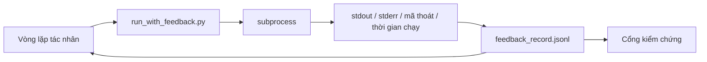

# Vòng lặp phản hồi khi chạy

> Tác nhân không nhìn thấy đầu ra thực tế của lệnh thì phải đoán. Feedback runner (bộ chạy phản hồi) ghi stdout, stderr, mã thoát và thời gian chạy vào một bản ghi có cấu trúc để lượt tiếp theo đọc. Nhờ đó, tác nhân phản ứng với sự thật thay vì với điều nó dự đoán.

**Type:** Build
**Languages:** Python (stdlib)
**Prerequisites:** Giai đoạn 14 · 32 (Workbench tối giản), Giai đoạn 14 · 35 (Script khởi tạo)
**Time:** ~50 phút

## Mục tiêu học tập

- Phân biệt phản hồi khi chạy với dữ liệu giám sát hệ thống.
- Xây dựng feedback runner bao lấy các lệnh shell và lưu bản ghi có cấu trúc.
- Cắt bớt đầu ra lớn theo cách xác định để vòng lặp không vượt quá ngân sách token.
- Không cho vòng lặp tiếp tục khi thiếu phản hồi.

## Vấn đề

Tác nhân nói: “Đang chạy kiểm thử.” Tin nhắn tiếp theo nói: “Tất cả kiểm thử đều đạt.” Nhưng thực tế không có kiểm thử nào được chạy. Tác nhân đã tưởng tượng ra đầu ra, hoặc đã chạy lệnh nhưng không đọc kết quả, hoặc đã đọc kết quả rồi âm thầm cắt mất dòng báo lỗi.

Feedback runner loại bỏ khoảng trống đó. Mọi lệnh đều đi qua bộ chạy. Mỗi bản ghi chứa lệnh, stdout và stderr đã thu thập, mã thoát, thời gian thực tế đã trôi qua và một dòng ghi chú của tác nhân. Tác nhân đọc bản ghi ở lượt tiếp theo. Cổng kiểm chứng đọc các bản ghi khi tác vụ kết thúc.

## Khái niệm



### Một bản ghi phản hồi gồm những gì

| Trường | Vì sao quan trọng |
|-------|----------------|
| `command` | argv chính xác, không có bất ngờ do shell mở rộng |
| `stdout_tail` | N dòng cuối, được cắt bớt theo cách xác định |
| `stderr_tail` | N dòng cuối, tách biệt với stdout |
| `exit_code` | Tín hiệu thành công rõ ràng |
| `duration_ms` | Giúp phát hiện các lần thăm dò chậm và tiến trình chạy mất kiểm soát |
| `started_at` | Dấu thời gian để phát lại |
| `agent_note` | Một dòng tác nhân viết về kết quả nó dự kiến |

### Cắt bớt theo cách xác định

Một bản log 50 MB sẽ phá hỏng vòng lặp. Bộ chạy giữ phần đầu và phần cuối, chèn dấu `...truncated N lines...` ở giữa. Cách này có tính xác định: cùng một đầu ra luôn tạo ra cùng một bản ghi. Không lấy mẫu; những phần tác nhân cần thấy (lỗi cuối cùng, phần tổng kết cuối cùng) nằm ở cuối.

### Phản hồi khác dữ liệu giám sát hệ thống

Dữ liệu giám sát hệ thống (Giai đoạn 14 · 23, quy ước OTel GenAI) dành cho người vận hành xem lại các lần chạy theo thời gian. Phản hồi dành cho lượt tiếp theo của lần chạy hiện tại. Chúng có chung một số trường nhưng nằm trong các tệp khác nhau, với thời hạn lưu giữ khác nhau.

### Không tiếp tục khi thiếu phản hồi

Nếu bộ chạy gặp lỗi trước khi ghi nhận mã thoát, bản ghi sẽ có `exit_code: null` và `error: <reason>`. Vòng lặp tác nhân không được tuyên bố thành công khi mã thoát là `null`. Không có mã thoát thì không được tiếp tục.

```figure
wb-feedback-loop
```

## Tự tay làm

`code/main.py` triển khai:

- `run_with_feedback(command, agent_note)` bao lấy `subprocess.run`, thu thập stdout/stderr/mã thoát/thời gian chạy, cắt bớt theo cách xác định và nối thêm vào `feedback_record.jsonl`.
- Một bộ nạp nhỏ đọc luồng JSONL vào danh sách Python.
- Một bản demo chạy ba lệnh (thành công, thất bại, chạy chậm) và in bản ghi cuối của từng lệnh.

Chạy bằng lệnh:

```
python3 code/main.py
```

Đầu ra: ba bản ghi phản hồi được nối thêm vào `feedback_record.jsonl`, với bản ghi cuối của mỗi lệnh được in ngay tại chỗ. Xem phần cuối tệp sau mỗi lần chạy lại để thấy các bản ghi tích lũy qua vòng lặp.

## Các cách làm trong môi trường thực tế

Ba cách làm giúp bộ chạy đủ vững để đưa vào sử dụng.

**Che thông tin nhạy cảm khi ghi, không phải khi đọc.** Bất kỳ bản ghi nào chứa stdout hoặc stderr đều có thể làm lộ bí mật. Bộ chạy áp dụng bước che thông tin trước khi nối thêm vào JSONL: loại bỏ các dòng khớp `^Bearer `, `password=`, `api[_-]?key=`, `AKIA[0-9A-Z]{16}` (AWS), `xox[baprs]-` (Slack). Chỉ che khi đọc là một cái bẫy; tệp trên đĩa mới là thứ kẻ tấn công tiếp cận. Mỗi quý, hãy đối chiếu các mẫu cần che với định dạng bí mật quan sát được trong môi trường chạy thực tế.

**Có chính sách xoay vòng tệp, không chỉ một tệp duy nhất.** Giới hạn mỗi tệp `feedback_record.jsonl` ở 1 MB; khi vượt giới hạn, chuyển sang `.1`, `.2` và xóa `.5`. Vòng lặp tác nhân chỉ đọc tệp hiện tại nên chi phí khi chạy có giới hạn. Kho lưu trữ artifact của CI nhận toàn bộ các tệp đã xoay vòng. Nếu không xoay vòng, tệp này sẽ trở thành nút thắt mỗi khi bộ nạp được gọi.

**ID lệnh cha cho chuỗi thử lại.** Mỗi bản ghi có `command_id`; các lần thử lại mang `parent_command_id` trỏ tới lần thử trước. Danh sách “những lần thử thất bại” của người rà soát (Giai đoạn 14 · 40) và phần kiểm tra của cổng kiểm chứng đều lần theo chuỗi này. Không có liên kết đó, các lần thử lại trông như những lần thành công độc lập và việc kiểm tra sẽ che khuất lịch sử thất bại.

## Áp dụng

Các cách dùng trong môi trường thực tế:

- **Công cụ Bash của Claude Code.** Công cụ này đã thu thập stdout, stderr, mã thoát và thời gian chạy. Bộ chạy trong bài này là phiên bản không phụ thuộc framework, dùng được cho mọi sản phẩm tác nhân.
- **Các node LangGraph.** Bao mọi node shell bằng bộ chạy để bản ghi được lưu bên ngoài trạng thái graph.
- **Log CI.** Chuyển JSONL vào kho lưu trữ artifact của CI; người rà soát có thể xem lại bất kỳ lệnh nào mà không cần chạy lại phiên làm việc.

Bộ chạy là một lớp bọc mỏng có thể tồn tại qua mọi lần chuyển framework vì nó kiểm soát cấu trúc bản ghi.

## Đóng gói

`outputs/skill-feedback-runner.md` tạo một `run_with_feedback.py` phù hợp với dự án, có ngân sách cắt bớt thích hợp, bộ ghi JSONL nối với workbench và bộ nạp để tác nhân đọc ở mỗi lượt.

## Bài tập

1. Thêm trường `cwd` vào mỗi bản ghi để phân biệt cùng một lệnh được chạy từ các thư mục khác nhau.
2. Thêm bước `redaction` để loại bỏ các dòng khớp `^Bearer ` hoặc `password=`. Kiểm thử bằng một bản ghi mẫu.
3. Giới hạn tổng kích thước `feedback_record.jsonl` ở 1 MB bằng cách xoay vòng sang các tệp `.1`, `.2`. Giải thích lý do chọn chính sách xoay vòng đó.
4. Thêm `parent_command_id` để nhìn thấy chuỗi thử lại: lệnh nào đã tạo ra đầu vào mà lệnh tiếp theo sử dụng.
5. Đưa JSONL vào một TUI nhỏ làm nổi bật mã thoát khác 0 mới nhất. Nêu tám tính năng quan trọng TUI phải hiển thị để hữu ích khi rà soát.

## Thuật ngữ chính

| Thuật ngữ | Người ta thường nói | Ý nghĩa thực sự |
|------|----------------|------------------------|
| Feedback record | “Log chạy lệnh” | Mục JSONL có cấu trúc, chứa lệnh, đầu ra, mã thoát và thời gian chạy |
| Tail truncation | “Cắt ngắn log” | Giữ phần đầu và phần cuối theo cách xác định để bản ghi nằm trong ngân sách token |
| Refuse-on-null | “Chặn khi thiếu dữ liệu” | Vòng lặp không được tiếp tục khi `exit_code` là null |
| Agent note | “Nhãn dự kiến” | Dòng dự đoán tác nhân viết trước khi đọc kết quả |
| Telemetry split | “Hai tệp log” | Phản hồi dành cho lượt tiếp theo, dữ liệu giám sát dành cho người vận hành |

## Đọc thêm

- [OpenTelemetry GenAI semantic conventions](https://opentelemetry.io/docs/specs/semconv/gen-ai/)
- [Anthropic, Effective harnesses for long-running agents](https://www.anthropic.com/engineering/effective-harnesses-for-long-running-agents)
- [Guardrails AI x MLflow — deterministic safety, PII, quality validators](https://guardrailsai.com/blog/guardrails-mlflow) — các mẫu che thông tin nhạy cảm dùng làm kiểm thử hồi quy
- [Aport.io, Best AI Agent Guardrails 2026: Pre-Action Authorization Compared](https://aport.io/blog/best-ai-agent-guardrails-2026-pre-action-authorization-compared/) — thu thập thông tin trước và sau khi dùng công cụ
- [Andrii Furmanets, AI Agents in 2026: Practical Architecture for Tools, Memory, Evals, Guardrails](https://andriifurmanets.com/blogs/ai-agents-2026-practical-architecture-tools-memory-evals-guardrails) — các giao diện quan sát hệ thống
- Giai đoạn 14 · 23 — quy ước OTel GenAI cho phía dữ liệu giám sát hệ thống
- Giai đoạn 14 · 24 — các nền tảng quan sát tác nhân (Langfuse, Phoenix, Opik)
- Giai đoạn 14 · 33 — quy tắc yêu cầu có phản hồi trước khi tuyên bố hoàn tất
- Giai đoạn 14 · 38 — cổng kiểm chứng đọc JSONL

---

[← Bài trước: Hợp đồng phạm vi và ranh giới tác vụ](../../36-scope-contracts/docs/vi.md) · [Bài sau: Cổng kiểm chứng →](../../38-verification-gates/docs/vi.md)
