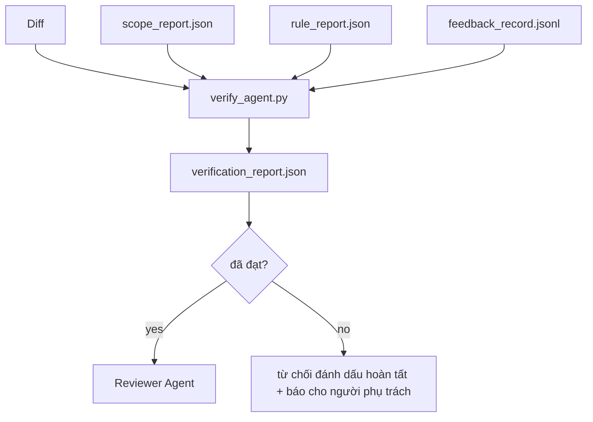

# Cổng kiểm chứng

> Agent không được tự đánh dấu công việc của mình là hoàn tất. Một verification gate (cổng kiểm chứng) đọc hợp đồng phạm vi, nhật ký phản hồi, báo cáo quy tắc và diff, rồi trả lời một câu hỏi: tác vụ này đã thực sự hoàn tất chưa? Nếu cổng nói không, tác vụ vẫn chưa xong, bất kể cuộc trò chuyện nói gì.

**Type:** Build
**Languages:** Python (stdlib)
**Prerequisites:** Giai đoạn 14 · 33 (Quy tắc), Giai đoạn 14 · 36 (Phạm vi), Giai đoạn 14 · 37 (Phản hồi)
**Time:** ~55 phút

## Mục tiêu học tập

- Định nghĩa cổng kiểm chứng là một hàm tất định chạy trên các artifact của workbench.
- Kết hợp báo cáo quy tắc, báo cáo phạm vi, bản ghi phản hồi và diff thành một kết luận duy nhất.
- Tạo `verification_report.json` để cả reviewer agent và CI đều có thể đọc.
- Không cho tác vụ tiến tiếp nếu có bất kỳ lỗi mức block nào, không có ngoại lệ.

## Vấn đề

Agent tuyên bố thành công quá dễ dàng. Ba kiểu thất bại phổ biến nhất là:

- “Có vẻ ổn.” Model đọc diff của chính mình rồi quyết định rằng nó đúng.
- “Các bài kiểm thử đã đạt.” Nói rất chắc chắn, nhưng không có bản ghi nào cho thấy bài kiểm thử thực sự đã chạy.
- “Đã đáp ứng tiêu chí chấp nhận.” Tiêu chí được diễn giải lỏng đến mức “trông giống như đã xong” cũng được tính.

Cách khắc phục trong workbench là một cổng kiểm chứng duy nhất: nó đọc các artifact mà agent đã tạo và đưa ra kết luận. Cổng hoạt động tất định. Cổng nằm trong hệ thống quản lý phiên bản. Cổng được tích hợp vào CI. Agent không thể mua chuộc nó.

## Khái niệm



### Cổng kiểm tra những gì

| Kiểm tra | Artifact nguồn | Mức độ |
|-------|-----------------|----------|
| Tất cả lệnh kiểm tra tiêu chí chấp nhận đã chạy | `feedback_record.jsonl` | block |
| Tất cả lệnh kiểm tra tiêu chí chấp nhận có mã thoát bằng không | `feedback_record.jsonl` | block |
| Kiểm tra phạm vi không phát hiện thao tác ghi bị cấm | `scope_report.json` | block |
| Kiểm tra phạm vi không phát hiện thao tác ghi ngoài phạm vi | `scope_report.json` | block hoặc warn |
| Tất cả quy tắc mức block đều đạt | `rule_report.json` | block |
| Không có mã thoát `null` trong bản ghi phản hồi | `feedback_record.jsonl` | block |
| Các tệp bị chỉnh sửa khớp với `scope.allowed_files` | cả hai | warn |

Một phát hiện mức `warn` được ghi vào kết luận; một phát hiện mức `block` ngăn `passed: true`.

### Tất định, không dựa trên xác suất

Với cùng một bộ artifact, cổng phải luôn đưa ra cùng một kết luận. Không dùng LLM để đánh giá. Việc đánh giá bằng LLM thuộc về reviewer (Giai đoạn 14 · 39), nơi mục tiêu là đánh giá định tính chứ không phải xác định trạng thái.

### Một báo cáo, một đường dẫn

Cổng tạo một `verification_report.json` cho mỗi lần kết thúc tác vụ, tại `outputs/verification/<task_id>.json`. CI đọc cùng đường dẫn đó. Nhiều cổng dùng các đường dẫn khác nhau sẽ tạo ra nhiều nguồn thông tin được coi là chuẩn.

### Từ chối, không có ngoại lệ

Agent không thể bỏ qua các phát hiện mức block. Chỉ con người mới có thể ghi đè chúng, với `override_reason` được ghi lại và id người dùng trong `overridden_by`. Việc ghi đè là một thay đổi có chữ ký, không phải quyết định của agent.

```figure
wb-gate-sequence
```

## Tự tay làm

`code/main.py` triển khai:

- Một bộ nạp cho từng artifact đầu vào, tất cả đều có dữ liệu giả lập cục bộ để bài học có thể chạy độc lập.
- Một hàm thuần `verify(task_id, artifacts) -> VerdictReport`.
- Một bộ in hiển thị kết quả từng mục kiểm tra và kết luận đạt/không đạt cuối cùng.
- Một bản demo với ba tình huống tác vụ: đạt hoàn toàn, mở rộng phạm vi và thiếu bước kiểm tra tiêu chí chấp nhận.

Chạy:

```
python3 code/main.py
```

Kết quả: ba báo cáo kết luận, mỗi báo cáo được lưu cạnh script.

## Các cách áp dụng trong thực tế

Bốn cách sau biến cổng từ “một tác vụ lint nữa” thành “bước quyết định”.

**Phòng vệ nhiều lớp, không chỉ một cổng.** Hook trước commit → kiểm tra trạng thái CI → hook phân quyền trước khi dùng công cụ → cổng trước khi merge. Mỗi lớp đều tất định, nên lỗi lọt qua lớp này sẽ bị lớp tiếp theo bắt lại. Playbook tháng 3 năm 2026 của microservices.io nói rõ: không thể bỏ qua hook trước commit vì, khác với skill ở phía model, nó không phụ thuộc vào việc agent có làm theo hướng dẫn hay không. Cổng kiểm chứng nằm ở lớp CI / trước khi merge.

**Dùng kiểm tra tất định để phòng vệ, chỉ dùng model đánh giá những điểm tinh tế.** Cách ghép đôi Hybrid Norm năm 2026 của Anthropic: các thước đo có thể kiểm chứng (unit test, kiểm tra schema, mã thoát) trả lời “code đã giải quyết vấn đề chưa?” — các tiêu chí đánh giá bằng LLM trả lời “code có dễ đọc, an toàn, đúng phong cách không?” Cổng xử lý nhóm đầu; reviewer (Giai đoạn 14 · 39) xử lý nhóm sau. Trộn hai nhóm sẽ làm mất tín hiệu rõ ràng.

**Nhật ký ghi đè có chữ ký, không phải các luồng thảo luận trên Slack.** Mỗi lần ghi đè tạo một dòng trong `outputs/verification/overrides.jsonl`, gồm: dấu thời gian, mã phát hiện, lý do, người dùng ký xác nhận và commit HEAD hiện tại. Hệ thống chạy từ chối mọi ghi đè thiếu chữ ký; nhật ký kiểm toán được theo dõi bằng git. Đây là ranh giới giữa chính sách ghi đè và việc ghi đè chỉ để làm màu.

**Ngưỡng coverage là một mục kiểm tra chính thức.** `coverage_report.json` cung cấp dữ liệu cho mục kiểm tra `coverage_floor` (mặc định 80%). Cổng không cho đạt nếu coverage đo được thấp hơn ngưỡng, hoặc thấp hơn ngưỡng của lần merge trước quá 1 điểm phần trăm. Không có mục kiểm tra này, agent có thể âm thầm xóa các bài kiểm thử không đạt mà báo cáo kiểm chứng vẫn báo xanh.

**Chế độ `--strict` nâng cảnh báo thành lỗi chặn.** Với các nhánh phát hành, PR có thể chặn phát hành hoặc lúc phân loại sự cố sau sự kiện, `--strict` biến mọi cảnh báo thành lỗi khiến kiểm tra không đạt. Cờ này được bật riêng theo nhánh, không phải mặc định toàn cục, vì áp dụng nghiêm ngặt cho mọi thứ sẽ cản trở công việc hằng ngày.

## Áp dụng

Các cách áp dụng trong production:

- **Bước CI.** Một job `verify_agent` chạy cổng trên các artifact cuối cùng của agent. Cơ chế bảo vệ merge từ chối nếu không có `passed: true`.
- **Hook trước khi bàn giao.** Hệ thống chạy agent gọi cổng trước khi tạo tài liệu bàn giao. Không có kết luận đạt thì không bàn giao.
- **Kiểm tra thủ công.** Người vận hành đọc báo cáo khi agent tuyên bố thành công nhưng con người nghi ngờ.

Cổng là bước quyết định trong luồng workbench. Mọi thành phần khác đều diễn ra trước nó.

## Đóng gói

`outputs/skill-verification-gate.md` tích hợp cổng vào một dự án cụ thể: những lệnh kiểm tra tiêu chí chấp nhận nào cung cấp dữ liệu cho cổng, quy tắc nào ở mức block, thao tác ghi ngoài phạm vi nào được chấp nhận và cách lưu nhật ký kiểm toán ghi đè.

## Bài tập

1. Thêm mục kiểm tra `coverage_floor`: lệnh kiểm thử phải tạo báo cáo coverage đạt ít nhất 80%. Quyết định artifact nào chứa ngưỡng này.
2. Hỗ trợ chế độ `--strict` nâng mọi `warn` thành `block`. Ghi rõ những trường hợp nên bật chế độ nghiêm ngặt theo mặc định.
3. Cho cổng tạo thêm bản tóm tắt Markdown bên cạnh JSON. Giải thích những trường nào nên có trong bản tóm tắt.
4. Thêm mục kiểm tra `time_since_last_human_touch`: mọi tệp được chỉnh sửa trong vòng 60 giây sau thao tác gõ phím của con người đều được miễn gắn cờ ngoài phạm vi.
5. Chạy cổng trên một diff thật do agent tạo trong sản phẩm của bạn. Có bao nhiêu phát hiện là vấn đề thật và bao nhiêu là nhiễu? Cổng cần được mở rộng ở đâu?

## Thuật ngữ chính

| Thuật ngữ | Người ta thường nói | Ý nghĩa thực sự |
|------|----------------|------------------------|
| Verification gate | “Bước kiểm tra ngăn công việc đi tiếp” | Hàm tất định chạy trên các artifact của workbench để đưa ra kết luận đạt/không đạt |
| Block severity | “Lỗi nghiêm trọng” | Mức phát hiện ngăn `passed: true` và đòi hỏi ghi đè có chữ ký |
| Override log | “Lý do chúng ta cho qua” | Các mục có chữ ký, lý do và id người dùng, được kiểm tra khi review |
| Acceptance command | “Bằng chứng” | Lệnh shell có mã thoát bằng không để xác nhận ý nghĩa của `done` |
| One report path | “Nguồn thông tin chuẩn” | `outputs/verification/<task_id>.json`, được cả CI và con người sử dụng |

## Đọc thêm

- [Anthropic, Harness design for long-running application development](https://www.anthropic.com/engineering/harness-design-long-running-apps)
- [OpenAI Agents SDK guardrails](https://openai.github.io/openai-agents-python/guardrails/)
- [microservices.io, GenAI dev platform: guardrails](https://microservices.io/post/architecture/2026/03/09/genai-development-platform-part-1-development-guardrails.html) — phòng vệ nhiều lớp từ trước commit đến CI
- [ICMD, The 2026 Playbook for Agentic AI Ops](https://icmd.app/article/the-2026-playbook-for-agentic-ai-ops-guardrails-costs-and-reliability-at-scale-1776661990431) — các nấc cổng phê duyệt (bản nháp → phê duyệt → tự động trong ngưỡng cho phép)
- [Type-Checked Compliance: Deterministic Guardrails (arXiv 2604.01483)](https://arxiv.org/pdf/2604.01483) — Lean 4 là mức cao nhất của cơ chế kiểm soát tất định
- [logi-cmd/agent-guardrails — merge gate spec](https://github.com/logi-cmd/agent-guardrails) — các cổng kiểm tra phạm vi và mutation testing
- [Guardrails AI x MLflow](https://guardrailsai.com/blog/guardrails-mlflow) — các bộ kiểm tra tất định dùng để chấm điểm trong CI
- Giai đoạn 14 · 27 — các biện pháp chống prompt injection (cặp đối kháng của cổng)
- Giai đoạn 14 · 36 — hợp đồng phạm vi mà cổng này thực thi
- Giai đoạn 14 · 37 — nhật ký phản hồi mà cổng này đánh giá
- Giai đoạn 14 · 39 — reviewer agent mà cổng bàn giao công việc cho

---

[← Bài trước: Vòng lặp phản hồi khi chạy](../../37-runtime-feedback-loops/docs/vi.md) · [Bài sau: Reviewer Agent: Tách người xây dựng khỏi người chấm →](../../39-reviewer-agent/docs/vi.md)
