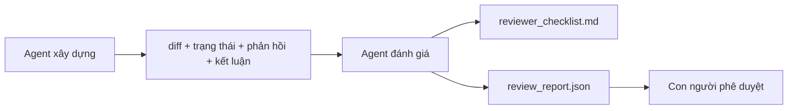

# Reviewer Agent: Tách người xây dựng khỏi người chấm

> Agent viết code không thể tự chấm công việc của mình. Reviewer là một vòng đánh giá thứ hai, có system prompt khác, mục tiêu khác và chỉ được đọc mọi thứ builder đã tạo. Khoảng cách giữa builder và reviewer là nền tảng của phần lớn độ tin cậy.

**Type:** Build
**Languages:** Python (stdlib)
**Prerequisites:** Giai đoạn 14 · 38 (Cổng kiểm chứng)
**Time:** ~55 phút

## Mục tiêu học tập

- Giải thích vì sao cùng một agent không thể tự đánh giá công việc của mình một cách đáng tin cậy.
- Xây dựng vòng lặp reviewer agent nhận các sản phẩm của builder và tạo báo cáo đánh giá có cấu trúc.
- Viết rubric (bộ tiêu chí chấm điểm) cho reviewer để chấm từng khía cạnh cụ thể, thay vì dựa vào cảm tính.
- Tích hợp reviewer vào workbench để bước đánh giá của con người bắt đầu từ một sản phẩm có sẵn.

## Vấn đề

Bạn yêu cầu agent sửa một lỗi. Nó chỉnh sửa bốn tệp, chạy các bài kiểm thử rồi báo đã xong. Cổng kiểm chứng (Giai đoạn 14 · 38) xác nhận bước nghiệm thu đã chạy và phạm vi được giữ đúng. Cổng báo `passed: true`. Bạn gộp thay đổi. Hai ngày sau, bạn phát hiện bản sửa chỉ giải quyết sai một nửa của lỗi.

Nghiệm thu là cần thiết nhưng chưa đủ. Reviewer đặt những câu hỏi mà bước nghiệm thu không thể đặt ra: thay đổi này có giải quyết đúng vấn đề không? Nó có mở rộng phạm vi mà không báo trước không? Nó có ghi lại những giả định lẽ ra cần được chất vấn không? Nó có để workbench ở trạng thái mà phiên tiếp theo có thể tiếp tục không?

## Khái niệm



### Rubric cho reviewer

Năm khía cạnh, mỗi khía cạnh được chấm từ 0 đến 2.

| Khía cạnh | Câu hỏi |
|-----------|----------|
| Mức độ phù hợp với vấn đề | Thay đổi có giải quyết đúng nhiệm vụ được nêu, thay vì một nhiệm vụ gần giống không? |
| Giữ đúng phạm vi | Các chỉnh sửa có nằm trong thỏa thuận ban đầu, hay thỏa thuận đã được chủ động mở rộng? |
| Giả định | Mọi giả định ngầm có được ghi lại ở nơi có thể đánh giá không? |
| Chất lượng kiểm chứng | Lệnh nghiệm thu có thực sự chứng minh mục tiêu đã đạt, hay chỉ chứng minh một phiên bản yếu hơn? |
| Mức độ sẵn sàng bàn giao | Phiên tiếp theo có thể tiếp tục suôn sẻ từ trạng thái hiện tại không? |

Tổng điểm tối đa là 10. Dưới 7 điểm là chưa đạt ở mức nhẹ; dưới 5 điểm là không đạt ở mức nghiêm trọng.

### Reviewer là một vai trò riêng, không nhất thiết là một mô hình riêng

Bạn có thể dùng cùng một mô hình cho reviewer và builder. Điều quan trọng là tách biệt vai trò: system prompt khác, đầu vào khác, không có quyền ghi vào diff. Sự thay đổi trong cách tiếp cận tạo ra tín hiệu đánh giá khác.

### Reviewer không được chỉnh sửa diff

Reviewer đọc diff, trạng thái, phản hồi và kết luận. Nó viết báo cáo, không sửa diff. Nếu báo cáo nói “hãy sửa chỗ này”, lượt builder tiếp theo sẽ thực hiện việc sửa; reviewer sau đó quay lại đánh giá. Trộn lẫn hai vai trò sẽ xóa đi khoảng cách cần thiết.

### Rubric của reviewer so với cổng kiểm chứng

Cổng kiểm chứng (Giai đoạn 14 · 38) kiểm tra các sự kiện xác định: bước nghiệm thu đã chạy chưa, các quy tắc có được đáp ứng không, phạm vi có được giữ đúng không. Reviewer đưa ra nhận định định tính: đây có phải việc cần làm không, tài liệu đã đầy đủ chưa, kết quả bàn giao có dùng được không. Cần cả hai.

```figure
wb-builder-marker
```

## Tự tay làm

`code/main.py` triển khai:

- Một dataclass `ReviewerInputs` gom các sản phẩm mà reviewer sẽ đọc.
- Bộ chấm rubric có một hàm cho mỗi khía cạnh. Mỗi hàm cho kết quả xác định và chỉ chấm ở mức minh họa cho bài học; bản triển khai thực tế sẽ gọi LLM.
- Bộ ghi `review_report.json` chứa năm điểm thành phần, tổng điểm và kết luận (`pass`, `soft_fail`, `hard_fail`).
- Hai trường hợp minh họa: một thay đổi đạt yêu cầu và một thay đổi “kiểm thử đúng, vấn đề sai”.

Chạy chương trình:

```
python3 code/main.py
```

Kết quả: hai báo cáo đánh giá được ghi ra đĩa và một bảng điểm theo từng khía cạnh hiển thị trên console.

## Các cách triển khai thực tế

Số liệu thực tế: hệ thống AI Code Review của Cloudflare vào tháng 4 năm 2026 đã thực hiện 131,246 lượt đánh giá trên 48,095 yêu cầu gộp mã thuộc 5,169 repo trong 30 ngày. Thời gian hoàn tất đánh giá trung vị là 3 phút 39 giây. Tối đa bảy reviewer chuyên trách (bảo mật, hiệu năng, chất lượng code, tài liệu, quản lý phát hành, tuân thủ, Engineering Codex) chạy song song dưới sự điều phối của Review Coordinator, bộ phận gộp các phát hiện trùng lặp và đánh giá mức độ nghiêm trọng. Mô hình cao cấp nhất chỉ dành cho bộ điều phối; các reviewer chuyên trách dùng những mức mô hình rẻ hơn.

Bốn cách làm giúp hệ thống hoạt động ở quy mô lớn.

**Một nhóm reviewer chuyên trách, không phải một reviewer ôm hết.** Một reviewer với rubric năm khía cạnh phù hợp cho repo cá nhân. Khi codebase có những phần liên quan chặt chẽ đến bảo mật, hiệu năng và tài liệu, hãy chia thành các reviewer chuyên trách với prompt ngắn hơn. Bộ điều phối xử lý các phát hiện trùng lặp; reviewer chuyên trách không chạy toàn bộ rubric. Việc phân tầng mô hình theo đó cũng rõ ràng: reviewer chuyên trách dùng mô hình rẻ, bộ điều phối dùng mô hình đắt hơn.

**Giảm thiên lệch là yêu cầu thiết kế, không phải bước tối ưu.** LLM dùng để chấm điểm có bốn dạng thiên lệch thường gặp (Adnan Masood, tháng 4 năm 2026): thiên lệch vị trí (GPT-4 cho kết quả không nhất quán khoảng 40% khi đổi thứ tự (A,B) thành (B,A)), thiên lệch độ dài (điểm tăng khoảng 15% khi đầu ra dài hơn), thiên lệch ưu ái chính mình (mô hình chấm thích đầu ra từ cùng họ mô hình), và thiên lệch uy tín (mô hình chấm đánh giá quá cao các đoạn nhắc đến tác giả nổi tiếng). Cách giảm thiểu: đánh giá cả hai thứ tự và chỉ tính những lần thắng nhất quán; dùng thang điểm 1-4 ghi rõ rằng sự súc tích được đánh giá cao; luân phiên mô hình chấm giữa các họ mô hình; bỏ tên tác giả trước khi chấm.

**Tập hiệu chuẩn, không đánh giá bằng cảm tính.** Hãy dùng một tập gồm 10-20 nhiệm vụ trước đây với kết luận đúng đã biết. Chạy reviewer trên tập đó mỗi khi thay đổi prompt. Nếu mức độ trùng khớp với kết quả trước đây xuống dưới 80%, bạn cần sửa rubric trước khi đưa reviewer vào sử dụng. Đội ngũ nào rồi cũng sẽ tự nhận ra điều này; tốt hơn là áp dụng ngay từ đầu.

**Kết hợp với cổng kiểm chứng.** Cổng kiểm chứng (Giai đoạn 14 · 38) xử lý các bước kiểm tra xác định (bước nghiệm thu đã chạy chưa, kiểm thử có đạt không, phạm vi có được giữ đúng không). Reviewer xử lý các bước kiểm tra về ý nghĩa (đây có phải việc cần làm không, giả định có được ghi lại không, kết quả bàn giao có dùng được không). Hướng dẫn năm 2026 của Anthropic nêu rõ sự phân chia này: đừng yêu cầu reviewer làm lại việc mà cổng kiểm chứng đã chứng minh.

## Áp dụng

Các cách triển khai thực tế:

- **Subagent của Claude Code.** Một reviewer subagent chạy sau khi builder hoàn tất nhiệm vụ. Nó đăng bình luận trên PR kèm điểm rubric.
- **Bàn giao giữa các agent trong OpenAI Agents SDK.** Builder bàn giao cho Reviewer khi hoàn tất nhiệm vụ. Reviewer có thể gửi lại danh sách phát hiện hoặc chuyển lên cho con người.
- **Kết hợp hai mô hình.** Builder chạy trên mô hình nhanh và rẻ hơn. Reviewer chạy trên mô hình mạnh hơn với ngữ cảnh ngắn hơn, tập trung vào việc đánh giá.

Reviewer là cặp mắt thứ hai mà workbench bổ sung khi con người không thể tự đánh giá mọi thay đổi.

## Đóng gói

`outputs/skill-reviewer-agent.md` tạo một rubric reviewer riêng cho dự án, một bản khung reviewer agent được kết nối với các sản phẩm của builder, và phần tích hợp với cổng kiểm chứng để con người bắt đầu đánh giá từ một báo cáo đã viết thay vì một trang trắng.

## Bài tập

1. Thêm khía cạnh thứ sáu dành riêng cho lĩnh vực sản phẩm của bạn. Giải thích vì sao nó không nằm trong năm khía cạnh hiện có.
2. Chạy reviewer với hai system prompt khác nhau (ngắn gọn, chi tiết). Cách nào tạo ra báo cáo mà con người có khả năng đọc hơn?
3. Thêm trường `confidence` cho mỗi khía cạnh. Không cho phép gửi báo cáo nếu độ tin cậy ở khía cạnh có điểm thấp nhất dưới 0.6.
4. Xây dựng tập hiệu chuẩn: 10 lần kết thúc nhiệm vụ trước đây với kết luận đúng đã biết. Chạy reviewer trên tập này. Nó bất đồng với kết quả trước đây ở đâu?
5. Thêm khả năng “yêu cầu thêm bằng chứng”: reviewer có thể yêu cầu builder chạy một bài kiểm thử cụ thể trước khi chấm điểm. Nên giới hạn việc yêu cầu lại như thế nào để tránh lặp vô tận?

## Thuật ngữ chính

| Thuật ngữ | Người ta thường nói | Ý nghĩa thực sự |
|------|----------------|------------------------|
| Reviewer rubric | “Danh sách kiểm tra” | Chấm điểm năm khía cạnh theo thang 0-2, mỗi khía cạnh có một câu hỏi bằng văn bản |
| Soft fail | “Cần chỉnh sửa” | Tổng điểm dưới 7; builder nhận danh sách phát hiện cần xử lý |
| Hard fail | “Từ chối” | Tổng điểm dưới 5 hoặc bất kỳ khía cạnh nào được 0; dừng lại và báo cho con người |
| Role separation | “Prompt khác” | Cùng một mô hình có thể đảm nhiệm cả hai vai trò; điều quan trọng là tách biệt đầu vào và cách tiếp cận |
| Confidence floor | “Đừng gửi báo cáo thiếu cơ sở” | Không đưa ra kết luận khi rubric không đủ chắc chắn |

## Đọc thêm

- [Bàn giao giữa các agent trong OpenAI Agents SDK](https://openai.github.io/openai-agents-python/handoffs/)
- [Subagent của Anthropic Claude Code](https://code.claude.com/docs/en/sub-agents)
- [Cloudflare, Orchestrating AI Code Review at Scale](https://blog.cloudflare.com/ai-code-review/) — kiến trúc gồm 7 reviewer chuyên trách và một bộ điều phối, 131k lượt chạy / 30 ngày
- [Agent-as-a-Judge: Evaluating Agents with Agents (OpenReview / ICLR)](https://openreview.net/forum?id=DeVm3YUnpj) — bộ đánh giá DevAI, 366 yêu cầu giải pháp được phân cấp
- [Adnan Masood, Rubric-Based Evaluations and LLM-as-a-Judge: Methodologies, Biases, Empirical Validation](https://medium.com/@adnanmasood/rubric-based-evals-llm-as-a-judge-methodologies-and-empirical-validation-in-domain-context-71936b989e80) — bốn dạng thiên lệch và cách giảm thiểu
- [MLflow, LLM-as-a-Judge Evaluation](https://mlflow.org/llm-as-a-judge) — công cụ triển khai thực tế để tách builder và người đánh giá
- [LangChain, How to Calibrate LLM-as-a-Judge with Human Corrections](https://www.langchain.com/articles/llm-as-a-judge) — quy trình dùng tập hiệu chuẩn
- [Evidently AI, LLM-as-a-judge: a complete guide](https://www.evidentlyai.com/llm-guide/llm-as-a-judge)
- [Arize, LLM as a Judge — Primer and Pre-Built Evaluators](https://arize.com/llm-as-a-judge/)
- Giai đoạn 14 · 05 — Self-Refine và CRITIC (cách tự đánh giá cơ bản của một agent)
- Giai đoạn 14 · 30 — phát triển agent dựa trên đánh giá (bộ tạo tập hiệu chuẩn)
- Giai đoạn 14 · 38 — cổng kiểm chứng mà reviewer đọc
- Giai đoạn 14 · 40 — gói bàn giao nhận dữ liệu từ báo cáo của reviewer

---

[← Bài trước: Cổng kiểm chứng](../../38-verification-gates/docs/vi.md) · [Bài sau: Bàn giao qua nhiều phiên →](../../40-multi-session-handoff/docs/vi.md)
