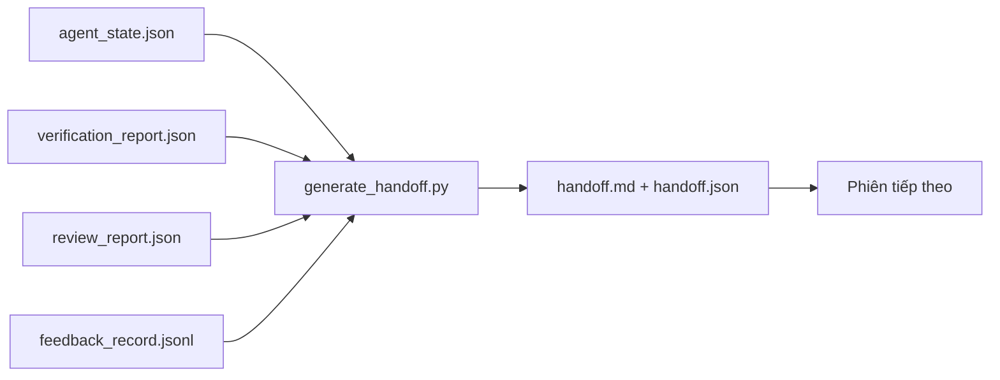

# Bàn giao qua nhiều phiên

> Phiên làm việc sắp kết thúc. Công việc thì chưa. Gói bàn giao là sản phẩm biến câu “agent đã làm việc một giờ” thành “phiên tiếp theo có thể bắt tay vào việc ngay từ phút đầu tiên”. Hãy chủ động tạo nó, đừng để đến phút cuối mới nghĩ tới.

**Type:** Build
**Languages:** Python (stdlib)
**Prerequisites:** Giai đoạn 14 · 34 (Bộ nhớ repo), Giai đoạn 14 · 38 (Kiểm chứng), Giai đoạn 14 · 39 (Người đánh giá)
**Time:** ~50 phút

## Mục tiêu học tập

- Xác định bảy trường mà mọi gói bàn giao cần có.
- Tạo gói bàn giao từ các sản phẩm của môi trường làm việc mà không phải tự viết phần mô tả.
- Rút gọn nhật ký phản hồi lớn thành bản tóm tắt vừa đủ cho gói bàn giao.
- Xác định rõ việc đầu tiên cần làm ở phiên tiếp theo.

## Vấn đề

Phiên làm việc kết thúc. Agent nói “tuyệt, chúng ta đã có tiến triển”. Phiên tiếp theo bắt đầu. Agent mới hỏi “lần trước ta dừng ở đâu?” Câu trả lời của agent trước đã mất. Agent mới phải tìm hiểu lại, chạy lại cùng những lệnh đó, hỏi người dùng lại những câu hỏi đó và mất ba mươi phút để khôi phục ba mươi giây cuối của phiên trước.

Cái giá của một lần bàn giao kém phải trả ở mọi phiên cho đến khi công việc hoàn tất. Cách khắc phục là một gói được tạo tự động vào cuối phiên: những gì đã thay đổi, lý do, những gì đã thử, những gì thất bại, những gì còn lại và việc đầu tiên cần làm lần tới.

## Khái niệm



### Bảy trường có trong mọi gói bàn giao

| Trường | Câu hỏi được trả lời |
|-------|---------------------|
| `summary` | Một đoạn tóm tắt công việc đã làm |
| `changed_files` | Tổng quan các thay đổi |
| `commands_run` | Những lệnh thực sự đã chạy |
| `failed_attempts` | Những gì đã thử và lý do không thành công |
| `open_risks` | Những vấn đề có thể gây khó khăn ở phiên tiếp theo, kèm mức độ nghiêm trọng |
| `next_action` | Bước cụ thể đầu tiên của phiên tiếp theo |
| `verdict_pointer` | Đường dẫn đến báo cáo kiểm chứng và đánh giá |

Trường `next_action` là phần quan trọng nhất. Một gói có mọi thứ trừ `next_action` chỉ là báo cáo tình trạng, không phải gói bàn giao.

### Gói bàn giao được tạo tự động, không viết tay

Nếu phải viết tay, gói bàn giao rất dễ bị bỏ qua vào những ngày khó khăn. Trình tạo đọc các sản phẩm trong môi trường làm việc rồi xuất ra gói bàn giao. Việc của agent là để môi trường làm việc ở trạng thái mà trình tạo có thể tóm tắt, chứ không phải tự viết bản tóm tắt.

### Hai dạng: cho người đọc và cho máy đọc

`handoff.md` dành cho người đọc. `handoff.json` dành cho agent ở phiên tiếp theo nạp vào. Cả hai đều được tạo từ cùng các sản phẩm nguồn. Nếu chúng khác nhau, ưu tiên bản JSON.

### Rút gọn nhật ký phản hồi

Toàn bộ `feedback_record.jsonl` có thể chứa hàng trăm mục. Gói bàn giao chỉ mang theo K mục cuối cùng và mọi mục có mã thoát khác không. Phiên tiếp theo có thể nạp toàn bộ nhật ký nếu cần, còn gói bàn giao vẫn gọn.

### Để lại trạng thái sạch

Gói bàn giao mô tả công việc. Trạng thái sạch giúp công việc có thể tiếp tục. Đó là hai việc khác nhau. Một `handoff.md` hoàn hảo cũng vô ích nếu phiên tiếp theo bắt đầu với các thay đổi mới áp dụng dở, một tệp tạm agent đã quên, một nhánh phát sinh ngoài ý muốn và các bài kiểm thử báo lỗi trước cả khi chạy. Khi đó, agent tiếp theo mất mười phút đầu để dọn dẹp thay vì làm việc, và chi phí ấy cộng dồn qua từng phiên cho đến khi công việc hoàn tất.

Vì vậy, phiên làm việc không kết thúc ngay khi tính năng chạy được. Nó kết thúc khi môi trường làm việc ở trạng thái mà trình tạo có thể tóm tắt và phiên tiếp theo có thể tin cậy. Dọn dẹp là một giai đoạn riêng, thực hiện trước khi bàn giao, và phải được kiểm tra thay vì chỉ dựa vào thói quen, vì thói quen chính là thứ dễ bị bỏ qua vào những ngày khó khăn.

| Mục kiểm tra | Trạng thái sạch nghĩa là | Trạng thái chưa sạch gây trở ngại vì |
|-------|-------------|----------------------|
| Cây làm việc | Mọi thay đổi đã được commit hoặc được stash rõ ràng kèm ghi chú | Các thay đổi mới áp dụng dở có thể bị agent tiếp theo hiểu nhầm là công việc có chủ đích |
| Sản phẩm tạm | Không còn `*.tmp`, thư mục nháp, lệnh in để gỡ lỗi hoặc khối mã đã chú thích | Tệp thừa làm rối phần thay đổi và cách agent tiếp theo hình dung công việc |
| Kiểm thử | Đều đạt, hoặc có bài không đạt với lỗi được nêu trong `open_risks` | Một bài kiểm thử âm thầm không đạt là cái bẫy chờ phiên tiếp theo |
| Bảng tính năng | Trạng thái trong `feature_list.json` phản ánh đúng thực tế (Giai đoạn 14 · 36) | Bảng chưa cập nhật sẽ khiến phiên tiếp theo làm lại việc đã xong |
| Nhánh | Đang ở nhánh dự kiến, không có detached HEAD hay nhánh không dùng đến | Ở sai nhánh đồng nghĩa commit đầu tiên của phiên tiếp theo sẽ nằm sai chỗ |

Giai đoạn dọn dẹp xuất ra `clean_state.json` chứa các vấn đề cản trở; danh sách rỗng là điều kiện tiên quyết mà trình tạo gói bàn giao kiểm tra trước khi ghi gói. Gói bàn giao được tạo từ một cây làm việc chưa sạch không phải là bàn giao, mà là chuyển tiếp một mớ lộn xộn. Hai sản phẩm này đi cùng nhau: bước dọn dẹp chứng minh có thể an tâm rời môi trường làm việc, còn gói bàn giao giúp phiên tiếp theo biết bắt đầu từ đâu.

```figure
wb-handoff-packet
```

## Tự tay làm

`code/main.py` triển khai:

- Bộ nạp gom trạng thái, kết quả kiểm chứng, đánh giá và phản hồi vào một `WorkbenchSnapshot`.
- Hàm `generate_handoff(snapshot) -> (markdown, payload)`.
- Bộ lọc chọn K mục phản hồi cuối cùng và mọi mục có mã thoát khác không.
- Lần chạy minh họa ghi `handoff.md` và `handoff.json` cạnh script.

Chạy:

```
python3 code/main.py
```

Kết quả: nội dung gói bàn giao được in ra, cùng với hai tệp được ghi vào ổ đĩa.

## Cách triển khai thực tế

Codex CLI, Claude Code và OpenCode dùng những cách thu gọn ngữ cảnh khác nhau; gói bàn giao có cấu trúc hoạt động trên cả ba.

**Cách thu gọn khác nhau; lược đồ gói bàn giao thì không.** POST /v1/responses/compact của Codex CLI trả về một khối AES không thể đọc trực tiếp từ phía máy chủ (đường xử lý nhanh cho các model OpenAI); phương án dự phòng là một “bản tóm tắt bàn giao” được tạo cục bộ và thêm dưới dạng tin nhắn vai trò người dùng `_summary`. Claude Code thu gọn dần qua năm giai đoạn khi ngữ cảnh đạt 95%. OpenCode ẩn tin nhắn dựa trên dấu thời gian và tạo bản tóm tắt bằng LLM với 5 đề mục. Ba cơ chế khác nhau, cùng một nhu cầu: lưu những gì còn lại sau khi nén vào một sản phẩm có thể mang sang nơi khác. Gói bàn giao chính là sản phẩm đó.

**Bàn giao sang phiên mới không phải là thu gọn ngữ cảnh.** Thu gọn kéo dài một phiên; bàn giao khép lại phiên đó gọn gàng và bắt đầu phiên tiếp theo. Cách nhìn của Hermes Issue #20372 (April 2026) là đúng: khi việc nén ngay trong phiên bắt đầu làm giảm chất lượng, agent nên viết một gói bàn giao ngắn gọn, kết thúc phiên và tiếp tục với ngữ cảnh mới. Gói bàn giao giúp việc chuyển tiếp này ít tốn công. Sai lầm là tiếp tục nén cho đến khi chất lượng sụp đổ; cách khắc phục là dành chỗ cho một lần bàn giao sớm và gọn gàng.

**Mỗi nhánh và chủ đề chỉ có một gói bàn giao đang dùng.** Việc phối hợp nhiều agent thường trục trặc vì các gói bàn giao lỗi thời hơn là vì kết quả kém từ model. Luôn đưa vào `branch`, `last_known_good_commit` và `status` với một trong các giá trị `active | superseded | archived`. Các gói bàn giao lỗi thời được lưu trữ; chỉ gói đang dùng mới định hướng phiên tiếp theo. Đó là khác biệt giữa việc coi gói bàn giao là ghi chú và coi nó là trạng thái.

**Kết thúc khi đã dùng 50-75% ngữ cảnh, đừng đợi chạm giới hạn.** Cẩm nang về cách làm thủ công (CLAUDE.md + HANDOVER.md) cho biết kết quả tốt nhất đến khi phiên kết thúc ở mức 50-75% ngân sách ngữ cảnh thay vì 95%. Trình tạo gói bàn giao chạy ổn định trước khi các dấu vết của việc nén làm nhiễu trạng thái nguồn. Khi ngữ cảnh còn nguyên vẹn, việc tạo gói ít tốn công; khi model đã bắt đầu mất mạch, việc đó trở nên tốn kém.

## Áp dụng

Cách triển khai thực tế:

- **Hook cuối phiên.** Môi trường chạy kích hoạt trình tạo khi người dùng đóng cuộc trò chuyện. Gói được đưa vào `outputs/handoff/<session_id>/`.
- **Mẫu PR.** Markdown do trình tạo xuất ra cũng dùng làm phần nội dung PR. Người đánh giá có thể đọc mà không cần mở thêm năm tệp khác.
- **Bàn giao giữa các agent.** Xây dựng bằng một sản phẩm (Claude Code), tiếp tục bằng sản phẩm khác (Codex). Gói bàn giao là ngôn ngữ chung.

Gói này nhỏ, có cấu trúc nhất quán và ít tốn công tạo ra. Khoản tiết kiệm tích lũy qua từng phiên.

## Đóng gói

`outputs/skill-handoff-generator.md` tạo ra một trình tạo phù hợp với đường dẫn sản phẩm của dự án, một hook cuối phiên để chạy trình tạo đó và một lược đồ `handoff.json` cho agent tiếp theo đọc khi khởi động.

## Bài tập

1. Thêm trường `assumptions_to_validate` để nêu mọi giả định mà người xây dựng đã ghi lại nhưng người đánh giá không chấm trên 1.
2. Rút gọn bản tóm tắt phản hồi theo hai cách khác nhau cho những lần chạy thất bại và thành công. Giải thích vì sao cần phân biệt.
3. Thêm danh sách “câu hỏi dành cho người dùng”. Khi nào một câu hỏi cần được đưa vào gói bàn giao, thay vì chỉ gửi trong tin nhắn?
4. Làm cho trình tạo có tính idempotent: chạy hai lần vẫn tạo ra cùng một gói. Những gì cần ổn định để đạt được điều đó?
5. Thêm mục “điều kiện cần cho phiên tiếp theo”, liệt kê chính xác những sản phẩm mà phiên tiếp theo phải nạp trước khi hành động.

## Thuật ngữ chính

| Thuật ngữ | Người ta thường nói | Ý nghĩa thực sự |
|------|----------------|------------------------|
| Handoff packet | “Bản tóm tắt phiên” | Sản phẩm được tạo tự động, mang theo bảy trường ở cả dạng markdown và JSON |
| Next action | “Việc đầu tiên cần làm” | Một bước cụ thể để bắt đầu phiên tiếp theo |
| Feedback trim | “Bản tóm tắt nhật ký” | K bản ghi cuối cùng cùng mọi bản ghi có mã thoát khác không |
| Status report | “Những gì đã làm” | Tài liệu thiếu `next_action`; hữu ích nhưng không phải gói bàn giao |
| Verdict pointer | “Dẫn chiếu kết quả” | Đường dẫn đến báo cáo kiểm chứng và đánh giá để có thể truy lại |

## Đọc thêm

- [Anthropic, Effective harnesses for long-running agents](https://www.anthropic.com/engineering/effective-harnesses-for-long-running-agents)
- [OpenAI Agents SDK handoffs](https://openai.github.io/openai-agents-python/handoffs/)
- [Codex Blog, Codex CLI Context Compaction: Architecture, Configuration, Managing Long Sessions](https://codex.danielvaughan.com/2026/03/31/codex-cli-context-compaction-architecture/) — POST /v1/responses/compact và phương án dự phòng cục bộ
- [Justin3go, Shedding Heavy Memories: Context Compaction in Codex, Claude Code, OpenCode](https://justin3go.com/en/posts/2026/04/09-context-compaction-in-codex-claude-code-and-opencode) — so sánh cách thu gọn ngữ cảnh của ba nhà cung cấp
- [JD Hodges, Claude Handoff Prompt: How to Keep Context Across Sessions (2026)](https://www.jdhodges.com/blog/ai-session-handoffs-keep-context-across-conversations/) — CLAUDE.md + HANDOVER.md, ngân sách ngữ cảnh 50-75%
- [Mervin Praison, Managing Handoffs in Multi-Agent Coding Sessions: Fresh Context Without Losing Continuity](https://mer.vin/2026/04/managing-handoffs-in-multi-agent-coding-sessions-fresh-context-without-losing-continuity/) — cách nhìn theo hệ thống phân tán
- [Hermes Issue #20372 — automatic fresh-session handoff when compression becomes risky](https://github.com/NousResearch/hermes-agent/issues/20372)
- [Hermes Issue #499 — Context Compaction Quality Overhaul](https://github.com/NousResearch/hermes-agent/issues/499) — prompt hướng đến bàn giao trong Codex CLI
- [Microsoft Agent Framework, Compaction](https://learn.microsoft.com/en-us/agent-framework/agents/conversations/compaction)
- [OpenCode, Context Management and Compaction](https://deepwiki.com/sst/opencode/2.4-context-management-and-compaction)
- [LangChain, Context Engineering for Agents](https://www.langchain.com/blog/context-engineering-for-agents)
- Giai đoạn 14 · 34 — tệp trạng thái mà trình tạo đọc
- Giai đoạn 14 · 38 — kết quả kiểm chứng mà gói bàn giao dẫn đến
- Giai đoạn 14 · 39 — báo cáo của người đánh giá được đưa vào gói

---

[← Bài trước: Reviewer Agent: Tách người xây dựng khỏi người chấm](../../39-reviewer-agent/docs/vi.md) · [Bài sau: Workbench trên một repo thực tế →](../../41-workbench-for-real-repos/docs/vi.md)
