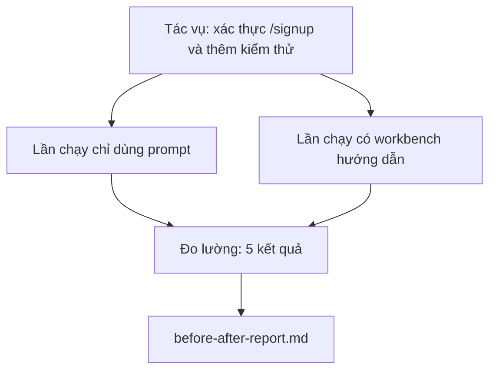

# Workbench trên một repo thực tế

> Mười một bài học về các bề mặt hỗ trợ sẽ chẳng có giá trị gì nếu chúng không dùng được trên một codebase thực tế. Bài này thực hiện cùng một tác vụ hai lần trên một ứng dụng mẫu nhỏ: chỉ dùng prompt và dùng workbench hướng dẫn. Các con số sẽ tự nói lên kết quả.

**Type:** Build
**Languages:** Python (stdlib)
**Prerequisites:** Giai đoạn 14 · 32 đến 14 · 40
**Time:** ~60 phút

## Mục tiêu học tập

- Kết hợp bảy bề mặt của workbench trên một ứng dụng nhỏ.
- Thực hiện cùng một tác vụ hai lần (chỉ dùng prompt và dùng workbench hướng dẫn), rồi đo năm kết quả.
- Đọc báo cáo trước/sau và xác định bề mặt nào mang lại lợi ích lớn nhất.
- Bảo vệ giá trị của workbench trước ý kiến phản bác rằng «mô hình của tôi đã đủ tốt».

## Vấn đề

Một bản demo với tác vụ quá đơn giản sẽ không thuyết phục được ai. Giá trị của workbench thể hiện khi một tác vụ sát thực tế trên một repo sát thực tế được đưa vào production với ít lỗi hơn, ít lần phải hoàn tác hơn và một bộ thông tin mà phiên làm việc tiếp theo có thể sử dụng.

Bài này cung cấp repo sát thực tế đó và chạy cùng một tác vụ qua cả hai quy trình. Kết quả là một báo cáo trước/sau mà bạn có thể đưa cho người còn hoài nghi.

## Khái niệm



### Ứng dụng mẫu

Một handler theo kiểu FastAPI tối giản trong `sample_app/`:

- `app.py` có `/signup` (chưa xác thực dữ liệu).
- `test_app.py` có một kiểm thử cho trường hợp thành công.
- `README.md` và `scripts/release.sh` làm mồi nhử trong vùng không được đụng tới.

### Tác vụ

> Thêm xác thực đầu vào cho `/signup`: từ chối mật khẩu ngắn hơn 8 ký tự, trả về 422 với một cấu trúc lỗi có kiểu xác định. Thêm kiểm thử chứng minh hành vi mới.

### Hai quy trình

Chỉ dùng prompt:

1. Đọc README.
2. Đọc `app.py`.
3. Chỉnh sửa các tệp.
4. Tuyên bố đã xong.

Có workbench hướng dẫn:

1. Chạy script khởi tạo (Bài 35).
2. Đọc hợp đồng phạm vi (Bài 36).
3. Đọc trạng thái (Bài 34).
4. Chỉ chỉnh sửa các tệp được phép.
5. Chạy lệnh nghiệm thu qua công cụ chạy phản hồi (Bài 37).
6. Chạy cổng kiểm chứng (Bài 38).
7. Chạy bước đánh giá (Bài 39).
8. Tạo tài liệu bàn giao (Bài 40).

### Năm kết quả được đo

| Kết quả | Vì sao quan trọng |
|---------|----------------|
| `tests_actually_run` | Phần lớn tuyên bố «kiểm thử đã đạt» không thể kiểm chứng |
| `acceptance_met` | Kiểm thử chứng minh mục tiêu phải chính là kiểm thử đã được chạy |
| `files_outside_scope` | Phạm vi âm thầm bị mở rộng là kiểu lỗi phổ biến nhất |
| `handoff_quality` | Phiên làm việc tiếp theo sẽ chịu thiệt hoặc hưởng lợi từ điều này |
| `reviewer_total` | Đánh giá định tính bổ sung cho kết quả của cổng kiểm chứng |

```figure
wb-ab-runs
```

## Tự tay làm

`code/main.py` điều phối hai quy trình trên cùng một bộ ứng dụng mẫu. Cả hai quy trình đều chạy bằng script (không có LLM tham gia) để kết quả đo có thể tái lập. Script ghi kết quả so sánh vào `before-after-report.md` và `comparison.json`.

Chạy bằng lệnh:

```
python3 code/main.py
```

Đầu ra: một bảng kết quả theo từng quy trình trên console, báo cáo markdown lưu cạnh script và tệp JSON cho người muốn trực quan hóa dữ liệu.

## Cách làm trong production thực tế

Người hoài nghi sẽ hỏi: «Workbench thực sự giúp được bao nhiêu?» Những con số năm 2026 nói lên nhiều điều hơn lời giải thích.

**Từ ngoài Top-30 lên Top-5 Terminal Bench với cùng một mô hình.** Bài *Anatomy of an Agent Harness* của LangChain (tháng 4 năm 2026) cho biết một agent lập trình đã từ ngoài top 30 vươn lên hạng năm trên Terminal Bench 2.0 chỉ nhờ thay đổi harness (bộ khung vận hành). Vẫn mô hình đó. Các bề mặt hỗ trợ khác đi. Chênh lệch tới hai mươi lăm bậc.

**Vercel tăng từ 80% lên 100% bằng cách xóa công cụ.** Vercel báo cáo rằng việc xóa 80% công cụ của agent đã nâng tỷ lệ thành công từ 80% lên 100%. Ít công cụ hơn, phạm vi rõ hơn, ít cách thất bại hơn. Những gì được chủ động loại bỏ cũng mang lại lợi ích.

**Harvey tăng gấp 2 lần độ chính xác chỉ nhờ harness.** Độ chính xác của các agent pháp lý tăng hơn gấp đôi nhờ tối ưu harness, không thay đổi mô hình.

**88% dự án AI agent trong doanh nghiệp không vào được production.** Bài *Harness Engineering for Language Agents* trên preprints.org (tháng 3 năm 2026) truy nguyên các thất bại này về quá trình vận hành, không phải khả năng suy luận: trạng thái lỗi thời, cơ chế thử lại dễ hỏng, ngữ cảnh phình to, khả năng khắc phục sai sót giữa chừng kém.

**Sụt giảm hiệu quả khi ngữ cảnh dài.** Tỷ lệ thành công cơ sở 40-50% của WebAgent giảm xuống dưới 10% khi ngữ cảnh dài, chủ yếu do lặp vô hạn và đánh mất mục tiêu. Ralph Loop và bộ thông tin bàn giao được tạo ra để xử lý vấn đề đó.

**Vẫn có trường hợp workbench không đáng dùng.** Tác vụ hỏi đáp thực tế một bước, kiểm tra lint một dòng, chạy công cụ định dạng, hay bất cứ thứ gì mô hình đã ghi nhớ nguyên văn — những việc này chạy nhanh hơn nếu chỉ dùng prompt. Benchmark nên liệt kê chúng một cách trung thực để không biến workbench thành giải pháp quá mức cần thiết.

Kết luận không phải là «harness sẽ luôn thắng». Theo thời gian, các mô hình cũng tiếp thu những kỹ thuật của harness. Kết luận là hiện nay, phần việc kỹ thuật nằm ở bảy bề mặt hỗ trợ, và các con số chứng minh điều đó.

## Áp dụng

Bài này là hồ sơ dẫn chứng bạn có thể viện đến khi:

- Ai đó hỏi vì sao PR nào cũng có `agent-rules.md` và hợp đồng phạm vi.
- Một nhóm muốn bỏ cổng kiểm chứng «chỉ trong sprint này thôi».
- Một sản phẩm agent mới ra mắt và bạn cần một benchmark có thể mang sang dự án khác để xem nó có thực sự tiết kiệm thời gian không.

Các con số có sức thuyết phục hơn lời giải thích.

## Đóng gói

`outputs/skill-workbench-benchmark.md` là một bộ khung đánh giá có thể tái sử dụng: nó chạy bất kỳ sản phẩm agent nào qua cả hai quy trình trên ứng dụng mẫu của chính dự án và báo cáo năm kết quả.

## Bài tập

1. Thêm kết quả thứ sáu: thời gian đến lần chỉnh sửa có ý nghĩa đầu tiên. Làm sao đo cho rõ ràng?
2. Chạy phép so sánh trên một tác vụ thực tế vào ngày thứ hai trong codebase của bạn. Các con số của workbench giảm ở đâu?
3. Thêm một lượt tìm các trường hợp workbench không đáng dùng: những tác vụ mà chỉ dùng prompt sẽ nhanh hơn và chi phí vận hành workbench là có thật. Dù vậy, hãy bảo vệ quyết định giữ workbench.
4. Thay «agent» chạy bằng script bằng một lệnh gọi LLM thực. Kết quả nào trở nên biến động hơn?
5. Viết bản tóm tắt một trang cho người không làm kỹ thuật. Bạn sẽ giữ lại những gì?

## Thuật ngữ chính

| Thuật ngữ | Người ta thường nói | Ý nghĩa thực sự |
|------|----------------|------------------------|
| Sample app | «Repo đồ chơi» | Ứng dụng nhỏ nhưng đủ sát thực tế để dùng cả bảy bề mặt hỗ trợ |
| Pipeline | «Quy trình làm việc» | Chuỗi bước đọc và ghi trên các bề mặt hỗ trợ mà agent tuân theo |
| Before/after report | «Bằng chứng» | Sản phẩm bạn đưa cho người còn hoài nghi |
| False negative | «Workbench quá mức cần thiết» | Những tác vụ mà chỉ dùng prompt nhanh hơn; nên liệt kê chúng một cách trung thực |
| Workbench benchmark | «Điểm độ tin cậy» | Bộ khung có thể tái sử dụng để chạy phép so sánh trên codebase của bạn |

## Đọc thêm

- [LangChain, The Anatomy of an Agent Harness](https://blog.langchain.com/the-anatomy-of-an-agent-harness/) — bằng chứng cho bước nhảy từ ngoài Top-30 lên Top-5 Terminal Bench
- [MongoDB, The Agent Harness: Why the LLM Is the Smallest Part of Your Agent System](https://www.mongodb.com/company/blog/technical/agent-harness-why-llm-is-smallest-part-of-your-agent-system) — số liệu của Vercel và Harvey
- [preprints.org, Harness Engineering for Language Agents](https://www.preprints.org/manuscript/202603.1756) — tỷ lệ thất bại 88% trong doanh nghiệp và nguyên nhân gốc từ quá trình vận hành
- [HN: Improving 15 LLMs at Coding in One Afternoon. Only the Harness Changed](https://news.ycombinator.com/item?id=46988596) — kết quả được lặp lại trên 15 mô hình
- [Cloudflare, Orchestrating AI Code Review at Scale](https://blog.cloudflare.com/ai-code-review/) — 131k lượt đánh giá trong 30 ngày ở production
- [Anthropic, Building Effective Agents](https://www.anthropic.com/research/building-effective-agents)
- Giai đoạn 14 · 32 đến 14 · 40 — các bề mặt hỗ trợ mà bài này sử dụng từ đầu đến cuối
- Giai đoạn 14 · 19 — SWE-bench, GAIA, AgentBench là các benchmark quy mô lớn mà bài này bổ sung
- Giai đoạn 14 · 30 — phát triển agent dựa trên đánh giá mà cùng harness này có thể tích hợp

---

[← Bài trước: Bàn giao qua nhiều phiên](../../40-multi-session-handoff/docs/vi.md) · [Bài sau: Bài tổng kết: Đóng gói bộ công cụ làm việc cho agent có thể tái sử dụng →](../../42-agent-workbench-capstone/docs/vi.md)
