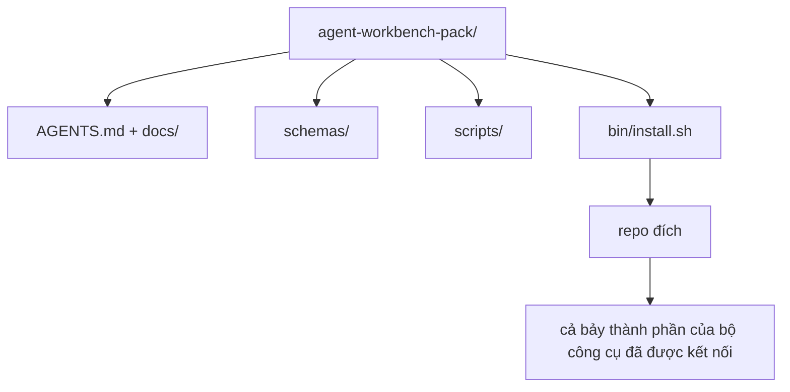

# Bài tổng kết: Đóng gói bộ công cụ làm việc cho agent có thể tái sử dụng

> Chuỗi bài học nhỏ kết thúc bằng một bộ công cụ bạn có thể đưa vào bất kỳ repo nào. Những gì học được về các thành phần qua mười một bài được gói vào một thư mục: chỉ cần `cp -r` là sáng hôm sau agent có thể làm việc ổn định. Sản phẩm tổng kết này là thành quả cốt lõi của chương trình học.

**Type:** Build
**Languages:** Python (stdlib)
**Prerequisites:** Giai đoạn 14 · 31 đến 14 · 41
**Time:** ~75 phút

## Mục tiêu học tập

- Đóng gói bảy thành phần của bộ công cụ làm việc vào một thư mục có thể đưa thẳng vào repo.
- Cố định phiên bản schema, script và mẫu để repo mới có một nền tảng đã được kiểm chứng.
- Thêm một script cài đặt duy nhất để triển khai bộ công cụ mà chạy lại không gây thay đổi ngoài ý muốn.
- Quyết định phần nào được đưa vào bộ công cụ và phần nào để ngoài, đồng thời giải thích từng lựa chọn.
- Minh họa một thay đổi trong repository có agent hỗ trợ, kèm bằng chứng mà người đánh giá có thể tái hiện.

## Vấn đề

Một bộ công cụ làm việc nằm rải rác trong Google Doc, lịch sử trò chuyện và ba script chỉ còn nhớ mang máng sẽ phải được dựng lại mỗi quý. Giải pháp là một bộ công cụ có phiên bản: một repo hoặc thư mục chứa các thành phần, schema, script và trình cài đặt chạy bằng một lệnh.

Bạn sẽ kết thúc bài học này với `outputs/agent-workbench-pack/` đã được tạo trên đĩa và `bin/install.sh` có thể đưa bộ công cụ vào bất kỳ repo đích nào.

## Khái niệm



### Cấu trúc bộ công cụ

```
outputs/agent-workbench-pack/
├── AGENTS.md
├── docs/
│   ├── agent-rules.md
│   ├── reliability-policy.md
│   ├── handoff-protocol.md
│   └── reviewer-rubric.md
├── schemas/
│   ├── agent_state.schema.json
│   ├── task_board.schema.json
│   └── scope_contract.schema.json
├── scripts/
│   ├── init_agent.py
│   ├── run_with_feedback.py
│   ├── verify_agent.py
│   └── generate_handoff.py
├── bin/
│   └── install.sh
└── README.md
```

### Phần nào giữ lại, phần nào để ngoài

Đưa vào:

- Schema của các thành phần. Chúng là hợp đồng.
- Bốn script ở trên. Chúng là phần thực thi.
- Bốn tài liệu. Chúng là quy tắc và tiêu chí đánh giá.

Để ngoài:

- Các tác vụ riêng của dự án. Tác vụ thuộc bảng công việc của repo đích, không thuộc bộ công cụ.
- Lệnh gọi SDK của nhà cung cấp. Bộ công cụ không phụ thuộc framework.
- Nội dung hướng dẫn người mới. Bộ công cụ nằm cạnh tài liệu hướng dẫn sẵn có của nhóm, không nằm trong đó.

### Trình cài đặt

Một `bin/install.sh` (hoặc `bin/install.py`) ngắn gọn:

1. Từ chối cài đè lên bộ công cụ đã có nếu không dùng `--force`.
2. Sao chép bộ công cụ vào repo đích.
3. Kết nối CI nếu có `.github/workflows/`.
4. In các bước tiếp theo: điền bảng công việc, đặt các lệnh kiểm tra chấp nhận, chạy script khởi tạo.

### Quản lý phiên bản

Bộ công cụ có tệp `VERSION`. Những thay đổi schema và script đòi hỏi di chuyển trạng thái sẽ tăng phiên bản chính. Thay đổi chỉ liên quan đến tài liệu sẽ tăng phiên bản vá. `agent_state.json` của repo đích ghi lại phiên bản bộ công cụ dùng khi khởi tạo.

```figure
wb-pack-install
```

## Tự tay làm

`code/main.py` tập hợp bộ công cụ vào `outputs/agent-workbench-pack/` bên cạnh bài học, sử dụng các schema và script từ những bài trước trong chuỗi bài học nhỏ này cùng những tài liệu bạn đã viết.

Chạy nó:

```
python3 code/main.py
```

Script sao chép và cố định các thành phần, viết README, in cây thư mục của bộ công cụ rồi thoát với mã không. Chạy lại sẽ không gây thay đổi ngoài ý muốn.

## Các cách làm trong thực tế triển khai

Một bộ công cụ chỉ có giá trị nếu nó vẫn hoạt động qua các lần fork, cập nhật và cả khi dự án thượng nguồn không thuận lợi. Bốn cách làm sau giúp đạt được điều đó.

**`VERSION` là hợp đồng, không phải nội dung quảng bá.** Tăng phiên bản chính đòi hỏi di chuyển trạng thái. Tăng phiên bản phụ đòi hỏi chạy lại công cụ kiểm tra. Tăng phiên bản vá chỉ dành cho thay đổi tài liệu. Trình cài đặt ghi `.workbench-version` vào repo đích trong mỗi lần cài; `lint_pack.py` từ chối phát hành nếu phiên bản được khóa ở repo đích không khớp với `VERSION` của bộ công cụ. Đây là cách `npm`, `Cargo` và `pyproject.toml` tồn tại qua 10 năm thay đổi liên tục; agent không làm thay đổi các quy tắc đó.

**Một nguồn duy nhất để phân phối cho nhiều công cụ.** Nx cung cấp một lệnh `nx ai-setup` để tạo `AGENTS.md`, `CLAUDE.md`, `.cursor/rules/`, `.github/copilot-instructions.md` và một máy chủ MCP từ cùng một cấu hình. Bộ công cụ cũng nên làm vậy; trình cài đặt tạo các liên kết tượng trưng (`ln -s AGENTS.md CLAUDE.md`) để một nguồn thông tin chuẩn phục vụ mọi agent lập trình. Fork bộ công cụ chỉ để hỗ trợ công cụ này thay vì công cụ khác là một kiểu thất bại.

**`uninstall.sh` từ chối chạy khi có trạng thái cần giữ lại.** Gỡ cài đặt bộ công cụ không được xóa `agent_state.json`, `task_board.json` hoặc `outputs/` của người dùng. Trình gỡ cài đặt xóa schema, script, tài liệu và `AGENTS.md` (có thể giữ lại bằng `--keep-agents-md`), đồng thời từ chối tiếp tục nếu các tệp trạng thái có thay đổi chưa commit. Trạng thái thuộc về người dùng; bộ công cụ không sở hữu nó.

**Skill có thể phát hành. Phân phối theo kiểu SkillKit.** Bộ công cụ được phát hành dưới dạng một SkillKit skill: `skillkit install agent-workbench-pack` triển khai nó cho 32 AI agent từ một nguồn duy nhất. Repo của bộ công cụ là nguồn thông tin chuẩn; SkillKit là kênh phân phối. Sự phụ thuộc vào một nhà cung cấp không còn là rào cản; bảy thành phần vẫn giữ nguyên.

## Áp dụng

Ba cách phân phối bộ công cụ:

- **Dưới dạng thư mục đưa vào repo.** `cp -r outputs/agent-workbench-pack /path/to/repo`.
- **Dưới dạng repo mẫu công khai.** Fork rồi tùy chỉnh, với `VERSION` kiểm soát sự sai lệch.
- **Dưới dạng SkillKit skill.** Tích hợp vào sản phẩm agent của bạn để triển khai bằng một lệnh.

Bộ công cụ là công thức. Mỗi lần cài đặt là một lần áp dụng công thức đó.

## Đóng gói

`outputs/skill-workbench-pack.md` tạo một bộ công cụ được điều chỉnh cho dự án: quy tắc được làm rõ theo lịch sử của nhóm, các mẫu glob giới hạn phạm vi khớp với repo, và các tiêu chí đánh giá được bổ sung một mục riêng cho lĩnh vực.

## Bài tập

1. Quyết định tài liệu tùy chọn thứ năm nào xứng đáng được đưa vào bộ công cụ chuẩn. Giải thích lựa chọn của bạn.
2. Viết lại trình cài đặt bằng Python với cờ `--dry-run`. So sánh mức độ thuận tiện khi dùng với bash.
3. Thêm `bin/uninstall.sh` để gỡ bộ công cụ an toàn và từ chối chạy nếu các tệp trạng thái có lịch sử đáng kể. Thế nào là đáng kể?
4. Thêm `lint_pack.py` để báo lỗi khi bộ công cụ không còn khớp với `VERSION`. Tích hợp nó vào CI của chính repo chứa bộ công cụ.
5. Viết hướng dẫn di chuyển từ bộ công cụ tự dựng sang bộ công cụ này. Thứ tự thao tác nào giảm thiểu thời gian gián đoạn?

## Thực hành nghề nghiệp: Chứng minh một thay đổi trong repository

Bản minh họa đóng gói chứng minh rằng chương trình tập hợp bộ công cụ chạy được và tạo ra các tệp. Nó không chứng minh rằng agent của bạn có thể hoàn thành một tác vụ mới, rằng các bước kiểm tra được tạo ra chứng minh tác vụ đó, hay rằng hệ thống đã triển khai hoạt động. Hãy tách biệt các nhận định ấy.

Chọn một tác vụ nhỏ, có thật trong repository mà bạn sở hữu hoặc được phép thay đổi. Dùng một agent lập trình mà bạn đã có quyền truy cập. Sửa lỗi, thêm một tính năng có phạm vi rõ ràng hoặc cải thiện vận hành đều được; cài đặt nhiều agent không thuộc bài tập này.

Dành một buổi làm việc riêng ngoài phần thực hành đóng gói. Sao chép mẫu ghi bằng chứng được liên kết bên dưới vào thư mục `learning-artifacts/` của riêng bạn. Giữ nguyên mẫu và bộ công cụ đã được commit để làm tài liệu tham chiếu.

### 1. Xác định tác vụ và chọn mức độ tự chủ

Dùng khung mô tả tác vụ từ bài 43 và kế hoạch thu thập bằng chứng từ bài 44. Ghi lại revision ban đầu, mục tiêu có thể quan sát, những việc không làm, các đường dẫn được phép thay đổi và bằng chứng chấp nhận. Xác định người dùng hoặc người vận hành thực sự cần hành vi đó.

Chọn cách làm việc: hướng dẫn từng bước, triển khai với các điểm kiểm tra, hoặc để agent tự thực hiện trong phạm vi giới hạn. Giải thích vì sao mức độ bất định, hậu quả và khả năng hoàn tác cho phép cách làm đó. Một lần tái cấu trúc nhỏ trên máy cục bộ có thể cần ít điểm kiểm tra hơn thay đổi về kiểm soát truy cập.

Đặt giới hạn thời gian thực và giới hạn token hoặc chi phí nếu agent hỗ trợ. Ghi rõ những số liệu không thể đo được. Xác định điều kiện dừng khi lỗi lặp lại, cần quyền mới, hết ngân sách hoặc chưa giải quyết được quyết định về hợp đồng; nêu rõ ai có thể giải quyết.

### 2. Chuẩn bị môi trường tối thiểu nhưng đủ dùng

Tìm phần triển khai, nơi gọi, bài kiểm tra và hướng dẫn cục bộ có liên quan. Ghi lại vì sao mỗi nguồn cần có trong ngữ cảnh và bằng chứng hiện tại nào sẽ thay thế một ghi chú đã lỗi thời. Đừng mặc định nạp toàn bộ repository.

Đưa ra một lựa chọn rõ ràng cho mỗi loại phần mở rộng có liên quan: skill cung cấp quy trình có thể lặp lại; công cụ MCP cung cấp quyền truy cập; hook chạy bước kiểm tra xác định; plugin đóng gói các khả năng. Chỉ giữ phần mở rộng khi tác vụ cần đến nó, với quyền tối thiểu đủ để hoạt động.

Ghi lại chi phí về ngữ cảnh hoặc bảo trì của một phần bổ sung được đề xuất mà bạn từ chối. Kiểm tra lại một ghi nhớ hoặc hướng dẫn đã cũ, rồi ngừng dùng hoặc thay thế nó trong thiết lập do bạn quản lý khi bằng chứng ủng hộ quyết định đó. Chạy lại bước kiểm tra bị ảnh hưởng để xác nhận rằng việc loại bỏ không làm mất một ràng buộc cần thiết.

### 3. Ghi nhận trạng thái ban đầu và triển khai

Trước khi chỉnh sửa, chạy bước kiểm tra hiện có gần nhất và cho thấy trạng thái hiện tại của hành vi được yêu cầu. Giữ lại lệnh, revision, kết quả và vị trí lưu bằng chứng. Một tính năng chưa tồn tại vẫn có trạng thái ban đầu: ghi lại phản hồi quan sát được hoặc thao tác chưa được hỗ trợ.

Để agent triển khai trong phạm vi hợp đồng. Duy trì nhật ký can thiệp, ghi lý do cho mỗi lần sửa, thay đổi quyền hoặc điều chỉnh kế hoạch. Không bắt buộc phải giao việc cho agent khác; nếu việc đó hữu ích, hãy áp dụng hợp đồng về quyền sở hữu và tích hợp của bài 45 trước khi thêm người thực hiện.

### 4. Thử thách bằng chứng

Chọn cách chứng minh có thể quan sát phần đã thay đổi. Với UI, dựng lại và kiểm tra hành trình người dùng được phục vụ ở các độ rộng màn hình liên quan. Với API, kiểm tra request và response sau khi tuần tự hóa. Với CLI, chạy lệnh đã dựng và kiểm tra mã thoát cùng output. Chọn những bước kiểm tra tác vụ cần và giải thích giới hạn của chúng.

Tự viết kết quả mong đợi từ hợp đồng tác vụ, độc lập với phần triển khai của agent. Trong một bản sao có thể bỏ đi, cố ý tạo ra một kết quả sai cụ thể, chẳng hạn chấp nhận giá trị không hợp lệ hoặc bỏ một trường bắt buộc trong response. Chạy cùng bước kiểm tra chấp nhận: nó phải báo lỗi vì lý do đó.

Nếu bước kiểm tra vẫn báo đạt, hãy tăng độ chặt của điều kiện kiểm tra hoặc cách quan sát trước khi tin vào nó. Khôi phục phần triển khai đúng và chạy lại thành công. Giữ bằng chứng của cả hai lần. Lỗi cú pháp hoặc cấu hình kiểm thử bị hỏng không được tính là phát hiện hồi quy.

Rà soát diff cuối cùng, kể cả các bài kiểm tra đã thay đổi, đối chiếu với mục tiêu ban đầu và các đường dẫn được phép. Nhờ một đồng nghiệp hoặc một phiên đánh giá riêng chất vấn bằng chứng yếu nhất mà không chỉnh sửa phần triển khai. Bạn vẫn chịu trách nhiệm đưa ra kết luận cuối cùng; sự đồng tình của một agent khác không phải là bằng chứng thực thi.

### 5. Diễn tập vận hành và khôi phục

Chạy sản phẩm đã thay đổi trong môi trường cục bộ hoặc staging có thể bỏ đi. Gắn nhãn mọi quan sát là `local`, `staging` hoặc `live`, kèm revision hoặc định danh sản phẩm chính xác. Diễn tập cục bộ chỉ hỗ trợ nhận định về môi trường cục bộ; bài tập này không yêu cầu triển khai production.

Chọn một tín hiệu lỗi liên quan đến tác vụ, một ngưỡng, một khoảng thời gian quan sát và một người chịu trách nhiệm. Giải thích cách phản ứng khi tín hiệu vượt ngưỡng. Kích hoạt tín hiệu an toàn trong buổi diễn tập và giữ lại log, metric hoặc response quan sát được.

Diễn tập quay lui về một phiên bản đã biết là hoạt động tốt và kiểm tra rằng hành vi trước đó được khôi phục. Tính đến dữ liệu được lưu lâu dài khi có liên quan; chỉ thay tệp nhị phân có thể không đảo ngược được thay đổi dữ liệu. Ghi lại mọi bước khôi phục bạn chưa thể xác minh.

### 6. Cải thiện lần chạy sau và bàn giao

So sánh kết quả với trạng thái ban đầu, bao gồm thời gian đã dùng, dữ liệu sử dụng hiện có và các lần con người can thiệp. Một tác vụ cho thấy điều đã xảy ra với tác vụ đó; nó không chứng minh rằng agent nói chung nhanh hơn hoặc đáng tin cậy hơn.

Chuyển một lần sửa dựa trên quan sát thành bài kiểm tra, ranh giới quyền hạn hẹp hơn, bước tự động hóa hoặc ví dụ rõ hơn theo bài 46. Chạy lại bước kiểm tra bị ảnh hưởng. Xóa các thay đổi tạm thời và ghi rõ nhánh cuối cùng, các tệp đã thay đổi, rủi ro còn mở và hành động tiếp theo cho phiên sau.

### Tiêu chí đánh giá thủ công

Yêu cầu người đánh giá kiểm tra các tệp bằng chứng và tái hiện ít nhất bước kiểm tra chấp nhận yếu nhất. Dùng `demonstrated`, `needs revision` hoặc `unverified` cho từng hàng, kèm vị trí bằng chứng và lý do. Các trường đã được điền và script đóng gói chạy đạt không thể thay thế những quan sát này.

| Khía cạnh | Bằng chứng người đánh giá cần chất vấn |
|---|---|
| Tác vụ và mức độ tự chủ | Hành vi ban đầu, mục tiêu có phạm vi rõ ràng, quyền hạn được giải thích, ngân sách và quy tắc dừng dùng được |
| Ngữ cảnh và môi trường | Nguồn liên quan, quyền truy cập công cụ có lý do và quyết định ngừng dùng đã được kiểm tra lại |
| Kiểm chứng | Hành vi thực tế trước và sau, cùng một kết quả sai được cố ý tạo ra mà chính bước kiểm tra đó phát hiện |
| Đánh giá và vận hành | Diff đã được kiểm tra, chất vấn độc lập, quan sát khi chạy có gắn nhãn và khôi phục đã được diễn tập |
| Cải tiến và bàn giao | Một cải tiến đã được kiểm chứng, giới hạn được trình bày trung thực, trạng thái cuối cùng sạch và hành động tiếp theo có thể tái hiện |

Giải quyết các mục `needs revision` trước khi tuyên bố tác vụ hoàn tất. Để bằng chứng không có ở trạng thái `unverified` và thu hẹp nhận định cho phù hợp. Hồ sơ này thể hiện năng lực đánh giá kỹ thuật của bạn qua một tác vụ có phạm vi rõ ràng; nó không bảo đảm việc tuyển dụng hay triển khai.

## Sản phẩm bàn giao

Giữ lại bộ công cụ có thể tái sử dụng và bản [career-agent-evidence.md](https://github.com/rohitg00/ai-engineering-from-scratch/blob/main/phases/14-agent-engineering/42-agent-workbench-capstone/outputs/career-agent-evidence.md) bạn đã hoàn thành. Mẫu này nối khung mô tả tác vụ, kế hoạch thực hiện, bằng chứng khi chạy, đánh giá, diễn tập khôi phục và bàn giao thành một nghiên cứu tình huống có thể đánh giá.

## Thuật ngữ chính

| Thuật ngữ | Người ta thường nói | Ý nghĩa thực sự |
|------|----------------|------------------------|
| Workbench pack | "Bộ công cụ khởi đầu" | Một thư mục có phiên bản, chứa cả bảy thành phần |
| Installer | "Script thiết lập" | `bin/install.sh` triển khai bộ công cụ mà chạy lại không gây thay đổi ngoài ý muốn |
| Pack version | "VERSION" | Tăng phiên bản chính khi thay đổi schema/script, tăng phiên bản vá khi chỉ đổi tài liệu |
| Drop-in pack | "cp -r là dùng được" | Bộ công cụ hoạt động ngay ngày đầu mà không cần tùy chỉnh cho từng repo |
| Forkable template | "Mẫu GitHub" | Repo công khai có thể sao chép bằng tính năng "Use this template" của GitHub |

## Đọc thêm

- Giai đoạn 14 · 31 đến 14 · 41 — mọi thành phần được gói trong bộ công cụ này
- [SkillKit](https://github.com/rohitg00/skillkit) — cài đặt skill này cho 32 AI agent
- [Nx Blog, Teach Your AI Agent How to Work in a Monorepo](https://nx.dev/blog/nx-ai-agent-skills) — trình tạo từ một nguồn duy nhất cho sáu công cụ
- [agents.md — đặc tả mở](https://agents.md/) — những gì bộ định tuyến của bộ công cụ phải triển khai
- [HKUDS/OpenHarness](https://github.com/HKUDS/OpenHarness) — triển khai tham chiếu tương đương bộ công cụ
- [Augment Code, A good AGENTS.md is a model upgrade](https://www.augmentcode.com/blog/how-to-write-good-agents-dot-md-files) — chuẩn chất lượng cho tài liệu của bộ công cụ
- [Anthropic, Effective harnesses for long-running agents](https://www.anthropic.com/engineering/effective-harnesses-for-long-running-agents)
- [Anthropic, Harness design for long-running application development](https://www.anthropic.com/engineering/harness-design-long-running-apps)
- Giai đoạn 14 · 30 — phát triển agent dựa trên đánh giá, sử dụng cổng kiểm chứng của bộ công cụ
- Giai đoạn 14 · 41 — mốc so sánh trước và sau mà bộ công cụ này cải thiện

---

[← Bài trước: Workbench trên một repo thực tế](../../41-workbench-for-real-repos/docs/vi.md) · [Bài sau: Xác định phạm vi tác vụ trước khi agent viết code →](../../43-frame-the-task-before-code/docs/vi.md)
