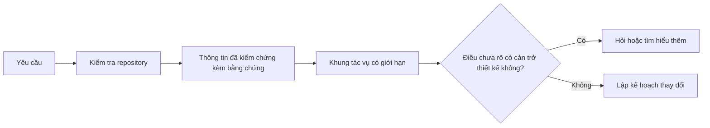

# Xác định phạm vi tác vụ trước khi agent viết code

> Một coding agent có thể triển khai nhanh một tác vụ rõ ràng. Nó cũng có thể triển khai nhanh một tác vụ chưa rõ ràng. Tốc độ như nhau. Chi phí thì không.

**Type:** Learn + Build
**Languages:** Python (stdlib)
**Prerequisites:** Giai đoạn 14, Bài 31 và 36
**Time:** ~60 phút

## Mục tiêu học tập

- Chuyển một yêu cầu thành khung tác vụ có giới hạn trước khi chỉnh sửa.
- Tách các thông tin đã kiểm chứng trong repository khỏi giả định và câu hỏi còn bỏ ngỏ.
- Xác định các đường dẫn được phép sửa, các đường dẫn không được sửa và bằng chứng nghiệm thu.
- Quyết định khi nào đã khảo sát đủ để bắt đầu làm việc.

## Sai lầm tốn kém

“Thêm cơ chế ngăn email trùng lặp” nghe có vẻ cụ thể. Nhưng không phải vậy. Việc kiểm tra tính duy nhất thuộc về API, dịch vụ miền hay cơ sở dữ liệu? So sánh có phân biệt chữ hoa chữ thường không? Hệ thống hiện công khai lỗi theo định dạng nào? Có được phép thay đổi schema không? Bài kiểm thử nào chứng minh hành vi này?

Một agent có năng lực sẽ lấp những chỗ trống đó bằng các lựa chọn có vẻ hợp lý. Đây là trường hợp nguy hiểm: phần triển khai có thể gọn gàng, đã được kiểm thử mà vẫn không tương thích với hệ thống.

Vì vậy, bước đầu tiên của coding agent không phải là chỉnh sửa. Đó là lập khung tác vụ (task frame) dựa trên bằng chứng từ repository.

## Khung tác vụ

Một khung tác vụ hữu ích có sáu mục:

| Mục | Câu hỏi |
|---|---|
| Mục tiêu | Hành vi quan sát được nào phải thay đổi? |
| Thông tin đã kiểm chứng trong repository | Bạn đã kiểm tra điều gì trong code, bài kiểm thử, cấu hình hoặc lịch sử thay đổi? |
| Đường dẫn được phép sửa | Thay đổi có thể nằm ở đâu? |
| Đường dẫn không được sửa | Những gì phải giữ nguyên? |
| Bằng chứng nghiệm thu | Lệnh hoặc kết quả quan sát nào chứng minh mục tiêu đã đạt được? |
| Điều chưa rõ | Quyết định nào vẫn cần thêm bằng chứng hoặc cần con người đưa ra? |

Thông tin đã kiểm chứng phải có nguồn dẫn. “API dùng 409 cho trường hợp trùng lặp” chưa phải là thông tin đã kiểm chứng nếu bạn chưa chỉ ra bài kiểm thử hoặc đoạn xử lý hiện có. Đường dẫn tệp và số dòng là đủ. Nếu cần xác nhận hành vi, kết quả chạy lệnh còn tốt hơn.



## Khảo sát để tìm ra các ràng buộc

Đừng đọc toàn bộ repository. Hãy tìm những phần đặt ra ràng buộc cho thay đổi:

1. Hành vi hiện tại và nơi gọi nó.
2. Bài kiểm thử hiện có gần với thay đổi nhất.
3. Giao kèo công khai hoặc định dạng dữ liệu sau khi tuần tự hóa.
4. Hướng dẫn của dự án áp dụng cho đường dẫn đó.
5. Các lệnh build và kiểm chứng.
6. Những thay đổi tương tự đã hoàn thành, cho thấy cách làm của dự án.

Hãy dừng khi mọi quyết định dự kiến đều có bằng chứng hỗ trợ, đã được giao quyền quyết định rõ ràng hoặc được liệt kê là điều chưa rõ. Đọc thêm sau thời điểm đó thường chỉ là cách trì hoãn.

## Điều chưa rõ không phải là thất bại

Điều chưa rõ là một khoảng trống được kiểm soát. Giả định là câu trả lời thiếu kiểm soát cho khoảng trống đó.

Phân loại từng điều chưa rõ:

- **Có thể tìm ra:** repository hoặc hệ thống đang chạy có thể cho câu trả lời.
- **Có thể tự quyết:** yêu cầu tác vụ trao cho agent quyền lựa chọn.
- **Cần con người quyết định:** lựa chọn làm thay đổi hành vi sản phẩm, chi phí, rủi ro hoặc khả năng tương thích của giao kèo công khai.
- **Để sau:** lựa chọn nằm ngoài phần việc này và thuộc danh sách những việc không làm.

Agent nên tiếp tục xử lý những điều có thể tìm ra và những điều được giao quyền quyết định. Với những điều cần con người quyết định, agent nên tạm dừng trước khi lựa chọn bị chôn trong code.

## Xác định cách nghiệm thu trước khi triển khai

Hãy viết cách chứng minh kết quả trước khi viết bản sửa. Đó có thể là:

- lệnh chạy một bài kiểm thử unit hoặc integration tập trung vào thay đổi;
- hành trình thao tác trên trình duyệt với kích thước khung nhìn và trạng thái mong đợi được nêu rõ;
- một yêu cầu gửi qua mạng và giao kèo phản hồi chính xác;
- phép đo hiệu năng với ngưỡng cụ thể;
- bước kiểm tra phạm vi để xác nhận không có tệp không liên quan nào bị thay đổi.

“Các bài kiểm thử đều đạt” không phải là kế hoạch chứng minh. Hãy nêu tên bài kiểm thử làm căn cứ và điều nó chứng minh.

## Tự tay làm

Bài thực hành này tạo một `TaskFrame`, kiểm tra giới hạn và bằng chứng của nó, rồi ghi ra `outputs/task-frame.md`.

Chạy từ thư mục bài học này:

```bash
python3 code/main.py
python3 -m unittest discover code/tests -v
```

Hãy làm hỏng ví dụ theo bốn cách: bỏ mục tiêu, bỏ nguồn dẫn cho một thông tin đã kiểm chứng, để một đường dẫn vừa được phép sửa vừa không được sửa, và bỏ lệnh nghiệm thu. Bộ kiểm tra phải từ chối từng khung vì một lý do khác nhau.

## Áp dụng trong một repository thực tế

Trước khi yêu cầu agent chỉnh sửa:

1. Viết mục tiêu dưới dạng hành vi, không phải thay đổi tệp.
2. Ghi lại hai hoặc ba thông tin đã kiểm chứng cùng bằng chứng chính xác.
3. Chỉ định tập đường dẫn được phép sửa nhỏ nhất.
4. Nêu rõ những phần không được đụng đến.
5. Viết lệnh hoặc kết quả quan sát xác nhận tác vụ hoàn tất.
6. Liệt kê những quyết định mà bạn chưa có đủ cơ sở để đưa ra.

Khung tác vụ nên vừa trên một màn hình. Nếu không, tác vụ có thể gồm nhiều thay đổi có thể kiểm chứng độc lập.

## Bài tập

1. Lập khung tác vụ cho một lỗi thực tế trong repository của bạn mà không đề xuất giải pháp.
2. Tìm một nhận định trong khung thực chất là giả định. Thay nó bằng bằng chứng.
3. Thêm một điều chưa rõ cần con người quyết định mà câu trả lời sẽ làm thay đổi giao kèo công khai.
4. Thu hẹp một đường dẫn được phép sửa quá rộng thành tập đường dẫn an toàn nhỏ nhất.
5. Thêm bằng chứng về phạm vi thay đổi vào phần bằng chứng nghiệm thu.

## Đọc thêm

- [Nuseibeh and Easterbrook, Requirements Engineering: A Roadmap](https://www.cs.toronto.edu/~sme/papers/2000/ICSE2000.pdf), về cách gắn phần triển khai với mục tiêu thực tế và các ràng buộc luôn thay đổi.
- [Yang et al., SWE-agent: Agent-Computer Interfaces Enable Automated Software Engineering](https://arxiv.org/abs/2405.15793), về bằng chứng cho thấy giao diện làm việc của coding agent ảnh hưởng đến hiệu quả của nó.

## Điều bạn giữ lại

Hãy giữ `outputs/task-frame.md`. Đây là đầu vào cho bài học tiếp theo, nơi khung tác vụ trở thành kế hoạch thực hiện dựa trên bằng chứng.

---

[← Bài trước: Bài tổng kết: Đóng gói bộ công cụ làm việc cho agent có thể tái sử dụng](../../42-agent-workbench-capstone/docs/vi.md) · [Bài sau: Xây dựng kế hoạch thực thi dựa trên bằng chứng →](../../44-plan-from-evidence/docs/vi.md)
