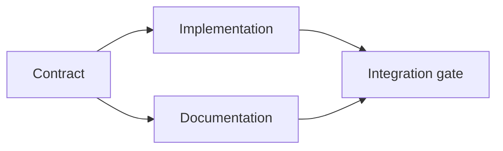

# Xây dựng kế hoạch thực thi dựa trên bằng chứng

> Kế hoạch không phải là danh sách việc cần làm được trình bày đẹp hơn. Đó là một đồ thị phụ thuộc (dependency graph), trong đó mỗi thay đổi đều có lý do và mỗi nút cuối đều có bằng chứng hoàn thành.

**Type:** Learn + Build
**Languages:** Python (stdlib)
**Prerequisites:** Giai đoạn 14, Bài 43
**Time:** ~65 phút

## Mục tiêu học tập

- Chuyển khung nhiệm vụ thành các hạng mục công việc có bằng chứng và cách kiểm chứng.
- Biểu diễn thứ tự thực hiện bằng các mối phụ thuộc thay vì một chuỗi mô tả.
- Phát hiện thông tin còn thiếu, mối phụ thuộc chưa rõ và chu trình trước khi sửa tệp.
- Tách các bước có thể làm cùng lúc khỏi các bước phải chờ.

## Vì sao kế hoạch của agent thất bại

Kế hoạch yếu chỉ viết lại yêu cầu ở thì tương lai:

1. Cập nhật API.
2. Thêm bài kiểm thử.
3. Cập nhật tài liệu.

Danh sách đó không cho biết đã tìm thấy gì, vì sao những tệp ấy là đúng, hợp đồng giao diện (contract) nào cần thay đổi trước, hay việc nào có thể làm đồng thời. Agent có thể làm đúng từng bước mà vẫn phải làm lại.

Một kế hoạch tốt đưa ra năm cam kết cho mỗi hạng mục công việc:

| Cam kết | Mục đích |
|---|---|
| Mã định danh | Tham chiếu ổn định cho các mối phụ thuộc và việc bàn giao |
| Thay đổi | Thay đổi nhỏ nhất về hành vi hoặc hợp đồng giao diện |
| Bằng chứng | Những thông tin trong repository làm căn cứ cho thay đổi |
| Mối phụ thuộc | Công việc phải hoàn tất trước |
| Kiểm chứng | Phép kiểm tra chính xác để hoàn tất hạng mục |

## Lập kế hoạch cho hợp đồng giao diện trước các phần triển khai

Khi nhiều thành phần cùng phụ thuộc vào một hành vi, hãy xác định hành vi đó trước. Sau đó, bài kiểm thử, phần triển khai, tài liệu và phần tích hợp có thể dùng chung một hợp đồng giao diện thay vì tự tạo ra bốn phiên bản khác nhau.



Đồ thị cho thấy những việc có thể làm đồng thời một cách an toàn. Phần triển khai và tài liệu có thể tiến hành cùng lúc sau khi hợp đồng giao diện được chốt. Phần tích hợp phải chờ cả hai.

## Bằng chứng làm thay đổi kế hoạch

Bằng chứng từ repository không phải để trang trí. Nó phải có khả năng làm thay đổi công việc:

- Một hàm hỗ trợ có sẵn khiến bạn không cần tạo thêm lớp trừu tượng đã định.
- Một bài kiểm thử tương thích buộc bạn thêm bước chuyển đổi.
- Một ràng buộc triển khai hệ thống khiến thay đổi schema phải chuyển sang nhiệm vụ khác.
- Một kiểu phản hồi công khai làm thay đổi thứ tự triển khai và viết tài liệu.

Nếu bằng chứng không thể làm thay đổi kế hoạch, có lẽ nó không phải là căn cứ cho quyết định đó.

## Thiết kế để có thể tiếp tục sau khi gián đoạn

Phiên làm việc của coding agent có thể kết thúc bất ngờ. Một kế hoạch có thể tiếp tục thực hiện cần chia công việc đủ nhỏ để phiên sau xác định được:

- hạng mục nào đã hoàn tất;
- phép kiểm chứng nào đã chạy;
- những tệp nào đã thay đổi;
- những mối phụ thuộc nào đã được tháo gỡ;
- hạng mục an toàn tiếp theo là gì.

Đừng chỉ ghi trạng thái bằng các ô đánh dấu trong cuộc trò chuyện. Hãy lưu kế hoạch cùng với phần việc.

## Kiểm tra kế hoạch

Hãy từ chối kế hoạch trước khi thực hiện nếu:

- mã định danh bị trùng;
- một hạng mục công việc không có bằng chứng;
- một hạng mục công việc không có cách kiểm chứng;
- một mối phụ thuộc trỏ đến hạng mục không tồn tại;
- đồ thị có chu trình;
- hành động không thể đảo ngược đầu tiên diễn ra trước khi điều chưa chắc chắn liên quan được làm rõ.

Năm phép kiểm tra đầu có thể thực hiện tự động. Phép cuối cần sự phán đoán và phải được nêu rõ.

## Tự tay làm

`code/main.py` mô hình hóa các hạng mục công việc, kiểm tra bằng chứng của chúng, tính các đợt thực thi bằng thuật toán sắp xếp topo (topological sort) và ghi `outputs/evidence-plan.json`.

Chạy:

```bash
python3 code/main.py
python3 -m unittest discover code/tests -v
```

Ví dụ tạo ra ba đợt. Việc xác định hợp đồng giao diện diễn ra trước. Phần triển khai và tài liệu được làm cùng lúc. Bước kiểm tra tích hợp diễn ra cuối cùng.

## Áp dụng với coding agent

Yêu cầu agent lập kế hoạch trước khi thay đổi tệp. Xem lại ba điểm trong kế hoạch:

1. Mọi khẳng định về đường dẫn và hành vi đều có bằng chứng từ repository.
2. Mỗi hạng mục có một cách kiểm chứng hoàn thành rõ ràng.
3. Đồ thị trì hoãn công việc tốn kém hoặc không thể đảo ngược cho đến khi điều chưa chắc chắn mà công việc đó phụ thuộc vào được làm rõ.

Hãy phê duyệt kế hoạch, không phải một lời hứa chung chung rằng agent sẽ cẩn thận.

## Bài tập

1. Thêm một hạng mục chuyển đổi cần con người phê duyệt rõ ràng.
2. Tạo một chu trình và giải thích bất đồng về sản phẩm ẩn sau nó.
3. Chia một hạng mục có hai lệnh kiểm chứng thành hai hạng mục.
4. Thêm một hạng mục công việc có thể chạy ở đợt thứ hai mà không đụng đến hai nhánh hiện có.
5. Hiển thị kế hoạch dưới dạng Markdown nhưng vẫn dùng JSON làm nguồn thông tin chuẩn.

## Đọc thêm

- [Nuseibeh and Easterbrook, Requirements Engineering: A Roadmap](https://www.cs.toronto.edu/~sme/papers/2000/ICSE2000.pdf), về mối quan hệ lặp lại giữa mục tiêu, đặc tả, sự thống nhất và quá trình phát triển.
- [Barry Boehm, A Spiral Model of Software Development and Enhancement](https://dl.acm.org/doi/10.1145/12944.12948), về cách sắp xếp công việc phát triển theo việc giải quyết rủi ro thay vì theo một trình tự tuyến tính cố định.

## Điều bạn giữ lại

Giữ `outputs/evidence-plan.json`. Tệp này trở thành thỏa thuận giao việc trong bài tiếp theo.

---

[← Bài trước: Xác định phạm vi tác vụ trước khi agent viết code](../../43-frame-the-task-before-code/docs/vi.md) · [Bài sau: Giao việc cho agent với cơ chế cô lập và hợp đồng hợp nhất →](../../45-delegate-with-isolation/docs/vi.md)
