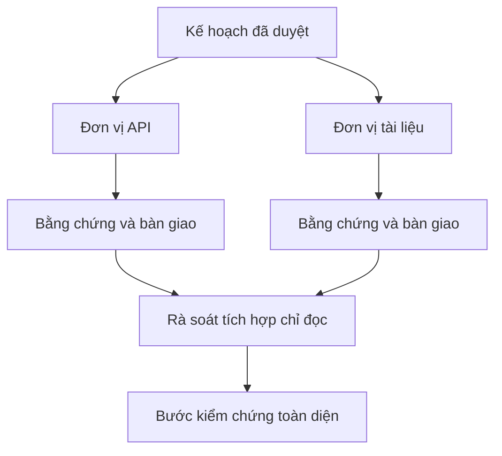

# Giao việc cho agent với cơ chế cô lập và hợp đồng hợp nhất

> Agent chạy song song chỉ tiết kiệm thời gian khi công việc độc lập. Nếu không, chúng biến một nhiệm vụ rõ ràng thành bài toán phối hợp dễ thất bại nhanh hơn.

**Type:** Learn + Build
**Languages:** Python (stdlib)
**Prerequisites:** Giai đoạn 14, Bài 39 và 44
**Time:** ~70 phút

## Mục tiêu học tập

- Quyết định có nên giao việc dựa trên tính độc lập thực sự.
- Giao mỗi worker quyền chỉnh sửa tệp độc quyền và yêu cầu bằng chứng rõ ràng.
- Tính các đợt thực thi theo quan hệ phụ thuộc.
- Thiết kế hợp đồng hợp nhất để kết hợp công việc của agent an toàn.

## Kiểm tra khả năng chạy song song

Đừng giao việc chỉ vì có thêm agent. Chỉ giao khi có ít nhất một điều sau:

- hai cuộc điều tra độc lập giải đáp những điều chưa rõ khác nhau;
- hai phần triển khai phụ trách các tệp và hợp đồng tách biệt;
- người rà soát có thể kiểm tra sản phẩm hoàn chỉnh mà không sửa nó;
- bước kiểm tra bên ngoài mất nhiều thời gian có thể chạy trong lúc công việc cục bộ tiếp tục.

Hãy làm tuần tự khi các agent cần cùng tệp, cùng quyết định chưa giải quyết hoặc cùng môi trường có thể thay đổi.

## Một đơn vị công việc là một hợp đồng

Mỗi đơn vị được giao cần có:

| Trường | Ý nghĩa |
|---|---|
| Mục tiêu | Một kết quả quan sát được |
| Người phụ trách | Một worker chịu trách nhiệm |
| Đường dẫn | Quyền chỉnh sửa độc quyền |
| Quan hệ phụ thuộc | Các đơn vị phải hoàn thành trước khi bắt đầu |
| Bằng chứng | Bằng chứng cụ thể gửi cho người tích hợp |
| Bàn giao | Tệp đã sửa, quyết định đã đưa ra, rủi ro còn lại |

“Xử lý backend” không phải đơn vị công việc. “Triển khai kiểm tra trùng lặp trong `app/accounts.py` và chứng minh bằng bài kiểm thử tài khoản tương ứng” thì đúng.

## Cơ chế cô lập có ba lớp

1. **Cô lập hệ thống tệp:** worktree hoặc sandbox riêng ngăn vô tình chỉnh sửa chung.
2. **Cô lập quyền phụ trách:** hợp đồng ngăn hai worker chủ động sửa cùng đường dẫn.
3. **Cô lập trạng thái:** log và output riêng ngăn worker ghi đè bằng chứng của nhau.

Cô lập hệ thống tệp không giải quyết quyền phụ trách. Hai worktree riêng vẫn có thể tạo ra thiết kế xung đột. Hợp đồng hợp nhất phải thống nhất giao diện dùng chung trước khi bắt đầu.



## Người tích hợp không làm lại công việc

Người tích hợp nên:

1. xác nhận mỗi phần bàn giao đúng phạm vi được giao;
2. đọc kết quả kiểm chứng, không chỉ bản tóm tắt của worker;
3. kết hợp thay đổi theo thứ tự phụ thuộc;
4. chạy bước kiểm tra toàn diện giữa các đơn vị;
5. từ chối việc âm thầm mở rộng phạm vi;
6. ghi nhận xung đột thành quyết định mới, không âm thầm chỉnh sửa.

Nếu tích hợp đòi hỏi viết lại phần lớn kết quả của worker, cách chia việc ban đầu đã sai.

## Vai trò của con người và agent

Giao việc không thay thế phán đoán của con người. Con người vẫn quyết định những lựa chọn thay đổi hành vi công khai, rủi ro, thẩm quyền hoặc chi phí không thể thu hồi. Agent có thể phụ trách điều tra, triển khai, kiểm chứng và rà soát trong phạm vi giới hạn.

Đó là quyền tự chủ có điều chỉnh: hệ thống cho phép tự do khi có bằng chứng vững chắc và dễ hoàn tác, nhưng yêu cầu bước phê duyệt khi hậu quả lớn.

## Tự tay làm

Bài thực hành kiểm tra đường dẫn chồng lấn, xác thực quan hệ phụ thuộc, tính các đợt thực thi an toàn và ghi `outputs/delegation-plan.json`.

Chạy:

```bash
python3 code/main.py
python3 -m unittest discover code/tests -v
```

Đổi đơn vị tài liệu để nó phụ trách `app/`. Kế hoạch phải chặn vì đường dẫn thư mục cha này chồng lấn với đơn vị API.

## Bài tập

1. Chia một thay đổi thực tế thành hai đơn vị công việc độc lập và một người tích hợp.
2. Tìm cách chia việc song song chỉ có vẻ độc lập. Nêu quyết định chung chưa giải quyết.
3. Thêm worker nghiên cứu chỉ đọc, xuất ra bảng dữ kiện.
4. Thêm bước kiểm tra hợp nhất để đối chiếu tập tệp thay đổi cuối cùng với hợp đồng của mọi đơn vị.
5. Đặt quy tắc hủy công việc của worker khi phần việc nó phụ thuộc không còn hợp lệ.

## Đọc thêm

- [Reid Smith, The Contract Net Protocol](https://doi.org/10.1109/TC.1980.1675516), về một cách tiếp cận chính thức ban đầu đối với việc phân bổ nhiệm vụ phân tán và báo cáo kết quả.
- [Eric Horvitz, Principles of Mixed-Initiative User Interfaces](https://dl.acm.org/doi/10.1145/302979.303030), về khi nào hệ thống tự động nên hành động và khi nào nên trả quyền kiểm soát cho con người.

## Điều bạn giữ lại

Giữ `outputs/delegation-plan.json`. Tệp ghi lại vì sao cách chia việc an toàn, ai phụ trách từng đường dẫn và người tích hợp phải nhận bằng chứng nào.

---

[← Bài trước: Xây dựng kế hoạch thực thi dựa trên bằng chứng](../../44-plan-from-evidence/docs/vi.md) · [Bài sau: Biến mỗi lần sửa sai của agent thành cải tiến hệ thống →](../../46-turn-feedback-into-system/docs/vi.md)
