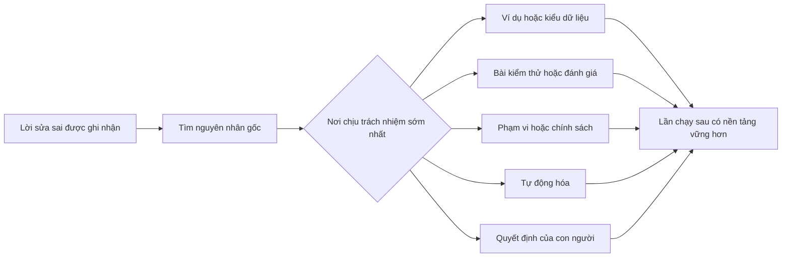

# Biến mỗi lần sửa sai của agent thành cải tiến hệ thống

> Lời sửa sai chỉ nằm trong chat khắc phục một lần chạy. Đưa nó vào bài kiểm thử, ranh giới, ví dụ hoặc công cụ sẽ cải thiện mọi lần chạy sau.

**Type:** Learn + Build
**Languages:** Python (stdlib)
**Prerequisites:** Giai đoạn 14, Bài 37 đến 41
**Time:** ~65 phút

## Mục tiêu học tập

- Biến lời sửa sai của agent thành biện pháp kiểm soát lâu dài.
- Đặt mỗi biện pháp ở tầng sớm nhất có thể ngăn lỗi tái diễn.
- Gộp bài học lặp lại bằng fingerprint (dấu nhận dạng) ổn định.
- Gỡ bỏ biện pháp không còn ngăn rủi ro thực tế.

## Lời sửa sai là bằng chứng

Khi bảo agent “đừng sửa tệp đó”, bạn biết ranh giới phạm vi chưa thể thực thi. Khi nói “định dạng đầu ra này sai”, bạn biết còn thiếu ví dụ hoặc bài kiểm thử. Khi thiết lập lại thất bại, bạn biết kiến thức về môi trường cần được tự động hóa.

Hãy xem lời sửa sai là quan sát về hệ thống làm việc, không phải lỗi viết prompt.

## Đưa biện pháp về tầng sớm nhất có hiệu quả

Dùng thứ tự sau:

| Lỗi tái diễn | Nơi đặt biện pháp lâu dài |
|---|---|
| Kết quả sai hoặc lỗi tái xuất hiện | Bài kiểm thử hoặc đánh giá |
| Hành động ngoài phạm vi hoặc không an toàn | Chính sách phạm vi hoặc quyền hạn |
| Lỗi thiết lập hoặc dùng lệnh lặp lại | Tự động hóa hoặc công cụ |
| Lỗi định dạng đầu ra lặp lại | Ví dụ chuẩn kèm bộ kiểm tra |
| Quy ước cục bộ chưa rõ | Hướng dẫn kèm kiểm tra theo tình huống |
| Bất đồng về sản phẩm | Biên bản quyết định của con người |

Biện pháp càng sớm càng ít tốn kém. Kiểu dữ liệu ngăn trạng thái không hợp lệ mạnh hơn nhận xét rà soát phát hiện lỗi về sau. Bài kiểm thử tập trung mạnh hơn đoạn văn nhắc agent ghi nhớ.



## Hồ sơ cải tiến tích lũy

Ghi lại:

- triệu chứng;
- nguyên nhân gốc;
- hậu quả;
- số lần tái diễn;
- biện pháp được chọn;
- cách kiểm chứng biện pháp;
- người phụ trách;
- ngày xem xét hoặc gỡ bỏ.

Đừng biến mọi sở thích chỉ xuất hiện một lần thành quy định. Chỉ làm vậy khi tần suất tái diễn hoặc hậu quả đủ biện minh cho độ phức tạp lâu dài.

## Phân biệt nguyên nhân và triệu chứng

“Agent đã sửa README” là triệu chứng. Nguyên nhân có thể là:

- tác vụ cho phép làm việc ở thư mục gốc kho mã;
- tài liệu ngầm được coi là an toàn để sửa;
- kế hoạch gộp việc triển khai và viết tài liệu;
- hai người thực hiện có phạm vi phụ trách chồng lấn.

Mỗi nguyên nhân cần biện pháp khác nhau. Quy tắc chỉ nhắc lại triệu chứng sẽ thất bại ở trường hợp hơi khác tiếp theo.

## Biện pháp kiểm soát cũng lỗi thời

Biện pháp cũ có thể mâu thuẫn, làm phình ngữ cảnh và mô tả hệ thống không còn tồn tại. Mỗi quy tắc được đưa vào sử dụng lâu dài cần điều kiện gỡ bỏ. Hãy gỡ hoặc viết lại khi:

- kiến trúc nền tảng thay đổi;
- biện pháp mạnh hơn, có thể thực thi, đã thay thế nó;
- lỗi không tái diễn trong một khoảng thời gian đủ để đánh giá;
- biện pháp gây nhiều trở ngại hơn rủi ro nó ngăn chặn.

Mục tiêu không phải tệp hướng dẫn dài nhất, mà là hệ thống gọn nhất vẫn giữ được kinh nghiệm khó có được.

## Tự tay làm

Bài thực hành phân loại lời sửa sai, chuyển thành biện pháp kiểm soát, dùng fingerprint nhận diện mục trùng và ghi `outputs/feedback-ratchet.json`.

Chạy:

```bash
python3 code/main.py
python3 -m unittest discover code/tests -v
```

Thêm hai lời sửa sai khác cách diễn đạt nhưng cùng nguyên nhân. Cải thiện bước chuẩn hóa đến khi chúng gộp thành một biện pháp mà không gộp nhầm lỗi không liên quan.

## Bài tập

1. Lấy năm lời sửa sai từ một phiên lập trình gần đây và xác định đúng nơi chịu trách nhiệm.
2. Thay một quy tắc viết bằng lời bằng bài kiểm thử có thể thực thi.
3. Thêm trọng số hậu quả để lỗi nghiêm trọng được đưa vào kiểm soát lâu dài ngay lần đầu.
4. Thêm người phụ trách và ngày xem xét gỡ bỏ vào đầu ra bài thực hành.
5. Xem lại một hướng dẫn hiện có cho agent; chỉ xóa sau khi chứng minh đã có biện pháp mạnh hơn.

## Đọc thêm

- [Basili, Caldiera, and Rombach, The Goal Question Metric Approach](https://www.cs.toronto.edu/~sme/CSC444F/handouts/GQM-paper.pdf), về cách chuyển mục tiêu thành câu hỏi và phép đo vận hành.
- [Shinn et al., Reflexion](https://arxiv.org/abs/2303.11366), về cách dùng dấu vết phản hồi để cải thiện quyết định sau này mà không đổi trọng số mô hình.
- [Madaan et al., Self-Refine](https://arxiv.org/abs/2303.17651), về phản hồi và chỉnh sửa lặp lại trong một vòng tác vụ.

## Điều bạn giữ lại

Giữ `outputs/feedback-ratchet.json`. Đây là thành quả lâu dài ở cuối lộ trình Agent-Assisted Engineering và là đầu vào cho những thay đổi tiếp theo của môi trường làm việc.

---

[← Bài trước: Giao việc cho agent với cơ chế cô lập và hợp đồng hợp nhất](../../45-delegate-with-isolation/docs/vi.md) · [Bài sau: Xác định kết quả trước khi chọn đầu ra →](../../47-outcomes-before-output/docs/vi.md)
