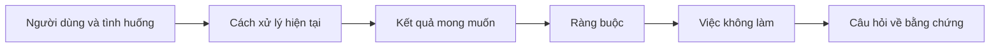

# Xác định kết quả trước khi chọn đầu ra

> Triển khai nhanh khiến việc chọn sai vấn đề phải trả giá đắt hơn. Hãy xác định kết quả trước để tốc độ đưa bạn đúng hướng.

**Type:** Learn + Build
**Languages:** Python (stdlib)
**Prerequisites:** Không có
**Time:** ~60 phút

## Mục tiêu học tập

- Viết khung kết quả mà không nêu giải pháp.
- Xác định người dùng, tình huống, cách xử lý hiện tại và thay đổi mong muốn.
- Nêu rõ ràng buộc và những việc không làm.
- Phát hiện giải pháp lọt vào mục tiêu trước khi thành phạm vi công việc.

## Đầu ra không phải kết quả

“Xây dựng trợ lý xử lý sự cố” nêu một đầu ra, nhưng không cho biết ai cần nó, điều gì sẽ tốt hơn hay điều gì phải giữ an toàn.

Khung kết quả (outcome frame) nêu:

> Khi có cảnh báo production, kỹ sư trực xác định dịch vụ gặp lỗi và bước xử lý an toàn tiếp theo trong hai phút, còn việc chẩn đoán chỉ đọc và có thể kiểm toán.

Có thể đạt kết quả này bằng phần mềm, runbook, sửa dữ liệu hoặc thay đổi giao diện nhỏ hơn. Nó giữ nhóm tập trung vào kết quả thay vì sản phẩm đầu tiên ai đó hình dung.

## Khung sáu phần

| Phần | Câu hỏi |
|---|---|
| Người dùng | Ai trực tiếp gặp vấn đề? |
| Tình huống | Vấn đề xảy ra khi nào, ở đâu? |
| Cách xử lý hiện tại | Hiện nay diễn ra thế nào, kể cả cách xử lý tạm? |
| Kết quả mong muốn | Trạng thái quan sát được nào cần cải thiện? |
| Ràng buộc | Giới hạn nào về an toàn, chính sách, chi phí hoặc tương thích là cố định? |
| Việc không làm | Việc liên quan nào dễ bị cuốn vào nhưng cần loại trừ? |



## Phát hiện giải pháp lọt vào mục tiêu

Giải pháp lọt vào mục tiêu (solution leakage) khi phát biểu kết quả chứa dạng sản phẩm, giao diện, lựa chọn mô hình, framework hoặc kiến trúc chưa được bằng chứng xác nhận.

- “Người dùng nhận bản tóm tắt AI hằng tuần” ấn định bản tóm tắt và tần suất.
- “Người dùng hiểu các thay đổi tài khoản trước khi phê duyệt” nêu kết quả.
- “Triển khai cơ sở dữ liệu vector” ấn định hạ tầng.
- “Có bằng chứng chính sách liên quan khi rà soát” nêu khả năng cần có.

Ràng buộc có thể nêu công nghệ nếu yêu cầu tương thích thực sự bắt buộc. Hãy ghi rõ lý do.

## Ràng buộc bảo vệ kết quả

Ràng buộc không phải chi tiết triển khai mà là một phần của mục tiêu thực tế:

- không ghi vào production khi chẩn đoán;
- phản hồi trong thời hạn xử lý sự cố;
- các sự kiện kiểm toán hiện có vẫn là nguồn có thẩm quyền;
- không thêm phụ thuộc runtime mới;
- giữ nguyên hành vi hỗ trợ khả năng tiếp cận.

Sản phẩm đạt kết quả bằng cách vi phạm ràng buộc thì chưa đạt kết quả.

## Việc không làm tạo ranh giới

Việc không làm ngăn một phần việc hữu ích phình thành nền tảng. Chúng phải đủ cụ thể để loại trừ công việc:

- không tự động khắc phục;
- không xây hệ thống định tuyến cảnh báo mới;
- không thay thế người chỉ huy xử lý sự cố;
- không phân tích dữ liệu lịch sử trong phần việc này.

## Tự tay làm

Bài thực hành kiểm tra `OutcomeFrame` và ghi `outputs/outcome-frame.json`.

```bash
python3 code/main.py
python3 -m unittest discover code/tests -v
```

Thay kết quả mong muốn bằng “sử dụng trợ lý xử lý sự cố”. Bộ kiểm tra phải báo rằng đầu ra đề xuất đã lọt vào kết quả.

## Bài tập

1. Viết lại một yêu cầu tính năng trong backlog thành khung kết quả.
2. Thêm một ràng buộc làm thay đổi các giải pháp khả thi.
3. Thêm hai việc không làm để giữ phần việc đầu tiên nhỏ gọn.
4. Xác định quan sát sớm nhất có thể bác bỏ kết quả mong muốn.
5. Viết ba đầu ra khác nhau có thể đáp ứng cùng kết quả.

## Đọc thêm

- [Nuseibeh and Easterbrook, Requirements Engineering: A Roadmap](https://www.cs.toronto.edu/~sme/papers/2000/ICSE2000.pdf), về việc lấy mục tiêu thực tế làm điểm tựa cho công việc phần mềm.
- [Dardenne, van Lamsweerde, and Fickas, Goal-Directed Requirements Acquisition](https://doi.org/10.1016/0167-6423(93)90021-G), về cách cụ thể hóa mục tiêu cấp cao thành ràng buộc và yêu cầu vận hành.

## Điều bạn giữ lại

Giữ `outputs/outcome-frame.json`. Bài tiếp theo kiểm tra nó với quy trình mọi người thực sự làm.

---

[← Bài trước: Biến mỗi lần sửa sai của agent thành cải tiến hệ thống](../../46-turn-feedback-into-system/docs/vi.md) · [Bài sau: Khám phá luồng công việc mọi người thực sự làm →](../../48-discover-the-real-workflow/docs/vi.md)
