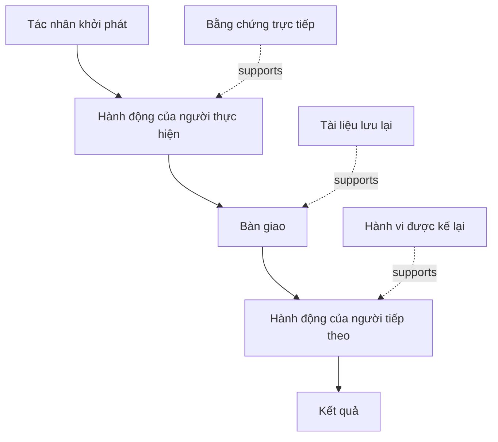

# Khám phá luồng công việc mọi người thực sự làm

> Yêu cầu không chờ sẵn trong cuộc họp để được thu thập. Chúng rải rác trong hành động, cách làm tạm, hồ sơ và bất đồng.

**Type:** Learn + Build
**Languages:** Python (stdlib)
**Prerequisites:** Giai đoạn 14, Bài 47
**Time:** ~70 phút

## Mục tiêu học tập

- Mô hình hóa luồng công việc hiện tại thành chuỗi hành động có bằng chứng.
- Phân biệt hành vi quan sát trực tiếp với hành vi được kể lại hoặc suy luận.
- Xác định trở ngại, bước bàn giao, quyền quyết định và trạng thái ẩn.
- Nêu rõ nhận định chưa chắc chắn thay vì biến chúng thành yêu cầu.

## Bắt đầu từ hệ thống hiện tại

Đừng hỏi mọi người muốn tính năng gì trước. Hãy dựng lại những gì đang diễn ra.

Với mỗi bước, ghi:

| Trường | Ví dụ |
|---|---|
| Người thực hiện | Kỹ sư trực sự cố |
| Tác nhân khởi phát | Cảnh báo production xuất hiện |
| Hành động | Mở cảnh báo, rồi tìm trên các dashboard |
| Đầu vào | Nội dung cảnh báo và hồ sơ triển khai |
| Đầu ra | Dịch vụ và người phụ trách có thể liên quan |
| Trở ngại | Chuyển giữa ba công cụ |
| Quyền quyết định | Người chỉ huy sự cố phê duyệt thao tác ghi |
| Bằng chứng | Bản ghi màn hình, nhật ký sự cố, hướng dẫn xử lý |

Luồng công việc không chỉ nằm trên màn hình. Nó gồm cả chờ đợi, sao chép và dán, kênh trao đổi bên lề, phê duyệt, khắc phục lỗi và những bước mọi người không còn để ý.

## Bằng chứng có độ tin cậy khác nhau

Dùng thang bằng chứng đơn giản:

1. **Hành vi trực tiếp:** quan sát, dấu vết, bản ghi hoặc sự kiện hệ thống.
2. **Tài liệu lưu lại:** phiếu công việc, hướng dẫn xử lý, nhật ký, biểu mẫu hoặc kết quả hoàn thành.
3. **Hành vi được kể lại:** một người mô tả việc họ làm.
4. **Suy luận:** nhóm kết luận điều có lẽ đã xảy ra.

Cả bốn đều hữu ích. Chỉ hai loại đầu trực tiếp chứng minh hành vi hiện tại. Hãy ghi rõ loại để mức tin cậy không âm thầm tăng lên.



## Tìm bốn điều

- **Trở ngại:** công sức lặp lại, chậm trễ, nhập lại dữ liệu hoặc khắc phục lỗi.
- **Trạng thái ẩn:** thông tin nằm trong trí nhớ, cuộc trò chuyện hoặc ghi chú cá nhân.
- **Quyền quyết định:** người hoặc hệ thống được phép thực hiện thay đổi có tác động đáng kể.
- **Ngoại lệ:** trường hợp luồng công việc thường lệ không còn diễn ra như thường lệ.

Tính năng AI thường thất bại ở bước bàn giao và ngoại lệ vì chỉ tình huống suôn sẻ được tính đến khi thiết kế.

## Đừng gộp các bất đồng thành trường hợp trung bình

Hai người dùng có thể theo hai luồng công việc khác nhau vì lý do chính đáng. Hãy giữ riêng các biến thể cho đến khi hiểu liệu chúng phản ánh:

- vai trò khác nhau;
- mức rủi ro khác nhau;
- quy trình cũ và hiện tại;
- khác biệt về chuyên môn;
- bất đồng thực sự về chính sách.

Luồng công việc lấy trung bình có thể chẳng mô tả đúng ai.

## Tự tay làm

Bài thực hành lưu bằng chứng cho từng bước, kiểm tra thứ tự và mức tin cậy, tính tỷ lệ bằng chứng trực tiếp, rồi ghi `outputs/workflow-evidence.json`.

```bash
python3 code/main.py
python3 -m unittest discover code/tests -v
```

Thêm nhánh ngoại lệ khi thiếu hồ sơ triển khai. Giữ nguyên thứ tự luồng chính và ghi nơi nhánh bắt đầu.

## Bài tập

1. Dựng lại một luồng công việc từ nhật ký mà không phỏng vấn ai.
2. Phỏng vấn một người dùng và đánh dấu mọi nhận định còn thiếu bằng chứng trực tiếp.
3. Thêm một ranh giới quyền quyết định và một bước khắc phục lỗi.
4. Mô hình hóa hai biến thể luồng công việc mà không gộp chúng.
5. Xác định một tính năng được đề xuất loại bỏ bước dễ thấy nhưng không động đến phần việc ẩn.

## Đọc thêm

- [Nuseibeh and Easterbrook, Requirements Engineering: A Roadmap](https://www.cs.toronto.edu/~sme/papers/2000/ICSE2000.pdf), đặc biệt về cách xem khai thác yêu cầu là diễn giải, mô hình hóa và kiểm chứng chứ không chỉ ghi nhận.
- [Gotel and Finkelstein, An Analysis of the Requirements Traceability Problem](https://doi.org/10.1109/ICRE.1994.292398), về khó khăn khi duy trì liên hệ giữa yêu cầu và nguồn của chúng.

## Điều bạn giữ lại

Giữ `outputs/workflow-evidence.json`. Trong bài tiếp theo, tệp này biến trở ngại đã quan sát và điều chưa chắc chắn thành bản đồ giả định.

---

[← Bài trước: Xác định kết quả trước khi chọn đầu ra](../../47-outcomes-before-output/docs/vi.md) · [Bài sau: Lập bản đồ giả định và xử lý điều rủi ro nhất trước →](../../49-map-assumptions-and-risk/docs/vi.md)
