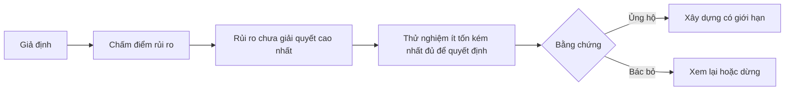

# Lập bản đồ giả định và xử lý điều rủi ro nhất trước

> Lộ trình giấu điều chưa chắc chắn trong các tính năng. Bản đồ giả định cho thấy điều gì phải đúng để những tính năng ấy đáng được xây dựng.

**Type:** Learn + Build
**Languages:** Python (stdlib)
**Prerequisites:** Giai đoạn 14, Bài 48
**Time:** ~65 phút

## Mục tiêu học tập

- Chuyển công việc dự kiến thành giả định rõ ràng.
- Chấm riêng tác động, mức độ chưa chắc chắn và mức độ khó đảo ngược.
- Chọn thử nghiệm tiếp theo theo rủi ro, không theo hào hứng.
- Thay giả định đã kiểm chứng bằng bằng chứng và quyết định.

## Mỗi lần xây dựng đều dựa trên giả định

Một công cụ xử lý sự cố có thể cần tất cả những điều sau là đúng:

- ngữ cảnh cảnh báo đủ để xác định dịch vụ;
- kỹ sư tin đề xuất mà họ không tự rút ra;
- thời gian phản hồi mong muốn có ý nghĩa trong vận hành;
- dữ liệu cần thiết có thể truy cập mà không cần quyền thiếu an toàn;
- quy trình diễn ra đủ thường xuyên để đáng bảo trì.

Đây không phải tác vụ triển khai. Đây là điều kiện để sản phẩm có giá trị, dùng được, khả thi và an toàn.

## Các loại giả định

| Loại | Câu hỏi |
|---|---|
| Giá trị | Kết quả có đủ quan trọng không? |
| Khả năng sử dụng | Người dùng có hiểu và hành động dựa trên đó không? |
| Tính khả thi | Hệ thống có tạo được kết quả với dữ liệu và ràng buộc hiện có không? |
| Khả năng duy trì | Tổ chức có duy trì được chi phí, trách nhiệm sở hữu và vận hành không? |
| An toàn | Hệ thống có thể gặp lỗi mà không gây hậu quả không thể chấp nhận không? |

Viết giả định thành phát biểu có thể bị bác bỏ. “Tính năng này hữu ích” không thể kiểm chứng. “Tám trong mười kỹ sư trực ca xác định đúng dịch vụ nhanh hơn nhờ kết quả chỉ đọc” thì có thể.

## Rủi ro không chỉ có một con số

Bài thực hành chấm ba chiều từ một đến năm:

- **Tác động:** thiệt hại nếu giả định sai.
- **Mức độ chưa chắc chắn:** bằng chứng hiện có yếu đến đâu.
- **Mức độ khó đảo ngược:** chi phí tìm hiểu sau khi đã cam kết.

Điểm ví dụ bằng tác động nhân mức độ chưa chắc chắn, rồi cộng mức độ khó đảo ngược. Công thức không áp dụng cho mọi trường hợp. Nó buộc nhóm nêu rõ vì sao phải giải quyết điều chưa biết này trước điều khác.



## Thiết kế thử nghiệm, không làm cho có để xác nhận

Một phép thử hữu ích cần:

- một khẳng định có thể sai;
- một nhóm đối tượng hoặc mẫu sát thực tế;
- một kết quả quan sát được;
- một ngưỡng định trước khi có kết quả;
- quyết định tiếp theo nếu đạt, không đạt hoặc bằng chứng chưa rõ.

Tránh phép thử chỉ chứng minh nhóm có thể xây dựng ý tưởng đó.

## Khả năng đảo ngược ảnh hưởng đến thứ tự

Lựa chọn có hậu quả lớn, khó đảo ngược cần bằng chứng sớm hơn. Có thể chạy lại dữ liệu ở chế độ chỉ đọc trước khi tích hợp vào môi trường vận hành. Có thể dùng bộ chuyển tiếp tạm trước khi di chuyển dữ liệu. Có thể để con người duyệt đề xuất trước khi tự động hành động.

Cách xây dựng nên theo những điều còn chưa chắc chắn.

## Tự tay làm

Bài thực hành xếp hạng giả định, phân biệt khẳng định đã kiểm chứng với khẳng định còn bỏ ngỏ, chọn rủi ro cao nhất còn bỏ ngỏ và ghi `outputs/assumption-map.json`.

```bash
python3 code/main.py
python3 -m unittest discover code/tests -v
```

Đổi bằng chứng cho giả định rủi ro cao nhất và xem thử nghiệm tiếp theo thay đổi ra sao.

## Bài tập

1. Viết năm giả định cho tính năng bạn muốn xây dựng.
2. Thêm một giả định an toàn bị danh sách tính năng bỏ sót.
3. Đặt ngưỡng khiến bạn dừng xây dựng.
4. Thay một thử nghiệm lớn bằng phép thử ít tốn kém hơn nhưng đủ để quyết định.
5. So thứ hạng rủi ro với ưu tiên trong lộ trình và giải thích sự khác biệt.

## Đọc thêm

- [Barry Boehm, A Spiral Model of Software Development and Enhancement](https://dl.acm.org/doi/10.1145/12944.12948), về chu trình phát triển theo rủi ro, giải quyết điều chưa chắc chắn trước khi cam kết sâu hơn.
- [Dardenne, van Lamsweerde, and Fickas, Goal-Directed Requirements Acquisition](https://doi.org/10.1016/0167-6423(93)90021-G), về làm rõ mục tiêu đồng thời phát hiện trở ngại và ràng buộc.

## Điều bạn giữ lại

Giữ `outputs/assumption-map.json`. Bài tiếp theo dùng tệp này để chọn phần nhỏ nhất có thể tạo bằng chứng đủ để quyết định.

---

[← Bài trước: Khám phá luồng công việc mọi người thực sự làm](../../48-discover-the-real-workflow/docs/vi.md) · [Bài sau: Chọn phần thử nghiệm nhỏ nhất có thể thay đổi quyết định →](../../50-choose-the-smallest-testable-slice/docs/vi.md)
