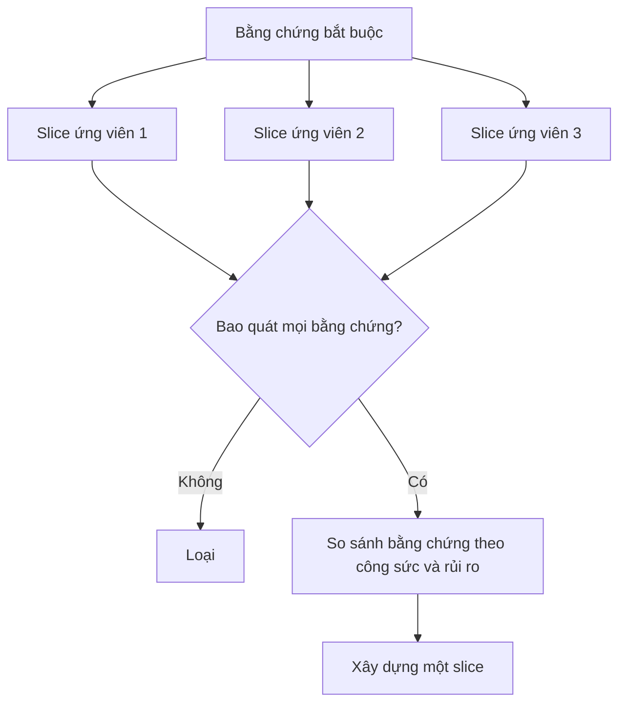

# Chọn phần thử nghiệm nhỏ nhất có thể thay đổi quyết định

> Nhỏ chỉ hữu ích khi chứng minh được điều quan trọng. Một bản dựng nhỏ không thể thay đổi quyết định tiếp theo thì chỉ là một bản dựng chưa hoàn chỉnh.

**Type:** Learn + Build
**Languages:** Python (stdlib)
**Prerequisites:** Giai đoạn 14, Bài 49
**Time:** ~65 phút

## Mục tiêu học tập

- Xác định một slice (phần thử nghiệm) bằng những giả định mà nó kiểm chứng.
- Cân bằng giá trị của kết quả, mức giảm bất định, công sức và hậu quả.
- Ưu tiên bằng chứng thu được theo cách có thể đảo ngược thay vì vội đưa vào production.
- Loại những slice bỏ qua phần rủi ro của quy trình làm việc.

## Xuyên suốt nghĩa là có bằng chứng từ đầu đến cuối

Một slice hữu ích đi qua quy trình thực tế tối thiểu cần thiết để quan sát kết quả. Nó có thể giới hạn về người dùng, dữ liệu, thời gian và khả năng. Nhưng đừng thu hẹp bằng cách loại bỏ chính điều bất định mà bạn cần kiểm tra.

Ví dụ:

- Chạy lại ở chế độ chỉ đọc trên mười sự cố thật giúp kiểm tra khả năng xác định dịch vụ và mức độ tin tưởng của người vận hành.
- Một dashboard chỉn chu dùng dữ liệu tổng hợp có thể kiểm tra mức độ dễ hiểu, nhưng không kiểm tra được tính khả thi về dữ liệu.
- Một hệ thống tự động khắc phục sự cố trên production kiểm tra mọi thứ cùng lúc, nhưng có hậu quả không thể chấp nhận.

## Xác định bằng chứng cần có trước

Lấy những giả định còn bỏ ngỏ có rủi ro cao nhất và chuyển chúng thành tập bằng chứng bắt buộc. Một slice ứng viên chỉ đủ điều kiện nếu bao quát toàn bộ tập đó.

Sau đó so sánh các slice đủ điều kiện theo:

| Tiêu chí | Hướng ưu tiên |
|---|---|
| Giá trị của kết quả | Càng nhiều càng tốt |
| Mức giảm bất định | Càng nhiều càng tốt |
| Công sức | Càng ít càng tốt |
| Hậu quả | Càng ít càng tốt |
| Khả năng đảo ngược | Càng cao càng tốt |

Cách tính điểm trong bài thực hành này được cố ý giữ đơn giản. Điều kiện đủ để được xét quan trọng hơn phép tính.



## Những cái tối thiểu nhưng không đủ

- **Chỉ làm UI:** bỏ qua bất định về dữ liệu và vận hành.
- **Chỉ làm hạ tầng:** chứng minh tính khả thi về kỹ thuật nhưng không chứng minh giá trị với người dùng.
- **Chỉ làm luồng thuận lợi:** bỏ qua ngoại lệ tạo ra phần lớn rủi ro.
- **Chỉ làm bản demo:** tạo ra một sản phẩm có sức thuyết phục nhưng không có phép đo lặp lại được.
- **Chỉ làm nền tảng:** xây dựng cơ chế dùng lại được trước khi một quy trình làm việc chứng tỏ nó xứng đáng.

## Đặt quy tắc dừng

Trước khi triển khai, hãy viết ra điều sẽ xảy ra nếu slice thất bại:

- từ bỏ kết quả mong muốn;
- thay đổi người dùng hoặc tình huống mục tiêu;
- kiểm tra một cơ chế khác;
- thu thập bằng chứng tốt hơn;
- thu hẹp quyền hạn hơn nữa.

Nếu mọi kết quả đều dẫn đến “tiếp tục xây dựng”, slice đó không phải là một thử nghiệm.

## Tự tay làm

Bài thực hành lọc các ứng viên theo bằng chứng bắt buộc, chấm điểm những slice đủ điều kiện và ghi `outputs/slice-decision.json`.

```bash
python3 code/main.py
python3 -m unittest discover code/tests -v
```

Thêm một ứng viên ít tốn kém hơn nhưng chỉ chứng minh được một giả định bắt buộc. Nó vẫn phải không đủ điều kiện, ngay cả khi điểm số của nó cao.

## Bài tập

1. Thiết kế ba slice cho cùng một kết quả mong muốn, với ba mức hậu quả khác nhau.
2. Nêu tập bằng chứng bắt buộc trước khi chấm điểm chúng.
3. Bỏ một khả năng nhưng vẫn giữ được bằng chứng mang tính quyết định.
4. Thêm quy tắc dừng cho một đợt thử nghiệm thất bại.
5. Chỉ ra một thành phần nền tảng có thể dùng lại nhưng nên để sau khi hoàn thành slice.

## Đọc thêm

- [Barry Boehm, A Spiral Model of Software Development and Enhancement](https://dl.acm.org/doi/10.1145/12944.12948), về cách gắn mỗi chu kỳ phát triển với những rủi ro mà chu kỳ đó phải giải quyết.
- [Lenarduzzi and Taibi, MVP Explained: A Systematic Mapping Study on the Definitions of Minimal Viable Product](https://arxiv.org/abs/1609.07592), về sự mơ hồ của “minimum” và “viable” trong thực tiễn phát triển sản phẩm phần mềm.

## Điều bạn giữ lại

Giữ `outputs/slice-decision.json`. Tệp này ghi lại lý do slice đó là phần nhỏ nhất có thể thay đổi quyết định.

---

[← Bài trước: Lập bản đồ giả định và xử lý điều rủi ro nhất trước](../../49-map-assumptions-and-risk/docs/vi.md) · [Bài sau: Viết đặc tả mà vẫn giữ chỗ cho phán đoán →](../../51-write-specifications-that-preserve-judgment/docs/vi.md)
