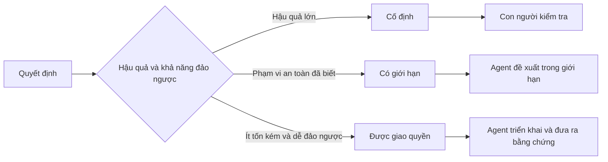

# Viết đặc tả mà vẫn giữ chỗ cho phán đoán

> Đặc tả hữu ích xác định điều phải luôn đúng và bằng chứng cần có, nhưng để ngỏ lựa chọn triển khai dễ đảo ngược. Nó là ranh giới ra quyết định, không phải kịch bản từng bước.

**Type:** Learn + Build
**Languages:** Python (stdlib)
**Prerequisites:** Giai đoạn 14, Bài 50
**Time:** ~75 phút

## Mục tiêu học tập

- Phân biệt kết quả, điều phải luôn đúng, ví dụ, việc không làm và bằng chứng.
- Đánh dấu quyết định là cố định, có giới hạn hoặc được giao quyền.
- Để agent tự phán đoán khi lựa chọn ít tốn kém và dễ đảo ngược.
- Yêu cầu con người kiểm tra khi hậu quả hoặc hành vi công khai thay đổi.

## Hai thái cực không hiệu quả

Nhiệm vụ thiếu đặc tả buộc agent đoán hệ thống. Nhiệm vụ đặc tả quá mức buộc nó chép theo thiết kế có thể đã sai.

Giải pháp ở giữa là hợp đồng có thể thực thi:

| Thành phần | Mục đích |
|---|---|
| Kết quả | Kết quả quan sát được |
| Điều phải luôn đúng | Điều kiện phải luôn được duy trì |
| Ví dụ | Trường hợp cụ thể làm rõ ý định |
| Việc không làm | Hành vi liên quan nhưng chủ ý loại trừ |
| Quy tắc ra quyết định | Lựa chọn nào cố định, có giới hạn hoặc được giao quyền |
| Bằng chứng | Bằng chứng cần có trước khi hoàn thành |

## Ba chế độ ra quyết định

- **Cố định:** agent không được tự chọn. Dùng cho khả năng tương thích công khai, quyền hạn, an toàn, chi phí không thể thu hồi hoặc cam kết sản phẩm.
- **Có giới hạn:** agent được chọn trong phạm vi rõ ràng. Dùng cho ngân sách tìm kiếm, số lần thử lại, thư viện phụ thuộc được phép hoặc nhóm giao diện đã biết.
- **Được giao quyền:** agent tự chọn và phải giải thích. Dùng cho cấu trúc cục bộ, cách đặt tên, tái cấu trúc dễ đảo ngược và chi tiết triển khai.



## Đặc tả hành vi bằng ví dụ

Ví dụ truyền đạt ý định tốt hơn tính từ. “Hữu ích”, “vững chắc” và “sẵn sàng đưa vào sản xuất” không thể thực thi. Một nhóm nhỏ ví dụ về trường hợp thông thường, trường hợp biên, lỗi và điều bị cấm cho cả người xây dựng lẫn người kiểm chứng căn cứ cụ thể.

Ví dụ không thay thế điều phải luôn đúng. Một trường hợp đạt yêu cầu không thể chứng minh quy tắc an toàn đúng trong mọi trường hợp.

## Bằng chứng phải tương xứng với điều cần chứng minh

- Kiểm thử đơn vị chứng minh hợp đồng của một hàm cục bộ.
- Kiểm thử trên đường truyền chứng minh hành vi tuần tự hóa và truyền tải.
- Một hành trình trên trình duyệt chứng minh một luồng thao tác qua giao diện.
- Một tập trường hợp chạy lại chứng minh hành vi trên các trường hợp tiêu biểu.
- Nhật ký kiểm toán chứng minh ranh giới quyền hạn được tuân thủ.

Đừng dùng bằng chứng ở tầng thấp hơn để chứng minh khẳng định ở tầng cao hơn.

## Chủ ý để ngỏ những điều chưa biết

Đặc tả có thể ghi: “phần triển khai được chọn bất kỳ nguồn chỉ đọc nào trả về trong giới hạn thời gian.” Đây không phải mơ hồ, mà là quyết định được chủ ý giao quyền, có ranh giới và bằng chứng.

Đặc tả nên thay đổi khi bằng chứng thay đổi. Hãy giữ lý do của các lựa chọn cố định và có giới hạn để nhóm sau điều chỉnh mà không phải lần mò tìm lại.

## Tự tay làm

Bài thực hành kiểm tra từng thành phần hợp đồng và chế độ ra quyết định, rồi ghi `outputs/executable-specification.json`.

```bash
python3 code/main.py
python3 -m unittest discover code/tests -v
```

Chuyển quyết định ghi vào môi trường sản xuất từ cố định sang được giao quyền. Giải thích vì sao schema chấp nhận giá trị đó nhưng rủi ro sản phẩm thì không.

## Bài tập

1. Chuyển một ticket trong backlog thành sáu thành phần đặc tả.
2. Thay ba chỉ dẫn triển khai bằng một điều phải luôn đúng và hai ví dụ.
3. Đánh dấu mọi quyết định và giải thích từng lựa chọn cố định hoặc có giới hạn.
4. Thêm bằng chứng xác nhận cho mỗi điều phải luôn đúng.
5. Bỏ một ràng buộc không có bằng chứng hoặc lý do về rủi ro.

## Đọc thêm

- [Nuseibeh and Easterbrook, Requirements Engineering: A Roadmap](https://www.cs.toronto.edu/~sme/papers/2000/ICSE2000.pdf), về quan hệ giữa mục tiêu, đặc tả chính xác, kiểm chứng, đồng thuận và sự thay đổi.
- [Zave and Jackson, Four Dark Corners of Requirements Engineering](https://doi.org/10.1145/237432.237434), về cách phân biệt giả định môi trường, yêu cầu và đặc tả.
- [Gotel and Finkelstein, An Analysis of the Requirements Traceability Problem](https://doi.org/10.1109/ICRE.1994.292398), về việc giữ lại lý do tồn tại và nguồn gốc của yêu cầu.

## Điều bạn giữ lại

Giữ `outputs/executable-specification.json`. Tệp này là hợp đồng chung cho agent viết code và người rà soát.

---

[← Bài trước: Chọn phần thử nghiệm nhỏ nhất có thể thay đổi quyết định](../../50-choose-the-smallest-testable-slice/docs/vi.md) · [Bài sau: Thiết kế chỉ số thành công trước khi có kết quả →](../../52-design-success-metrics/docs/vi.md)
