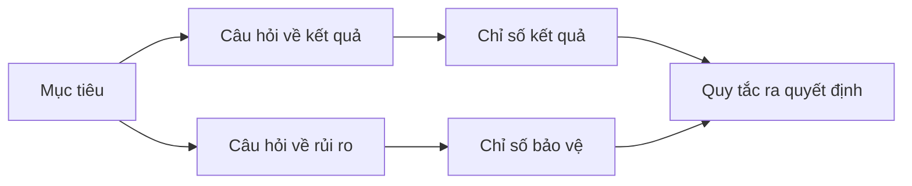

# Thiết kế chỉ số thành công trước khi có kết quả

> Đo lường phải phục vụ quyết định, không phải trang trí dashboard. Bắt đầu từ mục tiêu, đặt câu hỏi, rồi chọn số chỉ số tối thiểu để trả lời.

**Type:** Learn + Build
**Languages:** Python (stdlib)
**Prerequisites:** Giai đoạn 14, Bài 47 và 51
**Time:** ~70 phút

## Mục tiêu học tập

- Từ mục tiêu kết quả, xác định câu hỏi và chỉ số đo lường (metric).
- Định rõ ngưỡng, khoảng thời gian, nguồn và chiều đánh giá trước khi thấy kết quả.
- Kết hợp chỉ số kết quả với chỉ số bảo vệ (guardrail) và chỉ số đối trọng (counter-metric).
- Chọn bằng chứng đánh giá phù hợp với quyết định mà sản phẩm phải hỗ trợ.

## Mục tiêu, câu hỏi, chỉ số

Bắt đầu từ một mục tiêu:

> Giảm thời gian xác định dịch vụ bị ảnh hưởng mà không tăng hành động thiếu an toàn.

Đặt câu hỏi:

- Xác định đúng dịch vụ nhanh đến đâu?
- Tần suất xác định đúng dịch vụ là bao nhiêu?
- Việc chẩn đoán có vẫn chỉ đọc không?
- Quy trình có làm tăng việc bỏ qua cảnh báo hoặc khối lượng việc của người vận hành không?

Rồi chọn chỉ số để đo những điều các câu hỏi đặt ra.



## Mỗi chỉ số cần một quy định

Mỗi chỉ số cần:

| Trường | Ví dụ |
|---|---|
| Tên | `median_identification_seconds` |
| Chiều đánh giá | không quá |
| Ngưỡng | 120 |
| Khoảng thời gian | mười lần phát lại sự cố |
| Nguồn | nhật ký sự kiện phát lại |
| Nhóm được đo | kỹ sư trực vận hành trong đợt thí điểm |
| Loại | kết quả hoặc chỉ số bảo vệ |

Thiếu nguồn và khoảng thời gian thì không thể tái lập con số. Thiếu ngưỡng thì không thể dùng nó để quyết định.

## Chỉ số kết quả, chỉ số bảo vệ và chỉ số đối trọng

- **Chỉ số kết quả:** trạng thái mong muốn có cải thiện không?
- **Chỉ số bảo vệ:** ràng buộc cố định có còn được đáp ứng không?
- **Chỉ số đối trọng:** cải thiện cục bộ có đẩy chi phí hoặc tác hại sang nơi khác không?

Với quy trình xử lý sự cố, tốc độ chưa đủ. Độ chính xác, thao tác ghi lên production, khối lượng việc của người vận hành và cảnh báo bị bỏ sót giúp tránh kết quả nhanh nhưng thiếu an toàn.

## Bằng chứng offline và online

Phát lại offline giúp lặp lại phép đo và bao quát trường hợp biên. Thí điểm có giới hạn giúp quan sát hành vi thực, mức độ tin tưởng và tác động lên quy trình. Hai cách không thay thế nhau.

Dùng cách thu thập bằng chứng ít tốn kém nhất mà vẫn đủ cho quyết định hiện tại. Đừng cho người dùng thật tiếp xúc với hệ thống chỉ vì phần triển khai đã sẵn sàng.

## Quyết định trước khi đo

Viết sẵn điều kiện đạt, không đạt và chưa rõ trước khi xem kết quả. Nếu không, nhóm sẽ dời ngưỡng để bảo vệ sản phẩm đã làm.

Ví dụ:

- đạt: tỷ lệ xác định đúng dịch vụ ít nhất 0.9 và thời gian trung vị không quá 120 giây;
- không đạt: có bất kỳ thao tác ghi nào lên production hoặc tỷ lệ xác định đúng dưới 0.75;
- chưa rõ: cải thiện ít nhưng biến động lớn, cần bộ dữ liệu phát lại lớn hơn.

## Tự tay làm

Bài thực hành kiểm tra kế hoạch đo lường, đánh giá ngưỡng có tính giá trị bằng ngưỡng, ghi nhận giá trị thiếu và tạo `outputs/measurement-report.json`.

```bash
python3 code/main.py
python3 -m unittest discover code/tests -v
```

Xoá chỉ số bảo vệ và quan sát vì sao kế hoạch mất hiệu lực dù vẫn còn các chỉ số kết quả.

## Bài tập

1. Đặt ba câu hỏi từ một mục tiêu kết quả.
2. Thêm chỉ số đối trọng để phát hiện chi phí chuyển sang vai trò khác.
3. Xác định nguồn, nhóm được đo và khoảng thời gian cho từng chỉ số.
4. Viết điều kiện đạt, không đạt và chưa rõ trước khi tạo giá trị đo.
5. Tìm một chỉ số dễ thu thập nhưng không thể đổi quyết định. Bỏ chỉ số đó.

## Đọc thêm

- [Basili, Software Modeling and Measurement: The Goal/Question/Metric Paradigm](https://drum.lib.umd.edu/items/8119803a-362b-42ec-b6ce-2311713e7236), về cách rút ra phép đo vận hành từ mục tiêu rõ ràng.
- [Basili, Caldiera, and Rombach, The Goal Question Metric Approach](https://www.cs.toronto.edu/~sme/CSC444F/handouts/GQM-paper.pdf), về cách dùng phương pháp này làm hệ thống phản hồi và cải tiến.

## Điều bạn giữ lại

Giữ `outputs/measurement-report.json`. Tệp này xác định điều kiện về bằng chứng cho giai đoạn prototype, thí điểm hoặc production.

---

[← Bài trước: Viết đặc tả mà vẫn giữ chỗ cho phán đoán](../../51-write-specifications-that-preserve-judgment/docs/vi.md) · [Bài sau: Chủ động chọn prototype, pilot hay production →](../../53-prototype-pilot-or-production/docs/vi.md)
