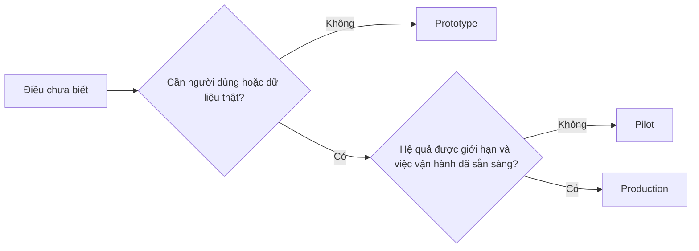

# Chủ động chọn prototype, pilot hay production

> Đây là các môi trường học hỏi khác nhau, không phải mức độ hoàn thiện. Chọn giai đoạn giải đáp điều chưa biết hiện tại với ít hệ quả không cần thiết nhất.

**Type:** Learn + Build
**Languages:** Python (stdlib)
**Prerequisites:** Giai đoạn 14, Bài 50 đến 52
**Time:** ~70 phút

## Mục tiêu học tập

- Chọn giai đoạn xây dựng dựa trên điều chưa biết, đối tượng, dữ liệu, hệ quả và mức sẵn sàng.
- Xác định biện pháp kiểm soát và tiêu chí kết thúc riêng cho từng giai đoạn.
- Ngăn prototype âm thầm thành hệ thống production.
- Hoãn trao quyền tác động thực tế đến khi bằng chứng và khả năng vận hành cho phép.

## Ba câu hỏi khác nhau

| Giai đoạn | Câu hỏi chính |
|---|---|
| Prototype | Cơ chế này có tạo được bằng chứng cần thiết không? |
| Pilot | Nó có hoạt động an toàn với nhóm người dùng thật giới hạn trong điều kiện thực tế không? |
| Production | Chúng ta có thể liên tục chịu trách nhiệm về nó ở mức tin cậy và rủi ro đã cam kết không? |

Prototype (bản thử nghiệm) có thể hoàn chỉnh về kỹ thuật nhưng vẫn dùng xong rồi bỏ. Pilot (thử nghiệm giới hạn) có thể dùng dữ liệu production nhưng vẫn giới hạn đối tượng và quyền tác động. Production (vận hành chính thức) bắt đầu khi tổ chức nhận trách nhiệm lâu dài.

## Prototype

Dùng prototype khi điều chưa biết không cần người dùng hoặc dữ liệu thật. Giữ nó:

- có thể bỏ đi;
- tách biệt;
- hành vi trong phạm vi hẹp;
- nêu rõ câu hỏi cần giải đáp;
- không hứa hẹn sai về khả năng vận hành.

Đừng tối ưu kiến trúc trước khi cơ chế chứng tỏ xứng đáng sang giai đoạn khác.

## Pilot

Dùng pilot khi điều chưa biết cần hành vi thực tế, dữ liệu sát thực tế hoặc quy trình thật, nhưng hệ quả hoặc mức sẵn sàng chưa phù hợp để phát hành rộng rãi.

Pilot cần:

- nhóm đối tượng được xác định rõ;
- người chịu trách nhiệm;
- thời hạn và quyền tác động có giới hạn;
- khả năng kiểm tra hoạt động và hoàn tác;
- ngưỡng kết quả và chỉ số an toàn;
- tiêu chí kết thúc để mở rộng, điều chỉnh hoặc dừng.

## Production

Production cần nhiều hơn triển khai:

- mục tiêu mức dịch vụ;
- người trực và chịu trách nhiệm xử lý sự cố;
- rà soát bảo mật và quyền riêng tư;
- kiểm soát chi phí và năng lực xử lý;
- khả năng hoàn tác và phục hồi;
- giám sát liên tục;
- lộ trình ngừng vận hành.



## Giai đoạn âm thầm thay đổi

Code prototype trở nên nguy hiểm khi có người dùng, dữ liệu hoặc quyền tác động mà chưa có người chịu trách nhiệm. Thể hiện ranh giới prototype và pilot trong cấu hình, kiểm soát truy cập, dữ liệu giám sát và tài liệu. Chỉ có biểu ngữ cảnh báo là chưa đủ.

Phải nhận biết được giai đoạn từ chính hệ thống.

## Tự tay làm

Bài thực hành chọn giai đoạn theo bối cảnh quyết định, trả về biện pháp kiểm soát cần thiết và ghi `outputs/stage-decisions.json`.

```bash
python3 code/main.py
python3 -m unittest discover code/tests -v
```

Đổi ví dụ pilot thành trường hợp hệ quả thấp, đã sẵn sàng vận hành. Giải thích cần thêm bằng chứng gì để chuyển sang production.

## Bài tập

1. Phân loại ba dự án hiện tại theo giai đoạn học hỏi, không theo trạng thái triển khai.
2. Viết tiêu chí kết thúc pilot, gồm cả quyết định dừng.
3. Thêm biện pháp kiểm soát kỹ thuật ngăn prototype tiếp cận dữ liệu production.
4. Xác định trách nhiệm vận hành đầu tiên khiến sản phẩm thành production.
5. Thiết kế bản ghi xác nhận hoàn tác cho pilot có giới hạn.

## Đọc thêm

- [Barry Boehm, A Spiral Model of Software Development and Enhancement](https://dl.acm.org/doi/10.1145/12944.12948), về cách điều chỉnh cam kết mỗi vòng lặp theo rủi ro đã giải quyết.
- [Fagerholm et al., Building Blocks for Continuous Experimentation](https://doi.org/10.1145/2601248.2601276), về điều kiện tổ chức và kỹ thuật để thử nghiệm liên tục.

## Điều bạn giữ lại

Giữ `outputs/stage-decisions.json`. Tệp ghi lý do chọn từng giai đoạn và biện pháp kiểm soát cần có trước giai đoạn kế tiếp.

---

[← Bài trước: Thiết kế chỉ số thành công trước khi có kết quả](../../52-design-success-metrics/docs/vi.md) · [Bài sau: Xây dựng cơ chế phản hồi tích lũy có người phụ trách và điều kiện loại bỏ →](../../54-build-the-feedback-ratchet/docs/vi.md)
