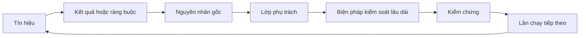

# Xây dựng cơ chế phản hồi tích lũy có người phụ trách và điều kiện loại bỏ

> Bàn giao khép lại vòng xây dựng và mở ra vòng học hỏi. Bằng chứng phải làm hệ thống thay đổi, nếu không chỉ là dữ liệu giám sát không ai phụ trách.

**Type:** Learn + Build
**Languages:** Python (stdlib)
**Prerequisites:** Giai đoạn 14, Bài 46 và 53
**Time:** ~75 phút

## Mục tiêu học tập

- Biến sự cố, đánh giá, hành vi người dùng và lần sửa lỗi thành hành động có người phụ trách.
- Chuyển mỗi tín hiệu đến ngữ cảnh, đánh giá, chính sách, môi trường chạy hoặc danh sách việc cần làm.
- Ưu tiên lỗi tái diễn theo mức độ nghiêm trọng và tần suất.
- Đặt điều kiện loại bỏ cho mọi biện pháp kiểm soát.
- Trình bày quyết định bàn giao cùng bằng chứng, đánh đổi và người chịu trách nhiệm.

## Phản hồi là hạ tầng

Một nhóm có thể thu thập dấu vết, kết quả đánh giá, phiếu hỗ trợ và nhật ký sự cố mà không học được gì. Thứ còn thiếu là cơ chế đưa quan sát thành thay đổi: con đường xác định từ quan sát đến thay đổi bền vững, có người phụ trách và bằng chứng xác nhận.

Vòng lặp gồm:

1. quan sát tín hiệu cụ thể;
2. liên hệ nó với kết quả, ràng buộc hoặc giả định;
3. tìm lớp sớm nhất trong hệ thống chịu trách nhiệm về nguyên nhân;
4. tạo thay đổi có giới hạn;
5. kiểm chứng khả năng tái diễn đã giảm;
6. xem lại liệu biện pháp kiểm soát có nên được giữ.

## Chuyển tín hiệu đến đúng lớp phụ trách

| Tín hiệu | Nơi xử lý |
|---|---|
| Dương tính giả, lỗi hồi quy, kết quả sai | Đánh giá hoặc kiểm thử |
| Thiếu ngữ cảnh, làm việc trùng lặp, thông tin lỗi thời | Nguồn ngữ cảnh hoặc cách truy xuất |
| Hành động không an toàn hoặc lỗ hổng về thẩm quyền | Ranh giới chính sách hoặc quyền truy cập |
| Timeout, bão retry, phụ thuộc ngừng hoạt động | Kiểm soát runtime |
| Nhu cầu sản phẩm mới hoặc đánh đổi chưa được giải quyết | Mục việc cần làm đã được xác định phạm vi |

Sửa nguyên nhân ở lớp sớm nhất có hiệu quả. Đừng thêm đoạn prompt khi kiểm thử hoặc quyền truy cập có thể ngăn hẳn lỗi.



## Người phụ trách là một phần của biện pháp kiểm soát

Mỗi hành động trong cơ chế này cần:

- một người phụ trách;
- mức ưu tiên theo hậu quả và khả năng tái diễn;
- thành phần cần thay đổi;
- cách kiểm chứng hiệu quả thay đổi;
- thời hạn xem xét hoặc hết hiệu lực;
- điều kiện loại bỏ.

Cải tiến không có người phụ trách chỉ là quan sát được trình bày đẹp hơn.

## Loại bỏ các biện pháp kiểm soát lỗi thời

Hệ thống phản hồi tích lũy quy định; chúng có thể mâu thuẫn và tốn kém. Xem lại biện pháp kiểm soát khi:

- kiến trúc hoặc quy trình thay đổi;
- quy tắc bất biến ở lớp thấp hơn thay thế chỉ dẫn ở lớp cao hơn;
- lỗi cần phòng ngừa không xuất hiện trong khoảng thời gian đã chọn;
- biện pháp cản trở công việc hợp lệ thường xuyên hơn mức ngăn ngừa tác hại.

Loại bỏ cũng cần bằng chứng. Đừng xóa biện pháp chỉ vì thấy nó đã cũ.

## Kết nối phản hồi từ quá trình xây dựng và coding agent

Cùng một cơ chế phục vụ cả hai hướng:

- Bằng chứng sản phẩm thay đổi cách xác định kết quả, giả định, phạm vi triển khai hoặc kế hoạch đo lường.
- Lần sửa cho coding agent thay đổi kiểm thử, ngữ cảnh, phạm vi, tự động hóa hoặc cách bàn giao.
- Sự cố có thể thay đổi cả ranh giới sản phẩm lẫn môi trường làm việc của agent.

Vì thế, xác định phạm vi xây dựng không kết thúc trước khi viết code. Việc này tiếp diễn qua mỗi thay đổi được chấp nhận.

## Tự tay làm

Bài thực hành phân loại tín hiệu, tạo hành động có người phụ trách, xếp ưu tiên và ghi `outputs/feedback-backlog.json`.

```bash
python3 code/main.py
python3 -m unittest discover code/tests -v
```

Thêm tín hiệu hết thời gian chờ và xác nhận nó được chuyển đến lớp xử lý khi chạy, không phải danh sách việc chung.

## Bài thực hành: Chịu trách nhiệm về quyết định sau trở ngại

Chọn một quy trình từ dự án portfolio thuộc lộ trình nghề nghiệp của bạn. Theo dõi nó qua một quyết định, thử nghiệm nhỏ và lần xem xét. Lưu bằng chứng trong [mẫu bằng chứng bàn giao cho lộ trình nghề nghiệp](https://github.com/rohitg00/ai-engineering-from-scratch/blob/main/phases/14-agent-engineering/54-build-the-feedback-ratchet/outputs/career-delivery-evidence.md).

Bài thực hành Python tạo hành động mẫu cho danh sách việc. Nó không quan sát người dùng, đo tác động của thay đổi hay chứng minh bạn sẵn sàng cho công việc. Chạy xong chỉ là bước chuẩn bị cho bài tập này.

### 1. Xác định điều đã xảy ra

Ghi người dùng, tác vụ, quy trình hiện tại và kết quả muốn cải thiện. Dẫn đến quan sát có sự đồng ý, hồ sơ hỗ trợ đã che thông tin nhạy cảm hoặc dấu vết tác vụ có thể tái hiện. Phân biệt điều bạn quan sát, điều người khác thuật lại và điều bạn suy luận.

Tìm một trở ngại: giả định sai, kết quả không dùng được, chi phí bất ngờ hoặc bàn giao chậm. Giải thích bằng chứng nào đã thay đổi cách bạn hiểu vấn đề. Trở ngại cần cách ứng phó và quyết định, không phải câu chuyện thành công che lấp nó.

Nếu không thể làm việc với người dùng, hãy chạy mô phỏng được ghi rõ với một người khác hoặc theo tình huống đã nêu. Tách quan sát mô phỏng khỏi bằng chứng người dùng thật. Đừng bịa phỏng vấn, phê duyệt, mức độ sử dụng hay tác động kinh doanh.

### 2. Tiến hành công việc trong phạm vi thẩm quyền

Liệt kê điều chưa biết và chọn hành động ít tốn kém nhất, có thể đảo ngược, để giải quyết điều quan trọng nhất. Nêu việc bạn có thể quyết định, việc bị giới hạn bởi thỏa thuận hiện có và việc cần cho phép trước khi làm.

Ví dụ, bạn có thể chuẩn bị lần chạy lại ngoại tuyến với dữ liệu đã che thông tin nhạy cảm trong lúc chờ quyền dùng dữ liệu khách hàng. Chủ động là thúc đẩy việc đã được phép và làm rõ quyết định đang bị chặn, không phải mở rộng quyền truy cập hay phê duyệt.

### 3. So sánh phương án và trình bày với người ra quyết định

Viết bản tóm tắt quyết định ngắn cho người không cần chi tiết triển khai. Gồm:

- vấn đề của người dùng và bằng chứng khiến kế hoạch thay đổi;
- ít nhất hai phương án, kể cả cách làm thủ công rẻ hơn hoặc không xây dựng nếu phù hợp;
- đánh đổi về chất lượng, thiết kế tương tác, công sức, chi phí vận hành và rủi ro;
- đề xuất, điều chưa chắc chắn và quyết định cần đưa ra;
- người ra quyết định, các bên bị ảnh hưởng và ngày cần quyết định.

Nhờ một người khác đóng vai bên liên quan bị ảnh hưởng và chất vấn một đánh đổi. Ghi ý kiến phản đối và cách nó thay đổi, hoặc không thay đổi, đề xuất. Ghi rõ phản hồi đóng vai là mô phỏng; nó không thay thế sự đồng thuận của bên liên quan thực sự.

### 4. Chạy thử nghiệm có giới hạn

Chọn làm nguyên mẫu, chạy thử quy mô nhỏ hoặc triển khai thực tế theo câu hỏi cần trả lời. Xác định đối tượng, dữ liệu, thẩm quyền, thời lượng, cách quay lại trạng thái trước và điều kiện tiếp tục, thay đổi hoặc dừng trước khi thu thập kết quả.

Đi qua tương tác từ điểm bắt đầu của người dùng đến khi hoàn thành tác vụ. Gồm cả trường hợp đầu ra sai hoặc thiếu dữ liệu. Quan sát liệu người dùng có nhận ra lỗi, sửa và tiếp tục mà không cần bạn âm thầm giúp hay không.

Tính thời gian con người kiểm tra và sửa lỗi vào quy trình. Model phản hồi nhanh hơn vẫn có thể khiến toàn bộ tác vụ chậm hơn hoặc khó tin cậy hơn.

### 5. So sánh kết quả và chi phí

Ghi số liệu ban đầu và sau thay đổi với cùng định nghĩa chỉ số, nhóm tác vụ, cách thu thập và khoảng quan sát có thể so sánh. Đặt số mẫu, trường hợp loại trừ và đường dẫn bằng chứng cạnh các con số. Nếu các điều kiện thay đổi, giải thích giới hạn của phép so sánh.

Gồm một kết quả cho người dùng, một chỉ số giới hạn về chất lượng hoặc an toàn và tổng công sức kiểm tra của con người. Ghi kết quả dù không đạt mục tiêu. Mẫu nhỏ hoặc mô phỏng chỉ hỗ trợ kết luận học hỏi có giới hạn, không chứng minh tác động kinh doanh.

Ước tính chi phí mỗi tác vụ hoàn thành thành công, gồm lần gọi model, lần thử lại, dịch vụ hỗ trợ và công sức kiểm tra của con người. Nêu giả định đơn giá nhân công và tách mức sử dụng đã đo khỏi ước tính. So sánh chi phí với cách làm thủ công hoặc giả định giá trị làm cơ sở cho dự án.

Dùng [bài học FinOps for LLMs hiện có](https://aiengineeringfromscratch.com/lesson?path=phases/17-infrastructure-and-production/27-finops-llms) để tìm hiểu sâu về phân bổ chi phí và chi phí trên mỗi đơn vị kết quả. Đổi model chỉ là một cách ứng phó; thu hẹp quy trình hoặc giữ bước thủ công có thể là quyết định sản phẩm tốt hơn.

### 6. Khép lại vòng phản hồi

Dùng tiêu chí đã xác định trước để đề xuất tiếp tục, thay đổi hoặc dừng. Nếu bằng chứng chưa đủ kết luận, nêu quan sát còn thiếu và phép thử có giới hạn tiếp theo. Ghi phản hồi của người chịu trách nhiệm ra quyết định; để trạng thái chờ nếu chưa có quyết định.

Chọn một cải tiến cho quy trình bàn giao: mô tả tác vụ rõ hơn, cho người dùng đi thử sớm hơn, danh sách kiểm tra tốt hơn, phạm vi bàn giao cho agent nhỏ hơn hoặc trường hợp đánh giá chặt chẽ hơn. Chỉ định người phụ trách và ngày xem xét.

Khi xem xét, quyết định giữ, sửa hay loại bỏ cải tiến. Ghi bằng chứng cho lựa chọn đó. Danh sách kiểm tra mới tạo thêm việc mà không ngăn lỗi cần phòng tránh thì chưa đáng giữ lâu dài.

## Sản phẩm bàn giao

Sao chép [career-delivery-evidence.md](https://github.com/rohitg00/ai-engineering-from-scratch/blob/main/phases/14-agent-engineering/54-build-the-feedback-ratchet/outputs/career-delivery-evidence.md) vào dự án và hoàn thiện bằng đường dẫn bằng chứng. Giữ mẫu đã lưu trong kho mã ở trạng thái có thể tái sử dụng. Đưa bản tóm tắt quyết định, quá trình đi thử tương tác, so sánh số liệu và bước tiếp theo có người phụ trách vào sản phẩm portfolio nghề nghiệp.

## Kiểm chứng lại

Dùng bảng tiêu chí chấp nhận thủ công này với một người khác. Đánh dấu mỗi hàng **đạt**, **cần cải thiện** hoặc **chưa quan sát**, kèm đường dẫn bằng chứng hoặc quan sát cụ thể còn thiếu. Điền đủ mục không chứng minh nhận định là đúng.

| Mục kiểm tra | Bằng chứng để được coi là đạt |
|---|---|
| Quy trình có cơ sở thực tế | Quan sát có thể truy vết làm căn cứ cho vấn đề; lời thuật lại, suy luận và mô phỏng được ghi rõ. |
| Tôn trọng thẩm quyền | Việc tiếp theo có thể đảo ngược được nêu rõ; hành động bị hạn chế chờ đúng người có quyền quyết định. |
| Trình bày các đánh đổi | Ghi các phương án khả thi, ý kiến phản đối của bên liên quan, đề xuất và yêu cầu ra quyết định rõ ràng. |
| Đã kiểm tra tương tác | Quá trình đi thử bao quát thành công, thất bại, khắc phục và công sức kiểm tra của con người. |
| Đã so sánh kết quả | Định nghĩa số liệu ban đầu và sau thay đổi nhất quán; số mẫu, chỉ số giới hạn, chi phí và giới hạn so sánh đều rõ. |
| Chịu trách nhiệm về trở ngại | Bằng chứng làm thay đổi quyết định tiếp tục/thay đổi/dừng và dẫn đến hành động tiếp theo có người chịu trách nhiệm. |
| Đã cải thiện quy trình | Một cải tiến quy trình có người phụ trách, ngày xem xét và quyết định giữ/sửa/loại bỏ dựa trên bằng chứng. |

Hành vi người dùng thật chưa được quan sát vẫn là khoảng trống, dù mọi bước mô phỏng đều đạt. Nêu rõ giới hạn đó khi khẳng định trong portfolio và xác định quan sát tiếp theo cần có để lấp khoảng trống.

## Bài tập

1. Biến một sự cố và một lời phàn nàn của người dùng thành hành động trong cơ chế phản hồi.
2. Nêu lớp sớm nhất có thể ngăn từng lỗi tái diễn.
3. Thêm lệnh kiểm chứng hoặc quan sát vào đầu ra bài thực hành.
4. Đặt điều kiện loại bỏ cho một quy tắc chính sách.
5. Truy vết một lần sửa được chấp nhận về bản mô tả tác vụ tiếp theo.

## Đọc thêm

- [Basili, Caldiera, and Rombach, The Goal Question Metric Approach](https://www.cs.toronto.edu/~sme/CSC444F/handouts/GQM-paper.pdf), về cách tổ chức học hỏi qua đo lường theo mục tiêu.
- [Fagerholm et al., Building Blocks for Continuous Experimentation](https://doi.org/10.1145/2601248.2601276), về vòng lặp kỹ thuật và tổ chức nối bằng chứng với quá trình tiếp tục phát triển sản phẩm.
- [Nuseibeh and Easterbrook, Requirements Engineering: A Roadmap](https://www.cs.toronto.edu/~sme/papers/2000/ICSE2000.pdf), về cách yêu cầu thay đổi trong suốt vòng đời hệ thống.

## Điều bạn giữ lại

Giữ `outputs/feedback-backlog.json` làm ví dụ chuyển tín hiệu đến nơi xử lý và bản bằng chứng bàn giao nghề nghiệp đã hoàn thiện làm hồ sơ quyết định của bạn. Cùng nhau, chúng khép lại lộ trình Đánh giá sản phẩm và Bàn giao, đồng thời định hướng cách xác định kết quả mong muốn tiếp theo.

---

[← Bài trước: Chủ động chọn prototype, pilot hay production](../../53-prototype-pilot-or-production/docs/vi.md)
